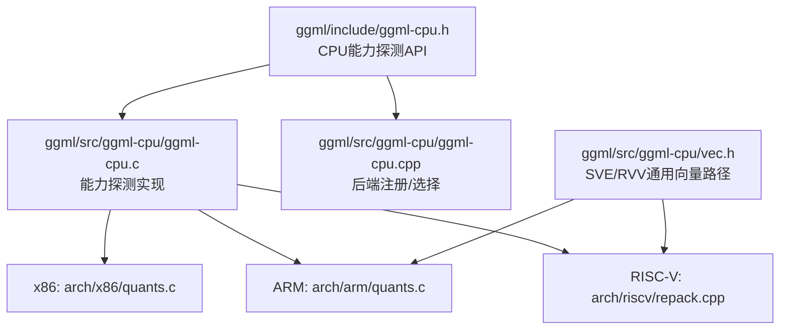
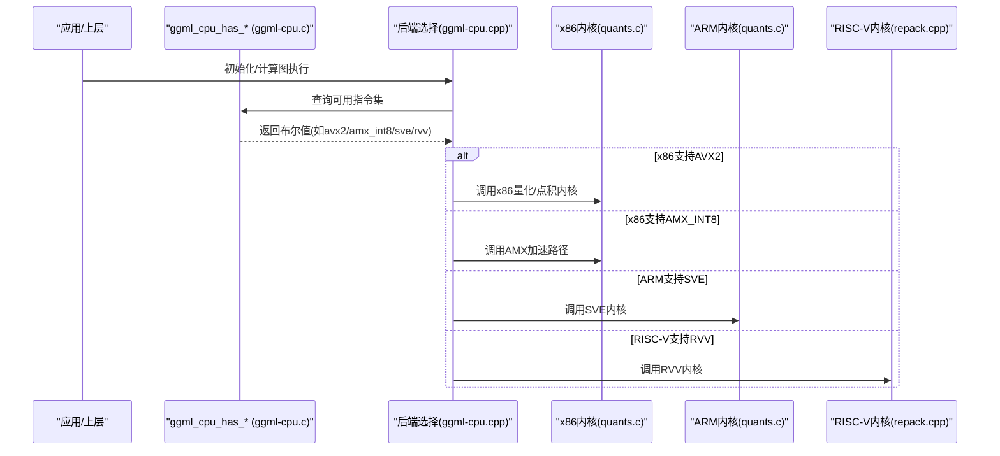
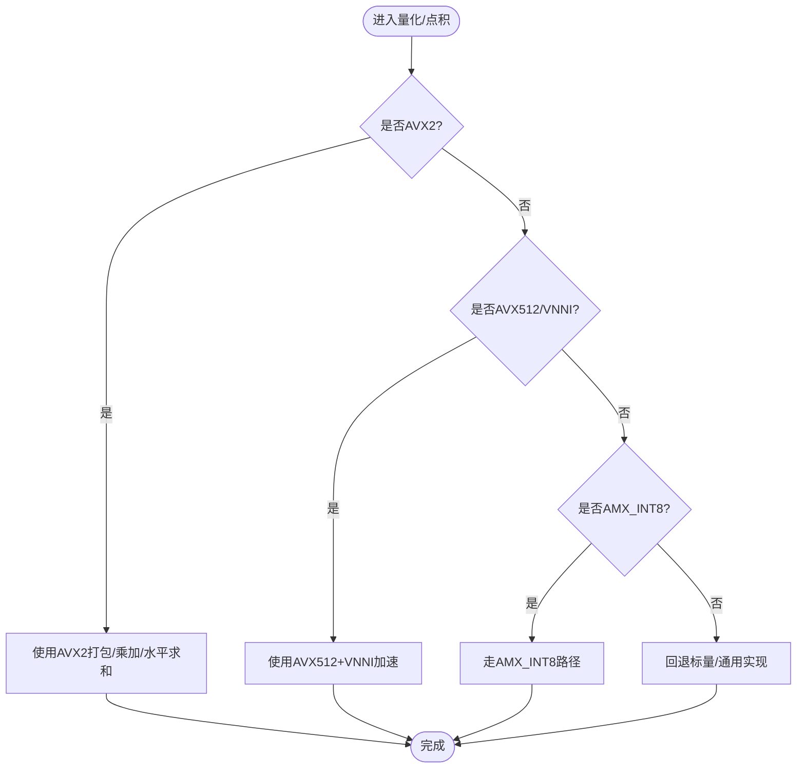
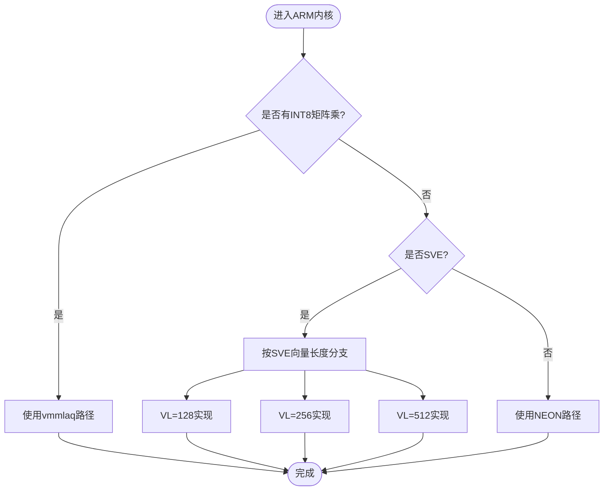
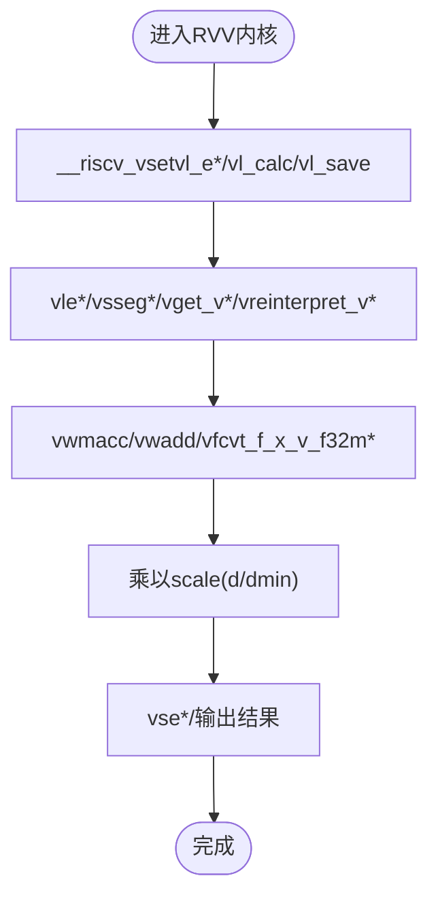
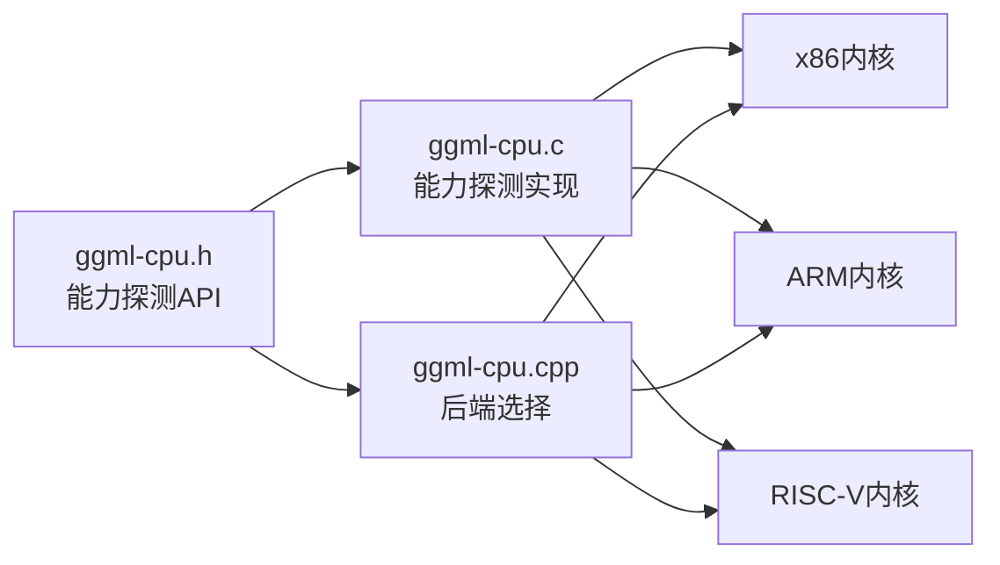

# SIMD指令集优化

<cite>
**本文引用的文件**   
- [ggml/include/ggml-cpu.h](file://ggml/include/ggml-cpu.h)
- [ggml/src/ggml-cpu/ggml-cpu.c](file://ggml/src/ggml-cpu/ggml-cpu.c)
- [ggml/src/ggml-cpu/ggml-cpu.cpp](file://ggml/src/ggml-cpu/ggml-cpu.cpp)
- [ggml/src/ggml-cpu/arch/x86/quants.c](file://ggml/src/ggml-cpu/arch/x86/quants.c)
- [ggml/src/ggml-cpu/arch/arm/quants.c](file://ggml/src/ggml-cpu/arch/arm/quants.c)
- [ggml/src/ggml-cpu/arch/riscv/repack.cpp](file://ggml/src/ggml-cpu/arch/riscv/repack.cpp)
- [ggml/src/ggml-cpu/vec.h](file://ggml/src/ggml-cpu/vec.h)
</cite>

## 目录
1. [简介](#简介)
2. [项目结构](#项目结构)
3. [核心组件](#核心组件)
4. [架构总览](#架构总览)
5. [详细组件分析](#详细组件分析)
6. [依赖关系分析](#依赖关系分析)
7. [性能与适用场景](#性能与适用场景)
8. [故障排查指南](#故障排查指南)
9. [结论](#结论)

## 简介
本文件系统性梳理 llama.cpp 在 CPU 后端的 SIMD 指令集优化实现，覆盖 x86（AVX2、AVX512、AMX）、ARM（NEON、SVE/SVE2）与 RISC-V（RVV）三大架构。文档重点解释向量寄存器操作、内存对齐与指令调度策略，说明运行时指令集检测与路径选择逻辑，并给出关键代码位置与流程图示，帮助读者理解不同指令集的性能特征与适用场景。

## 项目结构
SIMD 相关优化主要位于 ggml 子系统的 CPU 后端：
- 公共接口与能力探测：ggml/include/ggml-cpu.h
- 运行时能力探测与后端初始化：ggml/src/ggml-cpu/ggml-cpu.c、ggml-cpu.cpp
- x86 量化与点积内核：ggml/src/ggml-cpu/arch/x86/quants.c
- ARM NEON/SVE 内核：ggml/src/ggml-cpu/arch/arm/quants.c
- RISC-V RVV 重排与内核：ggml/src/ggml-cpu/arch/riscv/repack.cpp
- 通用向量抽象与 SVE/RVV 分支：ggml/src/ggml-cpu/vec.h

图表来源
- [ggml/include/ggml-cpu.h:76-109](file://ggml/include/ggml-cpu.h#L76-L109)
- [ggml/src/ggml-cpu/ggml-cpu.c:3657-3825](file://ggml/src/ggml-cpu/ggml-cpu.c#L3657-L3825)
- [ggml/src/ggml-cpu/ggml-cpu.cpp:558-597](file://ggml/src/ggml-cpu/ggml-cpu.cpp#L558-L597)

章节来源
- [ggml/include/ggml-cpu.h:76-109](file://ggml/include/ggml-cpu.h#L76-L109)
- [ggml/src/ggml-cpu/ggml-cpu.c:3657-3825](file://ggml/src/ggml-cpu/ggml-cpu.c#L3657-L3825)
- [ggml/src/ggml-cpu/ggml-cpu.cpp:558-597](file://ggml/src/ggml-cpu/ggml-cpu.cpp#L558-L597)

## 核心组件
- CPU能力探测API：提供各指令集检测函数，如 SSE3/SSSE3/AVX/AVX2/BMI2/F16C/FMA/AVX512系列/AMX_INT8、NEON/FMA/FP16VA/DotProd/MatmulInt8/SVE/SME、RVV、VSX/VXE/WASM_SIMD/Llamafile等。
- 运行时选择：后端根据能力探测结果选择最优内核路径（例如 AVX2、AMX_INT8、SVE、RVV）。
- 量化与点积内核：针对多种量化格式（Q8_0/Q8_1/Q4_0/Q2_0等）提供高度优化的向量化实现。
- 通用向量抽象：为 SVE/RVV 提供统一入口，按向量长度或特性分支到具体实现。

章节来源
- [ggml/include/ggml-cpu.h:76-109](file://ggml/include/ggml-cpu.h#L76-L109)
- [ggml/src/ggml-cpu/ggml-cpu.cpp:558-597](file://ggml/src/ggml-cpu/ggml-cpu.cpp#L558-L597)

## 架构总览
下图展示从高层 API 到具体内核的调用链路与指令集选择流程。

图表来源
- [ggml/src/ggml-cpu/ggml-cpu.c:3657-3825](file://ggml/src/ggml-cpu/ggml-cpu.c#L3657-L3825)
- [ggml/src/ggml-cpu/ggml-cpu.cpp:558-597](file://ggml/src/ggml-cpu/ggml-cpu.cpp#L558-L597)

## 详细组件分析

### x86架构：AVX2、AVX512、AMX
- 量化内核（Q8_0/Q8_1等）：使用 AVX/AVX2/AVX512 内建函数进行批量加载、绝对值比较、缩放、取整与打包；对 AVX2 使用 _mm256_packs_* 等指令高效压缩；对 AVX512 利用更宽向量与 VNNI 扩展提升吞吐。
- 点积内核（q1_0/q2_0/q4_0与q8_0）：通过位掩码展开、符号处理、乘加累加与水平求和，结合 FMA/DPBSSD/DPBUSSD 等指令减少延迟。
- AMX_INT8：通过运行时检测启用矩阵扩展指令加速 INT8 矩阵运算。

图表来源
- [ggml/src/ggml-cpu/arch/x86/quants.c:28-300](file://ggml/src/ggml-cpu/arch/x86/quants.c#L28-L300)
- [ggml/src/ggml-cpu/arch/x86/quants.c:302-502](file://ggml/src/ggml-cpu/arch/x86/quants.c#L302-L502)
- [ggml/src/ggml-cpu/arch/x86/quants.c:555-800](file://ggml/src/ggml-cpu/arch/x86/quants.c#L555-L800)
- [ggml/include/ggml-cpu.h:80-93](file://ggml/include/ggml-cpu.h#L80-L93)
- [ggml/src/ggml-cpu/ggml-cpu.c:3657-3697](file://ggml/src/ggml-cpu/ggml-cpu.c#L3657-L3697)

章节来源
- [ggml/src/ggml-cpu/arch/x86/quants.c:28-300](file://ggml/src/ggml-cpu/arch/x86/quants.c#L28-L300)
- [ggml/src/ggml-cpu/arch/x86/quants.c:302-502](file://ggml/src/ggml-cpu/arch/x86/quants.c#L302-L502)
- [ggml/src/ggml-cpu/arch/x86/quants.c:555-800](file://ggml/src/ggml-cpu/arch/x86/quants.c#L555-L800)
- [ggml/include/ggml-cpu.h:80-93](file://ggml/include/ggml-cpu.h#L80-L93)
- [ggml/src/ggml-cpu/ggml-cpu.c:3657-3697](file://ggml/src/ggml-cpu/ggml-cpu.c#L3657-L3697)

### ARM架构：NEON、SVE/SVE2
- NEON：广泛使用 vld1q/vst1q、vcvtq、vmulq、vaddvq 等进行向量化量化与点积；当存在 INT8 矩阵乘扩展时，优先使用 vmmlaq 提升吞吐。
- SVE：根据运行时向量长度（由 ggml_cpu_get_sve_cnt() 获取）分支到不同 VL 的实现；使用 sv* 系列指令（svld1rq_u8、svdot_s32、svmla_n_f32_x 等）进行变长向量处理。
- DotProd/MatmulInt8：在条件编译下启用专用路径，提高小批量的点积效率。

图表来源
- [ggml/src/ggml-cpu/arch/arm/quants.c:26-39](file://ggml/src/ggml-cpu/arch/arm/quants.c#L26-L39)
- [ggml/src/ggml-cpu/arch/arm/quants.c:140-220](file://ggml/src/ggml-cpu/arch/arm/quants.c#L140-L220)
- [ggml/src/ggml-cpu/arch/arm/quants.c:297-588](file://ggml/src/ggml-cpu/arch/arm/quants.c#L297-L588)
- [ggml/include/ggml-cpu.h:94-103](file://ggml/include/ggml-cpu.h#L94-L103)

章节来源
- [ggml/src/ggml-cpu/arch/arm/quants.c:26-39](file://ggml/src/ggml-cpu/arch/arm/quants.c#L26-L39)
- [ggml/src/ggml-cpu/arch/arm/quants.c:140-220](file://ggml/src/ggml-cpu/arch/arm/quants.c#L140-L220)
- [ggml/src/ggml-cpu/arch/arm/quants.c:297-588](file://ggml/src/ggml-cpu/arch/arm/quants.c#L297-L588)
- [ggml/include/ggml-cpu.h:94-103](file://ggml/include/ggml-cpu.h#L94-L103)

### RISC-V架构：RVV
- 重排与量化：使用 __riscv_vsetvl_* 动态设置向量长度，配合 vfmul/vfncvt_x_f_w_i16m4_rm 等指令进行缩放与类型转换，再使用 vsseg4e64_v 进行交错存储。
- 点积/GEMV：采用 vwmacc/vwadd 等宽乘加与归约指令，结合 Zvfhmin/Zvfh 扩展处理半精度尺度；对 Q4_K/Q2_K/iq4_nl 等复杂格式进行分块与校正项计算。
- 内存对齐：通过内联汇编屏障避免编译器生成违反对齐约束的 vlse64 指令。

图表来源
- [ggml/src/ggml-cpu/arch/riscv/repack.cpp:27-112](file://ggml/src/ggml-cpu/arch/riscv/repack.cpp#L27-L112)
- [ggml/src/ggml-cpu/arch/riscv/repack.cpp:114-203](file://ggml/src/ggml-cpu/arch/riscv/repack.cpp#L114-L203)
- [ggml/src/ggml-cpu/arch/riscv/repack.cpp:205-390](file://ggml/src/ggml-cpu/arch/riscv/repack.cpp#L205-L390)
- [ggml/src/ggml-cpu/arch/riscv/repack.cpp:392-668](file://ggml/src/ggml-cpu/arch/riscv/repack.cpp#L392-L668)
- [ggml/src/ggml-cpu/arch/riscv/repack.cpp:670-800](file://ggml/src/ggml-cpu/arch/riscv/repack.cpp#L670-L800)

章节来源
- [ggml/src/ggml-cpu/arch/riscv/repack.cpp:27-112](file://ggml/src/ggml-cpu/arch/riscv/repack.cpp#L27-L112)
- [ggml/src/ggml-cpu/arch/riscv/repack.cpp:114-203](file://ggml/src/ggml-cpu/arch/riscv/repack.cpp#L114-L203)
- [ggml/src/ggml-cpu/arch/riscv/repack.cpp:205-390](file://ggml/src/ggml-cpu/arch/riscv/repack.cpp#L205-L390)
- [ggml/src/ggml-cpu/arch/riscv/repack.cpp:392-668](file://ggml/src/ggml-cpu/arch/riscv/repack.cpp#L392-L668)
- [ggml/src/ggml-cpu/arch/riscv/repack.cpp:670-800](file://ggml/src/ggml-cpu/arch/riscv/repack.cpp#L670-L800)

### 通用向量抽象（SVE/RVV）
- vec.h 中提供基于 GGML_SIMD 宏的统一入口，按 SVE/RVV 分支到对应实现，并在不支持时回退到标量或通用路径。
- 该抽象层确保在不同架构上复用相同的算法骨架，降低维护成本。

章节来源
- [ggml/src/ggml-cpu/vec.h:151-175](file://ggml/src/ggml-cpu/vec.h#L151-L175)
- [ggml/src/ggml-cpu/vec.h:595-627](file://ggml/src/ggml-cpu/vec.h#L595-L627)

## 依赖关系分析
- 能力探测与后端选择：
  - ggml-cpu.c 实现各指令集的运行时检测（如 ggml_cpu_has_avx2、ggml_cpu_has_amx_int8、ggml_cpu_has_sve）。
  - ggml-cpu.cpp 在后端初始化中根据检测结果选择相应内核路径。
- 内核依赖：
  - x86/ARM/RISC-V 内核均依赖 ggml-cpu.h 暴露的能力探测 API 与公共数据结构（如 block_q*_xx）。
  - 部分内核依赖 simd-mappings.h 提供的内建映射与常量表。

图表来源
- [ggml/include/ggml-cpu.h:76-109](file://ggml/include/ggml-cpu.h#L76-L109)
- [ggml/src/ggml-cpu/ggml-cpu.c:3657-3825](file://ggml/src/ggml-cpu/ggml-cpu.c#L3657-L3825)
- [ggml/src/ggml-cpu/ggml-cpu.cpp:558-597](file://ggml/src/ggml-cpu/ggml-cpu.cpp#L558-L597)

章节来源
- [ggml/include/ggml-cpu.h:76-109](file://ggml/include/ggml-cpu.h#L76-L109)
- [ggml/src/ggml-cpu/ggml-cpu.c:3657-3825](file://ggml/src/ggml-cpu/ggml-cpu.c#L3657-L3825)
- [ggml/src/ggml-cpu/ggml-cpu.cpp:558-597](file://ggml/src/ggml-cpu/ggml-cpu.cpp#L558-L597)

## 性能与适用场景
- x86：
  - AVX2：适合中等规模数据与通用量化/点积任务，具备良好吞吐与兼容性。
  - AVX512/VNNI：在大张量与高吞吐场景下优势明显，尤其适合 INT8 矩阵乘与大规模量化计算。
  - AMX_INT8：面向矩阵扩展指令，适合大矩阵乘与批量推理。
- ARM：
  - NEON：移动端与嵌入式设备首选，兼顾能效与性能。
  - SVE/SVE2：服务器与高性能 ARM 平台，按向量长度自适应，适合大规模并行计算。
- RISC-V：
  - RVV：在新兴 RISC-V 平台上提供灵活向量长度与丰富算子，适合多样化硬件配置与定制化优化。

[本节为通用指导，不直接分析具体文件]

## 故障排查指南
- 指令集未启用：
  - 检查构建选项与目标平台是否支持相应指令集（如 AVX2/AVX512/AMX_INT8/NEON/SVE/RVV）。
  - 确认运行时检测函数返回值（如 ggml_cpu_has_avx2、ggml_cpu_has_amx_int8、ggml_cpu_has_sve、ggml_cpu_has_riscv_v）。
- 内存对齐问题：
  - RISC-V 内核中使用内联汇编屏障防止编译器生成违反对齐约束的 vlse64 指令。
- 回退路径异常：
  - 若高级路径不可用，应验证标量/通用实现是否正确回退（如 quantize_row_q8_0_ref、ggml_vec_dot_*_generic）。

章节来源
- [ggml/src/ggml-cpu/arch/riscv/repack.cpp:147-148](file://ggml/src/ggml-cpu/arch/riscv/repack.cpp#L147-L148)
- [ggml/src/ggml-cpu/arch/x86/quants.c:393-397](file://ggml/src/ggml-cpu/arch/x86/quants.c#L393-L397)
- [ggml/src/ggml-cpu/arch/arm/quants.c:78-82](file://ggml/src/ggml-cpu/arch/arm/quants.c#L78-L82)

## 结论
llama.cpp 的 CPU 后端通过统一的指令集探测与后端选择机制，将 x86（AVX2/AVX512/AMX）、ARM（NEON/SVE/SVE2）与 RISC-V（RVV）的 SIMD 优化无缝集成。针对不同量化格式与点积需求，提供了大量细粒度的向量化内核，并结合内存对齐、指令调度与扩展特性（如 VNNI、Zvfhmin）最大化性能。建议在实际部署中依据硬件能力开启相应路径，并通过基准测试验证性能收益。