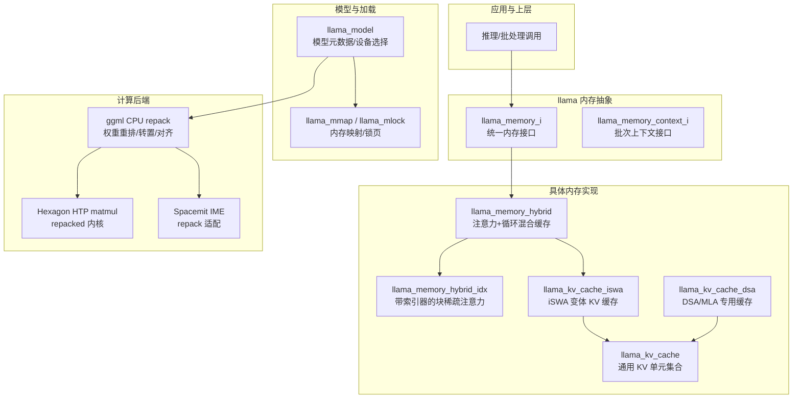
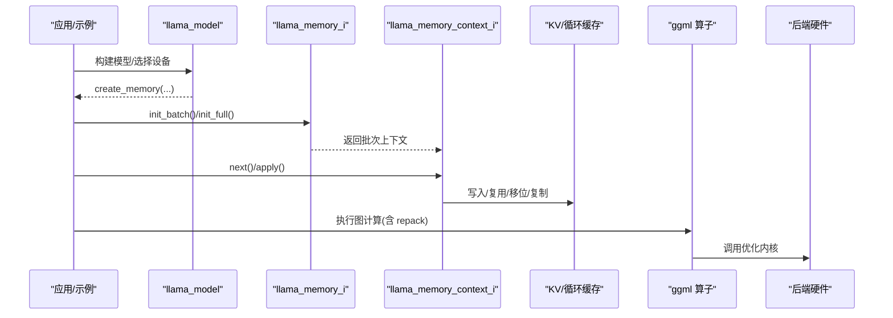
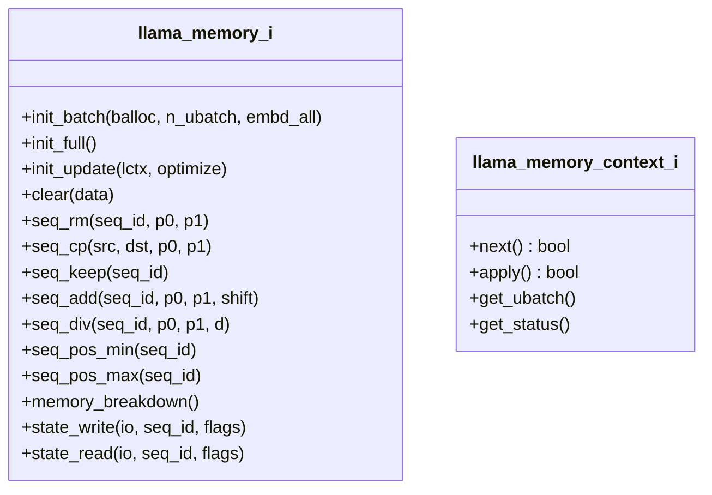
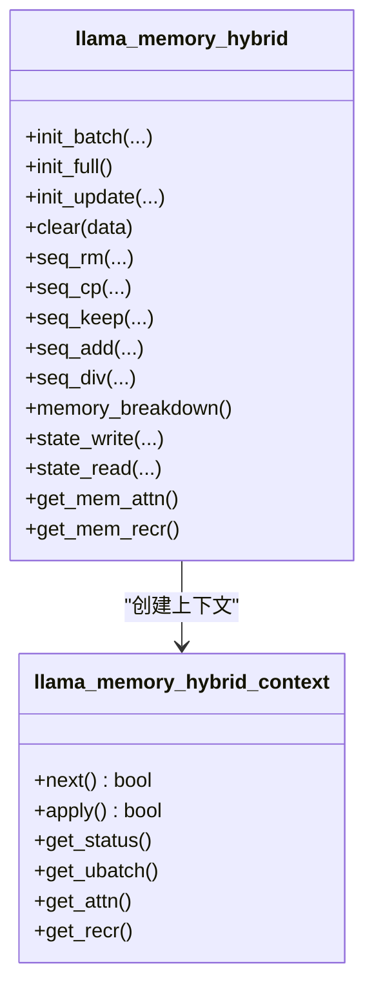
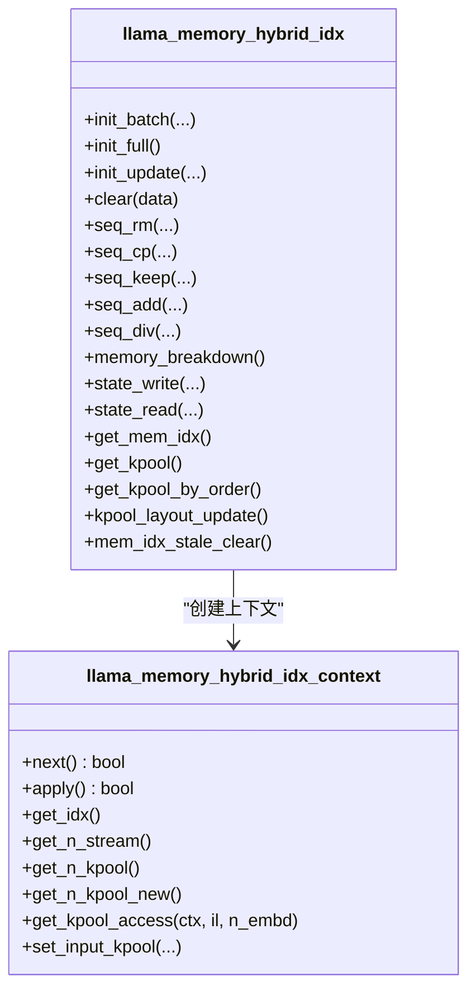
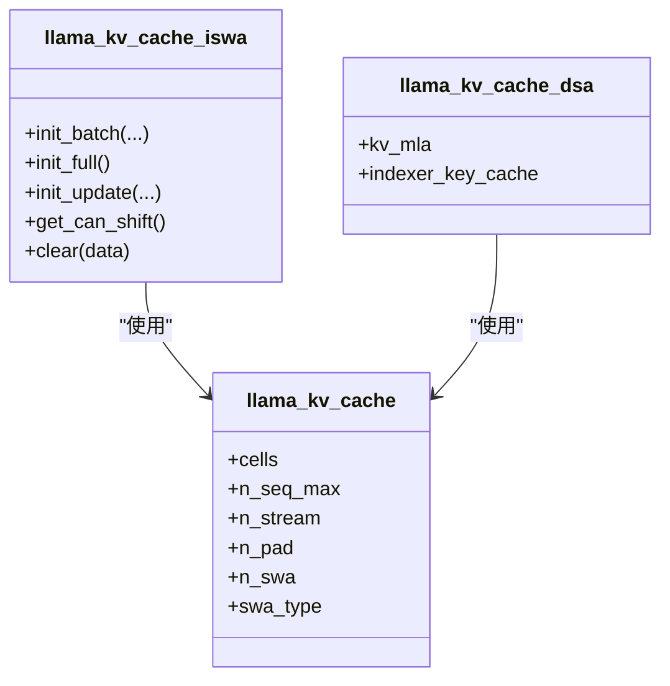
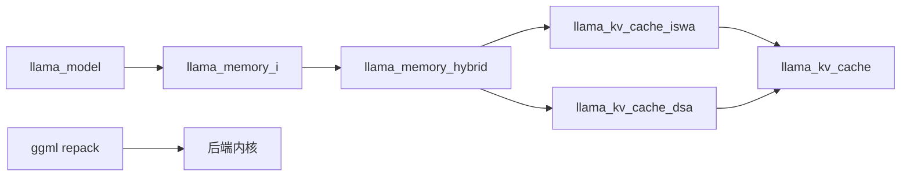
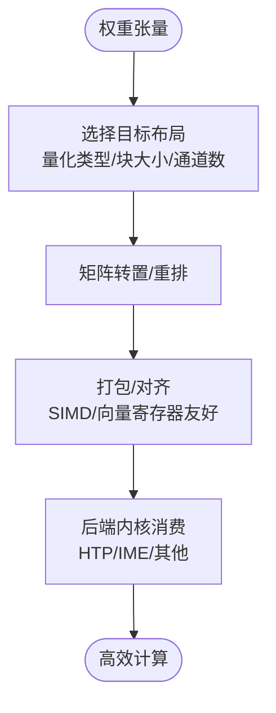
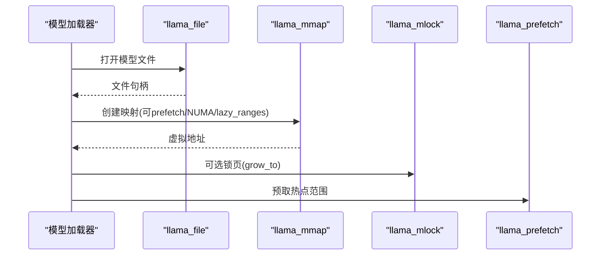

# 内存管理与优化

<cite>
**本文引用的文件**   
- [llama-memory.h](file://src/llama-memory.h)
- [llama-mmap.h](file://src/llama-mmap.h)
- [llama-memory-hybrid.h](file://src/llama-memory-hybrid.h)
- [llama-memory-hybrid-idx.h](file://src/llama-memory-hybrid-idx.h)
- [llama-kv-cache-iswa.h](file://src/llama-kv-cache-iswa.h)
- [llama-kv-cache-dsa.cpp](file://src/llama-kv-cache-dsa.cpp)
- [llama-kv-cache.cpp](file://src/llama-kv-cache.cpp)
- [llama-model.cpp](file://src/llama-model.cpp)
- [repack.cpp](file://ggml/src/ggml-cpu/repack.cpp)
- [matmul-ops.c](file://ggml/src/ggml-hexagon/htp/matmul-ops.c)
- [ime.cpp](file://ggml/src/ggml-spacemit/ime.cpp)
- [SYCL.md](file://docs/backend/SYCL.md)
</cite>

## 目录
1. [引言](#引言)
2. [项目结构](#项目结构)
3. [核心组件](#核心组件)
4. [架构总览](#架构总览)
5. [详细组件分析](#详细组件分析)
6. [依赖关系分析](#依赖关系分析)
7. [性能与预取策略](#性能与预取策略)
8. [监控、泄漏检测与故障恢复](#监控泄漏检测与故障恢复)
9. [结论](#结论)
10. [附录：关键接口速查](#附录关键接口速查)

## 引言
本文件面向 llama.cpp 的内存管理系统，聚焦高层内存（HBM）分配器与 KV 缓存体系，系统阐述以下主题：
- 内存池管理、碎片整理与垃圾回收机制
- 数据重排（repack）算法：矩阵转置、内存布局优化与缓存行对齐
- 内存映射文件与零拷贝技术
- 不同内存层次结构的访问模式与预取策略
- 内存使用监控、泄漏检测与性能分析技巧
- 内存安全检查与错误恢复机制

文档以代码级事实为依据，配合架构图与时序图帮助读者建立从高层 API 到底层实现的完整认知。

## 项目结构
llama.cpp 的内存子系统由“抽象内存接口 + 多种具体实现 + 模型加载与后端缓冲”组成：
- 抽象接口层：定义统一的内存上下文与操作语义
- 具体实现层：KV 缓存、混合注意力/循环状态缓存、索引化稀疏注意力缓存
- 模型加载层：权重分片、设备选择、内存映射与 mlock
- 计算后端层：ggml 算子对权重进行 repack，适配硬件最优布局

图表来源
- [llama-memory.h:17-131](file://src/llama-memory.h#L17-L131)
- [llama-memory-hybrid.h:19-91](file://src/llama-memory-hybrid.h#L19-L91)
- [llama-memory-hybrid-idx.h:17-131](file://src/llama-memory-hybrid-idx.h#L17-L131)
- [llama-kv-cache-iswa.h:33-68](file://src/llama-kv-cache-iswa.h#L33-L68)
- [llama-kv-cache-dsa.cpp:14-41](file://src/llama-kv-cache-dsa.cpp#L14-L41)
- [llama-kv-cache.cpp:65-87](file://src/llama-kv-cache.cpp#L65-L87)
- [llama-mmap.h:47-90](file://src/llama-mmap.h#L47-L90)
- [repack.cpp:4916-4933](file://ggml/src/ggml-cpu/repack.cpp#L4916-L4933)
- [matmul-ops.c:241-353](file://ggml/src/ggml-hexagon/htp/matmul-ops.c#L241-L353)
- [ime.cpp:1236-1264](file://ggml/src/ggml-spacemit/ime.cpp#L1236-L1264)

章节来源
- [llama-memory.h:17-131](file://src/llama-memory.h#L17-L131)
- [llama-mmap.h:47-90](file://src/llama-mmap.h#L47-L90)

## 核心组件
本节梳理内存系统的核心抽象与主要实现类，说明职责边界与协作方式。

- 抽象内存接口
  - llama_memory_i：定义批次初始化、全缓存模拟、更新准备、序列操作（删除/复制/保留/移位/缩放）、位置查询、内存分布统计、状态读写等统一能力。
  - llama_memory_context_i：封装当前 ubatch 的推进与应用逻辑，提供 next/apply/get_ubatch/get_status。

- 具体内存实现
  - llama_memory_hybrid：组合注意力 KV 缓存与循环状态缓存，支持每层过滤、复用与共享策略。
  - llama_memory_hybrid_idx：在 hybrid 基础上增加“索引器键池”，用于块稀疏注意力（如 Qwen4exp QSA）。
  - llama_kv_cache_iswa：针对 iSWA 场景的 KV 缓存变体，区分 SWA 与非 SWA 层并做尺寸对齐优化。
  - llama_kv_cache_dsa：为 MLA/DSA 架构定制的主 KV 缓存与索引器键缓存。
  - llama_kv_cache：通用 KV 单元集合，负责单元组织、流式维度、SWA 支持与其他缓存的复用。

- 模型与加载
  - llama_model：根据模型架构与配置创建对应内存实例，暴露 memory_breakdown 等诊断接口。
  - llama_mmap/llama_mlock：文件映射、按需取消映射、mlock 锁页、主机页预取。

章节来源
- [llama-memory.h:17-131](file://src/llama-memory.h#L17-L131)
- [llama-memory-hybrid.h:19-91](file://src/llama-memory-hybrid.h#L19-L91)
- [llama-memory-hybrid-idx.h:17-131](file://src/llama-memory-hybrid-idx.h#L17-L131)
- [llama-kv-cache-iswa.h:33-68](file://src/llama-kv-cache-iswa.h#L33-L68)
- [llama-kv-cache-dsa.cpp:14-41](file://src/llama-kv-cache-dsa.cpp#L14-L41)
- [llama-kv-cache.cpp:65-87](file://src/llama-kv-cache.cpp#L65-L87)
- [llama-model.cpp:797-841](file://src/llama-model.cpp#L797-L841)
- [llama-mmap.h:47-90](file://src/llama-mmap.h#L47-L90)

## 架构总览
下图展示从模型加载到推理批处理的内存路径：模型选择具体内存类型；批处理通过 init_batch/init_full/init_update 生成上下文；上下文驱动 KV 与循环状态的写入与复用；权重经 ggml repack 后进入后端内核。

图表来源
- [llama-model.cpp:797-841](file://src/llama-model.cpp#L797-L841)
- [llama-memory.h:85-127](file://src/llama-memory.h#L85-L127)
- [llama-kv-cache.cpp:65-87](file://src/llama-kv-cache.cpp#L65-L87)
- [repack.cpp:4916-4933](file://ggml/src/ggml-cpu/repack.cpp#L4916-L4933)

## 详细组件分析

### 抽象内存接口与上下文
- llama_memory_i
  - 批次生命周期：init_batch 将输入 batch 切分为若干 ubatch 并校验容量；init_full 用于最坏情况下的计算缓冲估算；init_update 聚合 pending 更新（移位、复制等）。
  - 序列操作：seq_rm/seq_cp/seq_keep/seq_add/seq_div 提供细粒度位置区间操作，便于长上下文滑动窗口与压缩。
  - 诊断：memory_breakdown 按后端 buffer type 汇总占用。
- llama_memory_context_i
  - next/apply 分离“规划”和“执行”，避免在 apply 中重复决策；get_status 提供失败快速返回。

图表来源
- [llama-memory.h:51-127](file://src/llama-memory.h#L51-L127)

章节来源
- [llama-memory.h:51-127](file://src/llama-memory.h#L51-L127)

### 混合内存（注意力 + 循环）
- llama_memory_hybrid
  - 同时持有注意力 KV 缓存与循环状态缓存，支持 per-layer filter/reuse/share 回调，灵活裁剪与复用。
  - 对外暴露 get_mem_attn/get_mem_recr 以便上层分别访问。
- llama_memory_hybrid_context
  - 组合 attn/recr 两个子上下文，统一推进与状态检查。

图表来源
- [llama-memory-hybrid.h:19-141](file://src/llama-memory-hybrid.h#L19-L141)

章节来源
- [llama-memory-hybrid.h:19-141](file://src/llama-memory-hybrid.h#L19-L141)

### 索引化稀疏注意力缓存（Qwen4exp QSA）
- llama_memory_hybrid_idx
  - 在 hybrid 基础上引入第三份缓存：每个 token 一个 indexer key，用于块稀疏注意力。
  - 维护 kpool_layout 与 stale_pos 机制，保证跨批次 pool 一致性；编辑序列时失效相应 pool。
  - 提供 set_input_kpool 等接口，将池化索引、掩码、尾部索引等张量接入计算图。

图表来源
- [llama-memory-hybrid-idx.h:17-236](file://src/llama-memory-hybrid-idx.h#L17-L236)

章节来源
- [llama-memory-hybrid-idx.h:17-236](file://src/llama-memory-hybrid-idx.h#L17-L236)

### iSWA KV 缓存与 DSA/MLA 缓存
- llama_kv_cache_iswa
  - 区分 SWA 与非 SWA 层，SWA 部分按 256 字节对齐以提升性能。
  - 支持 unified/stream 维度控制与 layer reuse/share。
- llama_kv_cache_dsa
  - 为 MLA/DSA 架构构造主 KV 缓存与索引器键缓存，复用通用 kv cache 能力。

图表来源
- [llama-kv-cache-iswa.h:33-68](file://src/llama-kv-cache-iswa.h#L33-L68)
- [llama-kv-cache-dsa.cpp:14-41](file://src/llama-kv-cache-dsa.cpp#L14-L41)
- [llama-kv-cache.cpp:65-87](file://src/llama-kv-cache.cpp#L65-L87)

章节来源
- [llama-kv-cache-iswa.h:33-68](file://src/llama-kv-cache-iswa.h#L33-L68)
- [llama-kv-cache-dsa.cpp:14-41](file://src/llama-kv-cache-dsa.cpp#L14-L41)
- [llama-kv-cache.cpp:65-87](file://src/llama-kv-cache.cpp#L65-L87)

### 模型侧内存创建与分解
- llama_model::create_memory 根据架构与参数创建具体内存对象（如 KV 缓存、混合缓存等）。
- llama_model::memory_breakdown 汇总各后端 buffer type 的内存占用，便于诊断。

章节来源
- [llama-model.cpp:797-841](file://src/llama-model.cpp#L797-L841)

## 依赖关系分析
- 耦合与内聚
  - llama_memory_i 作为稳定抽象，降低上层与具体实现的耦合。
  - llama_memory_hybrid 聚合 attn/recr 两类缓存，提升内聚性。
  - llama_kv_cache 被 iswa/dsa/hybrid 共同复用，体现高内聚低耦合。
- 外部依赖
  - ggml 后端通过 repack 将权重转换为硬件友好布局，减少运行时转置与访存开销。
  - SYCL/CUDA/Metal 等后端通过环境变量控制内存行为（如 pinned memory、VMM、Level Zero 大分配等）。

图表来源
- [llama-memory.h:17-131](file://src/llama-memory.h#L17-L131)
- [llama-memory-hybrid.h:19-91](file://src/llama-memory-hybrid.h#L19-L91)
- [llama-kv-cache-iswa.h:33-68](file://src/llama-kv-cache-iswa.h#L33-L68)
- [llama-kv-cache-dsa.cpp:14-41](file://src/llama-kv-cache-dsa.cpp#L14-L41)
- [llama-kv-cache.cpp:65-87](file://src/llama-kv-cache.cpp#L65-L87)
- [repack.cpp:4916-4933](file://ggml/src/ggml-cpu/repack.cpp#L4916-L4933)

章节来源
- [llama-memory.h:17-131](file://src/llama-memory.h#L17-L131)
- [llama-memory-hybrid.h:19-91](file://src/llama-memory-hybrid.h#L19-L91)
- [llama-kv-cache-iswa.h:33-68](file://src/llama-kv-cache-iswa.h#L33-L68)
- [llama-kv-cache-dsa.cpp:14-41](file://src/llama-kv-cache-dsa.cpp#L14-L41)
- [llama-kv-cache.cpp:65-87](file://src/llama-kv-cache.cpp#L65-L87)
- [repack.cpp:4916-4933](file://ggml/src/ggml-cpu/repack.cpp#L4916-L4933)

## 性能与预取策略

### 数据重排（repack）与矩阵转置
- CPU 端 repack
  - ggml CPU repack 针对不同量化格式（如 Q1_0/Q4_0/Q8_0 等）生成适合 SIMD/GEMM 的内核布局，包含块大小、列宽、通道数等模板参数。
  - repack 过程通常伴随矩阵转置与数据打包，以减少运行时转置与访存抖动。
- 硬件特化
  - Hexagon HTP 提供 repacked matmul/matrix-vector 宏，直接消费 repack 后的布局。
  - Spacemit IME 提供轻量 repack 适配路径，必要时回退为直拷。

图表来源
- [repack.cpp:4916-4933](file://ggml/src/ggml-cpu/repack.cpp#L4916-L4933)
- [matmul-ops.c:241-353](file://ggml/src/ggml-hexagon/htp/matmul-ops.c#L241-L353)
- [ime.cpp:1236-1264](file://ggml/src/ggml-spacemit/ime.cpp#L1236-L1264)

章节来源
- [repack.cpp:4916-4933](file://ggml/src/ggml-cpu/repack.cpp#L4916-L4933)
- [matmul-ops.c:241-353](file://ggml/src/ggml-hexagon/htp/matmul-ops.c#L241-L353)
- [ime.cpp:1236-1264](file://ggml/src/ggml-spacemit/ime.cpp#L1236-L1264)

### 缓存行对齐与内存布局优化
- 在设置行/列步长时尽量满足缓存行对齐，减少伪共享与缓存抖动。
- 某些路径会按 LCM(ne00, dst_cl_elems) 分组，确保线程间独占缓存行，避免原子竞争。

章节来源
- [SYCL.md:777-832](file://docs/backend/SYCL.md#L777-L832)

### 内存映射与零拷贝
- llama_mmap
  - 支持文件范围映射、按需 unmap_fragment、NUMA 感知与可选 prefetch。
- llama_mlock
  - 将已映射或分配的缓冲区锁定到物理内存，避免换页抖动。
- llama_prefetch
  - 对指定地址范围预取主机页，降低首次访问延迟。

图表来源
- [llama-mmap.h:20-90](file://src/llama-mmap.h#L20-L90)

章节来源
- [llama-mmap.h:20-90](file://src/llama-mmap.h#L20-L90)

### 不同内存层次的访问模式与预取
- 主机内存（Host RAM）
  - 通过 mmap 零拷贝加载权重，结合 mlock 避免换页；prefetch 预热热点页。
- 设备内存（GPU VRAM/HBM）
  - 通过后端 buffer type 分配；大型分配可通过 Level Zero 放宽限制；启用 VMM 或 pinned host staging 提升吞吐。
- NUMA 与亲和性
  - 建议结合 --numa 与线程亲和，减少跨节点访问。

章节来源
- [SYCL.md:777-832](file://docs/backend/SYCL.md#L777-L832)

## 监控、泄漏检测与故障恢复

### 内存使用监控
- llama_model::memory_breakdown
  - 汇总各后端 buffer type 的占用，便于定位异常增长。
- llama_memory_i::memory_breakdown
  - 各内存实现可按自身结构输出细分占用。
- 后端调试开关
  - SYCL 提供 GGML_SYCL_MEMTRACE/GGML_SYCL_MEMTRACE_STEP 等环境变量记录分配轨迹与峰值。

章节来源
- [llama-model.cpp:797-841](file://src/llama-model.cpp#L797-L841)
- [llama-memory.h:120-120](file://src/llama-memory.h#L120-L120)
- [SYCL.md:817-818](file://docs/backend/SYCL.md#L817-L818)

### 泄漏检测方法
- 结合 GGML_SYCL_MEMTRACE=1/2 输出分配/释放明细，对比模型加载前后差异。
- 使用 memory_breakdown 对比不同阶段（加载前/加载后/推理前/推理后）的增量。
- 关注未释放的临时 buffer（例如 repack 中间态），确认其生命周期与图计算结束点一致。

章节来源
- [SYCL.md:817-818](file://docs/backend/SYCL.md#L817-L818)

### 性能分析技巧
- 调整批大小与 ubatch 大小，观察 KV 缓存命中率与 repack 开销占比。
- 开启 Flash Attention 以降低 KV 显存占用（受模型与后端影响）。
- 合理设置 --cache-type-k/--cache-type-v 量化类型，权衡精度与带宽。
- 使用 --fit/--fit-target/--fit-ctx 自动适配设备内存。

章节来源
- [SYCL.md:802-816](file://docs/backend/SYCL.md#L802-L816)

### 内存安全检查与错误恢复
- 状态机与快速失败
  - llama_memory_status 提供 SUCCESS/NO_UPDATE/FAILED_PREPARE/FAILED_COMPUTE 等状态，上层可据此短路后续步骤。
- 失败恢复
  - 当某层或某序列更新失败时，可调用 state_drop 或清理相关缓存，避免不一致。
- 容量校验
  - init_batch 会在切分 ubatch 时校验是否可放入缓存，不足则返回失败状态，避免越界写入。

章节来源
- [llama-memory.h:30-42](file://src/llama-memory.h#L30-L42)
- [llama-memory-hybrid-idx.h:110-128](file://src/llama-memory-hybrid-idx.h#L110-L128)

## 结论
llama.cpp 的内存管理以抽象接口为核心，向上屏蔽 KV 缓存、循环状态与索引器键池的差异，向下对接 ggml 后端与硬件特性。通过 repack 将权重转为硬件友好布局，结合 mmap/mlock/prefetch 与后端环境变量，形成从主机到设备的完整内存优化闭环。对于大规模推理，建议优先关注：
- 合理的 KV 缓存设计与量化类型
- 权重 repack 与后端内核匹配
- 内存映射与锁页策略
- 基于 memory_breakdown 与后端 trace 的持续监控

## 附录：关键接口速查
- 抽象接口
  - llama_memory_i：批次/更新/序列操作/状态读写/内存分布
  - llama_memory_context_i：next/apply/get_ubatch/get_status
- 具体实现
  - llama_memory_hybrid：注意力+循环混合缓存
  - llama_memory_hybrid_idx：索引器键池与池化布局
  - llama_kv_cache_iswa：iSWA 变体 KV 缓存
  - llama_kv_cache_dsa：DSA/MLA 专用缓存
- 模型与加载
  - llama_model::create_memory/memory_breakdown
  - llama_mmap/llama_mlock/llama_prefetch
- 计算后端
  - ggml CPU repack/Hexagon HTP repacked kernels/Spacemit IME

章节来源
- [llama-memory.h:17-131](file://src/llama-memory.h#L17-L131)
- [llama-memory-hybrid.h:19-141](file://src/llama-memory-hybrid.h#L19-L141)
- [llama-memory-hybrid-idx.h:17-236](file://src/llama-memory-hybrid-idx.h#L17-L236)
- [llama-kv-cache-iswa.h:33-68](file://src/llama-kv-cache-iswa.h#L33-L68)
- [llama-kv-cache-dsa.cpp:14-41](file://src/llama-kv-cache-dsa.cpp#L14-L41)
- [llama-kv-cache.cpp:65-87](file://src/llama-kv-cache.cpp#L65-L87)
- [llama-model.cpp:797-841](file://src/llama-model.cpp#L797-L841)
- [llama-mmap.h:20-90](file://src/llama-mmap.h#L20-L90)
- [repack.cpp:4916-4933](file://ggml/src/ggml-cpu/repack.cpp#L4916-L4933)
- [matmul-ops.c:241-353](file://ggml/src/ggml-hexagon/htp/matmul-ops.c#L241-L353)
- [ime.cpp:1236-1264](file://ggml/src/ggml-spacemit/ime.cpp#L1236-L1264)