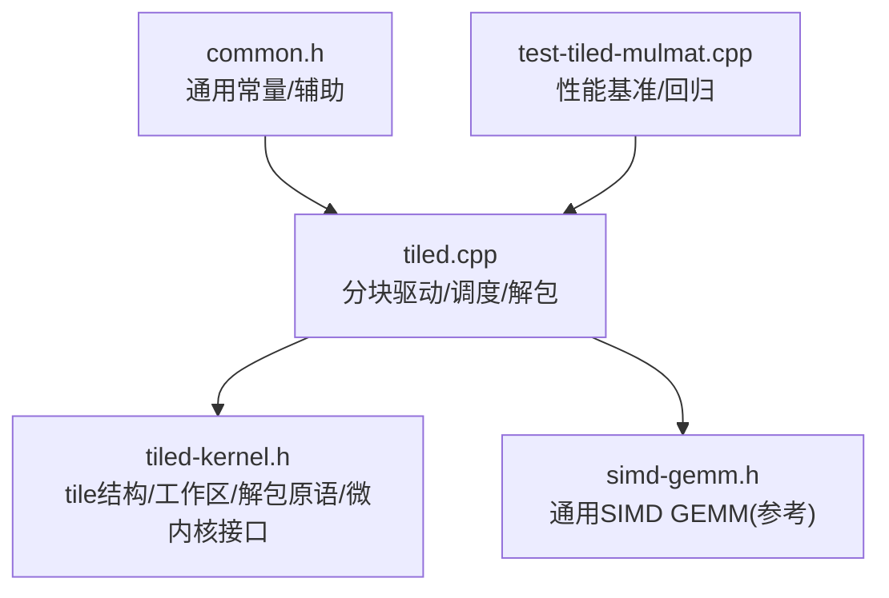
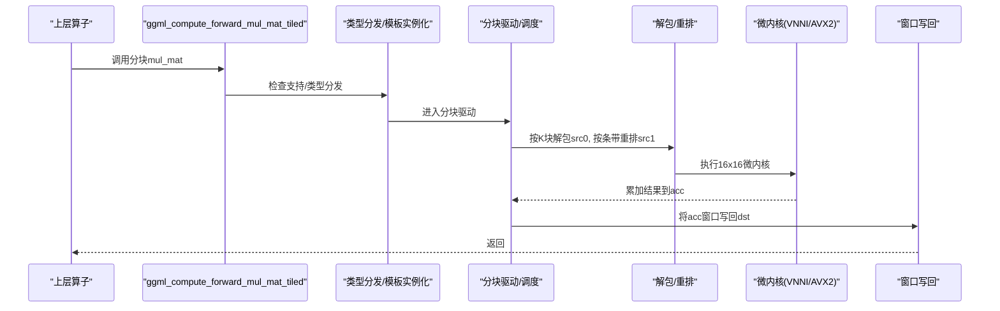
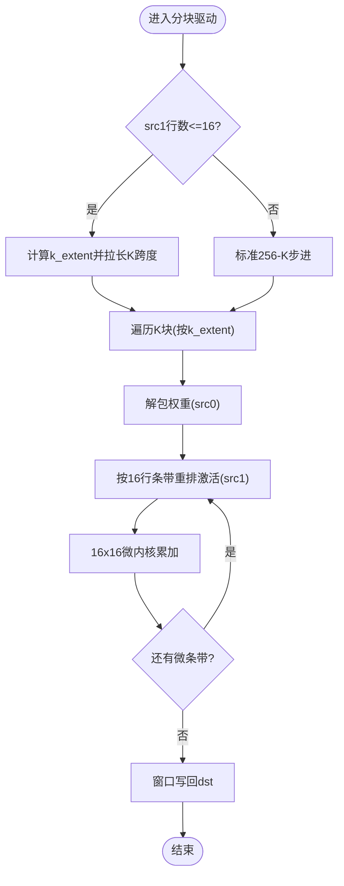
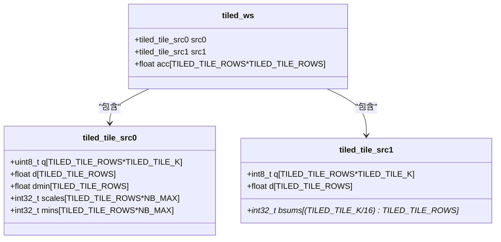
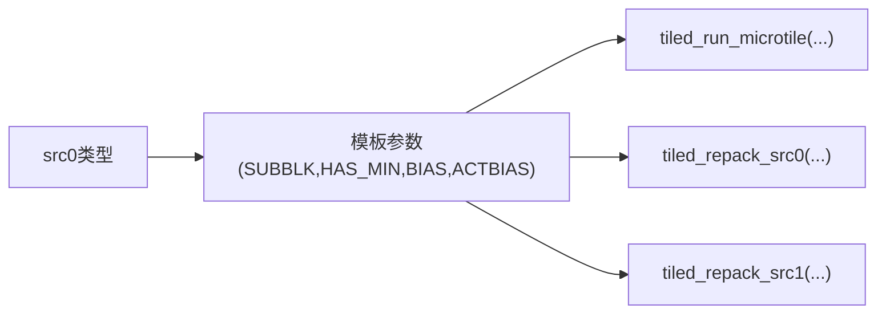
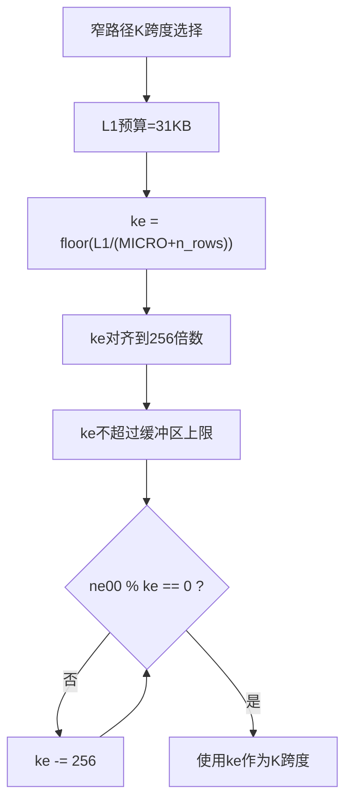
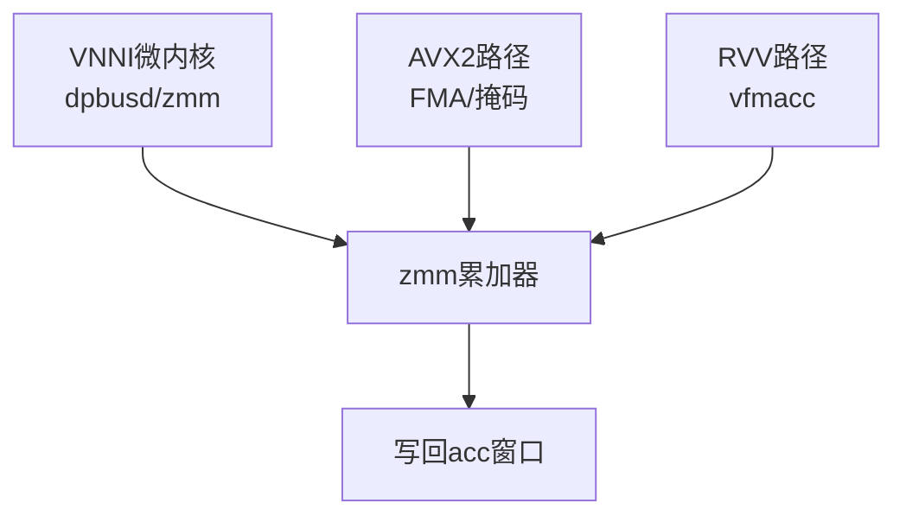
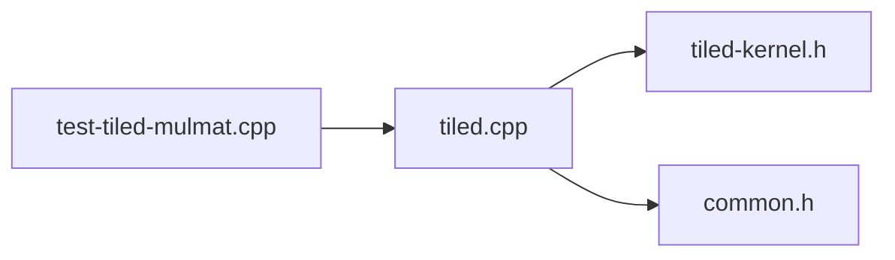

# 分块内核优化

<cite>
**本文引用的文件**   
- [tiled.cpp](file://ggml/src/ggml-cpu/tiled/tiled.cpp)
- [tiled-kernel.h](file://ggml/src/ggml-cpu/tiled/tiled-kernel.h)
- [simd-gemm.h](file://ggml/src/ggml-cpu/simd-gemm.h)
- [common.h](file://ggml/src/ggml-cpu/common.h)
- [test-tiled-mulmat.cpp](file://tests/test-tiled-mulmat.cpp)
</cite>

## 目录
1. [引言](#引言)
2. [项目结构](#项目结构)
3. [核心组件](#核心组件)
4. [架构总览](#架构总览)
5. [详细组件分析](#详细组件分析)
6. [依赖关系分析](#依赖关系分析)
7. [性能与内存局部性](#性能与内存局部性)
8. [调试与故障排查](#调试与故障排查)
9. [结论](#结论)
10. [附录：调优清单](#附录调优清单)

## 引言
本文件聚焦于 llama.cpp 的 ggml CPU 后端中的“分块（tiling）矩阵乘法内核”，系统阐述其二维分块策略、边界处理、内存局部性优化、模板实例化与代码生成机制、SIMD/VNNI 向量化结合方式，以及在不同数据类型和矩阵尺寸下的行为。文档同时给出性能分析方法、调试技巧与调优指南，帮助读者在保持数值正确性的前提下获得最佳吞吐与延迟。

## 项目结构
与分块内核直接相关的代码主要位于 ggml CPU 后端的 tiled 子系统中，并辅以通用 SIMD GEMM 工具与测试用例：
- ggml/src/ggml-cpu/tiled/tiled.cpp：分块驱动、窗口调度、数据解包/重排、类型分发、线程分片与批处理。
- ggml/src/ggml-cpu/tiled/tiled-kernel.h：分块数据结构、工作区布局、解包原语与微内核接口声明。
- ggml/src/ggml-cpu/simd-gemm.h：通用 SIMD GEMM 微内核（AVX/AVX2/AVX512/RVV），用于对比与参考。
- ggml/src/ggml-cpu/common.h：通用常量与辅助函数（如 FA tile 常量等）。
- tests/test-tiled-mulmat.cpp：分块路径的性能基准与回归测试入口。

**图表来源**
- [tiled.cpp:1-1246](file://ggml/src/ggml-cpu/tiled/tiled.cpp#L1-L1246)
- [tiled-kernel.h:1-181](file://ggml/src/ggml-cpu/tiled/tiled-kernel.h#L1-L181)
- [simd-gemm.h:1-267](file://ggml/src/ggml-cpu/simd-gemm.h#L1-L267)
- [common.h:1-96](file://ggml/src/ggml-cpu/common.h#L1-L96)
- [test-tiled-mulmat.cpp:417-447](file://tests/test-tiled-mulmat.cpp#L417-L447)

**章节来源**
- [tiled.cpp:1-1246](file://ggml/src/ggml-cpu/tiled/tiled.cpp#L1-L1246)
- [tiled-kernel.h:1-181](file://ggml/src/ggml-cpu/tiled/tiled-kernel.h#L1-L181)
- [simd-gemm.h:1-267](file://ggml/src/ggml-cpu/simd-gemm.h#L1-L267)
- [common.h:1-96](file://ggml/src/ggml-cpu/common.h#L1-L96)
- [test-tiled-mulmat.cpp:417-447](file://tests/test-tiled-mulmat.cpp#L417-L447)

## 核心组件
- 分块工作区与 Tile 结构
  - src0 tile：权重侧，包含展开后的无符号量化码、每行 d/dmin、每子块 scales/mins。
  - src1 tile：激活侧，来自 q8_K，包含字节级 q、每16元素 bsums、d。
  - acc：按 TILED_TILE_ROWS × TILED_TILE_ROWS 对齐的累加缓冲。
  - 每个线程一个 512KB 的工作区槽位，保证 64B 对齐。
- 二维分块参数
  - K 维 tile 大小固定为 256（对应 QK_K 块）。
  - 输出窗口最大 256×256，边缘 ragged 处理。
  - 微内核粒度 16×16，bsums 求和粒度也为 16。
- 解包与重排
  - 针对多种量化格式（Q2/Q3/Q4/Q5/Q6_K、IQ1/IQ2/IQ3/IQ4_xs 等）提供专用解包器。
  - src1 支持按 16 行条带即时重排（repack），提升 L1 命中。
- 调度与并行
  - 外层按 256 行窗口切分，内层按 16 微步推进；对 src1 行数较少时走“窄路径”以拉长连续读。
  - 多线程通过 chunk 分配与 work-stealing 协作。

**章节来源**
- [tiled-kernel.h:22-57](file://ggml/src/ggml-cpu/tiled/tiled-kernel.h#L22-L57)
- [tiled.cpp:537-570](file://ggml/src/ggml-cpu/tiled/tiled.cpp#L537-L570)
- [tiled.cpp:975-1025](file://ggml/src/ggml-cpu/tiled/tiled.cpp#L975-L1025)

## 架构总览
分块内核的整体流程如下：
1. 入口判定：检查是否启用分块、CPU 指令集是否支持、src0/src1 类型是否受支持、最小批量阈值。
2. 类型分发：根据 src0 量化类型选择模板参数（SUBBLK/HAS_MIN/BIAS/ACTBIAS）。
3. 数据准备：将 src1 转换为 vec_dot_type（通常为 q8_K），必要时进行预转换。
4. 二维分块调度：外层按 256 行/列窗口切分，内层按 16 微步推进；对窄路径采用更长 K 跨度以提升带宽利用率。
5. 解包与重排：按 K 块解包权重到 src0 tile，按 16 行条带即时重排 src1。
6. 微内核计算：调用 AVX512 VNNI 或 AVX2 微内核，累加到本地 acc。
7. 写回：将 acc 窗口转存至目标矩阵（考虑 batch/stride）。

**图表来源**
- [tiled.cpp:1209-1245](file://ggml/src/ggml-cpu/tiled/tiled.cpp#L1209-L1245)
- [tiled.cpp:1146-1200](file://ggml/src/ggml-cpu/tiled/tiled.cpp#L1146-L1200)
- [tiled.cpp:1027-1144](file://ggml/src/ggml-cpu/tiled/tiled.cpp#L1027-L1144)
- [tiled-kernel.h:160-178](file://ggml/src/ggml-cpu/tiled/tiled-kernel.h#L160-L178)

## 详细组件分析

### 二维分块策略与边界处理
- 宏定义
  - TILED_TILE_K = 256：K 维 tile 大小，与 QK_K 对齐。
  - TILED_TILE_ROWS = 256：输出窗口最大行数。
  - TILED_MICRO = 16：微内核边长，也是 bsums 求和粒度。
- 窗口切分
  - 外层循环按 256 行/列窗口推进，内层按 16 微步推进。
  - 当 src1 行数较小（≤16）时，走“窄路径”，拉长 K 跨度（k_extent）以提高内存带宽利用率。
- 边界处理
  - 输出窗口 ragged：writeback 时对 i/j 尾部分支处理，避免越界。
  - 批维度（i12/i13）在窗口内保持不变，跨批边界时调整窗口终点。

**图表来源**
- [tiled-kernel.h:22-25](file://ggml/src/ggml-cpu/tiled/tiled-kernel.h#L22-L25)
- [tiled.cpp:975-1025](file://ggml/src/ggml-cpu/tiled/tiled.cpp#L975-L1025)
- [tiled.cpp:679-711](file://ggml/src/ggml-cpu/tiled/tiled.cpp#L679-L711)

**章节来源**
- [tiled-kernel.h:22-25](file://ggml/src/ggml-cpu/tiled/tiled-kernel.h#L22-L25)
- [tiled.cpp:975-1025](file://ggml/src/ggml-cpu/tiled/tiled.cpp#L975-L1025)
- [tiled.cpp:679-711](file://ggml/src/ggml-cpu/tiled/tiled.cpp#L679-L711)

### 内存局部性与重排优化
- src1 重排（repack）
  - 按 16 行条带即时重排，使每次使用的激活数据在 L1 中热驻留。
  - 对 VNNI 路径，q 码会被 reshape+transpose 以便 dpbusd 高效访问。
- src0 解包
  - 针对不同量化格式提供专用解包器，将压缩码展开为 uint8 宽码，并提取 scales/mins/d。
  - IQ 系列使用 LUT 展开（如 iq4_xs、iq grids），减少分支与算术开销。
- 工作区布局
  - 每个线程 512KB 工作区，src0/src1/acc 均 64B 对齐，利于向量化加载。

**图表来源**
- [tiled-kernel.h:27-57](file://ggml/src/ggml-cpu/tiled/tiled-kernel.h#L27-L57)

**章节来源**
- [tiled-kernel.h:27-57](file://ggml/src/ggml-cpu/tiled/tiled-kernel.h#L27-L57)
- [tiled.cpp:537-570](file://ggml/src/ggml-cpu/tiled/tiled.cpp#L537-L570)

### 分块内核生成机制与模板实例化
- 模板参数
  - SUBBLK：子块宽度（16 或 32），决定 scales/mins 索引步长。
  - HAS_MIN：是否包含 per-block min。
  - BIAS：偏置值（例如 IQ 系列常用 128）。
  - ACTBIAS：激活是否已预偏置（+128）。
- 类型分发
  - 根据 src0 类型（Q2/Q3/Q4/Q5/Q6_K、IQ1/IQ2/IQ3/IQ4_xs）选择模板参数组合。
- 微内核接口
  - tiled_run_microtile<SUBBLK,HAS_MIN,BIAS,ACTBIAS>(...)：对单个 K 块执行 16x16 微内核。
  - tiled_repack_src1(...)：按 16 行条带重排激活。
  - tiled_repack_src0<SUBBLK>(...)：可选地对权重 tile 做就地重排。

**图表来源**
- [tiled.cpp:1146-1200](file://ggml/src/ggml-cpu/tiled/tiled.cpp#L1146-L1200)
- [tiled-kernel.h:160-178](file://ggml/src/ggml-cpu/tiled/tiled-kernel.h#L160-L178)

**章节来源**
- [tiled.cpp:1146-1200](file://ggml/src/ggml-cpu/tiled/tiled.cpp#L1146-L1200)
- [tiled-kernel.h:160-178](file://ggml/src/ggml-cpu/tiled/tiled-kernel.h#L160-L178)

### 分块大小选择算法与自适应调整
- K 跨度选择（窄路径）
  - 基于 31KB L1 预算估算 k_extent，向下取整到 256 的倍数，上限受缓冲区限制。
  - 若 ne00 不能被 k_extent 整除，逐步减小 k_extent 直至可整除。
- 线程分片与 chunk 大小
  - 初始 chunk_size=256，若 nchunk0*nchunk1 < nth*4，则减半直到满足饱和条件。
  - 通过 threadpool 的 chunk_add 实现 work-stealing。

**图表来源**
- [tiled.cpp:662-677](file://ggml/src/ggml-cpu/tiled/tiled.cpp#L662-L677)
- [tiled.cpp:1095-1108](file://ggml/src/ggml-cpu/tiled/tiled.cpp#L1095-L1108)

**章节来源**
- [tiled.cpp:662-677](file://ggml/src/ggml-cpu/tiled/tiled.cpp#L662-L677)
- [tiled.cpp:1095-1108](file://ggml/src/ggml-cpu/tiled/tiled.cpp#L1095-L1108)

### 与 SIMD 指令的结合与向量化优化
- AVX512 VNNI 微内核
  - 使用 dpbusd 指令，将 int8 激活与 int8 权重点积累加到 zmm 寄存器。
  - 8x16 band pass 设计，控制寄存器压力，先计算 s1_acc，再计算 s2_acc。
- AVX2 路径
  - 在无 VNNI 时使用 AVX2 向量 FMA 路径（具体实现由 kernel.h/.cpp 提供）。
- 通用 SIMD GEMM 参考
  - simd-gemm.h 提供跨平台（AVX/AVX2/AVX512/RVV）的浮点 GEMM 微内核，便于对比与参考。

**图表来源**
- [tiled-kernel.h:83-209](file://ggml/src/ggml-cpu/tiled/tiled-kernel.h#L83-L209)
- [simd-gemm.h:1-267](file://ggml/src/ggml-cpu/simd-gemm.h#L1-L267)

**章节来源**
- [tiled-kernel.h:83-209](file://ggml/src/ggml-cpu/tiled/tiled-kernel.h#L83-L209)
- [simd-gemm.h:1-267](file://ggml/src/ggml-cpu/simd-gemm.h#L1-L267)

### 不同数据类型与矩阵尺寸表现
- 支持的 src0 类型
  - Q2_K/Q3_K/Q4_K/Q5_K/Q6_K、IQ1_S/IQ1_M/IQ2_XXS/IQ2_XS/IQ2_S/IQ3_XXS/IQ3_S/IQ4_XS。
- src1 类型
  - F32 或 Q8_K（内部统一为 vec_dot_type，通常为 q8_K）。
- 小批量优化
  - 当 src1 行数 ≤16 时，自动切换窄路径，拉长 K 跨度以提升带宽利用率。
- MoE（MUL_MAT_ID）
  - 支持专家路由，按 expert_rows 收集/散播行，复用相同解包与微内核逻辑。

**章节来源**
- [tiled.cpp:597-643](file://ggml/src/ggml-cpu/tiled/tiled.cpp#L597-L643)
- [tiled.cpp:1146-1200](file://ggml/src/ggml-cpu/tiled/tiled.cpp#L1146-L1200)
- [tiled.cpp:713-832](file://ggml/src/ggml-cpu/tiled/tiled.cpp#L713-L832)

## 依赖关系分析
- 模块耦合
  - tiled.cpp 依赖 tiled-kernel.h 提供的 tile 结构与微内核接口。
  - 通过 common.h 获取通用常量与辅助函数。
  - 测试用例 test-tiled-mulmat.cpp 驱动分块路径并进行性能测量。
- 外部依赖
  - 依赖 CPU 指令集检测（AVX/AVX2/AVX512VNNI/GFNI）。
  - 依赖 ggml 的类型系统与张量布局（nb/stride）。

**图表来源**
- [tiled.cpp:1-10](file://ggml/src/ggml-cpu/tiled/tiled.cpp#L1-L10)
- [tiled-kernel.h:1-20](file://ggml/src/ggml-cpu/tiled/tiled-kernel.h#L1-L20)
- [common.h:1-10](file://ggml/src/ggml-cpu/common.h#L1-L10)
- [test-tiled-mulmat.cpp:417-447](file://tests/test-tiled-mulmat.cpp#L417-L447)

**章节来源**
- [tiled.cpp:1-10](file://ggml/src/ggml-cpu/tiled/tiled.cpp#L1-L10)
- [tiled-kernel.h:1-20](file://ggml/src/ggml-cpu/tiled/tiled-kernel.h#L1-L20)
- [common.h:1-10](file://ggml/src/ggml-cpu/common.h#L1-L10)
- [test-tiled-mulmat.cpp:417-447](file://tests/test-tiled-mulmat.cpp#L417-L447)

## 性能与内存局部性
- 关键优化点
  - 256-K 块对齐：充分利用缓存行与向量化加载。
  - 16 行条带即时重排：确保激活数据在 L1 热驻留。
  - 窄路径拉长 K 跨度：缓解内存带宽瓶颈。
  - 工作区 64B 对齐：避免伪共享与未对齐访问。
- 性能分析方法
  - 使用测试用例中的 best-of-N 计时与 flush buffer 策略，避免缓存污染影响测量。
  - 观察不同 src0 类型与 src1 行数下的吞吐变化，定位瓶颈（解码 vs 计算 vs 写回）。
- 调优建议
  - 优先保证 src1 连续且对齐，必要时使用 repack 路径。
  - 在小批量场景下确认窄路径被触发。
  - 在 AVX512VNNI 平台上验证 dpbusd 路径是否启用。

**章节来源**
- [tiled.cpp:975-1025](file://ggml/src/ggml-cpu/tiled/tiled.cpp#L975-L1025)
- [test-tiled-mulmat.cpp:417-447](file://tests/test-tiled-mulmat.cpp#L417-L447)

## 调试与故障排查
- 环境变量
  - GGML_CPU_TILED_MM：启用/禁用分块路径。
  - GGML_CPU_TILED_MM_FORCE：强制走分块路径（用于基准/回归）。
- 常见问题
  - 非连续 src1（Q8_K）导致跳过分块路径。
  - 不支持的 src0 类型或未达最小批量阈值。
  - 指令集不匹配（无 AVX/AVX2/AVX512VNNI）。
- 诊断步骤
  - 打印/检查 env 变量与类型门控结果。
  - 使用 use_ref 回退到 vec_dot 参考实现对比数值。
  - 通过测试用例复现并记录不同矩阵尺寸下的性能曲线。

**章节来源**
- [tiled.cpp:572-592](file://ggml/src/ggml-cpu/tiled/tiled.cpp#L572-L592)
- [tiled.cpp:1209-1245](file://ggml/src/ggml-cpu/tiled/tiled.cpp#L1209-L1245)

## 结论
llama.cpp 的分块内核通过严格的二维分块、精细的内存局部性优化、模板化的类型分发与高效的 SIMD/VNNI 微内核，在多类量化格式与小批量场景下实现了高吞吐与低延迟。其设计兼顾了可扩展性与可移植性，为后续扩展新架构与新量化格式提供了清晰接口。

## 附录：调优清单
- 确认 CPU 指令集支持（AVX/AVX2/AVX512VNNI）。
- 设置 GGML_CPU_TILED_MM 与 GGML_CPU_TILED_MM_FORCE 进行基准。
- 确保 src1 连续且对齐，必要时启用 repack。
- 在小批量场景下验证窄路径是否生效。
- 对不同 src0 类型与矩阵尺寸绘制性能曲线，定位瓶颈。
- 使用 test-tiled-mulmat.cpp 进行回归测试与数值校验。