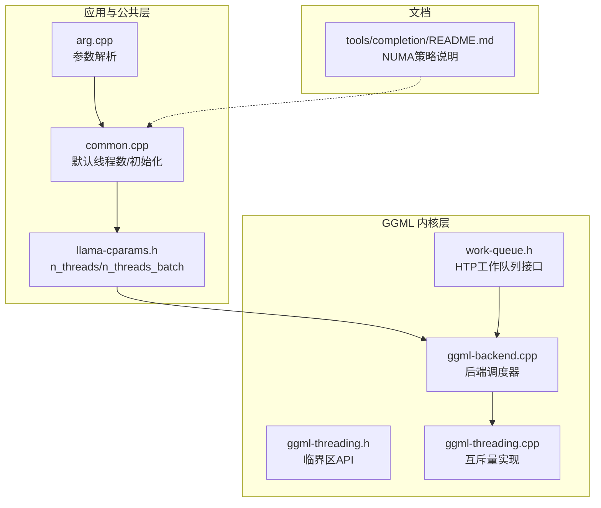
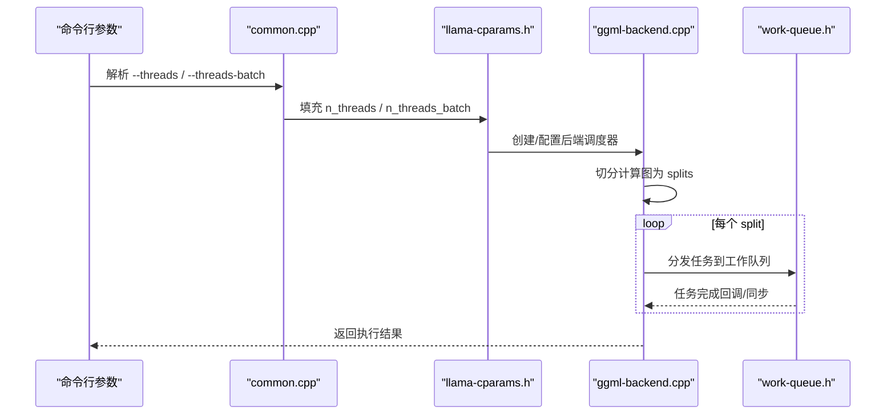
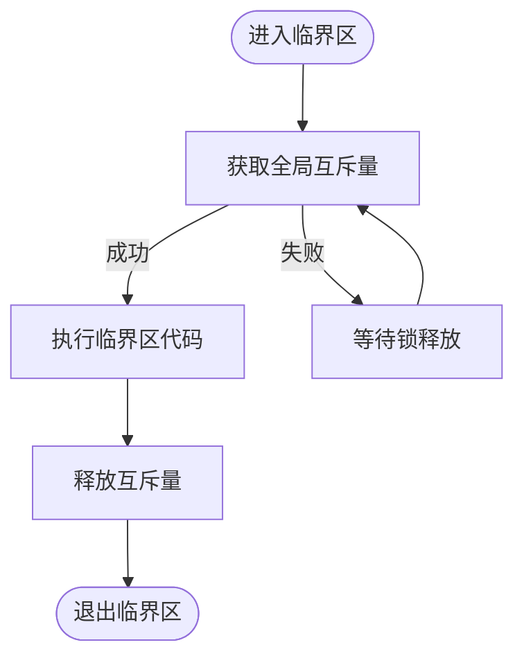
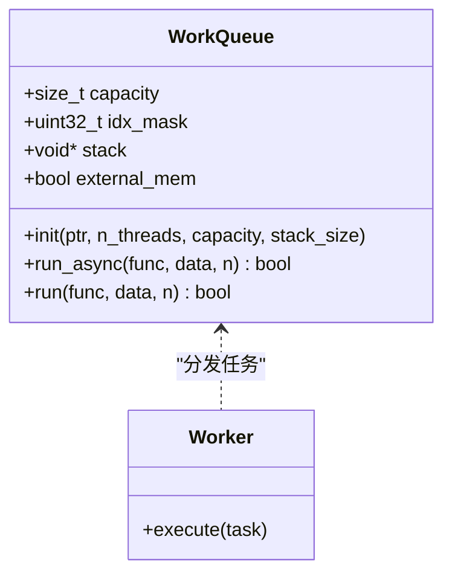
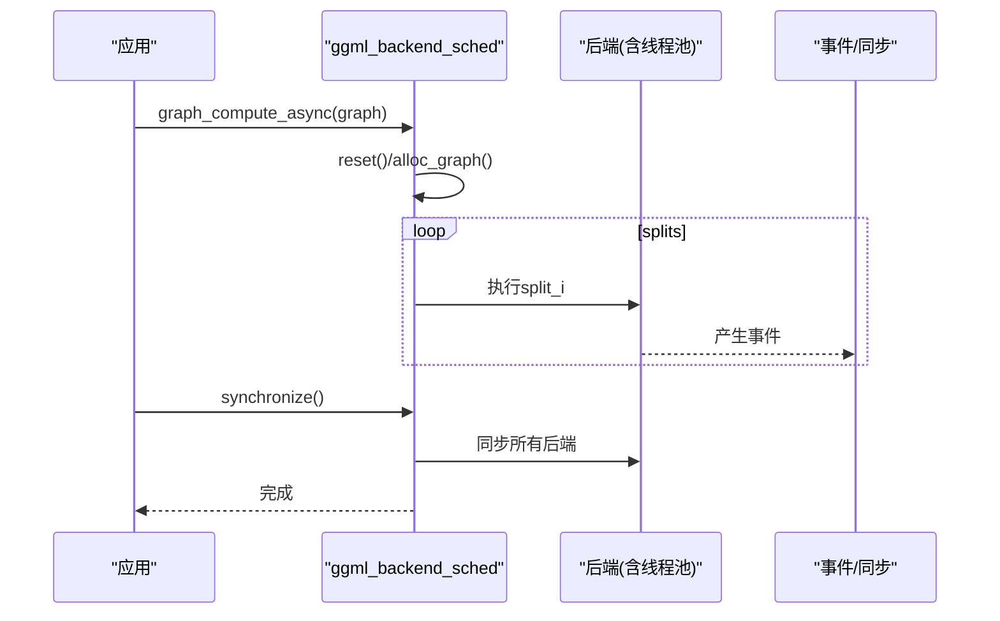
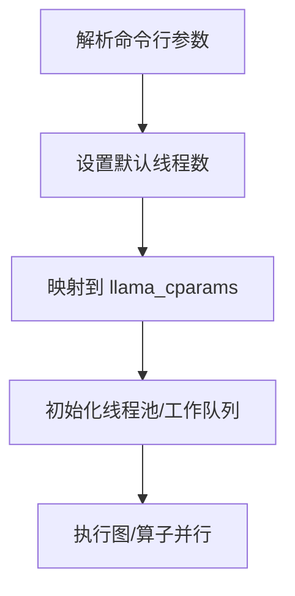
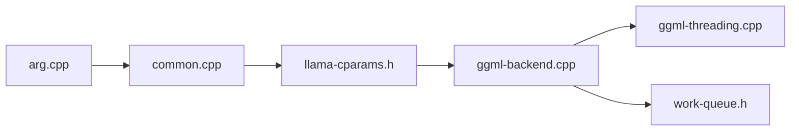
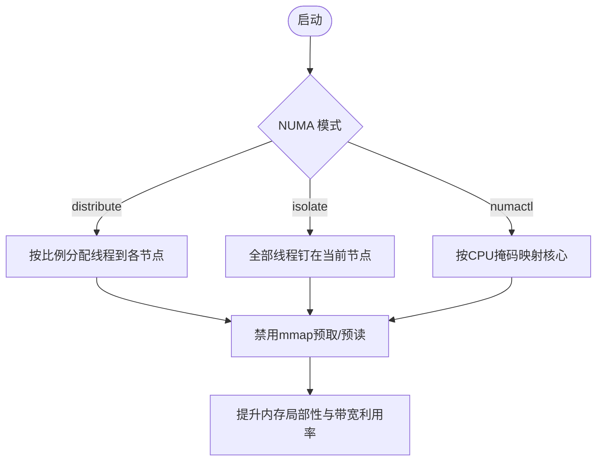

# 多线程并行计算

<cite>
**本文引用的文件**   
- [ggml-threading.h](file://ggml/src/ggml-threading.h)
- [ggml-threading.cpp](file://ggml/src/ggml-threading.cpp)
- [llama-cparams.h](file://src/llama-cparams.h)
- [common.cpp](file://common/common.cpp)
- [arg.cpp](file://common/arg.cpp)
- [ggml-backend.cpp](file://ggml/src/ggml-backend.cpp)
- [work-queue.h](file://ggml/src/ggml-hexagon/htp/work-queue.h)
- [README.md（completion）](file://tools/completion/README.md)
</cite>

## 目录
1. [引言](#引言)
2. [项目结构](#项目结构)
3. [核心组件](#核心组件)
4. [架构总览](#架构总览)
5. [详细组件分析](#详细组件分析)
6. [依赖关系分析](#依赖关系分析)
7. [性能与调优](#性能与调优)
8. [故障排查指南](#故障排查指南)
9. [结论](#结论)

## 引言
本技术文档聚焦于 llama.cpp 的多线程并行计算体系，围绕任务调度、负载均衡、工作窃取、线程池实现、任务队列管理、同步原语、内存屏障与原子操作、锁优化、NUMA 感知调度以及缓存友好的数据布局展开。同时给出多线程配置参数、性能调优建议与常见并发问题的解决方案，并说明线程安全保证与死锁避免机制的实现要点。

## 项目结构
与多线程并行相关的代码主要分布在以下位置：
- ggml 层通用线程同步接口：ggml-threading.*
- llama 推理上下文与线程数配置：llama-cparams.*
- 命令行参数解析与默认值设置：common/arg.cpp, common/common.cpp
- 后端图调度器（跨设备/多后端协同）：ggml-backend.cpp
- Hexagon HTP 工作队列（示例性线程池/任务队列模式）：ggml/src/ggml-hexagon/htp/work-queue.h
- NUMA 相关用户文档与策略说明：tools/completion/README.md

图表来源
- [arg.cpp:1521-1534](file://common/arg.cpp#L1521-L1534)
- [common.cpp:1720-1814](file://common/common.cpp#L1720-L1814)
- [llama-cparams.h:10-21](file://src/llama-cparams.h#L10-L21)
- [ggml-threading.h:9-10](file://ggml/src/ggml-threading.h#L9-L10)
- [ggml-threading.cpp:4-12](file://ggml/src/ggml-threading.cpp#L4-L12)
- [ggml-backend.cpp:926-989](file://ggml/src/ggml-backend.cpp#L926-L989)
- [work-queue.h:13-31](file://ggml/src/ggml-hexagon/htp/work-queue.h#L13-L31)
- [README.md（completion）:538-543](file://tools/completion/README.md#L538-L543)

章节来源
- [arg.cpp:1521-1534](file://common/arg.cpp#L1521-L1534)
- [common.cpp:1720-1814](file://common/common.cpp#L1720-L1814)
- [llama-cparams.h:10-21](file://src/llama-cparams.h#L10-L21)
- [ggml-threading.h:9-10](file://ggml/src/ggml-threading.h#L9-L10)
- [ggml-threading.cpp:4-12](file://ggml/src/ggml-threading.cpp#L4-L12)
- [ggml-backend.cpp:926-989](file://ggml/src/ggml-backend.cpp#L926-L989)
- [work-queue.h:13-31](file://ggml/src/ggml-hexagon/htp/work-queue.h#L13-L31)
- [README.md（completion）:538-543](file://tools/completion/README.md#L538-L543)

## 核心组件
- 线程同步与临界区
  - 提供全局临界区入口/出口函数，内部基于 std::mutex 保护共享状态，用于需要串行化的关键路径或调试输出等场景。
- 线程数与批处理线程数
  - llama_cparams 暴露 n_threads 与 n_threads_batch，分别控制生成阶段与批处理阶段的并行度。
- 后端图调度器
  - ggml_backend_sched 负责将计算图切分为多个子图（splits），分配给不同后端执行，支持流水线复制与事件同步。
- 工作队列（以 HTP 为例）
  - work_queue 提供统一的任务分发接口，支持单核退化路径与多线程异步执行，便于在不同后端复用相同调度模式。

章节来源
- [ggml-threading.h:9-10](file://ggml/src/ggml-threading.h#L9-L10)
- [ggml-threading.cpp:4-12](file://ggml/src/ggml-threading.cpp#L4-L12)
- [llama-cparams.h:10-21](file://src/llama-cparams.h#L10-L21)
- [ggml-backend.cpp:926-989](file://ggml/src/ggml-backend.cpp#L926-L989)
- [work-queue.h:13-31](file://ggml/src/ggml-hexagon/htp/work-queue.h#L13-L31)

## 架构总览
下图展示从上层参数到内核执行的并行链路：命令行参数决定线程数，进入 llama 上下文后由后端调度器对计算图进行切分与执行；底层算子通过工作队列在多线程中运行。

图表来源
- [arg.cpp:1521-1534](file://common/arg.cpp#L1521-L1534)
- [common.cpp:1720-1814](file://common/common.cpp#L1720-L1814)
- [llama-cparams.h:10-21](file://src/llama-cparams.h#L10-L21)
- [ggml-backend.cpp:2112-2131](file://ggml/src/ggml-backend.cpp#L2112-L2131)
- [work-queue.h:23-31](file://ggml/src/ggml-hexagon/htp/work-queue.h#L23-L31)

## 详细组件分析

### 线程同步与临界区
- 设计要点
  - 使用全局互斥量保护临界区，提供统一的开始/结束 API，确保调用方无需关心具体实现细节。
  - 该抽象可用于日志、统计、调试输出等需要串行化的场景，降低竞争开销。
- 复杂度与性能
  - 临界区粒度应尽量小，避免长时间持有锁导致线程阻塞。
  - 在高吞吐路径上应尽量避免进入临界区，必要时采用无锁数据结构或每线程局部变量+批量合并。

图表来源
- [ggml-threading.cpp:4-12](file://ggml/src/ggml-threading.cpp#L4-L12)

章节来源
- [ggml-threading.h:9-10](file://ggml/src/ggml-threading.h#L9-L10)
- [ggml-threading.cpp:4-12](file://ggml/src/ggml-threading.cpp#L4-L12)

### 线程池与工作队列（以 HTP 为例）
- 设计要点
  - work_queue_run 提供统一接口：当任务数为 1 时直接串行执行，否则走异步工作队列。
  - 通过固定大小的工作队列与栈空间，减少动态分配与上下文切换成本。
- 负载均衡与工作窃取
  - 当前接口未显式实现工作窃取；典型做法是“按块划分 + 轮询/随机取队尾”，以减少竞争。
  - 若需引入工作窃取，可在每个 worker 维护本地双端队列，空闲 worker 尝试从其他 worker 的队尾窃取任务。
- 同步与内存可见性
  - 工作队列内部通常使用原子计数器与内存序约束保证生产者-消费者语义；在 CPU 侧可结合编译器屏障/内存屏障确保可见性。

图表来源
- [work-queue.h:13-31](file://ggml/src/ggml-hexagon/htp/work-queue.h#L13-L31)

章节来源
- [work-queue.h:13-31](file://ggml/src/ggml-hexagon/htp/work-queue.h#L13-L31)

### 后端图调度器（ggml_backend_sched）
- 职责
  - 将输入计算图切分为多个 splits，为每个 split 分配后端缓冲区，并通过事件/同步点协调跨后端执行。
  - 支持 pipeline parallelism（多副本 copies）与回调机制（eval/copy/realloc）。
- 执行流程
  - 首次执行前进行 reset 与 alloc；随后 compute_splits 依次触发各 split 的执行。
  - synchronize 对所有后端进行同步，并在未分配图的情况下重置 next_copy，保证后续执行一致性。
- 并发模型
  - 调度器本身不直接创建线程，而是委托给各后端内部的线程池/工作队列；因此跨后端并行依赖于后端实现。

图表来源
- [ggml-backend.cpp:2112-2144](file://ggml/src/ggml-backend.cpp#L2112-L2144)
- [ggml-backend.cpp:926-989](file://ggml/src/ggml-backend.cpp#L926-L989)

章节来源
- [ggml-backend.cpp:926-989](file://ggml/src/ggml-backend.cpp#L926-L989)
- [ggml-backend.cpp:2112-2144](file://ggml/src/ggml-backend.cpp#L2112-L2144)

### 线程数与批处理线程数
- 参数来源
  - 命令行参数 cpuparams.n_threads 与 cpuparams_batch.n_threads 经 arg.cpp 解析后，由 common.cpp 映射到 llama_cparams 的 n_threads 与 n_threads_batch。
  - 默认值根据硬件并发数推导，避免过度并行导致的争用与抖动。
- 影响范围
  - n_threads 主要用于逐 token 生成时的并行化（如注意力头、通道等粒度的并行）。
  - n_threads_batch 用于批处理阶段（如 batched 推理、评估）的并行度。

图表来源
- [arg.cpp:1521-1534](file://common/arg.cpp#L1521-L1534)
- [common.cpp:1720-1814](file://common/common.cpp#L1720-L1814)
- [llama-cparams.h:10-21](file://src/llama-cparams.h#L10-L21)

章节来源
- [arg.cpp:1521-1534](file://common/arg.cpp#L1521-L1534)
- [common.cpp:1720-1814](file://common/common.cpp#L1720-L1814)
- [llama-cparams.h:10-21](file://src/llama-cparams.h#L10-L21)

## 依赖关系分析
- 组件耦合
  - common.cpp 依赖 arg.cpp 的参数解析结果，并将线程数写入 llama_cparams。
  - ggml_backend_sched 依赖后端提供的线程池/工作队列能力，但不直接管理线程生命周期。
  - ggml-threading 提供最小化的临界区抽象，被上层或调试路径使用。
- 外部依赖
  - 标准库互斥量（std::mutex）用于临界区。
  - 平台相关工具（如 numactl）用于 NUMA 绑定。

图表来源
- [arg.cpp:1521-1534](file://common/arg.cpp#L1521-L1534)
- [common.cpp:1720-1814](file://common/common.cpp#L1720-L1814)
- [llama-cparams.h:10-21](file://src/llama-cparams.h#L10-L21)
- [ggml-backend.cpp:926-989](file://ggml/src/ggml-backend.cpp#L926-L989)
- [ggml-threading.cpp:4-12](file://ggml/src/ggml-threading.cpp#L4-L12)
- [work-queue.h:13-31](file://ggml/src/ggml-hexagon/htp/work-queue.h#L13-L31)

章节来源
- [arg.cpp:1521-1534](file://common/arg.cpp#L1521-L1534)
- [common.cpp:1720-1814](file://common/common.cpp#L1720-L1814)
- [llama-cparams.h:10-21](file://src/llama-cparams.h#L10-L21)
- [ggml-backend.cpp:926-989](file://ggml/src/ggml-backend.cpp#L926-L989)
- [ggml-threading.cpp:4-12](file://ggml/src/ggml-threading.cpp#L4-L12)
- [work-queue.h:13-31](file://ggml/src/ggml-hexagon/htp/work-queue.h#L13-L31)

## 性能与调优

### 任务调度算法与负载均衡
- 任务切分
  - 优先按大块（如矩阵行/列块、序列块）切分，减少任务数量与调度开销。
  - 对于小规模任务，退化为串行执行以避免线程启动与同步成本。
- 负载均衡
  - 静态分片（round-robin 或按线程均摊）适用于均匀负载；非均匀负载可采用“带缓冲的工作队列 + 工作窃取”。
  - 热点路径应避免细粒度同步，尽量使用每线程局部累加器，最后归并。

### 工作窃取机制（建议实现）
- 每个 worker 维护一个本地双端队列（deque），push_back 入队，pop_back 出队。
- 当本地队列为空时，随机选择另一个 worker 的队尾尝试 pop_back（窃取），以降低竞争。
- 使用原子计数与 compare-and-swap 保证无锁或低锁竞争。

### 线程池实现与任务队列管理
- 固定大小线程池，避免频繁创建销毁线程。
- 任务描述符预分配，减少运行时分配；栈空间独立分配，避免共享栈污染。
- 使用条件变量/事件通知唤醒空闲 worker，避免忙等。

### 同步原语与内存屏障
- 临界区：使用全局互斥量保护少量共享状态（如日志、统计）。
- 原子操作：用于无锁队列的头尾指针、完成标志等。
- 内存屏障：在发布-订阅模式中，确保写顺序与读顺序一致，防止重排序导致的数据不一致。

### 锁优化技术
- 缩小锁粒度：仅对最小必要区域加锁。
- 读写分离：读多写少场景使用读写锁或无锁结构。
- 延迟释放：RCU 或 epoch-based reclamation 降低锁竞争。

### NUMA 感知调度
- 三种策略：
  - distribute：按比例将线程钉在各 NUMA 节点，充分利用内存带宽。
  - isolate：将所有线程钉在程序起始节点，保证本地访问。
  - numactl：通过外部工具传入 CPU 掩码，灵活定制核心分布。
- 配合 mmap 禁用预取/预读，使页面在首次访问时 fault-in 到使用节点，提高局部性。

图表来源
- [README.md（completion）:538-543](file://tools/completion/README.md#L538-L543)

章节来源
- [README.md（completion）:538-543](file://tools/completion/README.md#L538-L543)

### 缓存友好的数据布局
- 张量数据按行主序或块状布局存储，提升顺序访问命中率。
- 注意力头、通道维度对齐至缓存行，减少伪共享。
- 中间结果使用 per-thread 缓冲区，最后合并，避免跨线程写冲突。

### 多线程配置参数
- 生成线程数：cpuparams.n_threads -> llama_cparams.n_threads
- 批处理线程数：cpuparams_batch.n_threads -> llama_cparams.n_threads_batch
- 默认值推导：依据硬件并发数自动折半或下限保护，避免过载。

章节来源
- [arg.cpp:1521-1534](file://common/arg.cpp#L1521-L1534)
- [common.cpp:1720-1814](file://common/common.cpp#L1720-L1814)
- [llama-cparams.h:10-21](file://src/llama-cparams.h#L10-L21)

## 故障排查指南

### 常见问题与定位
- 线程数过大导致抖动
  - 现象：吞吐下降、延迟波动大。
  - 排查：检查 n_threads/n_threads_batch 是否超过物理核心数；适当降低。
- 锁竞争热点
  - 现象：部分线程长期等待互斥量。
  - 排查：定位临界区使用点，缩小锁粒度或改用无锁结构。
- NUMA 非本地访问
  - 现象：内存带宽不足、延迟升高。
  - 排查：确认 NUMA 模式与线程绑定；启用 distribute/isolate/numactl 并验证效果。
- 任务粒度太小
  - 现象：调度开销占比高。
  - 排查：增大任务块大小，减少任务数量。

### 死锁避免机制
- 避免嵌套锁：严格规定锁层次，禁止在同一线程内重复获取同一互斥量。
- 超时与回退：对可能阻塞的操作设置超时，失败时回退到串行路径。
- 资源有序获取：按固定顺序申请资源，打破循环等待。

### 线程安全保证
- 临界区保护共享状态，确保可见性与一致性。
- 原子操作与内存序约束保证发布-订阅语义。
- 后端调度器的 synchronize 确保跨后端执行完成后才继续。

章节来源
- [ggml-threading.cpp:4-12](file://ggml/src/ggml-threading.cpp#L4-L12)
- [ggml-backend.cpp:2133-2144](file://ggml/src/ggml-backend.cpp#L2133-L2144)

## 结论
llama.cpp 的多线程并行体系以“参数驱动线程数 + 后端图调度 + 工作队列”为核心，兼顾易用性与可扩展性。通过合理的任务切分、负载均衡与 NUMA 感知策略，能够在多核平台上获得稳定且高效的吞吐。实践中应关注任务粒度、锁粒度与数据布局，结合线程数与 NUMA 模式进行调优，以获得最佳性能。