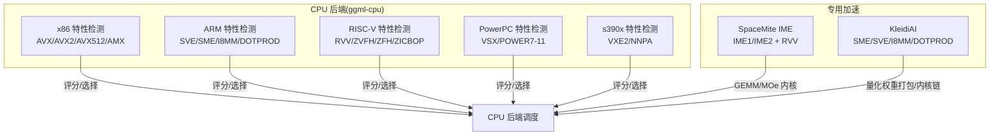
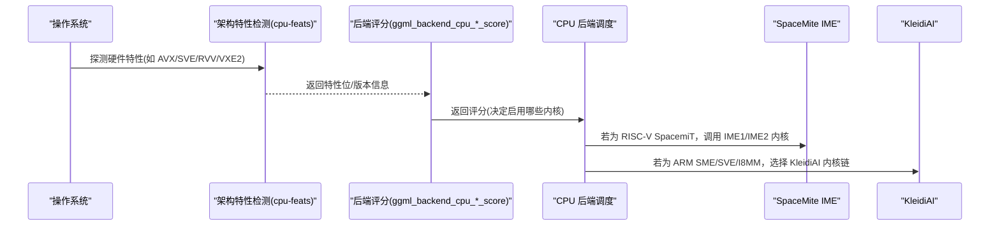
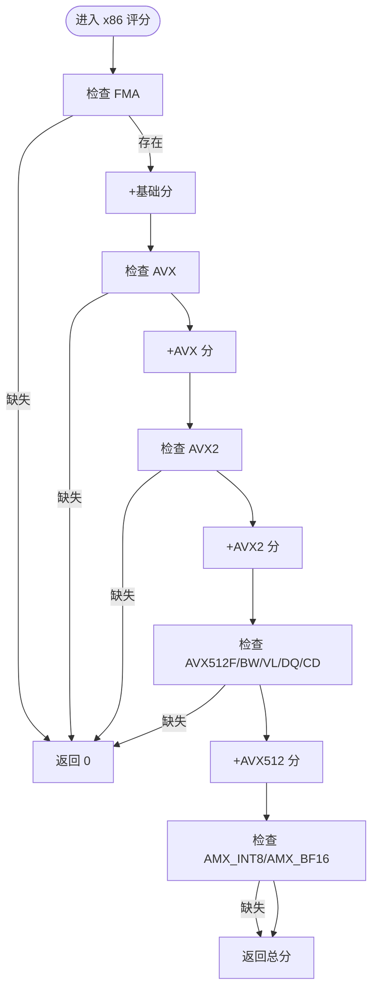
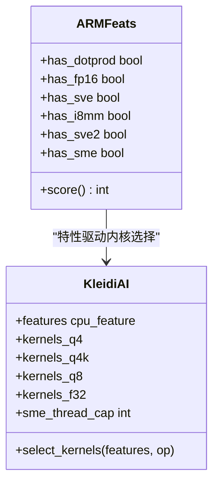
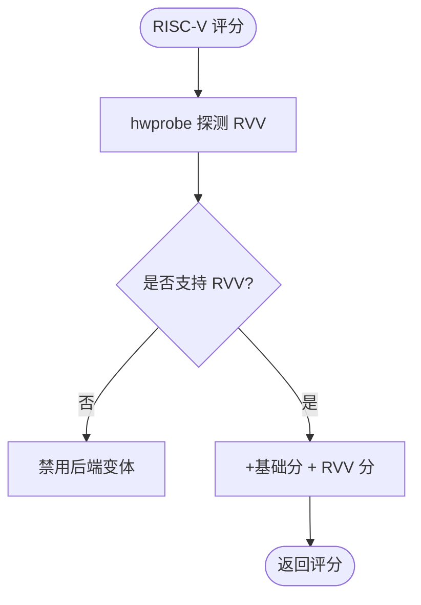
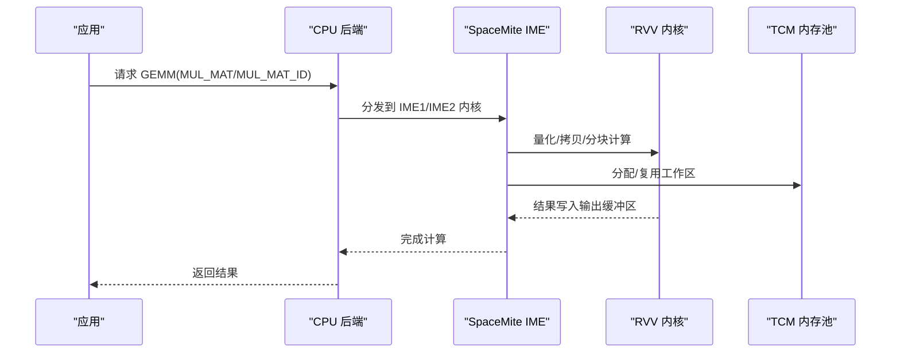
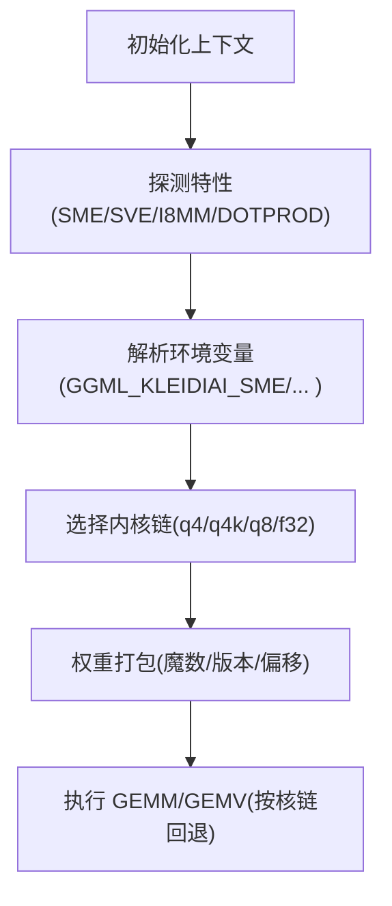
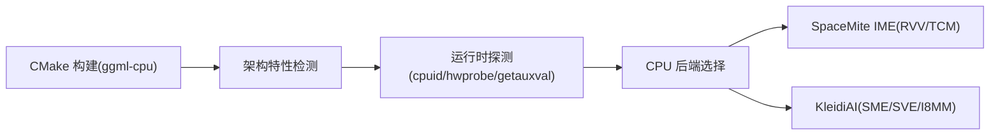

# 架构特定优化

<cite>
**本文引用的文件**   
- [README.md](file://README.md)
- [build-riscv64-spacemit.md](file://docs/build-riscv64-spacemit.md)
- [build-s390x.md](file://docs/build-s390x.md)
- [CMakeLists.txt（ggml-cpu）](file://ggml/src/ggml-cpu/CMakeLists.txt)
- [cpu-feats.cpp（x86）](file://ggml/src/ggml-cpu/arch/x86/cpu-feats.cpp)
- [cpu-feats.cpp（ARM）](file://ggml/src/ggml-cpu/arch/arm/cpu-feats.cpp)
- [cpu-feats.cpp（RISC-V）](file://ggml/src/ggml-cpu/arch/riscv/cpu-feats.cpp)
- [cpu-feats.cpp（PowerPC）](file://ggml/src/ggml-cpu/arch/powerpc/cpu-feats.cpp)
- [cpu-feats.cpp（s390）](file://ggml/src/ggml-cpu/arch/s390/cpu-feats.cpp)
- [ime.h](file://ggml/src/ggml-cpu/spacemit/ime.h)
- [ime.cpp](file://ggml/src/ggml-cpu/spacemit/ime.cpp)
- [kleidiai.h](file://ggml/src/ggml-cpu/kleidiai/kleidiai.h)
- [kleidiai.cpp](file://ggml/src/ggml-cpu/kleidiai/kleidiai.cpp)
</cite>

## 目录
1. [简介](#简介)
2. [项目结构](#项目结构)
3. [核心组件](#核心组件)
4. [架构总览](#架构总览)
5. [详细组件分析](#详细组件分析)
6. [依赖关系分析](#依赖关系分析)
7. [性能考量与基准建议](#性能考量与基准建议)
8. [故障排查指南](#故障排查指南)
9. [结论](#结论)
10. [附录：交叉编译与平台兼容](#附录交叉编译与平台兼容)

## 简介
本技术文档聚焦于 llama.cpp 在多种 CPU 架构上的特定优化实现，包括 x86、ARM、RISC-V、PowerPC、LoongArch、s390。重点覆盖：
- SpaceMite 处理器的 IME（In-Memory Engine）优化与 RISC-V 向量扩展支持
- KleidiAI 库的集成与 ARM SME/SVE/I8MM/DOTPROD 等特性适配
- 运行时架构特性检测与后端评分机制
- 各架构的性能基准对比与最佳实践
- 交叉编译配置与平台兼容性处理

## 项目结构
llama.cpp 将 CPU 后端优化集中在 ggml-cpu 子系统中，按架构拆分特性检测与内核选择逻辑；SpaceMite 与 KleidiAI 作为独立模块提供专用加速路径。

图表来源
- [CMakeLists.txt（ggml-cpu）:1-25](file://ggml/src/ggml-cpu/CMakeLists.txt#L1-L25)
- [cpu-feats.cpp（x86）:263-325](file://ggml/src/ggml-cpu/arch/x86/cpu-feats.cpp#L263-L325)
- [cpu-feats.cpp（ARM）:6-39](file://ggml/src/ggml-cpu/arch/arm/cpu-feats.cpp#L6-L39)
- [cpu-feats.cpp（RISC-V）:24-36](file://ggml/src/ggml-cpu/arch/riscv/cpu-feats.cpp#L24-L36)
- [cpu-feats.cpp（PowerPC）:45-80](file://ggml/src/ggml-cpu/arch/powerpc/cpu-feats.cpp#L45-L80)
- [cpu-feats.cpp（s390）:29-48](file://ggml/src/ggml-cpu/arch/s390/cpu-feats.cpp#L29-L48)

章节来源
- [README.md:60-74](file://README.md#L60-L74)

## 核心组件
- 架构特性检测与评分：每个架构提供独立的 cpu-feats.cpp，通过运行时探测硬件能力并返回评分，用于后端动态加载与回退策略。
- SpaceMite IME：面向 SpacemiT SoC 的内存内矩阵乘加速，支持 IME1/IME2 两种实现，结合 RVV 向量化与 TCM 内存池，针对 Q2_K/Q3_K/Q4_0/Q4_1/Q4_K/Q5_0/Q5_1/Q5_K/Q6_K/Q8_0/MXFP4 等量化类型进行内核选择与分块计算。
- KleidiAI：ARM 生态的量化 GEMM 加速库，自动探测 SME/SVE/I8MM/DOTPROD/F16 等特性，构建多内核链并按需回退，支持 Q4_0/Q4_K/Q8_0/F32 等数据类型与 GEMM/GEMV。

章节来源
- [cpu-feats.cpp（x86）:16-192](file://ggml/src/ggml-cpu/arch/x86/cpu-feats.cpp#L16-L192)
- [cpu-feats.cpp（ARM）:6-39](file://ggml/src/ggml-cpu/arch/arm/cpu-feats.cpp#L6-L39)
- [cpu-feats.cpp（RISC-V）:8-36](file://ggml/src/ggml-cpu/arch/riscv/cpu-feats.cpp#L8-L36)
- [cpu-feats.cpp（PowerPC）:11-43](file://ggml/src/ggml-cpu/arch/powerpc/cpu-feats.cpp#L11-L43)
- [cpu-feats.cpp（s390）:15-27](file://ggml/src/ggml-cpu/arch/s390/cpu-feats.cpp#L15-L27)
- [ime.h:9-17](file://ggml/src/ggml-cpu/spacemit/ime.h#L9-L17)
- [ime.cpp:73-120](file://ggml/src/ggml-cpu/spacemit/ime.cpp#L73-L120)
- [kleidiai.h:13-14](file://ggml/src/ggml-cpu/kleidiai/kleidiai.h#L13-L14)
- [kleidiai.cpp:65-74](file://ggml/src/ggml-cpu/kleidiai/kleidiai.cpp#L65-L74)

## 架构总览
下图展示各架构特性检测与后端评分流程，以及 SpaceMite/KleidiAI 如何接入 CPU 后端。

图表来源
- [cpu-feats.cpp（x86）:263-325](file://ggml/src/ggml-cpu/arch/x86/cpu-feats.cpp#L263-L325)
- [cpu-feats.cpp（ARM）:6-39](file://ggml/src/ggml-cpu/arch/arm/cpu-feats.cpp#L6-L39)
- [cpu-feats.cpp（RISC-V）:24-36](file://ggml/src/ggml-cpu/arch/riscv/cpu-feats.cpp#L24-L36)
- [cpu-feats.cpp（PowerPC）:45-80](file://ggml/src/ggml-cpu/arch/powerpc/cpu-feats.cpp#L45-L80)
- [cpu-feats.cpp（s390）:29-48](file://ggml/src/ggml-cpu/arch/s390/cpu-feats.cpp#L29-L48)

## 详细组件分析

### x86 架构优化
- 特性检测：通过 cpuid 指令族读取 Intel/AMD 厂商信息与扩展位，支持 SSE3/SSSE3/FMA/SSE4.1/AVX/AVX2/AVX512F/AVX512BW/AVX512VL/AVX512DQ/AVX512CD/AVX512_VBMI/AVX512_BF16/AVX512_VNNI/AVX_VNNI/AMX_TILE/AMX_INT8/AMX_FP16/AMX_BF16 等。
- 评分策略：根据编译期宏（GGML_FMA、GGML_AVX、GGML_AVX2、GGML_AVX512、GGML_AMX_INT8 等）检查对应特性是否可用，逐级加分；缺失关键特性则直接返回 0，禁用该后端变体。
- 适用场景：现代 x86 服务器/桌面端，优先启用 AVX2/AVX512/AMX 以提升 GEMM 吞吐。

图表来源
- [cpu-feats.cpp（x86）:263-325](file://ggml/src/ggml-cpu/arch/x86/cpu-feats.cpp#L263-L325)

章节来源
- [cpu-feats.cpp（x86）:16-192](file://ggml/src/ggml-cpu/arch/x86/cpu-feats.cpp#L16-L192)
- [cpu-feats.cpp（x86）:263-325](file://ggml/src/ggml-cpu/arch/x86/cpu-feats.cpp#L263-L325)

### ARM 架构优化
- 特性检测：基于 ggml_feats_get_arch64_runtime() 获取 has_dotprod/has_fp16/has_sve/has_i8mm/has_sve2/has_sme 等运行时特性。
- 评分策略：按 DOTPROD→FP16→SVE→I8MM→SVE2→SME 顺序加分；任一必需特性缺失即禁用对应后端变体。
- KleidiAI 集成：自动探测 SME/SVE/I8MM/DOTPROD/F16，构建多内核链（q4/q4k/q8/f32），支持按线程数与环境变量 GGML_KLEIDIAI_SME/GGML_KLEIDIAI_CHUNK_MULTIPLIER/GGML_TOTAL_THREADS 调整并行与分块策略。

图表来源
- [cpu-feats.cpp（ARM）:6-39](file://ggml/src/ggml-cpu/arch/arm/cpu-feats.cpp#L6-L39)
- [kleidiai.cpp:306-444](file://ggml/src/ggml-cpu/kleidiai/kleidiai.cpp#L306-L444)

章节来源
- [cpu-feats.cpp（ARM）:6-39](file://ggml/src/ggml-cpu/arch/arm/cpu-feats.cpp#L6-L39)
- [kleidiai.cpp:65-74](file://ggml/src/ggml-cpu/kleidiai/kleidiai.cpp#L65-L74)
- [kleidiai.cpp:306-444](file://ggml/src/ggml-cpu/kleidiai/kleidiai.cpp#L306-L444)

### RISC-V 架构优化
- 特性检测：通过 hwprobe 系统调用探测 RVV 扩展可用性。
- 评分策略：若启用 GGML_USE_RVV 且未检测到 RVV，则禁用该后端变体。
- SpaceMite IME：在 RISC-V SpacemiT 平台上，支持 IME1/IME2 两套内核，结合 RVV 向量化与 TCM 内存池，对多种量化类型进行高效 GEMM/MOE 计算；提供 NUMA 亲和性设置与共享内存分配接口。

图表来源
- [cpu-feats.cpp（RISC-V）:8-36](file://ggml/src/ggml-cpu/arch/riscv/cpu-feats.cpp#L8-L36)

章节来源
- [cpu-feats.cpp（RISC-V）:8-36](file://ggml/src/ggml-cpu/arch/riscv/cpu-feats.cpp#L8-L36)
- [ime.h:9-17](file://ggml/src/ggml-cpu/spacemit/ime.h#L9-L17)
- [ime.cpp:73-120](file://ggml/src/ggml-cpu/spacemit/ime.cpp#L73-L120)

### PowerPC 架构优化
- 特性检测：解析 AT_PLATFORM 字符串提取 POWER 版本（POWER7~POWER11），并判断 VSX 支持。
- 评分策略：按 POWER7/8/9/10/11 逐级加分；若启用 VSX 但不可用则禁用。

章节来源
- [cpu-feats.cpp（PowerPC）:11-43](file://ggml/src/ggml-cpu/arch/powerpc/cpu-feats.cpp#L11-L43)
- [cpu-feats.cpp（PowerPC）:45-80](file://ggml/src/ggml-cpu/arch/powerpc/cpu-feats.cpp#L45-L80)

### s390 架构优化
- 特性检测：通过 getauxval(AT_HWCAP) 读取 HWCAP_VXRS_EXT2（VXE2）与 HWCAP_NNPA（NNPA）。
- 评分策略：z15/LinuxONE 3 及以上支持 VXE2；z16/z17 支持 NNPA；缺失则禁用对应后端变体。

章节来源
- [cpu-feats.cpp（s390）:15-27](file://ggml/src/ggml-cpu/arch/s390/cpu-feats.cpp#L15-L27)
- [cpu-feats.cpp（s390）:29-48](file://ggml/src/ggml-cpu/arch/s390/cpu-feats.cpp#L29-L48)

### SpaceMite IME 优化详解
- 目标平台：RISC-V SpacemiT SoC（X60/A100 等）。
- 核心能力：
  - IME1/IME2 两套 GEMM 内核，按量化类型与数据布局选择最优实现。
  - RVV 向量化量化与拷贝，TCM 内存池减少访存延迟。
  - MOE（多头专家）路径 MUL_MAT_ID 的专家路由与批处理。
  - NUMA 亲和性与线程亲和性控制，提升多核并发效率。
- 量化支持：Q2_K/Q3_K/Q4_0/Q4_1/Q4_K/Q5_0/Q5_1/Q5_K/Q6_K/Q8_0/MXFP4。
- 构建选项：GGML_CPU_RISCV64_SPACEMIT=ON，RISCV64_SPACEMIT_IME1/IME2 二选一，配合 GGML_RVV/GGML_RV_ZVFH/GGML_RV_ZFH/GGML_RV_ZICBOP/GGML_RV_ZIHINTPAUSE/GGML_RV_ZBA。

图表来源
- [ime.cpp:236-546](file://ggml/src/ggml-cpu/spacemit/ime.cpp#L236-L546)
- [ime.cpp:548-800](file://ggml/src/ggml-cpu/spacemit/ime.cpp#L548-L800)

章节来源
- [ime.cpp:73-120](file://ggml/src/ggml-cpu/spacemit/ime.cpp#L73-L120)
- [ime.cpp:236-546](file://ggml/src/ggml-cpu/spacemit/ime.cpp#L236-L546)
- [ime.cpp:548-800](file://ggml/src/ggml-cpu/spacemit/ime.cpp#L548-L800)

### KleidiAI 集成与优化策略
- 特性探测：读取运行时特性（DOTPROD/I8MM/F16/SVE/SME/SME2），并结合环境变量（GGML_KLEIDIAI_SME/GGML_KLEIDIAI_CHUNK_MULTIPLIER/GGML_TOTAL_THREADS）调整线程上限与分块大小。
- 内核链：为 q4/q4k/q8/f32 分别选择主内核与回退内核，优先使用 SME/SVE 家族内核，必要时回退至 I8MM/DOTPROD。
- 权重打包：按数据类型与块大小对齐，生成带魔数/版本的头部，支持多槽位（slot）存储不同内核的打包权重。
- 线程上限：通过 SMCU 计数或保守默认值限制 SME 线程数，避免过度并行导致争用。

图表来源
- [kleidiai.cpp:306-444](file://ggml/src/ggml-cpu/kleidiai/kleidiai.cpp#L306-L444)
- [kleidiai.cpp:521-568](file://ggml/src/ggml-cpu/kleidiai/kleidiai.cpp#L521-L568)

章节来源
- [kleidiai.cpp:65-74](file://ggml/src/ggml-cpu/kleidiai/kleidiai.cpp#L65-L74)
- [kleidiai.cpp:306-444](file://ggml/src/ggml-cpu/kleidiai/kleidiai.cpp#L306-L444)
- [kleidiai.cpp:521-568](file://ggml/src/ggml-cpu/kleidiai/kleidiai.cpp#L521-L568)

## 依赖关系分析
- CMake 构建层：ggml-cpu 将各架构特性检测编译为独立对象目标，避免 LTO 导致的跨模块优化问题，确保旧 CPU 上加载新后端时不会触发非法指令。
- 运行时依赖：
  - x86：cpuid 指令族
  - ARM：ggml-feats 运行时 API
  - RISC-V：hwprobe 系统调用
  - PowerPC：getauxval(AT_PLATFORM)
  - s390：getauxval(AT_HWCAP)
- 专用库：
  - SpaceMite：RVV 内核、TCM 内存池、spine_barrier 同步原语
  - KleidiAI：kai_common、内核选择器、权重打包头

图表来源
- [CMakeLists.txt（ggml-cpu）:1-25](file://ggml/src/ggml-cpu/CMakeLists.txt#L1-L25)
- [cpu-feats.cpp（x86）:263-325](file://ggml/src/ggml-cpu/arch/x86/cpu-feats.cpp#L263-L325)
- [cpu-feats.cpp（RISC-V）:8-36](file://ggml/src/ggml-cpu/arch/riscv/cpu-feats.cpp#L8-L36)
- [cpu-feats.cpp（PowerPC）:11-43](file://ggml/src/ggml-cpu/arch/powerpc/cpu-feats.cpp#L11-L43)
- [cpu-feats.cpp（s390）:15-27](file://ggml/src/ggml-cpu/arch/s390/cpu-feats.cpp#L15-L27)

章节来源
- [CMakeLists.txt（ggml-cpu）:1-25](file://ggml/src/ggml-cpu/CMakeLists.txt#L1-L25)

## 性能考量与基准建议
- x86：
  - 优先启用 AVX2/AVX512/AMX；在支持 AMX 的平台上可显著提升 INT8/BF16 矩阵乘吞吐。
  - 注意 OS 对 AVX/AVX512 的支持（如 OSXSAVE），避免在虚拟化环境中误判。
- ARM：
  - 优先启用 SME/SVE/I8MM/DOTPROD；KleidiAI 会根据 SMCU 数量自动调节 SME 线程上限。
  - 使用 GGML_KLEIDIAI_SME 调试开关验证不同线程上限下的性能曲线。
- RISC-V：
  - 确保开启 RVV/ZVFH/ZFH/ZICBOP/ZIHINTPAUSE/ZBA；SpaceMite IME 在 IME2 下对高维矩阵有更好吞吐。
  - 参考官方基准文档中的 X60/A100 数据，合理设置线程数与 ubatch。
- PowerPC：
  - 推荐启用 BLAS（OpenBLAS）以发挥 VXE/VXE2 SIMD 加速；关闭 SMT 以获得更稳定性能。
- s390：
  - 模型必须为大端格式（Big-Endian）；建议使用预转换模型或脚本转换 safetensors→GGUF Big-Endian。
  - 推荐使用 zDNN 加速器（z17/LinuxONE 5 及以上）；SIMD 支持矩阵见附录 B。

章节来源
- [README.md:60-74](file://README.md#L60-L74)
- [build-riscv64-spacemit.md:1-111](file://docs/build-riscv64-spacemit.md#L1-L111)
- [build-s390x.md:17-65](file://docs/build-s390x.md#L17-L65)
- [build-s390x.md:149-183](file://docs/build-s390x.md#L149-L183)
- [build-s390x.md:227-277](file://docs/build-s390x.md#L227-L277)

## 故障排查指南
- 加载模型时报“字节序不匹配”（s390x）：
  - 确认模型为 GGUF v3 Big-Endian；使用提供的脚本将 safetensors 转换为 Big-Endian。
- 性能异常低：
  - 检查是否启用了正确的 SIMD/加速器（VXE/VXE2、zDNN、AMX、SME/SVE）；确认未启用 SMT。
- 构建失败（RISC-V SpacemiT）：
  - 确保已安装 RISC-V 工具链并设置 RISCV_ROOT_PATH；启用 GGML_CPU_RISCV64_SPACEMIT 与 GGML_RV_* 相关选项。
- KleidiAI 未启用：
  - 检查 GGML_KLEIDIAI_SME 环境变量；确认运行环境具备 SME/SVE/I8MM/DOTPROD 特性。

章节来源
- [build-s390x.md:185-203](file://docs/build-s390x.md#L185-L203)
- [build-riscv64-spacemit.md:1-34](file://docs/build-riscv64-spacemit.md#L1-L34)
- [kleidiai.cpp:306-444](file://ggml/src/ggml-cpu/kleidiai/kleidiai.cpp#L306-L444)

## 结论
llama.cpp 在多架构 CPU 上提供了完善的特性检测与后端评分机制，并通过 SpaceMite IME 与 KleidiAI 两大专用加速路径，分别在 RISC-V 与 ARM 生态中实现了高效的量化矩阵乘与推理加速。结合合理的构建选项与环境配置，可在不同平台上获得稳定且高性能的推理表现。

## 附录：交叉编译与平台兼容
- RISC-V SpacemiT：
  - 使用 cmake/riscv64-spacemit-linux-gnu-gcc.cmake 工具链；启用 GGML_CPU_RISCV64_SPACEMIT 与 RISCV64_SPACEMIT_IME1/IME2。
  - 可通过 QEMU 模拟运行，设置 qemu-riscv64 参数指定 vlen/elen/vext_spec。
- s390x：
  - 推荐使用 OpenBLAS；可选启用 GGML_ZDNN；模型必须为大端格式。
- ARM（Snapdragon）：
  - 使用 Docker 工具链镜像 ghcr.io/snapdragon-toolchain/arm64-linux:v0.7；通过 scripts/snapdragon/build.py 一键构建部署。

章节来源
- [build-riscv64-spacemit.md:1-51](file://docs/build-riscv64-spacemit.md#L1-L51)
- [build-s390x.md:17-82](file://docs/build-s390x.md#L17-L82)
- [docs/backend/snapdragon/linux.md:1-47](file://docs/backend/snapdragon/linux.md#L1-L47)