# CUDA后端

<cite>
**本文引用的文件**   
- [ggml-cuda.h](file://ggml/include/ggml-cuda.h)
- [ggml-cuda.cu](file://ggml/src/ggml-cuda/ggml-cuda.cu)
- [common.cuh](file://ggml/src/ggml-cuda/common.cuh)
- [mmq.cu](file://ggml/src/ggml-cuda/mmq.cu)
- [fattn.cu](file://ggml/src/ggml-cuda/fattn.cu)
- [norm.cu](file://ggml/src/ggml-cuda/norm.cu)
- [allreduce.cu](file://ggml/src/ggml-cuda/allreduce.cu)
- [build.md](file://docs/build.md)
</cite>

## 目录
1. [简介](#简介)
2. [项目结构](#项目结构)
3. [核心组件](#核心组件)
4. [架构总览](#架构总览)
5. [详细组件分析](#详细组件分析)
6. [依赖关系分析](#依赖关系分析)
7. [性能与调优](#性能与调优)
8. [故障排除指南](#故障排除指南)
9. [结论](#结论)

## 简介
本文件为 llama.cpp 的 CUDA 后端技术文档，聚焦以下方面：
- GPU 设备检测、显存管理与内存池机制
- CUDA 流管理、异步执行与多流并发
- 关键算子实现：量化矩阵乘法（MMQ）、FlashAttention、归一化等
- 不同 CUDA 架构（Ampere、Hopper、Blackwell 等）的优化策略
- 配置参数、性能调优与环境变量
- 与 NVIDIA 驱动/库版本的兼容性说明与最佳实践

## 项目结构
CUDA 后端位于 ggml/src/ggml-cuda 目录，提供大量算子的 CUDA 实现；对外通过 ggml/include/ggml-cuda.h 暴露后端 API。核心入口与上下文在 ggml-cuda.cu 中定义，通用基础设施（流、cublas、内存池、架构宏）集中在 common.cuh。

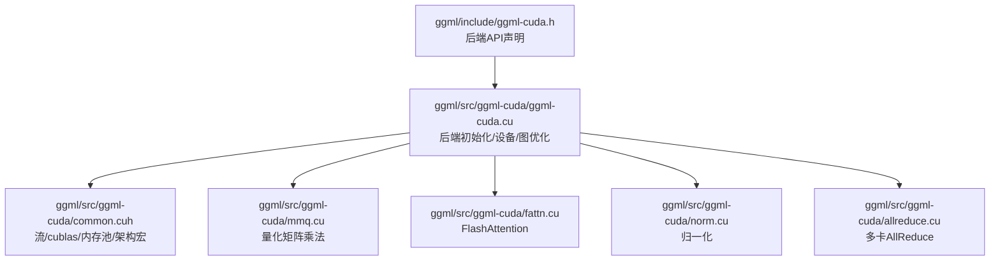

**图示来源** 
- [ggml-cuda.h:10-43](file://ggml/include/ggml-cuda.h#L10-L43)
- [ggml-cuda.cu:1-73](file://ggml/src/ggml-cuda/ggml-cuda.cu#L1-L73)
- [common.cuh:50-63](file://ggml/src/ggml-cuda/common.cuh#L50-L63)

**章节来源**
- [ggml-cuda.h:10-43](file://ggml/include/ggml-cuda.h#L10-L43)
- [ggml-cuda.cu:1-73](file://ggml/src/ggml-cuda/ggml-cuda.cu#L1-L73)

## 核心组件
- 后端API与设备信息
  - 设备计数、描述、显存查询、主机缓冲注册等接口在头文件中统一声明。
- 后端上下文与流管理
  - 每个设备维护非阻塞流、cublas句柄与工作区、按设备/流维度的内存池。
- 算子内核
  - MMQ（量化矩阵乘）、FlashAttention、归一化、池化、SSM等。
- 多卡通信
  - AllReduce 流水线，基于事件与流的多阶段同步。

**章节来源**
- [ggml-cuda.h:22-43](file://ggml/include/ggml-cuda.h#L22-L43)
- [common.cuh:1500-1566](file://ggml/src/ggml-cuda/common.cuh#L1500-L1566)

## 架构总览
下图展示从应用调用到GPU执行的典型路径：后端初始化 -> 设备选择 -> 流与cublas绑定 -> 算子分发 -> 内核执行。

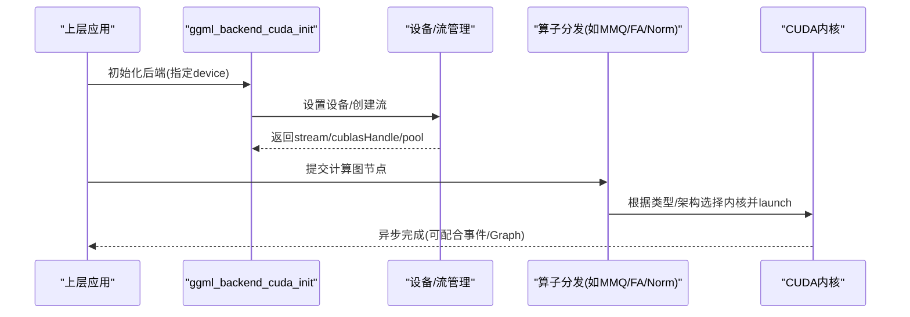

**图示来源**
- [ggml-cuda.cu:112-139](file://ggml/src/ggml-cuda/ggml-cuda.cu#L112-L139)
- [common.cuh:1521-1549](file://ggml/src/ggml-cuda/common.cuh#L1521-L1549)

## 详细组件分析

### 设备检测与显存管理
- 设备枚举与描述
  - 通过后端API获取设备数量、名称、PCI Bus ID、描述与显存总量/剩余量。
- 物理设备映射
  - 内部将“逻辑设备ID”映射到“物理CUDA设备”，避免Windows下频繁切换设备的开销。
- 显存分配策略
  - 支持统一内存（UMA）与常规设备内存；可通过环境变量控制是否启用UMA。
  - 针对临时计算缓冲区的padding清零，避免未初始化数据影响结果。

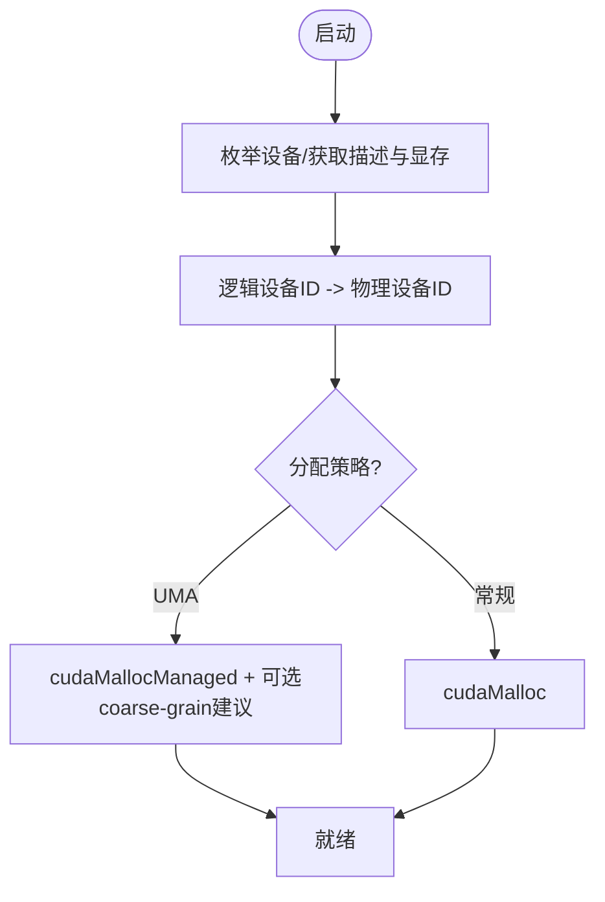

**图示来源**
- [ggml-cuda.cu:112-139](file://ggml/src/ggml-cuda/ggml-cuda.cu#L112-L139)
- [ggml-cuda.cu:185-200](file://ggml/src/ggml-cuda/ggml-cuda.cu#L185-L200)

**章节来源**
- [ggml-cuda.h:36-38](file://ggml/include/ggml-cuda.h#L36-L38)
- [ggml-cuda.cu:112-139](file://ggml/src/ggml-cuda/ggml-cuda.cu#L112-L139)
- [ggml-cuda.cu:185-200](file://ggml/src/ggml-cuda/ggml-cuda.cu#L185-L200)

### CUDA流管理与异步执行
- 流与cublas绑定
  - 每个设备维护多个非阻塞流；cublas句柄绑定到当前流，并设置TF32张量运算模式。
  - Hopper及以上架构使用更大的cublas工作区以提升性能。
- PDL（程序化流序列化）
  - 对PTX>=90的内核启用PDL，减少流间同步开销。

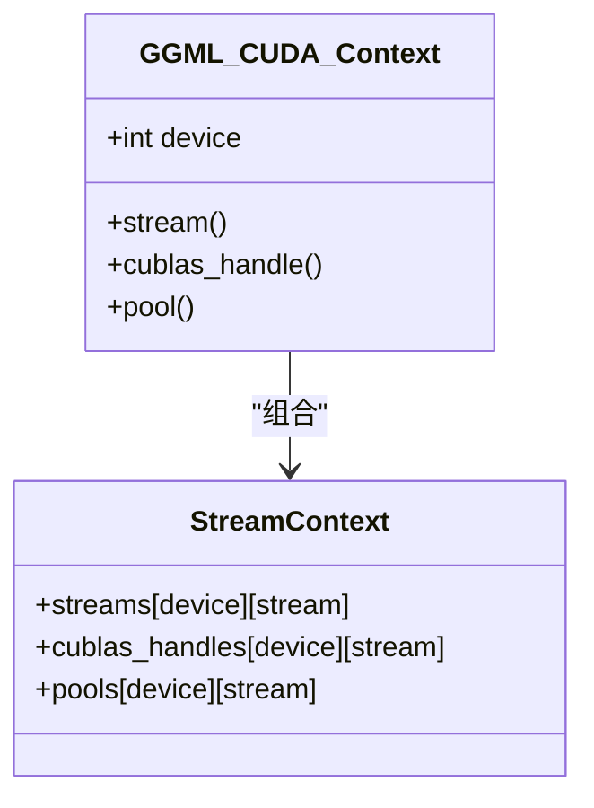

**图示来源**
- [common.cuh:1521-1549](file://ggml/src/ggml-cuda/common.cuh#L1521-L1549)
- [common.cuh:1609-1686](file://ggml/src/ggml-cuda/common.cuh#L1609-L1686)

**章节来源**
- [common.cuh:1521-1549](file://ggml/src/ggml-cuda/common.cuh#L1521-L1549)
- [common.cuh:1609-1686](file://ggml/src/ggml-cuda/common.cuh#L1609-L1686)

### 内存池机制
- 按设备/流维度缓存内存池，减少频繁分配的开销。
- 算子内部通过池分配中间缓冲区，例如交叉熵损失、SSM扫描等。

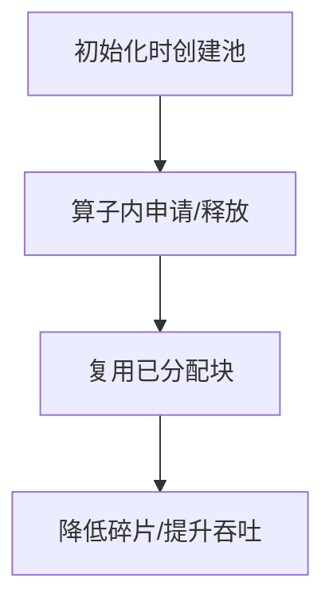

**图示来源**
- [common.cuh:1551-1566](file://ggml/src/ggml-cuda/common.cuh#L1551-L1566)
- [cross-entropy-loss.cu:123-135](file://ggml/src/ggml-cuda/cross-entropy-loss.cu#L123-L135)
- [ssm-scan.cu:611-633](file://ggml/src/ggml-cuda/ssm-scan.cu#L611-L633)

**章节来源**
- [common.cuh:1551-1566](file://ggml/src/ggml-cuda/common.cuh#L1551-L1566)

### 量化矩阵乘法（MMQ）
- 支持多种量化格式（Q1_0~Q8_0、K系列、IQ系列、MXFP4/NVFP4）。
- 精度选择
  - 通过环境变量或张量元数据决定激活精度（Q4/Q8），Blackwell上NVFP4/MXFP4可使用原生W4A4指令。
- 调度与回退
  - 根据形状、专家路由（IDs）与架构特性选择tile尺寸与内核分支；不满足条件时回退至通用路径。

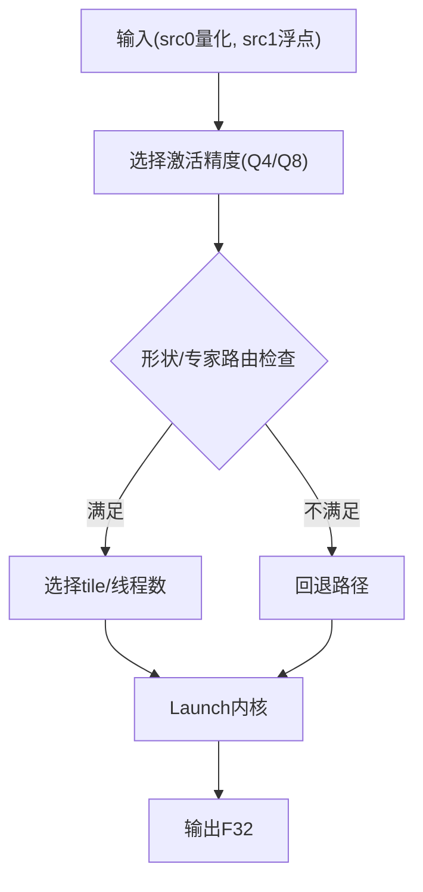

**图示来源**
- [mmq.cu:8-91](file://ggml/src/ggml-cuda/mmq.cu#L8-L91)
- [mmq.cu:93-132](file://ggml/src/ggml-cuda/mmq.cu#L93-L132)
- [mmq.cu:134-200](file://ggml/src/ggml-cuda/mmq.cu#L134-L200)

**章节来源**
- [mmq.cu:8-91](file://ggml/src/ggml-cuda/mmq.cu#L8-L91)
- [mmq.cu:93-132](file://ggml/src/ggml-cuda/mmq.cu#L93-L132)
- [mmq.cu:134-200](file://ggml/src/ggml-cuda/mmq.cu#L134-L200)

### FlashAttention
- 稀疏掩码优化
  - 仅在NVIDIA CUDA可用；根据mask密度、KV长度与Q规模决定是否走稀疏路径。
- 内核选择
  - 依据DKQ/DV与ncols1/ncols2以及Turing MMA可用性选择具体实例；小Q批量优先稀疏gather。
- 编译开关
  - 通过构建选项控制编译哪些K/V量化组合的FA内核。

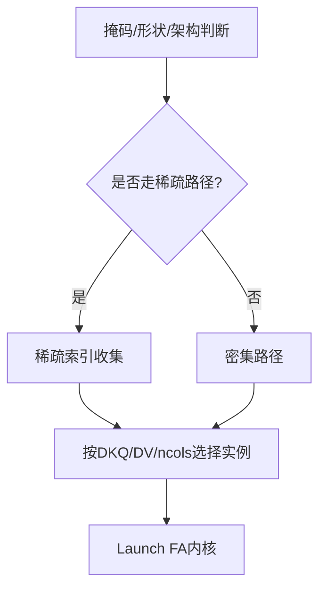

**图示来源**
- [fattn.cu:106-126](file://ggml/src/ggml-cuda/fattn.cu#L106-L126)
- [fattn.cu:128-152](file://ggml/src/ggml-cuda/fattn.cu#L128-L152)
- [fattn.cu:154-200](file://ggml/src/ggml-cuda/fattn.cu#L154-L200)

**章节来源**
- [fattn.cu:106-126](file://ggml/src/ggml-cuda/fattn.cu#L106-L126)
- [fattn.cu:128-152](file://ggml/src/ggml-cuda/fattn.cu#L128-L152)
- [fattn.cu:154-200](file://ggml/src/ggml-cuda/fattn.cu#L154-L200)

### 归一化（Norm/RMSNorm/GroupNorm/L2Norm）
- 提供f32内核，支持并行通道/样本遍历与block/warp级规约。
- RMSNorm支持融合乘加/缩放，减少访存次数。

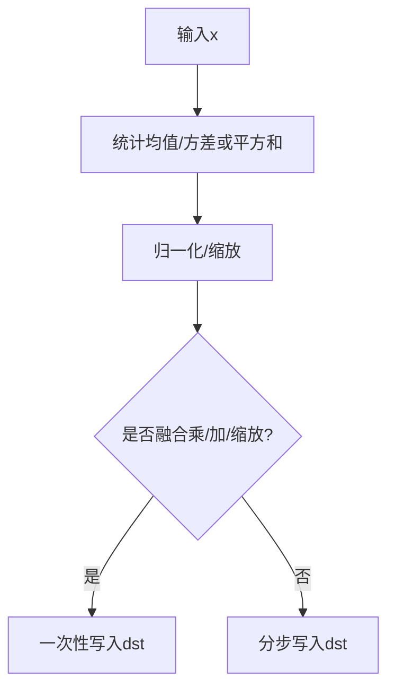

**图示来源**
- [norm.cu:4-47](file://ggml/src/ggml-cuda/norm.cu#L4-L47)
- [norm.cu:84-179](file://ggml/src/ggml-cuda/norm.cu#L84-L179)

**章节来源**
- [norm.cu:4-47](file://ggml/src/ggml-cuda/norm.cu#L4-L47)
- [norm.cu:84-179](file://ggml/src/ggml-cuda/norm.cu#L84-L179)

### 多卡AllReduce
- 两阶段流水线：H2D拷贝到固定大小host缓冲区，跨设备交换，再D2H写回。
- 使用事件池与流隔离保证顺序与可见性，避免覆盖未消费数据。

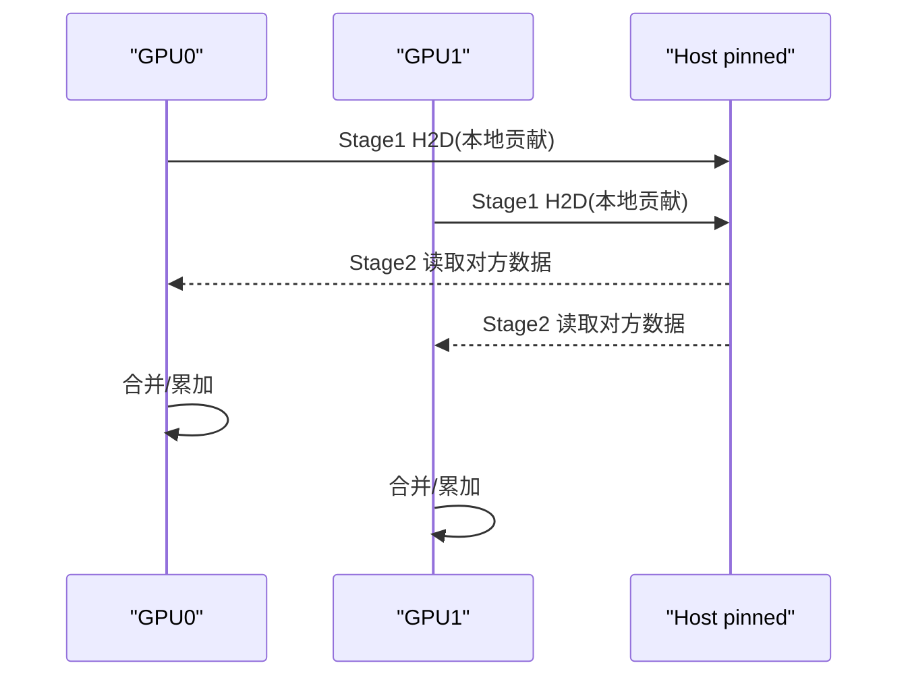

**图示来源**
- [allreduce.cu:440-467](file://ggml/src/ggml-cuda/allreduce.cu#L440-L467)
- [allreduce.cu:618-644](file://ggml/src/ggml-cuda/allreduce.cu#L618-L644)

**章节来源**
- [allreduce.cu:440-467](file://ggml/src/ggml-cuda/allreduce.cu#L440-L467)
- [allreduce.cu:618-644](file://ggml/src/ggml-cuda/allreduce.cu#L618-L644)

### 架构特定优化（Ampere/Hopper/Blackwell）
- 架构常量与能力探测
  - 定义Ampere/Turing/Hopper/Blackwell等CC常量，并提供turing_mma_available/blackwell_mma_available等能力判定。
- 内核选择
  - FlashAttention在Turing及以上启用MMA路径；MMQ在Blackwell上对NVFP4/MXFP4启用原生W4A4。
- cublas工作区
  - Hopper及以上增大工作区以发挥更大吞吐。

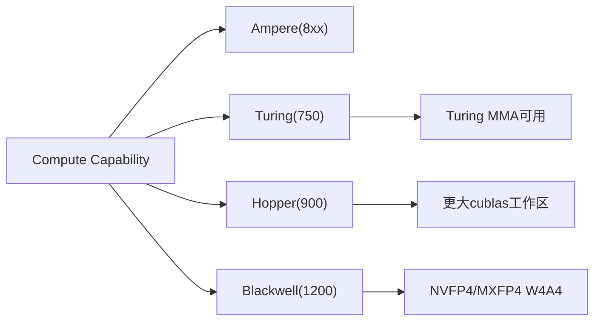

**图示来源**
- [common.cuh:50-63](file://ggml/src/ggml-cuda/common.cuh#L50-L63)
- [common.cuh:293-307](file://ggml/src/ggml-cuda/common.cuh#L293-L307)
- [common.cuh:1533-1549](file://ggml/src/ggml-cuda/common.cuh#L1533-L1549)
- [mmq.cu:115-132](file://ggml/src/ggml-cuda/mmq.cu#L115-L132)
- [fattn.cu:128-152](file://ggml/src/ggml-cuda/fattn.cu#L128-L152)

**章节来源**
- [common.cuh:50-63](file://ggml/src/ggml-cuda/common.cuh#L50-L63)
- [common.cuh:293-307](file://ggml/src/ggml-cuda/common.cuh#L293-L307)
- [common.cuh:1533-1549](file://ggml/src/ggml-cuda/common.cuh#L1533-L1549)
- [mmq.cu:115-132](file://ggml/src/ggml-cuda/mmq.cu#L115-L132)
- [fattn.cu:128-152](file://ggml/src/ggml-cuda/fattn.cu#L128-L152)

## 依赖关系分析
- 头文件依赖
  - ggml-cuda.h 依赖 ggml.h 与 ggml-backend.h，提供统一的设备/缓冲/后端注册接口。
- 运行时依赖
  - CUDA Runtime、cuBLAS；在HIP/MUSA下分别替换为对应库名。
- 算子耦合
  - ggml-cuda.cu 聚合各算子头文件，按op分发到对应实现。

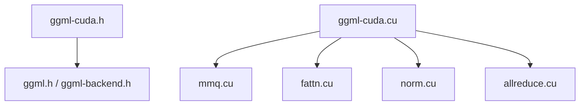

**图示来源**
- [ggml-cuda.h:1-5](file://ggml/include/ggml-cuda.h#L1-L5)
- [ggml-cuda.cu:1-73](file://ggml/src/ggml-cuda/ggml-cuda.cu#L1-L73)

**章节来源**
- [ggml-cuda.h:1-5](file://ggml/include/ggml-cuda.h#L1-L5)
- [ggml-cuda.cu:1-73](file://ggml/src/ggml-cuda/ggml-cuda.cu#L1-L73)

## 性能与调优
- 构建期开关
  - GGML_CUDA_FORCE_MMQ：强制使用自定义量化MM内核而非FP16 cuBLAS，降低VRAM占用但大批次可能变慢。
  - GGML_CUDA_FORCE_CUBLAS：强制FP16 cuBLAS，可能在数据中心GPU上更快，但数值溢出风险更高。
  - GGML_CUDA_FA_QUANTS：控制编译哪些K/V量化组合的FlashAttention内核；默认包含f16-f16。
- 运行期环境变量
  - GGML_CUDA_ENABLE_UNIFIED_MEMORY：启用统一内存，VRAM不足时可回退系统内存（Linux）。
  - GGML_CUDA_P2P：启用多卡P2P直传，需驱动支持，部分主板/BIOS可能不稳定。
  - GGML_CUDA_DISABLE_FUSION：禁用算子融合。
  - GGML_CUDA_NO_PINNED：禁用固定页主机内存。
  - GGML_CUDA_REGISTER_HOST：启用主机缓冲注册。
  - GGML_OP_OFFLOAD_MIN_BATCH：控制算子offload的最小batch阈值。
  - GGML_CUDA_MMQ_PREC：控制MMQ激活精度（q4/q8/auto）。

**章节来源**
- [build.md:326-335](file://docs/build.md#L326-L335)
- [build.md:314-324](file://docs/build.md#L314-L324)
- [ggml-cuda.cu:141-183](file://ggml/src/ggml-cuda/ggml-cuda.cu#L141-L183)
- [mmq.cu:93-113](file://ggml/src/ggml-cuda/mmq.cu#L93-L113)

## 故障排除指南
- 常见错误定位
  - CUDA错误日志会打印当前设备、函数与行号，便于快速定位。
- 显存不足
  - 启用统一内存（Linux）作为兜底；或减小模型/批大小；调整GGML_CUDA_FORCE_*开关。
- 多卡AllReduce异常
  - 检查驱动P2P支持；必要时关闭GGML_CUDA_P2P；确认事件/流资源充足。
- FlashAttention不可用
  - 非NVIDIA平台或编译未包含所需量化组合时会回退；检查GGML_CUDA_FA_QUANTS与架构能力。

**章节来源**
- [ggml-cuda.cu:100-110](file://ggml/src/ggml-cuda/ggml-cuda.cu#L100-L110)
- [build.md:314-324](file://docs/build.md#L314-L324)
- [allreduce.cu:440-467](file://ggml/src/ggml-cuda/allreduce.cu#L440-L467)
- [fattn.cu:106-126](file://ggml/src/ggml-cuda/fattn.cu#L106-L126)

## 结论
llama.cpp 的 CUDA 后端通过精细的设备/流/内存池管理与丰富的算子内核（MMQ、FlashAttention、归一化等），在多架构（Ampere/Hopper/Blackwell）上实现了高吞吐与低显存占用的推理路径。结合构建期与运行期的可调参数，用户可在不同硬件与负载场景下取得稳定且高效的性能表现。建议在数据中心GPU上优先评估cuBLAS路径，在RTX系列上保持默认MMQ路径，并根据模型形态与批大小微调FA量化组合与offload阈值。