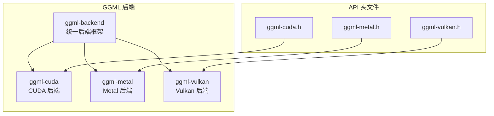
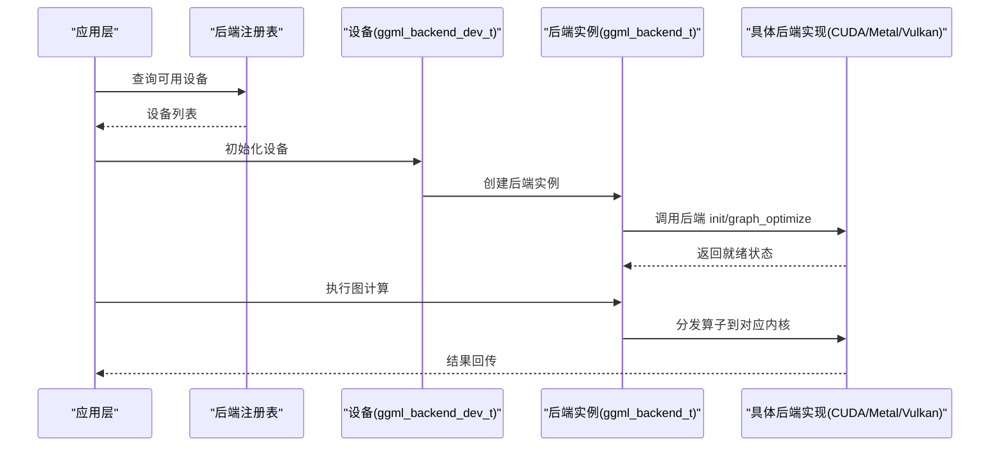
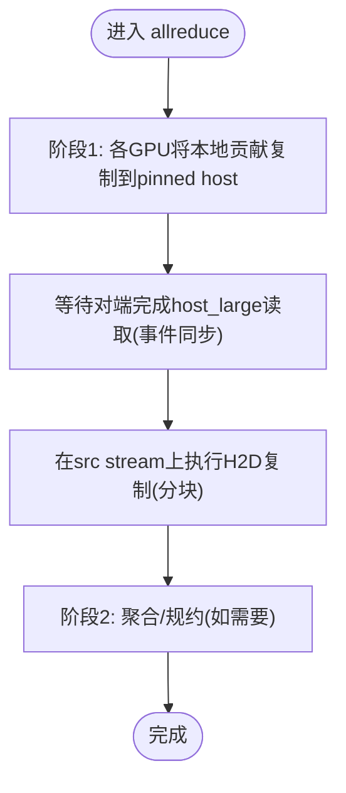
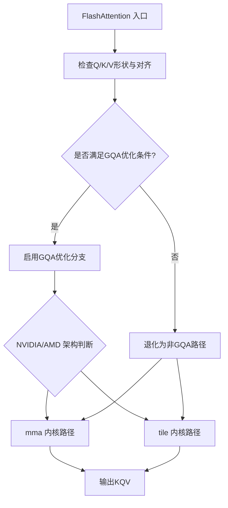
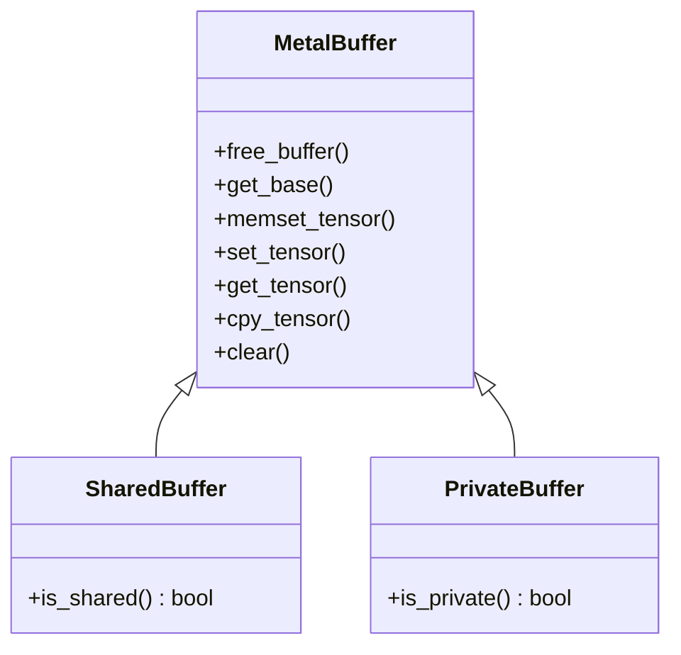
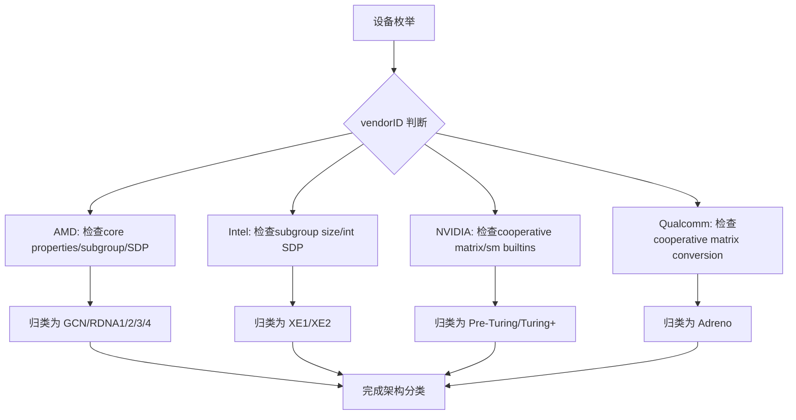
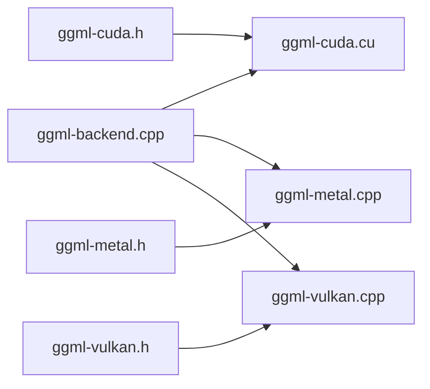

# GPU后端

<cite>
**本文引用的文件**   
- [ggml-cuda.h](file://ggml/include/ggml-cuda.h)
- [ggml-metal.h](file://ggml/include/ggml-metal.h)
- [ggml-vulkan.h](file://ggml/include/ggml-vulkan.h)
- [ggml-cuda.cu](file://ggml/src/ggml-cuda/ggml-cuda.cu)
- [allreduce.cu](file://ggml/src/ggml-cuda/allreduce.cu)
- [fattn.cu](file://ggml/src/ggml-cuda/fattn.cu)
- [fattn-tile.cuh](file://ggml/src/ggml-cuda/fattn-tile.cuh)
- [ggml-metal.cpp](file://ggml/src/ggml-metal/ggml-metal.cpp)
- [ggml-metal-device.m](file://ggml/src/ggml-metal/ggml-metal-device.m)
- [ggml-vulkan.cpp](file://ggml/src/ggml-vulkan/ggml-vulkan.cpp)
- [ggml-backend.cpp](file://ggml/src/ggml-backend.cpp)
- [build.md](file://docs/build.md)
- [multi-gpu.md](file://docs/multi-gpu.md)
- [main.cpp（tuning）](file://tools/tuning/main.cpp)
</cite>

## 目录
1. [简介](#简介)
2. [项目结构](#项目结构)
3. [核心组件](#核心组件)
4. [架构总览](#架构总览)
5. [详细组件分析](#详细组件分析)
6. [依赖关系分析](#依赖关系分析)
7. [性能与优化](#性能与优化)
8. [故障排查与调试](#故障排查与调试)
9. [结论](#结论)

## 简介
本文件系统性梳理 llama.cpp 的 GPU 后端体系，重点覆盖：
- CUDA 后端的内核优化、显存管理与多卡通信
- Metal 后端的 iOS/macOS 平台优化与图形 API 集成
- Vulkan 后端的跨平台兼容性与底层硬件抽象
- 设备检测、内存分配策略与计算图优化
- 配置选项、性能监控与调试方法
- NVIDIA/AMD/Intel 等厂商特定优化与兼容性处理

## 项目结构
GPU 相关代码主要位于 ggml 子系统中，按后端分目录组织：
- ggml/include: 各后端的对外 C API 头文件（CUDA/Metal/Vulkan）
- ggml/src/ggml-cuda: CUDA 后端实现（内核、内存、AllReduce、FlashAttention 等）
- ggml/src/ggml-metal: Metal 后端实现（设备探测、缓冲管理、算子调度）
- ggml/src/ggml-vulkan: Vulkan 后端实现（设备架构识别、扩展能力探测）
- ggml/src/ggml-backend: 通用后端框架（设备/缓冲接口、图优化入口）

图表来源
- [ggml-backend.cpp:707-753](file://ggml/src/ggml-backend.cpp#L707-L753)
- [ggml-cuda.h:1-48](file://ggml/include/ggml-cuda.h#L1-L48)
- [ggml-metal.h:1-62](file://ggml/include/ggml-metal.h#L1-L62)
- [ggml-vulkan.h:1-30](file://ggml/include/ggml-vulkan.h#L1-L30)

章节来源
- [ggml-backend.cpp:707-753](file://ggml/src/ggml-backend.cpp#L707-L753)
- [ggml-cuda.h:1-48](file://ggml/include/ggml-cuda.h#L1-L48)
- [ggml-metal.h:1-62](file://ggml/include/ggml-metal.h#L1-L62)
- [ggml-vulkan.h:1-30](file://ggml/include/ggml-vulkan.h#L1-L30)

## 核心组件
- CUDA 后端
  - 设备与流管理、虚拟/物理设备映射
  - 统一内存与页锁定主机内存
  - AllReduce 多卡通信（含 peer-to-peer 与 host staging）
  - FlashAttention 内核选择与 GQA 优化分支
- Metal 后端
  - Apple 设备族特性探测（SIMDGroup、BF16、Tensor Core）
  - 共享/私有缓冲模型与张量拷贝
  - 命令捕获与调试采集
- Vulkan 后端
  - 跨厂商设备架构识别（NVIDIA/AMD/Intel/Qualcomm）
  - 扩展能力探测（cooperative matrix、subgroup size control 等）
  - 设备故障信息与性能日志开关

章节来源
- [ggml-cuda.cu:100-183](file://ggml/src/ggml-cuda/ggml-cuda.cu#L100-L183)
- [ggml-cuda.cu:185-200](file://ggml/src/ggml-cuda/ggml-cuda.cu#L185-L200)
- [allreduce.cu:618-644](file://ggml/src/ggml-cuda/allreduce.cu#L618-L644)
- [fattn.cu:184-218](file://ggml/src/ggml-cuda/fattn.cu#L184-L218)
- [ggml-metal.cpp:181-200](file://ggml/src/ggml-metal/ggml-metal.cpp#L181-L200)
- [ggml-metal-device.m:1125-1149](file://ggml/src/ggml-metal/ggml-metal-device.m#L1125-L1149)
- [ggml-vulkan.cpp:3-144](file://ggml/src/ggml-vulkan/ggml-vulkan.cpp#L3-L144)

## 架构总览
后端通过统一的 ggml-backend 接口暴露设备与缓冲类型，具体实现由 CUDA/Metal/Vulkan 提供。运行时可选择不同后端并组合使用。

图表来源
- [ggml-backend.cpp:707-753](file://ggml/src/ggml-backend.cpp#L707-L753)
- [ggml-cuda.h:22-43](file://ggml/include/ggml-cuda.h#L22-L43)
- [ggml-metal.h:42-57](file://ggml/include/ggml-metal.h#L42-L57)
- [ggml-vulkan.h:13-25](file://ggml/include/ggml-vulkan.h#L13-L25)

## 详细组件分析

### CUDA 后端
- 设备与流
  - 虚拟设备到物理设备的映射，避免 Windows 下驱动检查开销
  - 设备切换封装，统一错误日志与 abort 行为
- 显存管理
  - 支持统一内存（UMA）与页锁定主机内存
  - 可选禁用 pinned memory 或启用 host buffer 注册
- 多卡通信
  - AllReduce 两阶段：peer 间数据经 pinned host 中转，必要时等待事件同步
  - 同物理设备走 device-to-device，跨物理设备走 peer copy（可编译期关闭）
- 内核优化
  - FlashAttention 根据架构与形状选择 mma/tile 路径，支持 GQA 优化分支
  - 针对 AMD/NVIDIA 的不同 SRAM/带宽约束调整 tile 列宽与 GQA 步长

图表来源
- [allreduce.cu:618-644](file://ggml/src/ggml-cuda/allreduce.cu#L618-L644)

图表来源
- [fattn.cu:184-218](file://ggml/src/ggml-cuda/fattn.cu#L184-L218)
- [fattn-tile.cuh:1255-1283](file://ggml/src/ggml-cuda/fattn-tile.cuh#L1255-L1283)

章节来源
- [ggml-cuda.cu:100-183](file://ggml/src/ggml-cuda/ggml-cuda.cu#L100-L183)
- [ggml-cuda.cu:185-200](file://ggml/src/ggml-cuda/ggml-cuda.cu#L185-L200)
- [ggml-cuda.cu:2631-2655](file://ggml/src/ggml-cuda/ggml-cuda.cu#L2631-L2655)
- [allreduce.cu:618-644](file://ggml/src/ggml-cuda/allreduce.cu#L618-L644)
- [fattn.cu:184-218](file://ggml/src/ggml-cuda/fattn.cu#L184-L218)
- [fattn-tile.cuh:1255-1283](file://ggml/src/ggml-cuda/fattn-tile.cuh#L1255-L1283)

### Metal 后端
- 设备探测与特性
  - 基于 Apple GPU Family 判定 SIMDGroup reduction、矩阵乘、BF16、Tensor 支持
  - 可通过环境变量关闭 BF16/Tensor 以适配旧系统或调试
- 缓冲模型
  - 共享缓冲与私有缓冲两类，分别实现 set/get/cpy/clear 等操作
  - 张量拷贝要求源缓冲为 Metal 缓冲
- 调试与采集
  - 支持捕获下一次 compute 的命令缓冲区，便于 Instruments 分析
  - 提供设备属性打印（simdgroup、unified memory、bfloat、tensor、residency sets、shared buffers）

图表来源
- [ggml-metal.cpp:31-103](file://ggml/src/ggml-metal/ggml-metal.cpp#L31-L103)
- [ggml-metal.cpp:107-179](file://ggml/src/ggml-metal/ggml-metal.cpp#L107-L179)
- [ggml-metal-device.m:1125-1149](file://ggml/src/ggml-metal/ggml-metal-device.m#L1125-L1149)
- [ggml-metal-device.m:1345-1359](file://ggml/src/ggml-metal/ggml-metal-device.m#L1345-L1359)

章节来源
- [ggml-metal.cpp:181-200](file://ggml/src/ggml-metal/ggml-metal.cpp#L181-L200)
- [ggml-metal-device.m:1125-1149](file://ggml/src/ggml-metal/ggml-metal-device.m#L1125-L1149)
- [ggml-metal-device.m:1345-1359](file://ggml/src/ggml-metal/ggml-metal-device.m#L1345-L1359)

### Vulkan 后端
- 设备架构识别
  - 依据 vendorID 与扩展能力区分 AMD(RDNA/GCN)、Intel(XE1/XE2)、NVIDIA(Turing及以后)、Qualcomm(Adreno)
  - 通过 subgroup size control、integer dot product、cooperative matrix 等扩展进行细粒度分类
- 跨平台兼容
  - 构建时启用 GGML_VULKAN=ON，Windows/macOS/Linux 均可用
  - 支持动态加载后端库，便于同一二进制在不同机器上使用不同 GPU
- 诊断与性能
  - 设备故障信息收集（vkGetDeviceFaultInfoEXT）
  - 性能日志与并发日志开关

图表来源
- [ggml-vulkan.cpp:3-144](file://ggml/src/ggml-vulkan/ggml-vulkan.cpp#L3-L144)

章节来源
- [ggml-vulkan.cpp:3-144](file://ggml/src/ggml-vulkan/ggml-vulkan.cpp#L3-L144)
- [ggml-vulkan.h:10-25](file://ggml/include/ggml-vulkan.h#L10-L25)

## 依赖关系分析
- 后端注册与设备接口
  - ggml-backend 提供设备名称、描述、内存、类型、属性、初始化等统一接口
  - 各后端通过 reg() 函数注册自身，供上层发现与选择
- 头文件与实现分离
  - ggml-cuda.h / ggml-metal.h / ggml-vulkan.h 定义对外 API
  - 具体实现在 ggml/src 对应后端目录中

图表来源
- [ggml-backend.cpp:707-753](file://ggml/src/ggml-backend.cpp#L707-L753)
- [ggml-cuda.h:22-43](file://ggml/include/ggml-cuda.h#L22-L43)
- [ggml-metal.h:42-57](file://ggml/include/ggml-metal.h#L42-L57)
- [ggml-vulkan.h:13-25](file://ggml/include/ggml-vulkan.h#L13-L25)

章节来源
- [ggml-backend.cpp:707-753](file://ggml/src/ggml-backend.cpp#L707-L753)

## 性能与优化
- CUDA
  - 统一内存（UMA）：适用于集成显卡场景，但可能降低非集显性能
  - Pinned Host Buffer：加速 CPU-GPU 传输
  - FlashAttention：按架构/形状选择最优内核，GQA 优化减少访存
  - AllReduce：peer-to-peer 直连与 host staging 结合，减少跨卡延迟
- Metal
  - 利用 Apple GPU Family 特性（SIMDGroup MM/BF16/Tensor）提升吞吐
  - 共享缓冲与 residency sets 减少重复分配与迁移
- Vulkan
  - 针对不同厂商扩展（cooperative matrix、subgroup size control）选择合适内核
  - 设备故障与性能日志辅助定位瓶颈

章节来源
- [ggml-cuda.cu:155-183](file://ggml/src/ggml-cuda/ggml-cuda.cu#L155-L183)
- [fattn.cu:184-218](file://ggml/src/ggml-cuda/fattn.cu#L184-L218)
- [fattn-tile.cuh:1255-1283](file://ggml/src/ggml-cuda/fattn-tile.cuh#L1255-L1283)
- [ggml-metal-device.m:1125-1149](file://ggml/src/ggml-metal/ggml-metal-device.m#L1125-L1149)
- [ggml-vulkan.cpp:3-144](file://ggml/src/ggml-vulkan/ggml-vulkan.cpp#L3-L144)

## 故障排查与调试
- CUDA
  - 环境变量
    - GGML_CUDA_ENABLE_UNIFIED_MEMORY=1：启用 UMA
    - GGML_CUDA_NO_PINNED=1：禁用 pinned memory
    - GGML_CUDA_REGISTER_HOST=1：启用 host buffer 注册
    - GGML_CUDA_DISABLE_FUSION=1：禁用融合
    - GGML_CUDA_P2P=1：启用 peer-to-peer
    - GGML_OP_OFFLOAD_MIN_BATCH=32：控制 offload 最小 batch
  - 错误日志：统一错误输出包含当前设备、函数与行号
- Metal
  - 捕获下一次 compute：用于 Instruments 抓取命令缓冲
  - 设备特性开关：GGML_METAL_BF16_DISABLE、GGML_METAL_TENSOR_DISABLE
- Vulkan
  - 设备故障信息：vkGetDeviceFaultInfoEXT 收集地址/厂商故障
  - 性能日志：vk_perf_logger_enabled/vk_perf_logger_concurrent/vk_enable_sync_logger
- 构建与运行
  - 同时构建多个后端：-DGGML_CUDA=ON -DGGML_VULKAN=ON
  - 动态加载后端：GGML_BACKEND_DL=ON
  - HIP/ROCm 设备可见性：HIP_VISIBLE_DEVICES；未支持 GPU 可使用 HSA_OVERRIDE_GFX_VERSION

章节来源
- [ggml-cuda.cu:100-183](file://ggml/src/ggml-cuda/ggml-cuda.cu#L100-L183)
- [ggml-metal.h:54-57](file://ggml/include/ggml-metal.h#L54-L57)
- [ggml-metal-device.m:1125-1149](file://ggml/src/ggml-metal/ggml-metal-device.m#L1125-L1149)
- [ggml-vulkan.cpp:149-198](file://ggml/src/ggml-vulkan/ggml-vulkan.cpp#L149-L198)
- [build.md:427-464](file://docs/build.md#L427-L464)
- [build.md:870-877](file://docs/build.md#L870-L877)

## 结论
llama.cpp 的 GPU 后端通过统一的 ggml-backend 框架，将 CUDA/Metal/Vulkan 三大后端有机整合：
- CUDA 在后端提供了完善的显存管理、AllReduce 通信与 FlashAttention 内核优化
- Metal 深度适配 Apple 平台特性，提供高效的命令捕获与设备特性探测
- Vulkan 以扩展能力探测为基础，实现对多厂商设备的广泛兼容
配合丰富的环境变量与调试工具，用户可在不同硬件平台上获得稳定且高性能的推理体验。