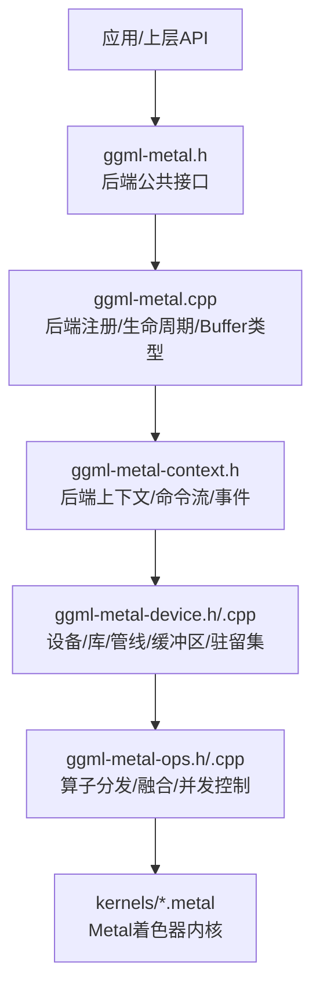
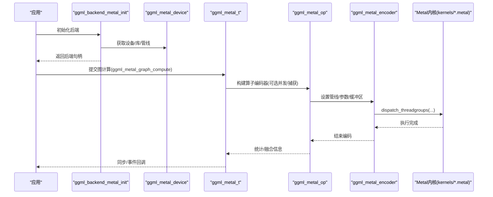
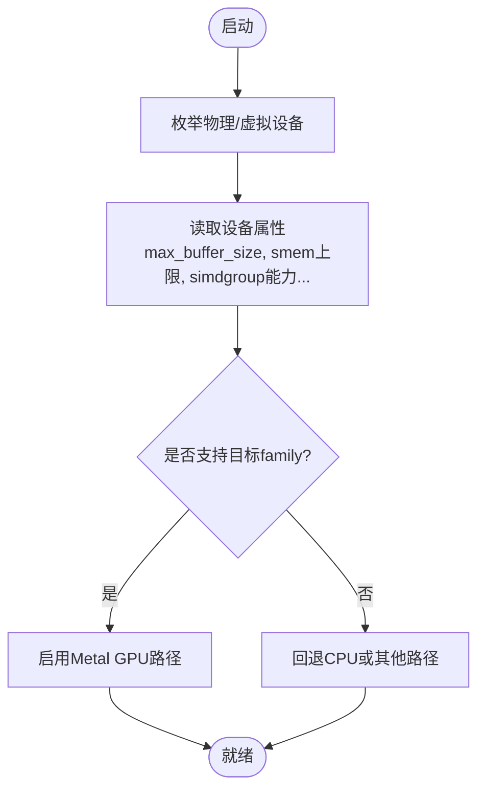
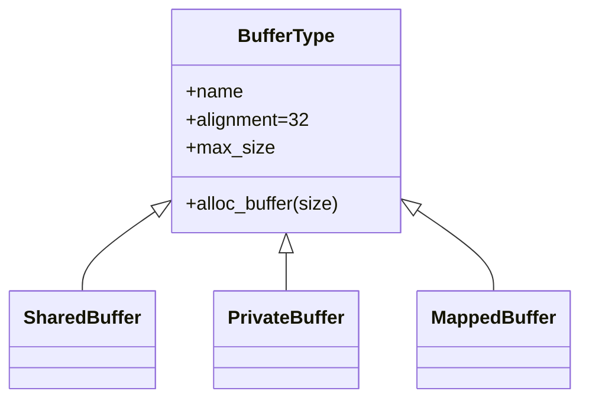
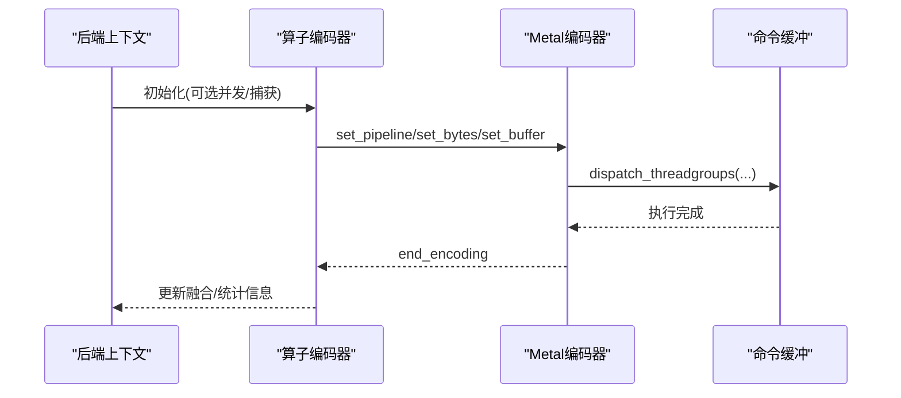
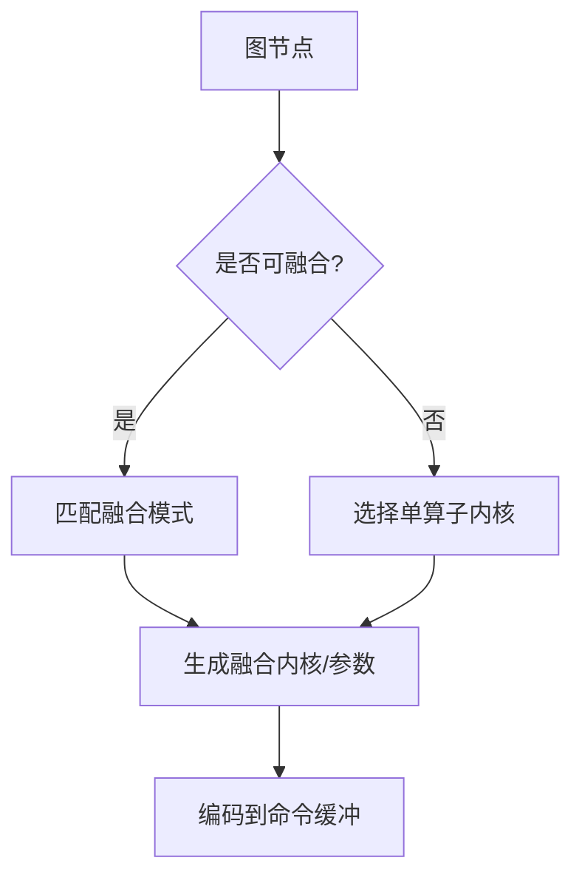
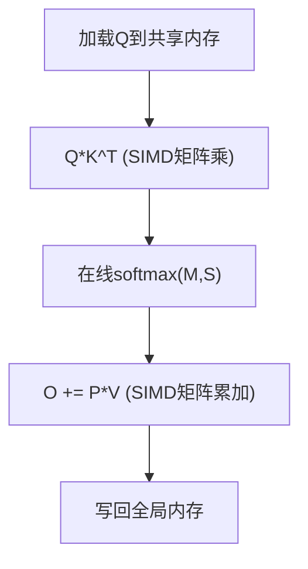
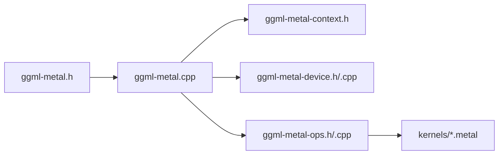

# Metal后端

<cite>
**本文引用的文件**   
- [ggml-metal.h](file://ggml/include/ggml-metal.h)
- [ggml-metal.cpp](file://ggml/src/ggml-metal/ggml-metal.cpp)
- [ggml-metal-device.h](file://ggml/src/ggml-metal/ggml-metal-device.h)
- [ggml-metal-device.cpp](file://ggml/src/ggml-metal/ggml-metal-device.cpp)
- [ggml-metal-context.h](file://ggml/src/ggml-metal/ggml-metal-context.h)
- [ggml-metal-ops.h](file://ggml/src/ggml-metal/ggml-metal-ops.h)
- [ggml-metal-ops.cpp](file://ggml/src/ggml-metal/ggml-metal-ops.cpp)
- [fa_common.metal](file://ggml/src/ggml-metal/kernels/fa_common.metal)
</cite>

## 目录
1. [简介](#简介)
2. [项目结构](#项目结构)
3. [核心组件](#核心组件)
4. [架构总览](#架构总览)
5. [详细组件分析](#详细组件分析)
6. [依赖关系分析](#依赖关系分析)
7. [性能与优化](#性能与优化)
8. [调试与性能分析指南](#调试与性能分析指南)
9. [平台适配与部署注意事项](#平台适配与部署注意事项)
10. [结论](#结论)

## 简介
本文件系统性梳理 llama.cpp 的 Metal 后端，聚焦 iOS/macOS 平台适配、Metal 图形 API 集成、Metal 着色器实现与优化策略（并行计算与内存访问模式）、设备发现与资源管理、命令队列处理，以及不同 Apple 芯片（M1/M2/Pro/Max/Ultra）的性能特性与优化技巧。同时提供调试工具使用方法和性能分析指南，并总结移动与桌面平台的部署注意事项与兼容性要求。

## 项目结构
Metal 后端位于 ggml 子模块中，围绕“设备抽象—库/管线管理—算子编码—Metal 内核”分层组织：
- 公共接口层：对外暴露 Metal 后端 API（初始化、设备能力查询、捕获等）。
- 后端上下文层：封装 Metal 命令缓冲、编码器、事件、同步等运行时状态。
- 设备与资源层：负责设备枚举、属性探测、缓冲区分配、内存映射、驻留集管理等。
- 算子与融合层：将图节点映射到具体 Metal 内核，支持算子融合与并发调度。
- 内核层：Metal 着色器实现，覆盖注意力、归一化、卷积、量化、SSM/RWKV 等关键路径。

**图表来源**
- [ggml-metal.h:1-62](file://ggml/include/ggml-metal.h#L1-L62)
- [ggml-metal.cpp:15-20](file://ggml/src/ggml-metal/ggml-metal.cpp#L15-L20)
- [ggml-metal-context.h:9-38](file://ggml/src/ggml-metal/ggml-metal-context.h#L9-L38)
- [ggml-metal-device.h:257-340](file://ggml/src/ggml-metal/ggml-metal-device.h#L257-L340)
- [ggml-metal-ops.h:30-106](file://ggml/src/ggml-metal/ggml-metal-ops.h#L30-L106)

**章节来源**
- [ggml-metal.h:1-62](file://ggml/include/ggml-metal.h#L1-L62)
- [ggml-metal.cpp:15-20](file://ggml/src/ggml-metal/ggml-metal.cpp#L15-L20)

## 核心组件
- 后端公共接口：提供初始化、设备能力检测、命令捕获等入口。
- 后端上下文：封装命令缓冲、编码器、事件、回调、并发线程组数等。
- 设备抽象：封装 MTLDevice/MTLCommandQueue、库与管线缓存、驻留集、内存查询、算子支持判断。
- 算子编排：按图节点选择合适内核，支持融合、并发、内存屏障与调试统计。
- Metal 内核：面向注意力、矩阵乘、归一化、卷积、SSM/RWKV 等的高性能实现。

**章节来源**
- [ggml-metal.h:42-57](file://ggml/include/ggml-metal.h#L42-L57)
- [ggml-metal-context.h:13-38](file://ggml/src/ggml-metal/ggml-metal-context.h#L13-L38)
- [ggml-metal-device.h:257-340](file://ggml/src/ggml-metal/ggml-metal-device.h#L257-L340)
- [ggml-metal-ops.h:30-106](file://ggml/src/ggml-metal/ggml-metal-ops.h#L30-L106)

## 架构总览
Metal 后端通过 ggml 后端框架接入，统一以“设备—后端—上下文—命令流—内核”的方式工作。下图展示从高层调用到 Metal 内核执行的典型流程。

**图表来源**
- [ggml-metal.cpp:614-636](file://ggml/src/ggml-metal/ggml-metal.cpp#L614-L636)
- [ggml-metal-context.h:22-38](file://ggml/src/ggml-metal/ggml-metal-context.h#L22-L38)
- [ggml-metal-ops.cpp:127-149](file://ggml/src/ggml-metal/ggml-metal-ops.cpp#L127-L149)
- [ggml-metal-device.h:73-92](file://ggml/src/ggml-metal/ggml-metal-device.h#L73-L92)

## 详细组件分析

### 设备发现与属性探测
- 设备枚举与虚拟设备：支持通过环境变量模拟多设备，便于测试与基准。
- 设备属性：包含最大缓冲区大小、工作组共享内存上限、SIMD 归约/MM 能力、统一内存、BFloat16、Tensor Core、驻留集开关、共享缓冲偏好、最小 offload batch size 等。
- 设备能力查询：提供 family 能力检查，用于在运行时选择合适内核或降级路径。

**图表来源**
- [ggml-metal.cpp:15-20](file://ggml/src/ggml-metal/ggml-metal.cpp#L15-L20)
- [ggml-metal-device.h:288-311](file://ggml/src/ggml-metal/ggml-metal-device.h#L288-L311)
- [ggml-metal.h:49-52](file://ggml/include/ggml-metal.h#L49-L52)

**章节来源**
- [ggml-metal.cpp:15-20](file://ggml/src/ggml-metal/ggml-metal.cpp#L15-L20)
- [ggml-metal-device.h:288-311](file://ggml/src/ggml-metal/ggml-metal-device.h#L288-L311)
- [ggml-metal.h:49-52](file://ggml/include/ggml-metal.h#L49-L52)

### 资源管理与缓冲区模型
- 三种 Buffer 类型：Shared（共享内存）、Private（私有内存）、Mapped（映射内存），分别对应不同的宿主/GPU 内存语义与对齐要求。
- 对齐与容量：默认对齐为 32 字节；部分操作需要额外临时空间（如 Flash Attention、MUL_MAT_ID、ARGSORT/TOP_K/CUMSUM 等）。
- 内存映射：支持将宿主指针映射为 Metal 缓冲区，减少拷贝开销。
- 驻留集：通过 Residency Set 管理 GPU 常驻对象，降低频繁创建销毁成本。

**图表来源**
- [ggml-metal.cpp:190-218](file://ggml/src/ggml-metal/ggml-metal.cpp#L190-L218)
- [ggml-metal.cpp:257-333](file://ggml/src/ggml-metal/ggml-metal.cpp#L257-L333)
- [ggml-metal.cpp:335-410](file://ggml/src/ggml-metal/ggml-metal.cpp#L335-L410)
- [ggml-metal.cpp:412-490](file://ggml/src/ggml-metal/ggml-metal.cpp#L412-L490)
- [ggml-metal-device.h:351-370](file://ggml/src/ggml-metal/ggml-metal-device.h#L351-L370)

**章节来源**
- [ggml-metal.cpp:190-218](file://ggml/src/ggml-metal/ggml-metal.cpp#L190-L218)
- [ggml-metal.cpp:257-333](file://ggml/src/ggml-metal/ggml-metal.cpp#L257-L333)
- [ggml-metal.cpp:335-410](file://ggml/src/ggml-metal/ggml-metal.cpp#L335-L410)
- [ggml-metal.cpp:412-490](file://ggml/src/ggml-metal/ggml-metal.cpp#L412-L490)
- [ggml-metal-device.h:351-370](file://ggml/src/ggml-metal/ggml-metal-device.h#L351-L370)

### 命令队列与执行模型
- 命令缓冲与编码器：每个算子块通过编码器设置管线、常量、缓冲区、共享内存大小，并 dispatch 线程组。
- 并发与内存屏障：支持并发编码多个算子，并通过内存屏障与内存范围检查避免数据竞争。
- 事件与回调：支持记录/等待事件，以及异步回调（abort callback）机制。
- 捕获：支持捕获下一次 compute 以便 Instruments/Xcode 分析。

**图表来源**
- [ggml-metal-device.h:67-92](file://ggml/src/ggml-metal/ggml-metal-device.h#L67-L92)
- [ggml-metal-ops.cpp:159-185](file://ggml/src/ggml-metal/ggml-metal-ops.cpp#L159-L185)
- [ggml-metal-context.h:22-38](file://ggml/src/ggml-metal/ggml-metal-context.h#L22-L38)

**章节来源**
- [ggml-metal-device.h:67-92](file://ggml/src/ggml-metal/ggml-metal-device.h#L67-L92)
- [ggml-metal-ops.cpp:159-185](file://ggml/src/ggml-metal/ggml-metal-ops.cpp#L159-L185)
- [ggml-metal-context.h:22-38](file://ggml/src/ggml-metal/ggml-metal-context.h#L22-L38)

### 算子分发与融合
- 算子映射：大量算子（UNARY、SOFTMAX、NORM、ROPE、CONV、POOL、TOPK、ARGSORT、FLASH_ATTN_EXT、SSM/RWKV 等）均有对应的 Metal 内核。
- 融合：基于模式匹配进行算子融合，减少内核启动与中间内存读写，提升吞吐。
- 并发：对独立子图可并发编码，配合内存屏障确保正确性。
- 调试：融合统计、内存范围跟踪、图可视化辅助。

**图表来源**
- [ggml-metal-ops.h:30-106](file://ggml/src/ggml-metal/ggml-metal-ops.h#L30-L106)
- [ggml-metal-ops.cpp:84-102](file://ggml/src/ggml-metal/ggml-metal-ops.cpp#L84-L102)

**章节来源**
- [ggml-metal-ops.h:30-106](file://ggml/src/ggml-metal/ggml-metal-ops.h#L30-L106)
- [ggml-metal-ops.cpp:84-102](file://ggml/src/ggml-metal/ggml-metal-ops.cpp#L84-L102)

### Metal 内核与优化策略（以 Flash Attention 为例）
- 模板与函数常量：通过模板参数与 function_constant 编译期裁剪分支，减少运行时分派开销。
- SIMD 矩阵加速：使用 simdgroup_load/multiply_accumulate/simdgroup_store 高效利用硬件矩阵单元。
- 共享内存布局：Q/K/V/O/Softmax 中间结果在 threadgroup 共享内存中复用，减少全局访存。
- 掩码与偏置：支持 ALiBi、mask、logit softcap、sinks 等高级特性，兼顾灵活性与性能。
- 分块与流水线：KV 分块迭代，在线 softmax 稳定数值，结合 block mask 跳过无效区域。

**图表来源**
- [fa_common.metal:17-46](file://ggml/src/ggml-metal/kernels/fa_common.metal#L17-L46)
- [fa_common.metal:138-166](file://ggml/src/ggml-metal/kernels/fa_common.metal#L138-L166)
- [fa_common.metal:287-407](file://ggml/src/ggml-metal/kernels/fa_common.metal#L287-L407)
- [fa_common.metal:411-456](file://ggml/src/ggml-metal/kernels/fa_common.metal#L411-L456)
- [fa_common.metal:458-603](file://ggml/src/ggml-metal/kernels/fa_common.metal#L458-L603)
- [fa_common.metal:629-651](file://ggml/src/ggml-metal/kernels/fa_common.metal#L629-L651)

**章节来源**
- [fa_common.metal:17-46](file://ggml/src/ggml-metal/kernels/fa_common.metal#L17-L46)
- [fa_common.metal:138-166](file://ggml/src/ggml-metal/kernels/fa_common.metal#L138-L166)
- [fa_common.metal:287-407](file://ggml/src/ggml-metal/kernels/fa_common.metal#L287-L407)
- [fa_common.metal:411-456](file://ggml/src/ggml-metal/kernels/fa_common.metal#L411-L456)
- [fa_common.metal:458-603](file://ggml/src/ggml-metal/kernels/fa_common.metal#L458-L603)
- [fa_common.metal:629-651](file://ggml/src/ggml-metal/kernels/fa_common.metal#L629-L651)

## 依赖关系分析
- 后端接口依赖设备抽象与上下文：后端初始化时绑定设备，上下文持有命令流与事件。
- 算子层依赖库/管线管理器：根据算子与数据类型动态查找或编译管线。
- 内核层依赖设备属性：例如是否支持 simdgroup MM、Tensor Core、BFloat16 等。

**图表来源**
- [ggml-metal.h:1-62](file://ggml/include/ggml-metal.h#L1-L62)
- [ggml-metal.cpp:1-10](file://ggml/src/ggml-metal/ggml-metal.cpp#L1-L10)
- [ggml-metal-ops.h:1-10](file://ggml/src/ggml-metal/ggml-metal-ops.h#L1-L10)

**章节来源**
- [ggml-metal.h:1-62](file://ggml/include/ggml-metal.h#L1-L62)
- [ggml-metal.cpp:1-10](file://ggml/src/ggml-metal/ggml-metal.cpp#L1-L10)
- [ggml-metal-ops.h:1-10](file://ggml/src/ggml-metal/ggml-metal-ops.h#L1-L10)

## 性能与优化
- 设备能力自适应：依据 gpu_family、simdgroup_mm、tensor、bfloat 等能力选择最优内核与参数。
- 共享内存与向量化：充分利用 threadgroup 共享内存与 SIMD 矩阵指令，减少全局访存与寄存器压力。
- 算子融合：合并相邻小算子，减少内核启动与中间写入，提高带宽利用率。
- 并发与批处理：合理设置 n_cb（并发编码器数量），平衡延迟与吞吐；对大 batch 的 MUL_MAT/MUL_MAT_ID 优先 offload。
- 内存对齐与对齐填充：Metal 内核要求某些矩阵类型对齐，必要时进行 padding。

实践建议：
- 针对大模型推理，优先开启 Fusion 与并发编码，并根据设备属性调整线程组规模与共享内存大小。
- 对 Flash Attention，尽量保证 head 维度与 batch 维度的对齐，以触发 SIMD 矩阵加速分支。
- 使用 Shared/Mapped Buffer 减少 CPU-GPU 拷贝，尤其在交互式生成场景。

**章节来源**
- [ggml-metal-device.h:288-311](file://ggml/src/ggml-metal/ggml-metal-device.h#L288-L311)
- [ggml-metal-ops.cpp:18-20](file://ggml/src/ggml-metal/ggml-metal-ops.cpp#L18-L20)
- [ggml-metal-ops.cpp:2725-2726](file://ggml/src/ggml-metal/ggml-metal-ops.cpp#L2725-L2726)
- [ggml-metal-ops.cpp:2854-2855](file://ggml/src/ggml-metal/ggml-metal-ops.cpp#L2854-L2855)
- [ggml-metal-ops.cpp:5134](file://ggml/src/ggml-metal/ggml-metal-ops.cpp#L5134)
- [ggml-metal-ops.cpp:5486](file://ggml/src/ggml-metal/ggml-metal-ops.cpp#L5486)

## 调试与性能分析指南
- 捕获命令缓冲：调用 capture_next_compute 后，下一次图计算将被捕获，可在 Xcode Instruments 中查看 Metal 内核执行时序、内存带宽与占用。
- 事件与回调：使用 event_record/event_wait 精确测量阶段耗时；通过 abort_callback 快速中断长任务。
- 融合调试：通过设备级 fusion_info 统计融合命中情况，定位未融合瓶颈。
- 日志与断言：合理使用 GGML_LOG_ERROR/GGML_ASSERT 输出错误与断言失败位置，便于定位问题。

操作步骤（概念性）：
1. 初始化后端后，调用捕获接口。
2. 执行一次推理/评估。
3. 打开 Xcode Instruments，选择 Metal System Trace，查看内核时间线、内存带宽、共享内存占用。
4. 结合融合统计与日志，定位热点算子与未融合路径。

**章节来源**
- [ggml-metal.h:54-55](file://ggml/include/ggml-metal.h#L54-L55)
- [ggml-metal-context.h:29-38](file://ggml/src/ggml-metal/ggml-metal-context.h#L29-L38)
- [ggml-metal-device.h:342-345](file://ggml/src/ggml-metal/ggml-metal-device.h#L342-L345)

## 平台适配与部署注意事项
- 平台与编译器：iOS/macOS 需使用 Apple Clang 与 Metal SDK；CMake 配置中已包含 arm64-apple-clang 相关脚本。
- 设备族与功能集：不同 Apple 芯片（M1/M2/Pro/Max/Ultra 及后续 M3/M4/M5/A18 Pro）具备不同 GPU 能力，应通过 supports_family 与设备属性探测选择合适内核。
- 内存模型：统一内存（Unified Memory）在 Mac 上表现良好；在 iOS 上注意内存峰值与后台限制，建议使用 Shared/Mapped Buffer 减少拷贝。
- 版本兼容：Metal 内核使用较新的 SIMD 矩阵指令与 function_constant，需确保系统版本满足最低要求。
- 构建产物：可使用 xcframework 打包供 Swift/Objective-C 工程集成；示例工程中提供了 Swift UI 与 Android/iOS 示例参考。

兼容性要点：
- 若设备不支持 Tensor Core 或 simdgroup MM，自动回退到通用路径。
- 对于不支持 BFloat16 的设备，禁用相关优化分支。
- 移动端需关注热节流与功耗，适当降低并发与批大小。

**章节来源**
- [ggml-metal-device.h:288-311](file://ggml/src/ggml-metal/ggml-metal-device.h#L288-L311)
- [ggml-metal.h:49-52](file://ggml/include/ggml-metal.h#L49-L52)
- [ggml-metal.cpp:257-333](file://ggml/src/ggml-metal/ggml-metal.cpp#L257-L333)

## 结论
llama.cpp 的 Metal 后端通过清晰的设备抽象、灵活的管线管理、丰富的算子实现与高效的 Metal 内核，为 Apple 平台提供了高性能的 GPU 推理能力。其设计强调设备能力自适应、共享内存与 SIMD 矩阵加速、算子融合与并发编码，能够在不同 Apple 芯片上取得稳定且优异的性能。借助捕获与事件机制，开发者可以方便地进行调试与性能分析。在部署层面，建议根据平台特性选择合适的内存模型与并发策略，并确保系统版本与 Metal SDK 的兼容性。