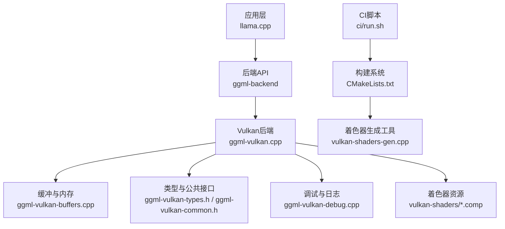
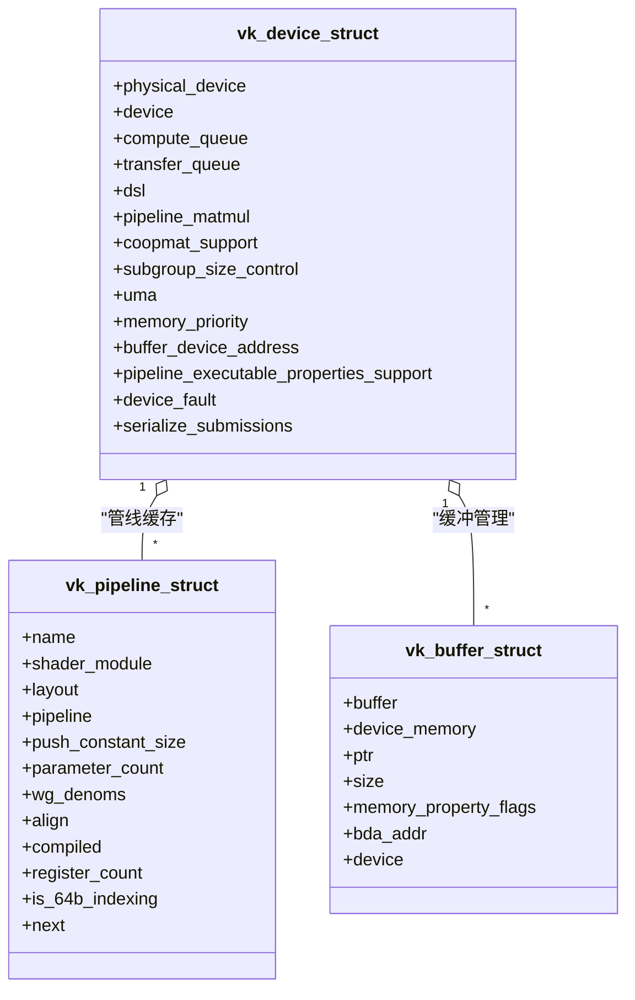
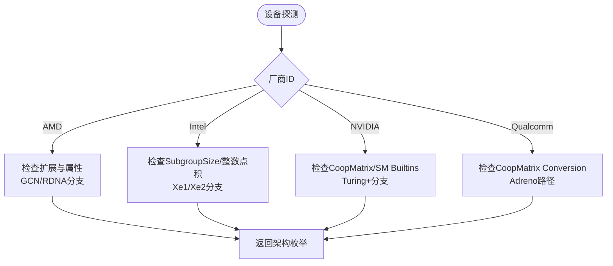
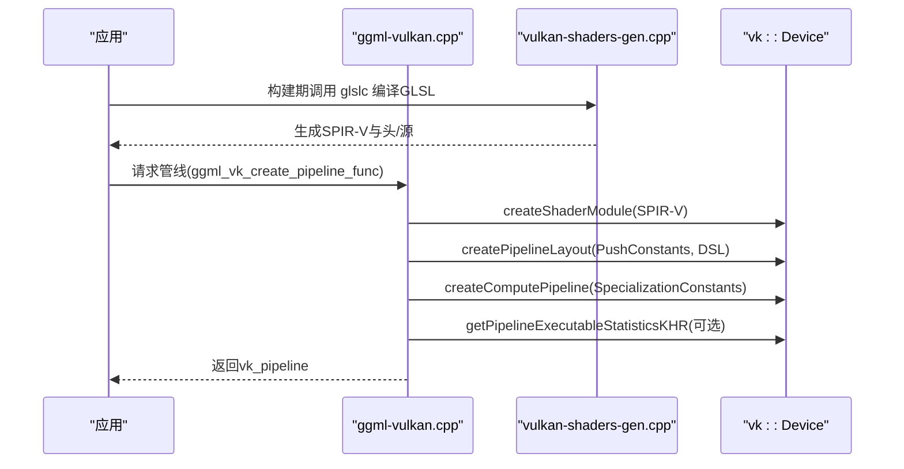
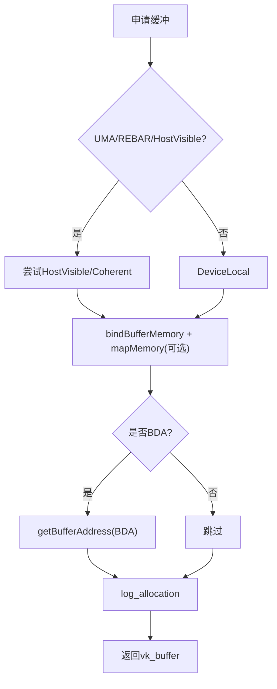
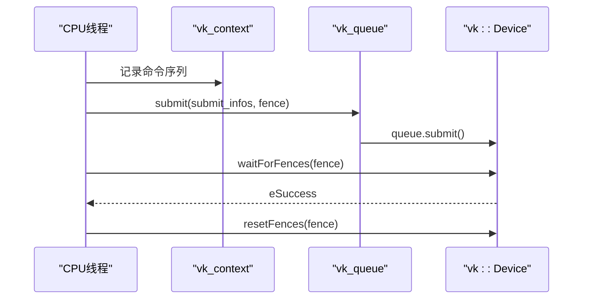
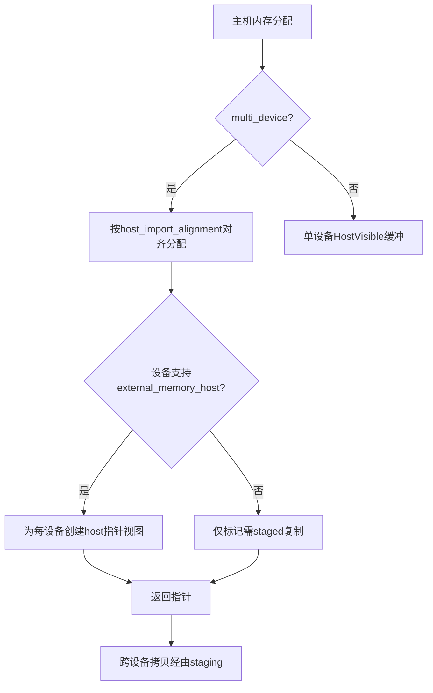
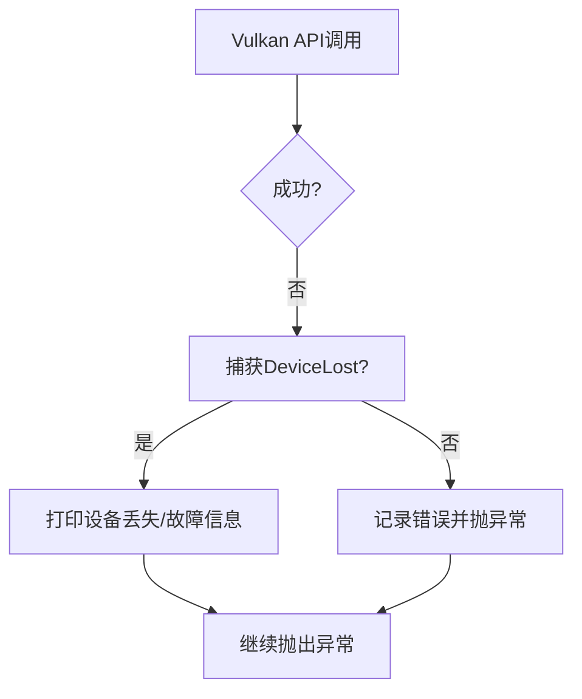

# Vulkan后端

<cite>
**本文引用的文件**   
- [ggml-vulkan.h](file://ggml/include/ggml-vulkan.h)
- [ggml-vulkan.cpp](file://ggml/src/ggml-vulkan/ggml-vulkan.cpp)
- [ggml-vulkan-buffers.cpp](file://ggml/src/ggml-vulkan/ggml-vulkan-buffers.cpp)
- [ggml-vulkan-common.h](file://ggml/src/ggml-vulkan/ggml-vulkan-common.h)
- [ggml-vulkan-types.h](file://ggml/src/ggml-vulkan/ggml-vulkan-types.h)
- [ggml-vulkan-debug.cpp](file://ggml/src/ggml-vulkan/ggml-vulkan-debug.cpp)
- [CMakeLists.txt](file://ggml/src/ggml-vulkan/CMakeLists.txt)
- [vulkan-shaders-gen.cpp](file://ggml/src/ggml-vulkan/vulkan-shaders/vulkan-shaders-gen.cpp)
- [run.sh](file://ci/run.sh)
</cite>

## 目录
1. [简介](#简介)
2. [项目结构](#项目结构)
3. [核心组件](#核心组件)
4. [架构总览](#架构总览)
5. [详细组件分析](#详细组件分析)
6. [依赖关系分析](#依赖关系分析)
7. [性能与优化](#性能与优化)
8. [故障排查与调试](#故障排查与调试)
9. [结论](#结论)
10. [附录](#附录)

## 简介
本文件面向llama.cpp的Vulkan后端，系统性阐述其跨平台兼容性与底层硬件抽象机制，覆盖GPU管线构建、着色器编译、内存与缓冲区管理、同步机制、多GPU支持、厂商驱动特性与优化策略，以及配置、监控与调试方法。目标是帮助开发者快速理解并高效使用/扩展该后端。

## 项目结构
Vulkan后端位于ggml子模块中，主要包含：
- 公共接口与类型定义：ggml-vulkan.h、ggml-vulkan-types.h、ggml-vulkan-common.h
- 核心实现：ggml-vulkan.cpp（设备探测、管线创建、调度、统计等）
- 缓冲与内存：ggml-vulkan-buffers.cpp（分配、映射、拷贝、读写的统一封装）
- 调试与日志：ggml-vulkan-debug.cpp（内存/性能/同步日志开关与记录）
- 构建与着色器生成：CMakeLists.txt、vulkan-shaders-gen.cpp
- CI集成：ci/run.sh（启用GGML_VULKAN构建选项）

图示来源
- [ggml-vulkan.cpp:1-800](file://ggml/src/ggml-vulkan/ggml-vulkan.cpp#L1-L800)
- [ggml-vulkan-buffers.cpp:1-200](file://ggml/src/ggml-vulkan/ggml-vulkan-buffers.cpp#L1-L200)
- [ggml-vulkan-common.h:1-120](file://ggml/src/ggml-vulkan/ggml-vulkan-common.h#L1-L120)
- [ggml-vulkan-types.h:1-120](file://ggml/src/ggml-vulkan/ggml-vulkan-types.h#L1-L120)
- [CMakeLists.txt:215-264](file://ggml/src/ggml-vulkan/CMakeLists.txt#L215-L264)
- [vulkan-shaders-gen.cpp:1385-1442](file://ggml/src/ggml-vulkan/vulkan-shaders/vulkan-shaders-gen.cpp#L1385-L1442)
- [run.sh:117-133](file://ci/run.sh#L117-L133)

章节来源
- [ggml-vulkan.h:10-25](file://ggml/include/ggml-vulkan.h#L10-L25)
- [ggml-vulkan.cpp:1-120](file://ggml/src/ggml-vulkan/ggml-vulkan.cpp#L1-L120)
- [ggml-vulkan-buffers.cpp:25-50](file://ggml/src/ggml-vulkan/ggml-vulkan-buffers.cpp#L25-L50)
- [ggml-vulkan-common.h:8-34](file://ggml/src/ggml-vulkan/ggml-vulkan-common.h#L8-L34)
- [ggml-vulkan-types.h:175-220](file://ggml/src/ggml-vulkan/ggml-vulkan-types.h#L175-L220)
- [CMakeLists.txt:215-264](file://ggml/src/ggml-vulkan/CMakeLists.txt#L215-L264)
- [vulkan-shaders-gen.cpp:1395-1442](file://ggml/src/ggml-vulkan/vulkan-shaders/vulkan-shaders-gen.cpp#L1395-L1442)
- [run.sh:117-133](file://ci/run.sh#L117-L133)

## 核心组件
- 后端API与注册：提供初始化、设备枚举、描述与显存查询、BufferType与Host BufferType、后端注册入口。
- 设备与架构探测：按厂商（AMD/Intel/NVIDIA/Qualcomm）识别能力集，选择最优代码路径（如Cooperative Matrix、Subgroup Size Control、Float8等）。
- 管线与着色器：GLSL -> SPIR-V -> ShaderModule -> ComputePipeline；支持Specialization Constants、Push Constants、Descriptor Sets复用。
- 缓冲与内存：统一分配策略（DeviceLocal/HostVisible/UMA/REBAR）、外部内存导入、Staging缓冲、异步读写与拷贝。
- 同步与提交：Fence/Event/Timeline Semaphore、队列族选择、内部同步队列优化、NVIDIA并发提交规避。
- 调试与监控：内存日志、性能日志、管线统计过滤、设备丢失/故障信息打印。

章节来源
- [ggml-vulkan.h:10-25](file://ggml/include/ggml-vulkan.h#L10-L25)
- [ggml-vulkan.cpp:3-144](file://ggml/src/ggml-vulkan/ggml-vulkan.cpp#L3-L144)
- [ggml-vulkan.cpp:572-832](file://ggml/src/ggml-vulkan/ggml-vulkan.cpp#L572-L832)
- [ggml-vulkan-buffers.cpp:50-205](file://ggml/src/ggml-vulkan/ggml-vulkan-buffers.cpp#L50-L205)
- [ggml-vulkan.cpp:902-977](file://ggml/src/ggml-vulkan/ggml-vulkan.cpp#L902-L977)
- [ggml-vulkan-debug.cpp:1-47](file://ggml/src/ggml-vulkan/ggml-vulkan-debug.cpp#L1-L47)

## 架构总览
Vulkan后端通过ggml-backend接口暴露给上层模型推理框架，内部以vk_device为抽象单元，封装物理设备、队列族、命令池、管线缓存、描述符池、内存分配策略与调试设施。

图示来源
- [ggml-vulkan-types.h:224-253](file://ggml/src/ggml-vulkan/ggml-vulkan-types.h#L224-L253)
- [ggml-vulkan-types.h:659-760](file://ggml/src/ggml-vulkan/ggml-vulkan-types.h#L659-L760)
- [ggml-vulkan-types.h:291-295](file://ggml/src/ggml-vulkan/ggml-vulkan-types.h#L291-L295)

## 详细组件分析

### 设备探测与厂商优化
- AMD：检测VK_AMD_shader_core_properties、VK_KHR_shader_integer_dot_product、VK_EXT_subgroup_size_control、VK_EXT_shader_float8，区分GCN/RDNA代际，调整工作组大小与共享内存占用。
- Intel：基于最小Subgroup Size区分Xe1/Xe2，结合整数点积能力选择路径。
- NVIDIA：通过VK_KHR_cooperative_matrix与VK_NV_shader_sm_builtins判断Turing及之后架构，必要时回退标量路径。
- Qualcomm：检测VK_QCOM_cooperative_matrix_conversion以启用Adreno优化路径。

图示来源
- [ggml-vulkan.cpp:3-144](file://ggml/src/ggml-vulkan/ggml-vulkan.cpp#L3-L144)
- [ggml-vulkan-types.h:366-378](file://ggml/src/ggml-vulkan/ggml-vulkan-types.h#L366-L378)

章节来源
- [ggml-vulkan.cpp:3-144](file://ggml/src/ggml-vulkan/ggml-vulkan.cpp#L3-L144)

### 管线构建与着色器编译
- GLSL着色器在构建期由glslc编译为SPIR-V，并通过vulkan-shaders-gen生成头与源文件嵌入二进制数据。
- 运行时创建ShaderModule，必要时对SPIR-V进行补丁（如FP16控制、DecodeVector剥离、特定驱动循环展开控制）。
- 创建PipelineLayout与ComputePipeline，设置SpecializationConstants、PushConstants、DescriptorSets。
- 可选开启PipelineExecutableStatistics用于寄存器计数等统计。

图示来源
- [CMakeLists.txt:215-264](file://ggml/src/ggml-vulkan/CMakeLists.txt#L215-L264)
- [vulkan-shaders-gen.cpp:1395-1442](file://ggml/src/ggml-vulkan/vulkan-shaders/vulkan-shaders-gen.cpp#L1395-L1442)
- [ggml-vulkan.cpp:572-832](file://ggml/src/ggml-vulkan/ggml-vulkan.cpp#L572-L832)

章节来源
- [ggml-vulkan.cpp:572-832](file://ggml/src/ggml-vulkan/ggml-vulkan.cpp#L572-L832)
- [CMakeLists.txt:215-264](file://ggml/src/ggml-vulkan/CMakeLists.txt#L215-L264)
- [vulkan-shaders-gen.cpp:1395-1442](file://ggml/src/ggml-vulkan/vulkan-shaders/vulkan-shaders-gen.cpp#L1395-L1442)

### GPU资源管理与缓冲区
- 分配策略：优先DeviceLocal，若UMA或REBAR可用则尝试HostVisible/HostCoherent以提升直接借用效率；支持external memory host导入。
- 对齐与偏移：根据minStorageBufferOffsetAlignment计算descriptor_offset与misalign bytes，确保地址对齐。
- 异步IO：pinned内存直接作为staging；否则使用sync staging buffer，deferred_memcpy/memset在submit后回填。
- 拷贝与memset：单设备内直接copyBuffer；跨设备经staging中转。

图示来源
- [ggml-vulkan-buffers.cpp:50-205](file://ggml/src/ggml-vulkan/ggml-vulkan-buffers.cpp#L50-L205)
- [ggml-vulkan.cpp:267-295](file://ggml/src/ggml-vulkan/ggml-vulkan.cpp#L267-L295)

章节来源
- [ggml-vulkan-buffers.cpp:50-205](file://ggml/src/ggml-vulkan/ggml-vulkan-buffers.cpp#L50-L205)
- [ggml-vulkan-buffers.cpp:217-254](file://ggml/src/ggml-vulkan/ggml-vulkan-buffers.cpp#L217-L254)
- [ggml-vulkan-buffers.cpp:279-351](file://ggml/src/ggml-vulkan/ggml-vulkan-buffers.cpp#L279-L351)
- [ggml-vulkan-buffers.cpp:389-407](file://ggml/src/ggml-vulkan/ggml-vulkan-buffers.cpp#L389-L407)
- [ggml-vulkan-buffers.cpp:409-577](file://ggml/src/ggml-vulkan/ggml-vulkan-buffers.cpp#L409-L577)
- [ggml-vulkan-buffers.cpp:579-619](file://ggml/src/ggml-vulkan/ggml-vulkan-buffers.cpp#L579-L619)
- [ggml-vulkan-buffers.cpp:621-759](file://ggml/src/ggml-vulkan/ggml-vulkan-buffers.cpp#L621-L759)
- [ggml-vulkan-buffers.cpp:761-794](file://ggml/src/ggml-vulkan/ggml-vulkan-buffers.cpp#L761-L794)

### 同步机制与提交
- Fence等待：vk_wait_for_fence轮询+yield，避免忙等；处理DeviceLost异常。
- 队列族选择：优先满足compute/transfer需求，避免冲突；必要时复用compute队列。
- 内部同步队列：当设备支持VK_KHR_internally_synchronized_queues时，减少锁开销；NVIDIA驱动bug规避并发提交。
- Timeline Semaphores：批量组装SubmitInfo，提升吞吐。

图示来源
- [ggml-vulkan.cpp:339-379](file://ggml/src/ggml-vulkan/ggml-vulkan.cpp#L339-L379)
- [ggml-vulkan.cpp:979-1057](file://ggml/src/ggml-vulkan/ggml-vulkan.cpp#L979-L1057)
- [ggml-vulkan.cpp:902-977](file://ggml/src/ggml-vulkan/ggml-vulkan.cpp#L902-L977)

章节来源
- [ggml-vulkan.cpp:339-379](file://ggml/src/ggml-vulkan/ggml-vulkan.cpp#L339-L379)
- [ggml-vulkan.cpp:979-1057](file://ggml/src/ggml-vulkan/ggml-vulkan.cpp#L979-L1057)
- [ggml-vulkan.cpp:902-977](file://ggml/src/ggml-vulkan/ggml-vulkan.cpp#L902-L977)

### 多GPU支持与负载均衡
- 设备枚举与描述：ggml_backend_vk_get_device_count/get_device_description/get_device_memory。
- Host pinned内存多设备视图：vk_host_malloc在多设备模式下按对齐分配，并为每个设备建立external memory host视图；不支持时降级为staged复制。
- 设备间拷贝：通过staging缓冲中转。

图示来源
- [ggml-vulkan-buffers.cpp:279-351](file://ggml/src/ggml-vulkan/ggml-vulkan-buffers.cpp#L279-L351)
- [ggml-vulkan-buffers.cpp:353-387](file://ggml/src/ggml-vulkan/ggml-vulkan-buffers.cpp#L353-L387)
- [ggml-vulkan-buffers.cpp:761-794](file://ggml/src/ggml-vulkan/ggml-vulkan-buffers.cpp#L761-L794)

章节来源
- [ggml-vulkan-buffers.cpp:279-351](file://ggml/src/ggml-vulkan/ggml-vulkan-buffers.cpp#L279-L351)
- [ggml-vulkan-buffers.cpp:353-387](file://ggml/src/ggml-vulkan/ggml-vulkan-buffers.cpp#L353-L387)
- [ggml-vulkan-buffers.cpp:761-794](file://ggml/src/ggml-vulkan/ggml-vulkan-buffers.cpp#L761-L794)

### 错误处理与异常恢复
- VK_CHECK宏统一捕获DeviceLost并打印设备丢失信息，随后抛出异常。
- 设备故障信息：通过vkGetDeviceFaultInfoEXT收集地址/厂商故障详情。
- 管线/缓冲创建失败：记录错误并抛出vk::SystemError。

图示来源
- [ggml-vulkan-types.h:195-212](file://ggml/src/ggml-vulkan/ggml-vulkan-types.h#L195-L212)
- [ggml-vulkan.cpp:149-198](file://ggml/src/ggml-vulkan/ggml-vulkan.cpp#L149-L198)
- [ggml-vulkan.cpp:248-257](file://ggml/src/ggml-vulkan/ggml-vulkan.cpp#L248-L257)

章节来源
- [ggml-vulkan-types.h:195-212](file://ggml/src/ggml-vulkan/ggml-vulkan-types.h#L195-L212)
- [ggml-vulkan.cpp:149-198](file://ggml/src/ggml-vulkan/ggml-vulkan.cpp#L149-L198)
- [ggml-vulkan.cpp:248-257](file://ggml/src/ggml-vulkan/ggml-vulkan.cpp#L248-L257)

## 依赖关系分析
- 构建依赖：需要Vulkan SDK、glslc、SPIRV-Headers；CMakeLists中通过自定义命令将GLSL编译为SPIR-V并生成头/源。
- 运行时依赖：动态加载Vulkan函数（DispatchLoaderDynamic），按需启用扩展（Cooperative Matrix、Float8、Subgroup Size Control等）。
- 上层依赖：ggml-backend接口与模型图执行流程。

图示来源
- [CMakeLists.txt:215-264](file://ggml/src/ggml-vulkan/CMakeLists.txt#L215-L264)
- [vulkan-shaders-gen.cpp:1395-1442](file://ggml/src/ggml-vulkan/vulkan-shaders/vulkan-shaders-gen.cpp#L1395-L1442)
- [ggml-vulkan.h:10-25](file://ggml/include/ggml-vulkan.h#L10-L25)

章节来源
- [CMakeLists.txt:215-264](file://ggml/src/ggml-vulkan/CMakeLists.txt#L215-L264)
- [ggml-vulkan.h:10-25](file://ggml/include/ggml-vulkan.h#L10-L25)

## 性能与优化
- 管线统计：启用PipelineExecutableStatistics可获取寄存器计数等指标，便于调优。
- 共享内存与Tile选择：针对不同量化类型与形状评估共享内存占用，选择合适warptile与路径（标量/CoopMat1/CoopMat2）。
- Subgroup Size Control：根据设备能力与head size调整workgroup/subgroup大小，避免过度调度导致缓存抖动。
- 队列与提交：内部同步队列减少锁竞争；NVIDIA下串行化提交规避驱动问题。
- UMA与Host可见内存：在UMA设备上优先HostVisible以减少PCIe往返；AMD UMA读取慢时走设备拷贝路径。

章节来源
- [ggml-vulkan.cpp:786-832](file://ggml/src/ggml-vulkan/ggml-vulkan.cpp#L786-L832)
- [ggml-vulkan.cpp:1200-1376](file://ggml/src/ggml-vulkan/ggml-vulkan.cpp#L1200-L1376)
- [ggml-vulkan.cpp:1038-1050](file://ggml/src/ggml-vulkan/ggml-vulkan.cpp#L1038-L1050)
- [ggml-vulkan-buffers.cpp:700-759](file://ggml/src/ggml-vulkan/ggml-vulkan-buffers.cpp#L700-L759)

## 故障排查与调试
- 内存日志：vk_memory_logger_enabled开关，记录分配/释放与总量。
- 性能日志：vk_perf_logger_enabled/vk_perf_logger_frequency控制采样频率；vk_perf_logger_concurrent控制并发采集。
- 同步日志：vk_enable_sync_logger。
- 管线统计过滤：vk_pipeline_stats_filter可按名称筛选输出。
- 设备丢失/故障：打印设备丢失上下文与前一次提交节点列表，辅助定位问题。

章节来源
- [ggml-vulkan-debug.cpp:1-47](file://ggml/src/ggml-vulkan/ggml-vulkan-debug.cpp#L1-L47)
- [ggml-vulkan.cpp:248-257](file://ggml/src/ggml-vulkan/ggml-vulkan.cpp#L248-L257)

## 结论
Vulkan后端在llama.cpp中提供了跨平台、可扩展且高度优化的GPU执行路径。通过精细的设备能力探测、灵活的管线与着色器构建、健壮的内存与同步管理，以及对AMD/Intel/NVIDIA/Qualcomm驱动的针对性优化，能够在多种硬件上获得稳定且高性能的推理体验。配合完善的调试与监控能力，便于在生产环境中定位与优化瓶颈。

## 附录
- 构建与启用：在CI脚本中通过GGML_VULKAN=1启用Vulkan后端构建；macOS下可能需要指定SPIRV-Headers路径。
- 常用API：
  - 初始化与设备查询：ggml_backend_vk_init、ggml_backend_vk_get_device_count、ggml_backend_vk_get_device_description、ggml_backend_vk_get_device_memory
  - BufferType：ggml_backend_vk_buffer_type、ggml_backend_vk_host_buffer_type
  - 后端注册：ggml_backend_vk_reg

章节来源
- [run.sh:117-133](file://ci/run.sh#L117-L133)
- [ggml-vulkan.h:10-25](file://ggml/include/ggml-vulkan.h#L10-L25)