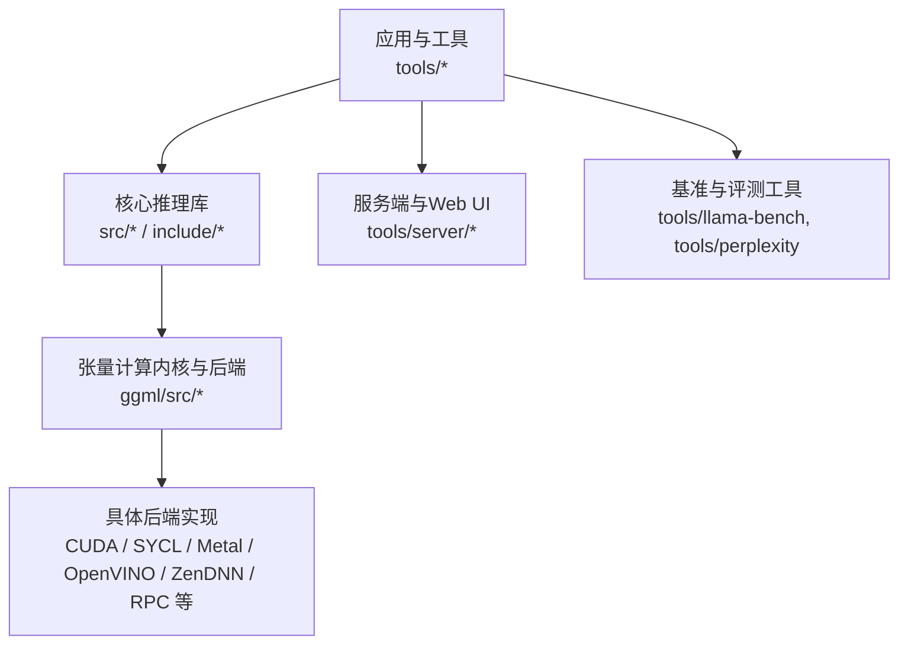
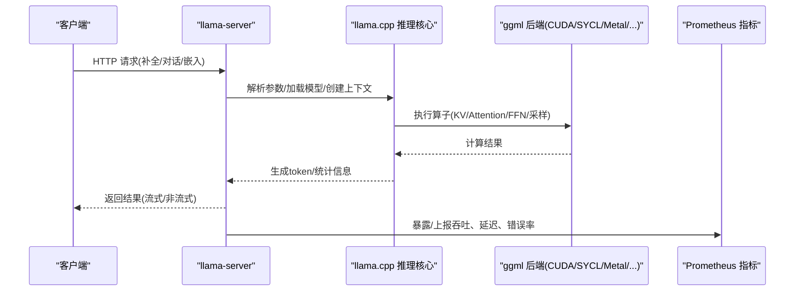
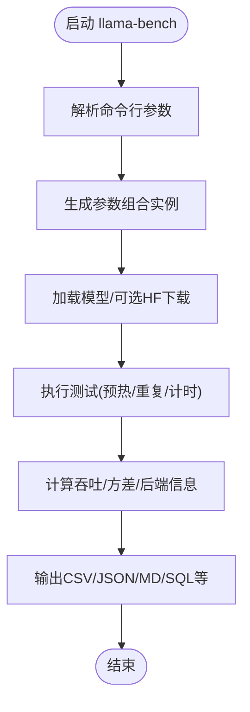
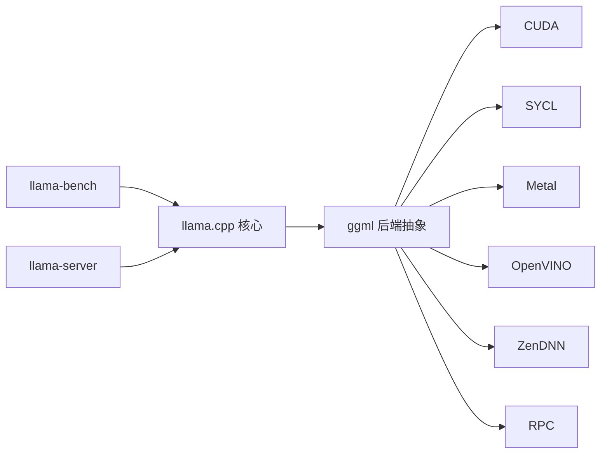
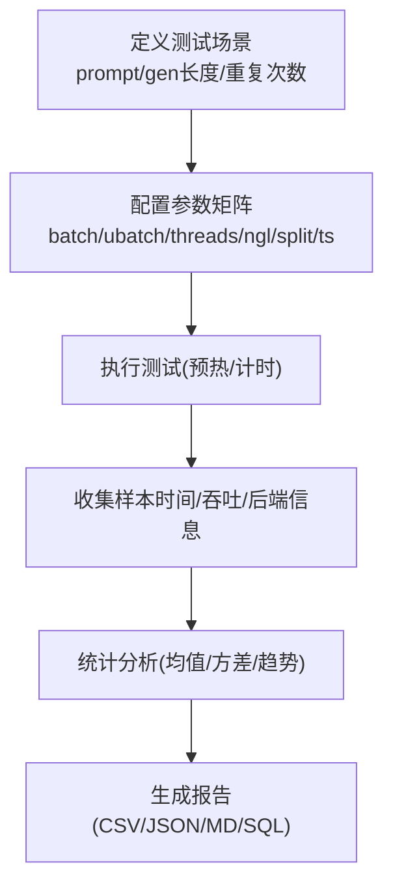
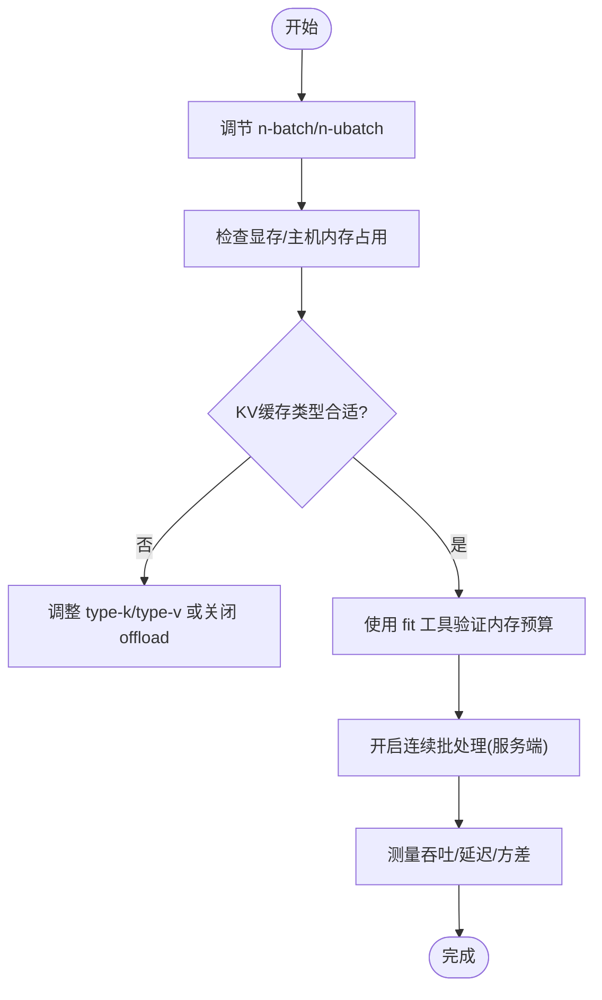

# 后端优化指南

<cite>
**本文引用的文件**   
- [README.md](file://README.md)
- [llama-bench.cpp](file://tools/llama-bench/llama-bench.cpp)
- [server README.md](file://tools/server/README.md)
- [SYCL.md](file://docs/backend/SYCL.md)
- [fit.cpp](file://common/fit.cpp)
- [ggml-common.h](file://ggml/src/ggml-common.h)
</cite>

## 目录
1. [引言](#引言)
2. [项目结构](#项目结构)
3. [核心组件](#核心组件)
4. [架构总览](#架构总览)
5. [详细组件分析](#详细组件分析)
6. [依赖关系分析](#依赖关系分析)
7. [性能考量与基准方法](#性能考量与基准方法)
8. [量化精度与性能的权衡](#量化精度与性能的权衡)
9. [批处理大小与内存使用优化](#批处理大小与内存使用优化)
10. [不同硬件平台的优化实践](#不同硬件平台的优化实践)
11. [生产环境部署与监控](#生产环境部署与监控)
12. [故障诊断与常见问题](#故障诊断与常见问题)
13. [结论](#结论)

## 引言
本指南面向在 llama.cpp 上进行后端优化的工程师与运维人员，聚焦以下目标：
- 建立系统化的后端性能基准测试方法与工具使用流程
- 明确关键性能指标（吞吐量、延迟、内存占用）的定义与测量方式
- 针对不同硬件平台（CPU/GPU/NPU）给出优化最佳实践与参数调优建议
- 分析量化精度与性能的权衡，并给出批处理大小与内存使用的优化策略
- 提供性能瓶颈诊断工具与常见问题解决方案
- 总结生产环境部署的性能调优经验与监控指标设置

## 项目结构
llama.cpp 采用“核心推理 + 多后端实现 + 工具链”的分层组织：
- 核心推理与模型加载位于 src/ 与 ggml/ 子树
- 多后端实现位于 ggml/src 下的各后端目录（CUDA、SYCL、Metal、OpenVINO、ZenDNN、RPC 等）
- 工具链包括 benchmark、server、quantize、perplexity 等
- 文档集中在 docs/，涵盖构建、后端、多模态、开发提示等

图表来源
- [README.md:60-96](file://README.md#L60-L96)
- [server README.md:1-22](file://tools/server/README.md#L1-L22)

章节来源
- [README.md:60-96](file://README.md#L60-L96)

## 核心组件
- 推理核心：负责模型加载、上下文管理、KV缓存、采样与生成循环
- 后端抽象：通过 ggml 后端接口统一调度 CPU/GPU/NPU 等执行单元
- 工具链：
  - llama-bench：端到端基准测试，支持多种参数组合与输出格式
  - llama-server：HTTP API 服务，支持并发、流式响应、Prometheus 指标
  - quantize：权重量化与类型选择
  - perplexity：困惑度评估

章节来源
- [README.md:60-96](file://README.md#L60-L96)
- [server README.md:1-22](file://tools/server/README.md#L1-L22)

## 架构总览
下图展示从请求到推理执行的典型路径，以及后端与工具之间的交互。

图表来源
- [server README.md:1-22](file://tools/server/README.md#L1-L22)
- [server README.md:220-224](file://tools/server/README.md#L220-L224)

## 详细组件分析

### 基准测试工具 llama-bench
- 功能要点
  - 支持多模型、多设备、多参数矩阵扫描（batch/ubatch、threads、gpu-layers、split-mode、load-mode、lazy-mode、tensor-split、override-tensor 等）
  - 支持重复运行、预热控制、NUMA 策略、优先级与轮询级别
  - 输出 CSV/JSON/JSONL/Markdown/SQL 等多种格式，便于自动化对比
- 关键参数类别
  - 模型与HF下载：model/hf-repo/hf-file/hf-token/offline
  - 输入规模：n-prompt/n-gen/n-depth/n-pg
  - 批处理：n-batch/n-ubatch
  - KV缓存类型：type-k/type-v
  - 线程与亲和性：n-threads/cpu-mask/cpu-strict/poll
  - GPU/设备：n-gpu-layers/split-mode/load-mode/lazy-mode/main-gpu/devices/tensor-split/override-tensor/no-op-offload/no-host/repack
  - 其他：flash-attn/embeddings/fit-target/fit-ctx/numa/prio/delay/repetitions/output/output-err
- 指标计算
  - 基于时间戳采样计算平均/标准差，导出每秒吞吐（tokens/s）
  - 自动识别后端（含RPC），记录CPU/GPU信息与模型描述

图表来源
- [llama-bench.cpp:218-494](file://tools/llama-bench/llama-bench.cpp#L218-L494)
- [llama-bench.cpp:525-1208](file://tools/llama-bench/llama-bench.cpp#L525-L1208)
- [llama-bench.cpp:1474-1599](file://tools/llama-bench/llama-bench.cpp#L1474-L1599)

章节来源
- [llama-bench.cpp:218-494](file://tools/llama-bench/llama-bench.cpp#L218-L494)
- [llama-bench.cpp:525-1208](file://tools/llama-bench/llama-bench.cpp#L525-L1208)
- [llama-bench.cpp:1474-1599](file://tools/llama-bench/llama-bench.cpp#L1474-L1599)

### 服务端 llama-server
- 功能要点
  - 兼容 OpenAI/Anthropic 的 REST API
  - 支持并行解码、连续批处理、多模态、函数调用、推测解码
  - 内置 Web UI，支持 SSE 流式响应
  - Prometheus 指标端点、槽位监控、属性动态调整
- 关键参数类别
  - 通用：threads/batch-size/ubatch-size/ctx-size/keep/flash-attn/perf/kv-offload/repack/no-host/cache-type-k/v/load-mode/lazy-mode/numa/device/override-tensor/cpu-moe/n-cpu-moe/n-cpu-ffn/gpu-layers/split-mode/tensor-split/main-gpu/fit/fit-target/fit-ctx/check-tensors/override-kv/op-offload/lora/control-vector
  - 采样：samplers/seed/sampling-sequence/ignore-eos/temperature/top-k/top-p/min-p/top-n-sigma/xtc/typical/repeat-last-n/repeat-penalty/presence-penalty/frequency-penalty/dry-* /adaptive-* /mirostat/logit-bias/grammar/json-schema/backend-sampling
  - 服务器：lookup-cache-static/dynamic/kv-unified-per-slot/ctx-checkpoints/checkpoint-min-step/cache-ram/kv-unified/cache-idle-slots/context-shift/reverse-prompt/special/warmup/spm-infill/pooling/parallel/cont-batching/mmproj/image/video/alias/tags/embd-normalize/host/port/reuse-port/path/cors/api-prefix/ui-config/tools/mcp-servers/agent/ui/embedding/rerank/api-key/api-key-file/ssl/chat-template/reasoning/format/effect/budget/preserve/skip-chat-parsing/prefill-assistant/slot-prompt-similarity/lora-init-without-apply/sleep-idle-seconds/log-prompts-dir/spec-draft-* /spec-default /spec-* /fim-* /vision-* /embd-gemma-default /gpt-oss-*
- 指标与监控
  - --metrics 启用 Prometheus 兼容指标端点
  - --slots 暴露槽位监控端点
  - --props 允许通过 POST /props 动态调整全局属性

章节来源
- [server README.md:1-22](file://tools/server/README.md#L1-L22)
- [server README.md:30-305](file://tools/server/README.md#L30-L305)
- [server README.md:220-224](file://tools/server/README.md#L220-L224)

### 量化与数据类型
- 量化类型覆盖广泛：Q2_K/Q3_K/Q4_K/Q5_K/Q6_K/IQ系列等
- 不同量化类型对应不同每权比特数与精度损失，影响吞吐与显存占用
- ggml-common.h 中定义了块结构与布局，用于高效反量化与计算

章节来源
- [ggml-common.h:311-368](file://ggml/src/ggml-common.h#L311-L368)

## 依赖关系分析
- 工具对核心的依赖
  - llama-bench 依赖 llama.h/ggml.h/common 进行模型加载、上下文创建与计时
  - llama-server 依赖 http 栈与 llama 推理核心，并通过 ggml 后端执行算子
- 后端抽象
  - ggml 后端注册表与设备枚举被 llama-bench 用于列出设备与后端名称
  - RPC 后端可被 llama-bench 动态注册远程设备

图表来源
- [llama-bench.cpp:120-142](file://tools/llama-bench/llama-bench.cpp#L120-L142)
- [llama-bench.cpp:176-196](file://tools/llama-bench/llama-bench.cpp#L176-L196)

章节来源
- [llama-bench.cpp:120-142](file://tools/llama-bench/llama-bench.cpp#L120-L142)
- [llama-bench.cpp:176-196](file://tools/llama-bench/llama-bench.cpp#L176-L196)

## 性能考量与基准方法

### 关键指标定义
- 吞吐量（Throughput）
  - 单位时间内生成的 token 数量（tokens/s）
  - 可由 llama-bench 的样本时间序列推导
- 延迟（Latency）
  - 首 token 延迟（TTFT）与平均 token 延迟
  - 服务端可通过响应时间与流式间隔估算
- 内存占用（Memory）
  - 模型权重、KV缓存、中间激活与后端缓冲区
  - 可使用 fit 工具或日志中的 buffer_size 观察

### 基准测试方法
- 单测场景
  - 固定 prompt 长度与生成长度，多次重复取均值与方差
  - 控制预热（no-warmup）以区分冷/热启动差异
- 参数扫描
  - 批量大小（n-batch）、物理批（n-ubatch）、线程数（n-threads）
  - GPU层数（n-gpu-layers）、分片模式（split-mode）、张量切分（tensor-split）
  - KV缓存类型（type-k/type-v）、Flash Attention（flash-attn）
- 输出与分析
  - 使用 CSV/JSON/SQL 输出，便于自动化对比不同配置
  - 结合后端信息（CPU/GPU/RPC）与设备描述进行归因

图表来源
- [llama-bench.cpp:218-494](file://tools/llama-bench/llama-bench.cpp#L218-L494)
- [llama-bench.cpp:1474-1599](file://tools/llama-bench/llama-bench.cpp#L1474-L1599)

章节来源
- [llama-bench.cpp:218-494](file://tools/llama-bench/llama-bench.cpp#L218-L494)
- [llama-bench.cpp:1474-1599](file://tools/llama-bench/llama-bench.cpp#L1474-L1599)

## 量化精度与性能的权衡
- 量化类型选择
  - Q4_K_M/Q5_K_M 等平衡精度与体积；IQ系列非线性量化适合特定后端
  - 低比特（如 IQ1_S/IQ2_*）显著降低内存但可能增加 PPL
- 后端适配
  - 某些后端对特定量化类型有优化（如 SYCL 对 Q4_0 MUL_MAT 优化）
- 实践建议
  - 先以 Q4_K_M 为基线，再根据 PPL 与吞吐微调至 Q5_K_M 或 IQ4_NL
  - 针对 Intel GPU（SYCL）关注 FP16/FP32 构建差异与指令集优化

章节来源
- [ggml-common.h:311-368](file://ggml/src/ggml-common.h#L311-L368)
- [SYCL.md:59-84](file://docs/backend/SYCL.md#L59-L84)

## 批处理大小与内存使用优化

### 批处理大小（n-batch/n-ubatch）
- n-batch 决定逻辑最大批大小，n-ubatch 决定物理最大批大小
- 增大批大小提升吞吐，但会增加显存与延迟波动
- 连续批处理（cont-batching）在服务端可提升多用户吞吐

### KV缓存与内存
- KV offload 可在显存不足时回退到主机内存，降低 OOM 风险但增加延迟
- KV cache type（K/V）可选择 f16/bf16/q8_0/q4_0/iq4_nl/q5_0/q5_1 等
- 使用 fit 工具估算设备内存需求，避免溢出

图表来源
- [server README.md:30-117](file://tools/server/README.md#L30-L117)
- [fit.cpp:30-168](file://common/fit.cpp#L30-L168)

章节来源
- [server README.md:30-117](file://tools/server/README.md#L30-L117)
- [fit.cpp:30-168](file://common/fit.cpp#L30-L168)

## 不同硬件平台的优化实践

### CPU（BLIS/ZenDNN/OpenVINO）
- 线程亲和与 NUMA
  - 使用 cpu-mask/cpu-range 绑定 CPU 核，减少跨 NUMA 访问
  - numa=distribute/isolate/numactl 按平台特性选择
- 加载模式
  - mmap/mlock/mmap+mlock/dio 影响加载速度与稳定性
- 批处理
  - 合理设置 n-batch/n-ubatch 与 threads，避免过度并行导致抖动

### NVIDIA GPU（CUDA/HIP）
- 层卸载与分片
  - n-gpu-layers=auto/all 或指定层数；split-mode=layer/row/tensor
  - tensor-split 按比例分配张量到多卡
- Flash Attention
  - flash-attn=on/auto 可降低显存并提升吞吐（视模型而定）
- 量化
  - 优先使用后端优化的量化类型（如 Q4_0/Q8_0）

### Intel GPU（SYCL）
- 构建选项
  - GGML_SYCL_F16=ON 通常带来更好性能；注意 FP32/FP16 精度差异
- 设备选择
  - ONEAPI_DEVICE_SELECTOR 指定 Level-Zero 设备；--main-gpu/--split-mode 控制多卡
- 优化点
  - MUL_MAT Q4_0 优化在 Arc/MTL/Flex/PVC 上显著提升
  - Flash Attention 可减少显存占用

章节来源
- [SYCL.md:33-103](file://docs/backend/SYCL.md#L33-L103)
- [SYCL.md:157-163](file://docs/backend/SYCL.md#L157-L163)
- [SYCL.md:378-459](file://docs/backend/SYCL.md#L378-L459)
- [SYCL.md:777-800](file://docs/backend/SYCL.md#L777-L800)

## 生产环境部署与监控

### 部署建议
- 容器化
  - 使用官方镜像或自定义 Dockerfile，挂载模型目录
- 网络与安全
  - 配置 CORS、API Key、SSL；限制来源与端口
- 资源隔离
  - 使用进程/线程优先级（prio/prio-batch）与 CPU 亲和（cpu-mask/cpu-range）
- 扩展性
  - 多实例+反向代理；水平扩展 slots 与 parallel

### 监控指标
- Prometheus 指标
  - 启用 --metrics 暴露 /metrics
- 槽位监控
  - 启用 --slots 暴露 slot 状态
- 动态属性
  - 启用 --props 通过 POST /props 调整全局属性（谨慎在生产使用）

章节来源
- [server README.md:193-224](file://tools/server/README.md#L193-L224)
- [server README.md:321-338](file://tools/server/README.md#L321-L338)

## 故障诊断与常见问题

### 常见性能问题
- 吞吐不稳定
  - 检查 poll/poll-batch 轮询级别与线程亲和
  - 确认是否开启 Flash Attention 与合适的 KV 缓存类型
- 显存溢出（OOM）
  - 降低 n-gpu-layers 或启用 KV offload
  - 使用 fit 工具估算内存预算并调整 ctx-size
- 延迟高
  - 减小 n-batch/n-ubatch，或提高硬件利用率（更多GPU层/并行）
- 量化导致的精度下降
  - 切换更高比特量化（Q5_K_M/IQ4_NL）或关闭部分后端优化

### 诊断工具
- llama-bench
  - 输出多格式便于回归对比；记录后端与设备信息
- llama-server
  - 查看 /health、/metrics、/slots 端点
  - 使用 --perf 打开内部性能计时
- fit 工具
  - 估算设备内存占用，辅助参数调优

章节来源
- [llama-bench.cpp:218-494](file://tools/llama-bench/llama-bench.cpp#L218-L494)
- [server README.md:473-484](file://tools/server/README.md#L473-L484)
- [server README.md:57-57](file://tools/server/README.md#L57-L57)
- [fit.cpp:30-168](file://common/fit.cpp#L30-L168)

## 结论
- 通过 llama-bench 的系统化参数扫描与多格式输出，可快速定位最优配置
- 服务端在吞吐与延迟之间需权衡批处理、KV缓存与 Flash Attention
- 量化类型与后端优化密切相关，应结合模型与硬件进行实证选择
- 生产环境需重视监控（/metrics、/slots）与安全（CORS、API Key、SSL）
- 针对不同平台（CPU/GPU/NPU）采用差异化优化策略，并结合 NUMA/亲和/加载模式等系统级参数