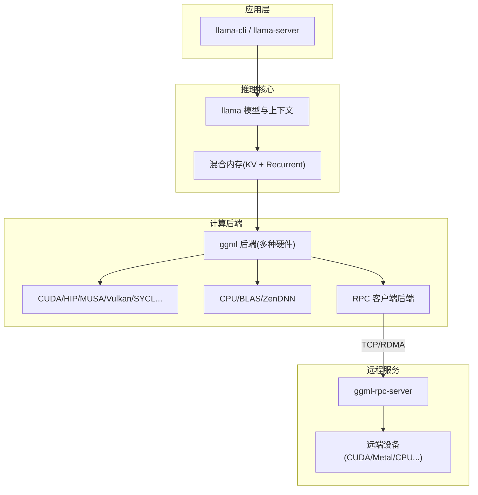
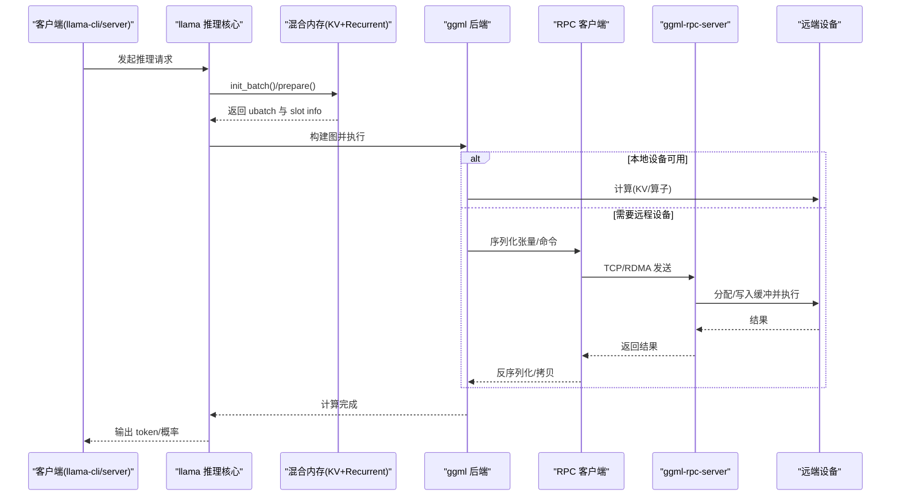
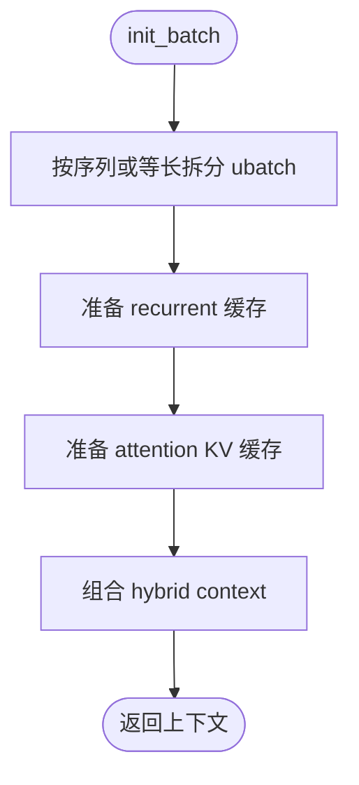
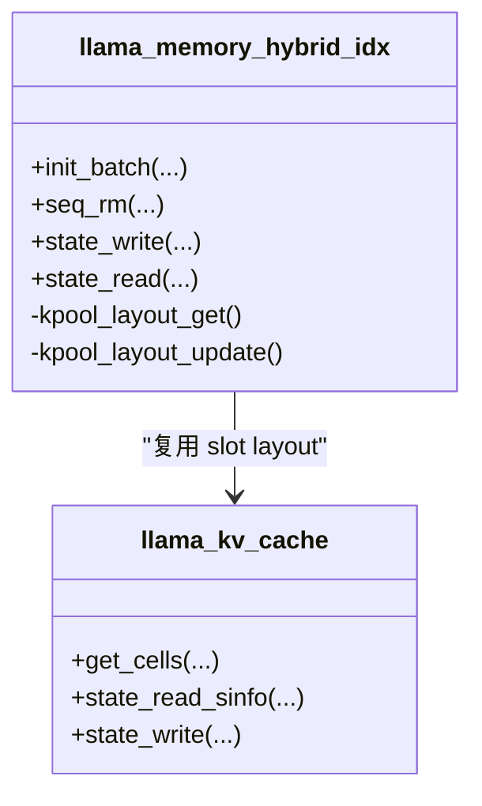
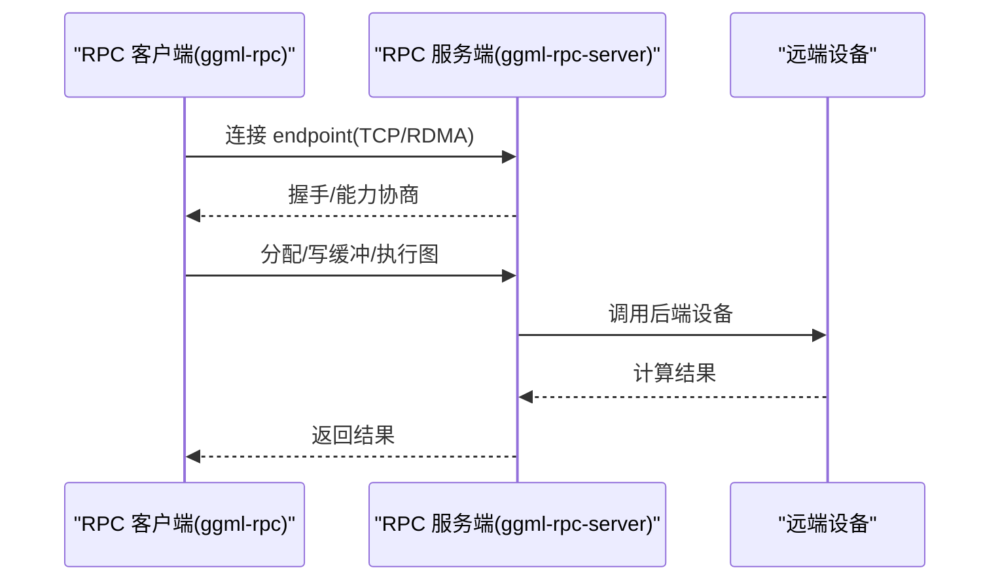
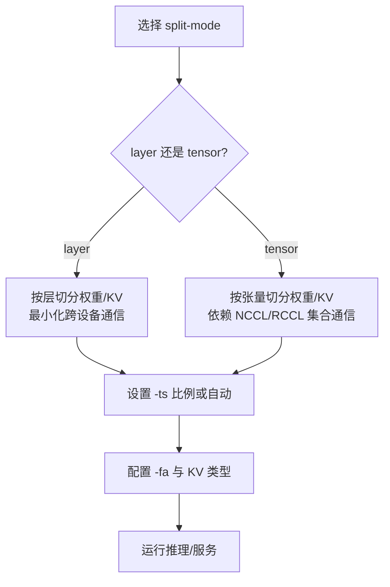
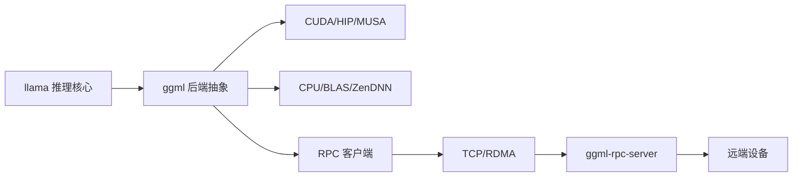

# 混合推理

<cite>
**本文引用的文件**   
- [README.md](file://README.md)
- [multi-gpu.md](file://docs/multi-gpu.md)
- [ggml-rpc.h](file://ggml/include/ggml-rpc.h)
- [rpc-server.cpp](file://tools/rpc/rpc-server.cpp)
- [ggml-rpc.cpp](file://ggml/src/ggml-rpc/ggml-rpc.cpp)
- [CMakeLists.txt](file://ggml/src/ggml-rpc/CMakeLists.txt)
- [llama-memory-hybrid.cpp](file://src/llama-memory-hybrid.cpp)
- [llama-memory-hybrid-idx.cpp](file://src/llama-memory-hybrid-idx.cpp)
- [llama-memory-hybrid-iswa.cpp](file://src/llama-memory-hybrid-iswa.cpp)
</cite>

## 目录
1. [简介](#简介)
2. [项目结构](#项目结构)
3. [核心组件](#核心组件)
4. [架构总览](#架构总览)
5. [详细组件分析](#详细组件分析)
6. [依赖关系分析](#依赖关系分析)
7. [性能与优化](#性能与优化)
8. [故障排查](#故障排查)
9. [结论](#结论)
10. [附录](#附录)

## 简介
本文件系统性梳理 llama.cpp 的“混合推理”能力，覆盖 CPU+GPU、多 GPU、以及通过 RPC 跨主机协同的完整链路。重点包括：
- 设备间的数据传输协议（RPC/TCP/RDMA）、内存映射与会话管理
- 同步机制（事件、屏障、allreduce）
- 混合推理的配置策略（split-mode、tensor-split、n-gpu-layers、fit）
- 负载均衡与调度（层切分、张量切分、KV 缓存分布）
- 故障恢复（断线重连、状态回滚、部分失败清理）
- 性能优化（NCCL/RCCL、P2P、RDMA、Flash Attention、批大小与上下文长度调优）
- 分布式部署模式与扩展性建议

## 项目结构
围绕混合推理的关键代码分布在以下位置：
- ggml 后端抽象与 RPC 实现：ggml/include/ggml-rpc.h、ggml/src/ggml-rpc/*
- RPC 服务端工具：tools/rpc/rpc-server.cpp
- 混合内存与 KV 缓存：src/llama-memory-hybrid*.cpp
- 多 GPU 使用指南：docs/multi-gpu.md
- 项目概览与后端列表：README.md

图表来源
- [README.md:60-96](file://README.md#L60-L96)
- [ggml-rpc.h:19-31](file://ggml/include/ggml-rpc.h#L19-L31)
- [rpc-server.cpp:213-267](file://tools/rpc/rpc-server.cpp#L213-L267)
- [llama-memory-hybrid.cpp:11-65](file://src/llama-memory-hybrid.cpp#L11-L65)

章节来源
- [README.md:60-96](file://README.md#L60-L96)

## 核心组件
- 混合内存子系统
  - 注意力 KV 缓存与循环状态缓存统一编排，支持 offload/unified/stream 等策略
  - 提供 batch/full/update 三种上下文构建路径，保证 ubatch 拆分与回滚一致性
- RPC 通信框架
  - 客户端侧：ggml_backend_rpc_init、buffer_type、device memory 查询
  - 服务端侧：ggml_backend_rpc_start_server，暴露本地设备供远程调用
  - 传输层：默认 TCP，可选 RDMA（Linux RoCEv2/macOS Thunderbolt）
- 多 GPU 切分
  - layer（流水线并行）、tensor（张量并行，实验性），配合 NCCL/RCCL 进行跨设备规约
  - tensor_split、n-gpu-layers、flash-attn、KV cache 类型等参数控制

章节来源
- [llama-memory-hybrid.cpp:11-65](file://src/llama-memory-hybrid.cpp#L11-L65)
- [llama-memory-hybrid.cpp:67-127](file://src/llama-memory-hybrid.cpp#L67-L127)
- [ggml-rpc.h:19-31](file://ggml/include/ggml-rpc.h#L19-L31)
- [multi-gpu.md:18-46](file://docs/multi-gpu.md#L18-L46)

## 架构总览
下图展示一次典型的混合推理请求在 CPU+GPU 或跨主机场景下的数据流与同步点。

图表来源
- [llama-memory-hybrid.cpp:67-127](file://src/llama-memory-hybrid.cpp#L67-L127)
- [ggml-rpc.cpp:2993-3065](file://ggml/src/ggml-rpc/ggml-rpc.cpp#L2993-L3065)
- [rpc-server.cpp:213-267](file://tools/rpc/rpc-server.cpp#L213-L267)

## 详细组件分析

### 混合内存与 KV 缓存（CPU+GPU 协同）
- 设计要点
  - 将注意力 KV 缓存与循环状态缓存分别管理，统一由 hybrid 协调
  - 支持 offload（溢出到 CPU）与 unified（单 stream）两种模式
  - init_batch/init_full/init_update 三条路径，确保 ubatch 拆分与回滚一致
- 关键流程
  - 根据是否 embd_all 选择按序列或等长拆分
  - 先准备 recurrent，再准备 attention，最后组合为 hybrid context
  - next()/apply() 推进批次并合并状态变更

图表来源
- [llama-memory-hybrid.cpp:67-127](file://src/llama-memory-hybrid.cpp#L67-L127)

章节来源
- [llama-memory-hybrid.cpp:11-65](file://src/llama-memory-hybrid.cpp#L11-L65)
- [llama-memory-hybrid.cpp:67-127](file://src/llama-memory-hybrid.cpp#L67-L127)

### 索引型 K-pool 与稀疏注意力（可选扩展）
- 目标
  - 为特定模型（如 Qwen4exp、GLM5-next）维护 K-pool 索引，减少密集 KV 访问
- 机制
  - 复用 attention 的 slot layout，避免布局漂移
  - 维护 pool 布局与“新池”标记，按需重建 pooled key
  - 对 seq_* 编辑进行失效传播与重建

图表来源
- [llama-memory-hybrid-idx.cpp:23-74](file://src/llama-memory-hybrid-idx.cpp#L23-L74)
- [llama-memory-hybrid-idx.cpp:386-474](file://src/llama-memory-hybrid-idx.cpp#L386-L474)

章节来源
- [llama-memory-hybrid-idx.cpp:23-74](file://src/llama-memory-hybrid-idx.cpp#L23-L74)
- [llama-memory-hybrid-idx.cpp:386-474](file://src/llama-memory-hybrid-idx.cpp#L386-L474)

### ISWA 变体（短窗口注意力）
- 特点
  - 同时维护 base 与 swa 两套 KV 缓存
  - 与 recurrent 缓存统一编排，保持与基础 hybrid 一致的接口
- 适用
  - 需要短窗口注意力的模型或任务

章节来源
- [llama-memory-hybrid-iswa.cpp:11-64](file://src/llama-memory-hybrid-iswa.cpp#L11-L64)
- [llama-memory-hybrid-iswa.cpp:66-127](file://src/llama-memory-hybrid-iswa.cpp#L66-L127)

### RPC 通信框架（跨主机/跨进程）
- 客户端 API
  - ggml_backend_rpc_init(endpoint, device)
  - ggml_backend_rpc_buffer_type(endpoint, device)
  - ggml_backend_rpc_get_device_memory(endpoint, device, free, total)
- 服务端入口
  - ggml_backend_rpc_start_server(endpoint, cache_dir, n_threads, n_devices, devices)
- 传输与拓扑
  - 默认 TCP；可自动协商 RDMA（Linux RoCEv2/macOS Thunderbolt）
  - 多服务器可通过 COMM_INIT 建立点对点通信通道，用于 allreduce 等集合操作

图表来源
- [ggml-rpc.h:19-31](file://ggml/include/ggml-rpc.h#L19-L31)
- [rpc-server.cpp:213-267](file://tools/rpc/rpc-server.cpp#L213-L267)
- [ggml-rpc.cpp:2993-3065](file://ggml/src/ggml-rpc/ggml-rpc.cpp#L2993-L3065)

章节来源
- [ggml-rpc.h:19-31](file://ggml/include/ggml-rpc.h#L19-L31)
- [rpc-server.cpp:213-267](file://tools/rpc/rpc-server.cpp#L213-L267)
- [ggml-rpc.cpp:2993-3065](file://ggml/src/ggml-rpc/ggml-rpc.cpp#L2993-L3065)

### 多 GPU 切分与负载均衡
- split-mode
  - layer：流水线并行，适合大模型显存不足且预填充优先
  - tensor：张量并行，适合低延迟生成，需快速互联（NCCL/RCCL）
- 关键参数
  - --split-mode/-sm、--tensor-split/-ts、--n-gpu-layers/-ngl、--flash-attn/-fa、--cache-type-k/v
- 自动适配
  - --fit 自动调整 ctx-size 等参数以适配设备内存（tensor 模式不支持）

图表来源
- [multi-gpu.md:18-46](file://docs/multi-gpu.md#L18-L46)

章节来源
- [multi-gpu.md:18-46](file://docs/multi-gpu.md#L18-L46)

## 依赖关系分析
- 组件耦合
  - llama 推理核心依赖 ggml 后端抽象；RPC 作为后端之一接入
  - 混合内存与 KV 缓存解耦于具体后端，仅通过 ggml 类型与 buffer type 交互
- 外部依赖
  - NCCL/RCCL（多 GPU 集合通信）
  - RDMA（可选，提升 RPC 吞吐/降低延迟）
  - 各硬件后端（CUDA/HIP/MUSA/Vulkan/SYCL/OpenCL/Metal 等）

图表来源
- [README.md:76-96](file://README.md#L76-L96)
- [ggml-rpc.cpp:2993-3065](file://ggml/src/ggml-rpc/ggml-rpc.cpp#L2993-L3065)

章节来源
- [README.md:76-96](file://README.md#L76-L96)

## 性能与优化
- 多 GPU 通信
  - 启用 NCCL/RCCL（构建时选项），避免跨设备瓶颈
  - 在 NVIDIA 上可开启 P2P（GGML_CUDA_P2P=1）以减少系统内存中转
- RPC 传输
  - 优先使用 RDMA（Linux RoCEv2/macOS Thunderbolt），否则回退 TCP
  - 合理设置 server 线程数与设备列表，避免 CPU 成为瓶颈
- 模型与 KV 缓存
  - 使用 Flash Attention（--flash-attn on/auto）
  - 选择合适的 KV 缓存类型（f16/bf16/f32），tensor 模式要求非量化
  - 调整 --ctx-size 与并发度（server 的 parallel）平衡显存与吞吐
- 批处理与调度
  - 利用 hybrid 的 ubatch 拆分与 apply 机制，提高流水线利用率
  - 对于 MoE/混合模型，关注架构限制（某些模型不支持 tensor 模式）

章节来源
- [multi-gpu.md:95-112](file://docs/multi-gpu.md#L95-L112)
- [CMakeLists.txt:13-31](file://ggml/src/ggml-rpc/CMakeLists.txt#L13-L31)

## 故障排查
- 启动错误
  - “SPLIT_MODE_TENSOR requires flash_attn to be enabled”：添加 -fa on 或移除 -fa off
  - “simultaneous use of SPLIT_MODE_TENSOR and KV cache quantization not implemented”：使用 f16/bf16/f32
  - “LLAMA_SPLIT_MODE_TENSOR not implemented for architecture 'X'”：改用 layer 模式
- 性能问题
  - 多 GPU 性能低于单卡：检查 NCCL/RCCL 是否启用；考虑改为 layer 模式；提升互联带宽
  - RPC 延迟高：确认是否走 RDMA；必要时强制 TCP（GGML_RPC_NO_RDMA=1）
- 稳定性问题
  - 启用 GGML_CUDA_P2P=1 后崩溃/输出损坏：关闭该环境变量
  - RPC 服务端绑定非 localhost：生产环境勿暴露至开放网络

章节来源
- [multi-gpu.md:116-128](file://docs/multi-gpu.md#L116-L128)

## 结论
llama.cpp 的混合推理通过 ggml 后端抽象与 RPC 框架，实现了跨 CPU/GPU/多设备乃至跨主机的灵活编排。结合 layer/tensor 切分、NCCL/RCCL、RDMA 与 Flash Attention 等特性，可在不同硬件与网络条件下取得良好吞吐与延迟表现。实际部署中应依据模型规模、互联带宽与延迟目标选择合适的切分模式与传输协议，并通过 fit、ctx-size、parallel 等参数精细调优。

## 附录
- 常用命令参考（来自多 GPU 文档）
  - 默认流水线并行：llama-cli/llama-server 不加额外参数
  - 自定义切分比例：-ts 3,1
  - 指定单卡：--list-devices 后 -dev CUDA1
  - 张量并行（实验）：-sm tensor -ctk f16 -ctv f16
  - 启用 NCCL：构建时开启，运行时自动使用
  - 启用 P2P：GGML_CUDA_P2P=1

章节来源
- [multi-gpu.md:52-112](file://docs/multi-gpu.md#L52-L112)