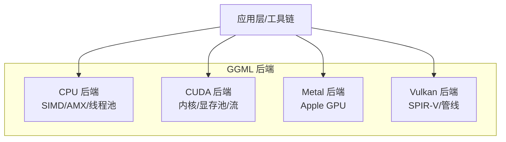
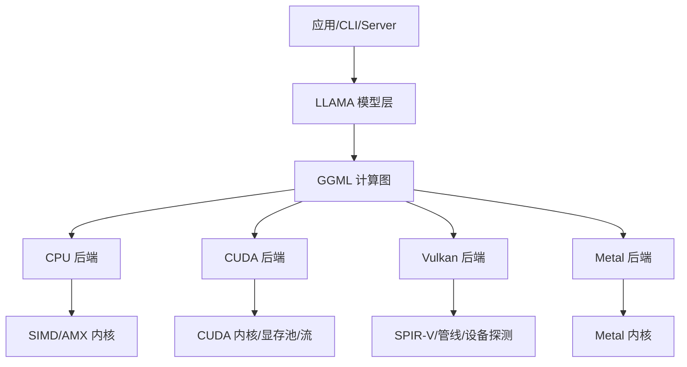
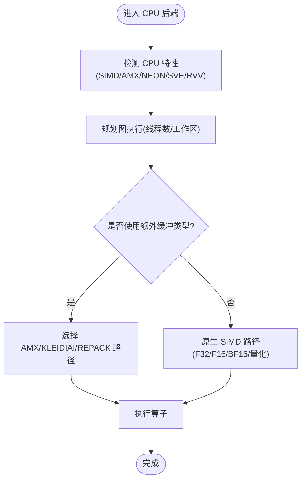
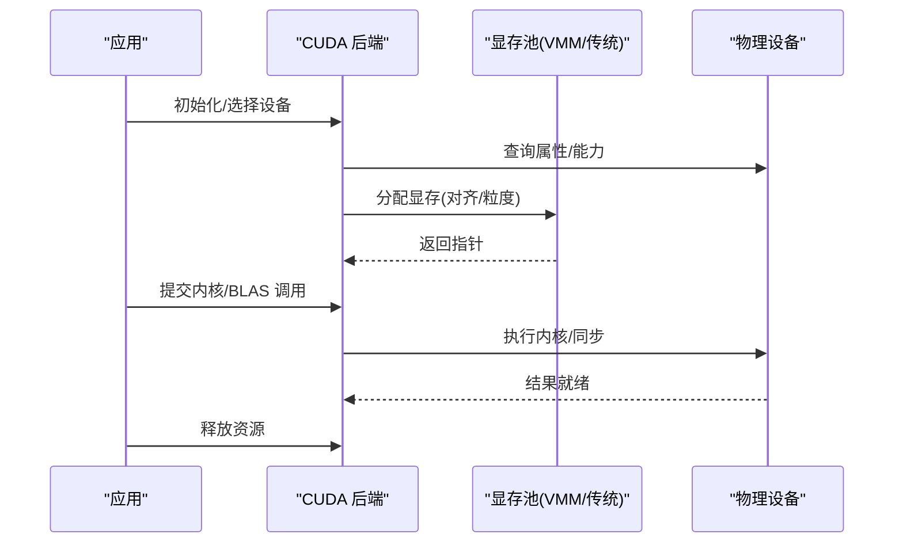
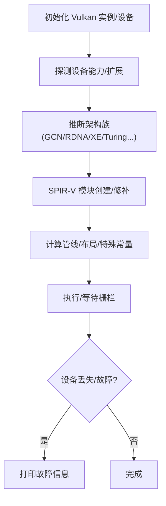
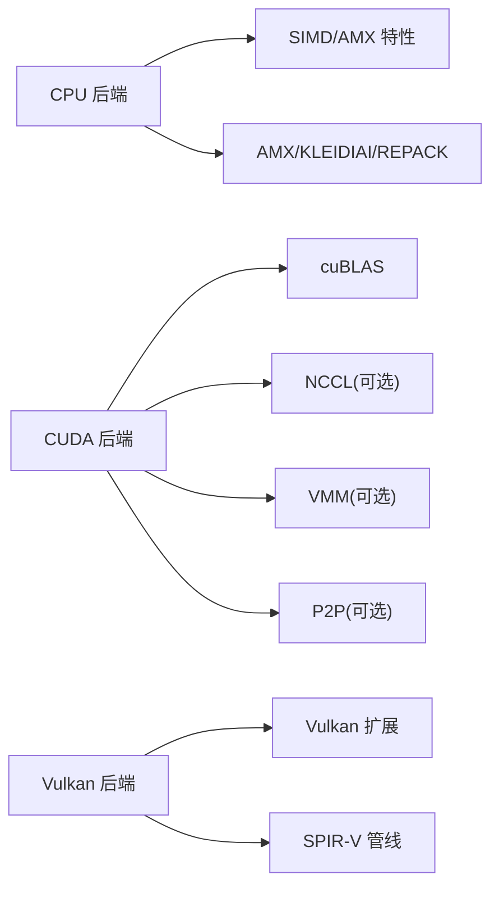

# 硬件后端

<cite>
**本文引用的文件**   
- [README.md](file://README.md)
- [ggml-cpu.cpp](file://ggml/src/ggml-cpu/ggml-cpu.cpp)
- [simd-gemm.h](file://ggml/src/ggml-cpu/simd-gemm.h)
- [simd-mappings.h](file://ggml/src/ggml-cpu/simd-mappings.h)
- [amx.cpp](file://ggml/src/ggml-cpu/amx/amx.cpp)
- [common.h](file://ggml/src/ggml-cpu/amx/common.h)
- [ggml-cuda.cu](file://ggml/src/ggml-cuda/ggml-cuda.cu)
- [ggml-vulkan.cpp](file://ggml/src/ggml-vulkan/ggml-vulkan.cpp)
- [multi-gpu.md](file://docs/multi-gpu.md)
</cite>

## 目录
1. [简介](#简介)
2. [项目结构](#项目结构)
3. [核心组件](#核心组件)
4. [架构总览](#架构总览)
5. [详细组件分析](#详细组件分析)
6. [依赖关系分析](#依赖关系分析)
7. [性能考量与基准建议](#性能考量与基准建议)
8. [故障排查指南](#故障排查指南)
9. [结论](#结论)
10. [附录：新硬件后端扩展指南](#附录新硬件后端扩展指南)

## 简介
本文件面向 llama.cpp 的硬件后端系统，系统性梳理 CPU、GPU（CUDA、Metal、Vulkan）后端的实现要点与优化策略，涵盖 SIMD 向量化、多线程并行、内存对齐、内核优化、显存管理、设备间通信、混合推理配置与多设备协同。同时给出各后端的性能基准测试方法与优化建议，并提供新硬件后端的扩展开发指南与集成步骤。

## 项目结构
llama.cpp 的后端实现集中在 ggml 子系统中，按硬件类型划分目录：
- ggml/src/ggml-cpu：CPU 后端，包含通用路径与多种 SIMD/矩阵加速实现（AVX/AVX2/AVX512/AMX/NEON/SVE/RVV 等）
- ggml/src/ggml-cuda：CUDA 后端，包含大量算子内核与显存池、流、cuBLAS 句柄管理等
- ggml/src/ggml-metal：Metal 后端（Apple Silicon）
- ggml/src/ggml-vulkan：Vulkan 后端，SPIR-V 管线构建、设备能力探测与优化
- ggml/include：对外暴露的后端头文件（如 ggml-cpu.h、ggml-cuda.h、ggml-vulkan.h、ggml-metal.h 等）

图表来源
- [README.md:60-96](file://README.md#L60-L96)

章节来源
- [README.md:60-96](file://README.md#L60-L96)

## 核心组件
- CPU 后端
  - 设备与后端注册、图计划与执行、线程池与中止回调
  - SIMD 特性检测与 AMX/KLEIDIAI/REPACK 等额外缓冲类型
  - 运算支持判定与类型适配（F32/F16/BF16/量化类型）
- CUDA 后端
  - 设备枚举、虚拟设备映射、统一内存/固定页内存、P2P 访问
  - 显存池（传统缓存与 VMM），流与 cuBLAS 句柄生命周期
  - 算子内核组织（注意力、归一化、量化、卷积、优化器等）
- Vulkan 后端
  - 物理设备架构探测（AMD/Intel/NVIDIA/Qualcomm）
  - SPIR-V 模块创建、管线布局、特殊常量、子组大小控制
  - 设备丢失/故障诊断、节点 FLOPs 估算与日志
- Metal 后端
  - Apple GPU 专用实现（Metal 框架）

章节来源
- [ggml-cpu.cpp:42-95](file://ggml/src/ggml-cpu/ggml-cpu.cpp#L42-L95)
- [ggml-cpu.cpp:99-247](file://ggml/src/ggml-cpu/ggml-cpu.cpp#L99-L247)
- [ggml-cpu.cpp:287-415](file://ggml/src/ggml-cpu/ggml-cpu.cpp#L287-L415)
- [ggml-cpu.cpp:541-656](file://ggml/src/ggml-cpu/ggml-cpu.cpp#L541-L656)
- [ggml-cuda.cu:112-183](file://ggml/src/ggml-cuda/ggml-cuda.cu#L112-L183)
- [ggml-cuda.cu:185-213](file://ggml/src/ggml-cuda/ggml-cuda.cu#L185-L213)
- [ggml-cuda.cu:265-447](file://ggml/src/ggml-cuda/ggml-cuda.cu#L265-L447)
- [ggml-cuda.cu:456-731](file://ggml/src/ggml-cuda/ggml-cuda.cu#L456-L731)
- [ggml-vulkan.cpp:3-144](file://ggml/src/ggml-vulkan/ggml-vulkan.cpp#L3-L144)
- [ggml-vulkan.cpp:572-776](file://ggml/src/ggml-vulkan/ggml-vulkan.cpp#L572-L776)

## 架构总览
下图展示从应用到 GGML 后端的路径，以及 CPU/CUDA/Vulkan/Metal 之间的职责分工。

图表来源
- [README.md:60-96](file://README.md#L60-L96)
- [ggml-cpu.cpp:99-247](file://ggml/src/ggml-cpu/ggml-cpu.cpp#L99-L247)
- [ggml-cuda.cu:265-447](file://ggml/src/ggml-cuda/ggml-cuda.cu#L265-L447)
- [ggml-vulkan.cpp:3-144](file://ggml/src/ggml-vulkan/ggml-vulkan.cpp#L3-L144)

## 详细组件分析

### CPU 后端：SIMD 优化、多线程与内存对齐
- SIMD 特性检测与调度
  - 运行时通过特征列表暴露 SSE3/SSSE3/AVX/AVX2/AVX512/AMX_NEON/SVE/RVV 等能力，供上层选择最优路径
  - 额外缓冲类型（AMX、KLEIDIAI、REPACK）在需要时启用以加速特定算子
- 多线程并行
  - 后端上下文维护线程数与线程池；支持设置自定义线程池与中止回调
  - 图计划阶段根据线程数与工作区大小分配工作内存
- 内存对齐与类型适配
  - 针对 F32/F16/BF16/量化类型的向量点积与转宽策略进行分支判断
  - 支持 host buffer 与 mmap 能力，便于零拷贝或大张量映射

图表来源
- [ggml-cpu.cpp:541-656](file://ggml/src/ggml-cpu/ggml-cpu.cpp#L541-L656)
- [ggml-cpu.cpp:99-247](file://ggml/src/ggml-cpu/ggml-cpu.cpp#L99-L247)
- [ggml-cpu.cpp:424-487](file://ggml/src/ggml-cpu/ggml-cpu.cpp#L424-L487)

章节来源
- [ggml-cpu.cpp:42-95](file://ggml/src/ggml-cpu/ggml-cpu.cpp#L42-L95)
- [ggml-cpu.cpp:99-247](file://ggml/src/ggml-cpu/ggml-cpu.cpp#L99-L247)
- [ggml-cpu.cpp:287-415](file://ggml/src/ggml-cpu/ggml-cpu.cpp#L287-L415)
- [ggml-cpu.cpp:541-656](file://ggml/src/ggml-cpu/ggml-cpu.cpp#L541-L656)
- [simd-gemm.h:8-152](file://ggml/src/ggml-cpu/simd-gemm.h#L8-L152)
- [simd-mappings.h:9-137](file://ggml/src/ggml-cpu/simd-mappings.h#L9-L137)
- [amx.cpp:38-240](file://ggml/src/ggml-cpu/amx/amx.cpp#L38-L240)
- [common.h:21-105](file://ggml/src/ggml-cpu/amx/common.h#L21-L105)

### CUDA 后端：内核优化、显存管理与设备通信
- 设备初始化与虚拟设备
  - 枚举物理设备，支持通过环境变量“虚拟化”多个逻辑设备，并映射到物理设备
  - 自动开启 P2P 访问（可选），提升多卡带宽
- 显存管理
  - 传统缓存池：按块分配/释放，OOM 时清理缓存并重试
  - VMM（虚拟内存）池：基于 CUmem 的按需映射与粒度对齐，支持跨设备访问权限设置
  - 统一内存与固定页内存开关，适配不同平台与驱动
- 流与 BLAS
  - 每设备/流维护 CUDA Stream 与 cuBLAS 句柄，销毁时加锁避免并发捕获冲突
- 内核组织
  - 大量 .cu/.cuh 文件覆盖注意力、归一化、量化、卷积、优化器步等常用算子

图表来源
- [ggml-cuda.cu:112-183](file://ggml/src/ggml-cuda/ggml-cuda.cu#L112-L183)
- [ggml-cuda.cu:185-213](file://ggml/src/ggml-cuda/ggml-cuda.cu#L185-L213)
- [ggml-cuda.cu:265-447](file://ggml/src/ggml-cuda/ggml-cuda.cu#L265-L447)
- [ggml-cuda.cu:456-731](file://ggml/src/ggml-cuda/ggml-cuda.cu#L456-L731)

章节来源
- [ggml-cuda.cu:112-183](file://ggml/src/ggml-cuda/ggml-cuda.cu#L112-L183)
- [ggml-cuda.cu:185-213](file://ggml/src/ggml-cuda/ggml-cuda.cu#L185-L213)
- [ggml-cuda.cu:265-447](file://ggml/src/ggml-cuda/ggml-cuda.cu#L265-L447)
- [ggml-cuda.cu:456-731](file://ggml/src/ggml-cuda/ggml-cuda.cu#L456-L731)

### Vulkan 后端：设备探测、SPIR-V 与管线构建
- 设备架构探测
  - 依据厂商扩展与属性（AMD/Intel/NVIDIA/Qualcomm）推断具体架构族（GCN/RDNA/XE1/XE2/Turing 等）
- SPIR-V 处理与管线创建
  - 动态插入 FP16 控制能力、扩展声明与执行模式
  - 条件性剥离/修补指令（如 cooperative_matrix_decode_vector）、循环展开控制
  - 子组大小控制、Robustness 选项、统计采集
- 诊断与日志
  - 设备丢失/故障信息打印，节点 FLOPs 估算与可视化

图表来源
- [ggml-vulkan.cpp:3-144](file://ggml/src/ggml-vulkan/ggml-vulkan.cpp#L3-L144)
- [ggml-vulkan.cpp:572-776](file://ggml/src/ggml-vulkan/ggml-vulkan.cpp#L572-L776)
- [ggml-vulkan.cpp:199-257](file://ggml/src/ggml-vulkan/ggml-vulkan.cpp#L199-L257)

章节来源
- [ggml-vulkan.cpp:3-144](file://ggml/src/ggml-vulkan/ggml-vulkan.cpp#L3-L144)
- [ggml-vulkan.cpp:572-776](file://ggml/src/ggml-vulkan/ggml-vulkan.cpp#L572-L776)
- [ggml-vulkan.cpp:199-257](file://ggml/src/ggml-vulkan/ggml-vulkan.cpp#L199-L257)

### Metal 后端（Apple Silicon）
- 通过 Metal 框架提供高性能 GPU 计算路径，配合 Apple 的 NEON/Accelerate 生态
- 与 CPU 后端协同，形成 CPU+GPU 混合推理

章节来源
- [README.md:60-96](file://README.md#L60-L96)

## 依赖关系分析
- CPU 后端依赖
  - 运行时 SIMD 特性检测（SSE/AVX/AMX/NEON/SVE/RVV）
  - 可选 AMX/KLEIDIAI/REPACK 扩展缓冲类型
- CUDA 后端依赖
  - CUDA Runtime/HIP/MUSA 抽象
  - cuBLAS、NCCL（可选，用于 tensor 并行）
  - VMM（可选）与 P2P（可选）
- Vulkan 后端依赖
  - Vulkan 驱动与扩展（cooperative_matrix、subgroup_size_control、float_controls 等）
  - SPIR-V 编译器/工具链

图表来源
- [ggml-cpu.cpp:541-656](file://ggml/src/ggml-cpu/ggml-cpu.cpp#L541-L656)
- [ggml-cuda.cu:265-447](file://ggml/src/ggml-cuda/ggml-cuda.cu#L265-L447)
- [ggml-vulkan.cpp:3-144](file://ggml/src/ggml-vulkan/ggml-vulkan.cpp#L3-L144)

章节来源
- [ggml-cpu.cpp:541-656](file://ggml/src/ggml-cpu/ggml-cpu.cpp#L541-L656)
- [ggml-cuda.cu:265-447](file://ggml/src/ggml-cuda/ggml-cuda.cu#L265-L447)
- [ggml-vulkan.cpp:3-144](file://ggml/src/ggml-vulkan/ggml-vulkan.cpp#L3-L144)

## 性能考量与基准建议
- CPU
  - 优先启用目标平台的最佳 SIMD 路径（AVX512/AMX/NEON/SVE/RVV）
  - 合理设置线程数与批处理线程数，避免过度并行导致争用
  - 对大张量使用 mmap 或 HBM（若可用）减少拷贝
- CUDA
  - 使用 VMM 池以获得更好的内存利用率与对齐
  - 在多卡场景下启用 P2P 与 NCCL（tensor 并行）以提升吞吐
  - 针对无 Tensor Core 的设备（如部分 Turing iGPU）考虑回退 Pascal 路径
- Vulkan
  - 确保启用必要的扩展（cooperative_matrix、subgroup_size_control、float_controls）
  - 根据设备能力调整子组大小与流水线参数
- 多 GPU 与混合推理
  - 默认采用层切分（pipeline parallel）以获得更好预填充速度
  - 实验性的张量并行（tensor parallel）适合低延迟生成，但受限于互联带宽
  - KV 缓存类型需与后端能力匹配（tensor 模式下要求非量化）

章节来源
- [multi-gpu.md:18-47](file://docs/multi-gpu.md#L18-L47)
- [multi-gpu.md:80-113](file://docs/multi-gpu.md#L80-L113)
- [ggml-cuda.cu:413-421](file://ggml/src/ggml-cuda/ggml-cuda.cu#L413-L421)

## 故障排查指南
- CUDA
  - OOM：清理缓存池重试；检查统一内存/固定页内存开关；降低 ctx-size/parallel/n-gpu-layers
  - P2P 不稳定：禁用 GGML_CUDA_P2P；检查主板/BIOS/IOMMU 设置
  - 设备不可见：检查 CUDA_VISIBLE_DEVICES 与 --device 参数
- Vulkan
  - 设备丢失：查看设备故障信息日志；检查驱动与扩展支持
  - 管线创建失败：确认 SPIR-V 能力与扩展；必要时关闭某些优化（如 robustness）
- CPU
  - 性能不达预期：确认 SIMD 特性被正确识别；调整线程数与批处理线程数
  - 量化类型不支持：检查类型转换与 vec_dot_type 路径

章节来源
- [multi-gpu.md:116-128](file://docs/multi-gpu.md#L116-L128)
- [ggml-vulkan.cpp:199-257](file://ggml/src/ggml-vulkan/ggml-vulkan.cpp#L199-L257)
- [ggml-cuda.cu:456-731](file://ggml/src/ggml-cuda/ggml-cuda.cu#L456-L731)

## 结论
llama.cpp 的硬件后端体系通过统一的 GGML 接口屏蔽了底层差异，为 CPU、CUDA、Metal、Vulkan 等设备提供了高效且可扩展的执行路径。CPU 后端强调 SIMD 与多线程优化，CUDA 后端聚焦内核与显存管理，Vulkan 后端注重设备能力探测与 SPIR-V 管线构建。结合多 GPU 与混合推理机制，可在不同硬件组合上取得良好的吞吐与延迟表现。

## 附录：新硬件后端扩展指南
- 设计目标
  - 遵循 GGML 后端接口，提供设备发现、缓冲区类型、算子支持与图执行能力
  - 尽量复用现有基础设施（线程池、内存对齐、日志、错误处理）
- 集成步骤
  - 新增后端目录与源文件（参考 ggml-cpu / ggml-cuda / ggml-vulkan 的组织方式）
  - 实现设备注册、属性查询、内存分配/释放、算子分发与执行
  - 提供 SIMD/向量/张量核实现（汇编/内联/第三方库）
  - 接入构建系统（CMake/Makefile），添加编译开关与环境变量
  - 编写文档与示例，验证端到端推理流程
- 关键检查点
  - 内存对齐与类型转换是否正确
  - 多线程/流/事件同步是否安全
  - 错误处理与日志是否完善
  - 多设备/混合推理兼容性（如适用）

[本节为概念性指导，不直接分析具体文件]