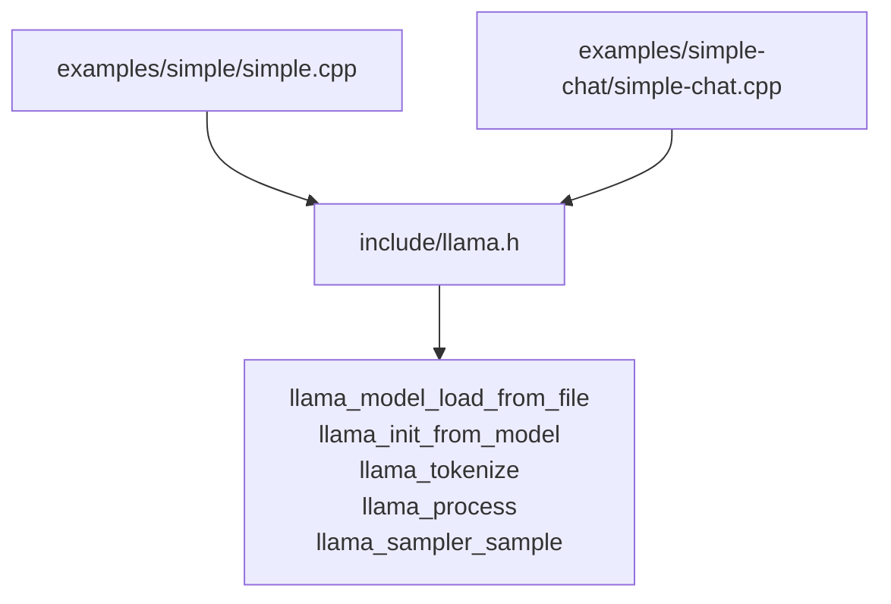
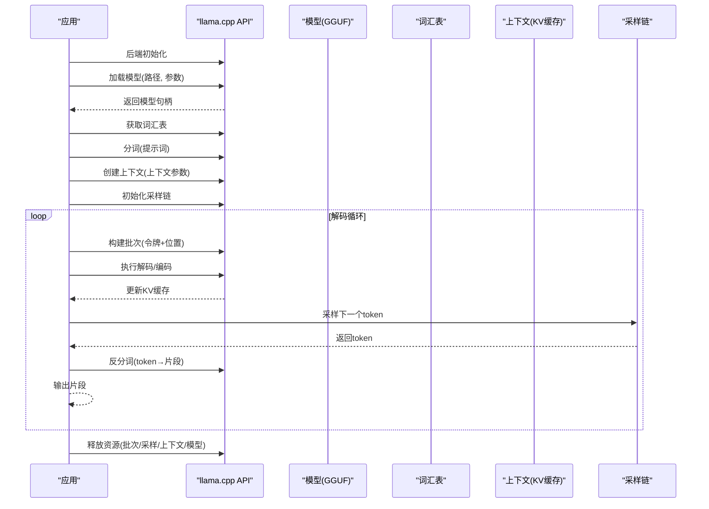
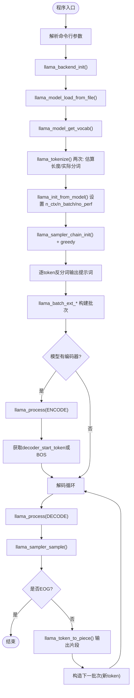
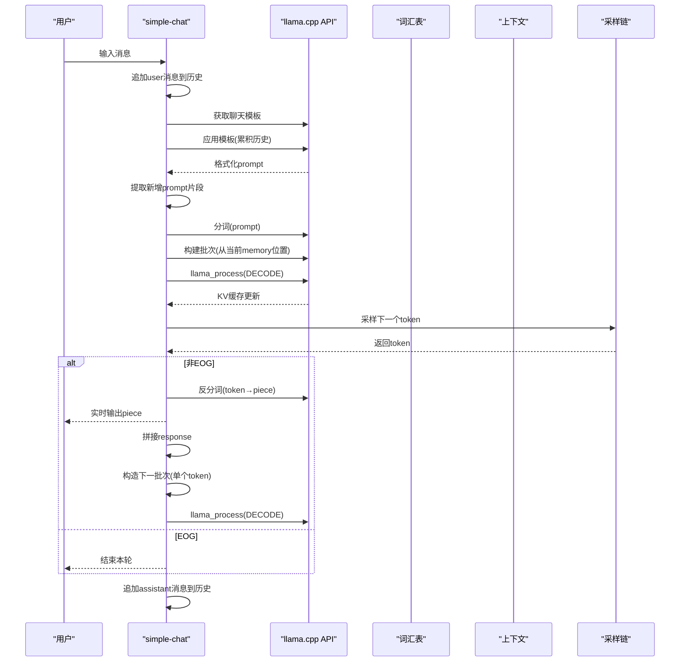
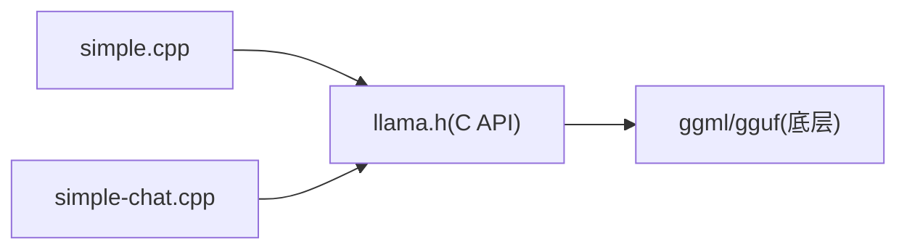

# 基础推理示例

<cite>
**本文引用的文件**   
- [examples/simple/simple.cpp](file://examples/simple/simple.cpp)
- [examples/simple-chat/simple-chat.cpp](file://examples/simple-chat/simple-chat.cpp)
- [include/llama.h](file://include/llama.h)
</cite>

## 目录
1. [简介](#简介)
2. [项目结构](#项目结构)
3. [核心组件](#核心组件)
4. [架构总览](#架构总览)
5. [详细组件分析](#详细组件分析)
6. [依赖关系分析](#依赖关系分析)
7. [性能与调优建议](#性能与调优建议)
8. [故障排查指南](#故障排查指南)
9. [结论](#结论)

## 简介
本文件面向初学者，系统讲解如何使用 llama.cpp 从零开始加载模型、进行文本生成并输出结果。重点解析两个入门示例：
- simple.cpp：单轮提示词到文本生成的最小闭环
- simple-chat.cpp：基于聊天模板的多轮对话交互

文档将逐步拆解模型初始化、上下文配置、采样链设置、批处理构建、解码循环、结果输出等关键步骤，并提供流程图和时序图帮助理解调用链路。同时给出常见错误定位与调试技巧，帮助你快速上手。

## 项目结构
本次文档聚焦 examples/simple 与 examples/simple-chat 两个示例，以及公共头文件 include/llama.h 中定义的 C API。

图示来源
- [examples/simple/simple.cpp:1-239](file://examples/simple/simple.cpp#L1-L239)
- [examples/simple-chat/simple-chat.cpp:1-230](file://examples/simple-chat/simple-chat.cpp#L1-L230)
- [include/llama.h:480-560](file://include/llama.h#L480-L560)
- [include/llama.h:984-1095](file://include/llama.h#L984-L1095)
- [include/llama.h:1269-1312](file://include/llama.h#L1269-L1312)
- [include/llama.h:1634-1645](file://include/llama.h#L1634-L1645)

章节来源
- [examples/simple/simple.cpp:1-239](file://examples/simple/simple.cpp#L1-L239)
- [examples/simple-chat/simple-chat.cpp:1-230](file://examples/simple-chat/simple-chat.cpp#L1-L230)
- [include/llama.h:480-560](file://include/llama.h#L480-L560)
- [include/llama.h:984-1095](file://include/llama.h#L984-L1095)
- [include/llama.h:1269-1312](file://include/llama.h#L1269-L1312)
- [include/llama.h:1634-1645](file://include/llama.h#L1634-L1645)

## 核心组件
- 模型加载与释放
  - 通过模型参数对象设置 GPU 层数等选项，从 GGUF 文件加载模型，并在结束时释放。
- 上下文创建与配置
  - 根据提示词长度与期望生成长度计算上下文大小，设置批大小，启用性能统计，然后创建上下文。
- 分词与反分词
  - 使用词汇表将输入文本转为 token 序列；将生成的 token 转回片段字符串输出。
- 批处理构建
  - 使用扩展批 API 将 token 与位置信息填入批次，并指定需要输出的 logits 位置。
- 采样链
  - 初始化采样链，添加贪心或温度/分布等采样器，最终由采样器选择下一个 token。
- 解码循环
  - 对批次执行 decode（或 encode+decode），采样下一个 token，判断是否结束，继续下一轮。

章节来源
- [examples/simple/simple.cpp:91-141](file://examples/simple/simple.cpp#L91-L141)
- [examples/simple-chat/simple-chat.cpp:79-108](file://examples/simple-chat/simple-chat.cpp#L79-L108)
- [include/llama.h:320-357](file://include/llama.h#L320-L357)
- [include/llama.h:366-428](file://include/llama.h#L366-L428)
- [include/llama.h:1014-1095](file://include/llama.h#L1014-L1095)
- [include/llama.h:1470-1500](file://include/llama.h#L1470-L1500)

## 架构总览
下图展示简单推理的整体流程：后端初始化 → 加载模型 → 创建上下文 → 分词 → 构建批次 → 解码 → 采样 → 输出 → 资源释放。

图示来源
- [examples/simple/simple.cpp:91-235](file://examples/simple/simple.cpp#L91-L235)
- [examples/simple-chat/simple-chat.cpp:79-226](file://examples/simple-chat/simple-chat.cpp#L79-L226)
- [include/llama.h:487-560](file://include/llama.h#L487-L560)
- [include/llama.h:984-1095](file://include/llama.h#L984-L1095)
- [include/llama.h:1269-1312](file://include/llama.h#L1269-L1312)
- [include/llama.h:1634-1645](file://include/llama.h#L1634-L1645)

## 详细组件分析

### simple.cpp：单轮提示词生成
该示例演示了最简的“提示词→文本”生成流程。

关键步骤
- 命令行参数解析：模型路径、GPU 层数、生成长度、提示词
- 后端初始化
- 模型加载：设置 n_gpu_layers，从 GGUF 文件加载
- 获取词汇表
- 分词：两次调用 llama_tokenize，先估算长度再分配缓冲区
- 上下文初始化：n_ctx = 提示词长度 + 预测长度 - 1；n_batch = 提示词长度；开启性能统计
- 采样链初始化：贪心采样
- 打印提示词片段：逐 token 反分词输出
- 构建批次：批量填充 token 与位置，仅最后一个 token 输出 logits
- 编码器支持检测：若模型含编码器，先 encode，再取 decoder_start_token 或 BOS 作为起始
- 解码循环：llama_process(DECODE) → 采样 → 检查 EOG → 反分词输出 → 构造下一批次
- 性能统计与资源释放

图示来源
- [examples/simple/simple.cpp:25-235](file://examples/simple/simple.cpp#L25-L235)
- [include/llama.h:984-1095](file://include/llama.h#L984-L1095)
- [include/llama.h:1269-1312](file://include/llama.h#L1269-L1312)
- [include/llama.h:1634-1645](file://include/llama.h#L1634-L1645)

章节来源
- [examples/simple/simple.cpp:25-235](file://examples/simple/simple.cpp#L25-L235)
- [include/llama.h:320-357](file://include/llama.h#L320-L357)
- [include/llama.h:366-428](file://include/llama.h#L366-L428)
- [include/llama.h:984-1095](file://include/llama.h#L984-L1095)
- [include/llama.h:1269-1312](file://include/llama.h#L1269-L1312)
- [include/llama.h:1634-1645](file://include/llama.h#L1634-L1645)

### simple-chat.cpp：多轮对话
该示例在 simple.cpp 的基础上增加了聊天模板、消息历史与交互式输入。

关键差异与要点
- 日志回调：仅输出错误级别日志
- 上下文参数：固定 n_ctx 与 n_batch
- 采样链：min-p → 温度 → 分布采样
- 对话模板：通过 llama_model_chat_template 与 llama_chat_apply_template 格式化消息
- 消息历史：维护 user/assistant 消息列表，增量格式化避免重复计算
- 上下文溢出保护：检测已用位置与上下文上限，超出则提示并退出
- 生成函数：封装提示词分词、批次构建、解码、采样、片段拼接

图示来源
- [examples/simple-chat/simple-chat.cpp:72-226](file://examples/simple-chat/simple-chat.cpp#L72-L226)
- [include/llama.h:1318-1334](file://include/llama.h#L1318-L1334)
- [include/llama.h:1269-1312](file://include/llama.h#L1269-L1312)
- [include/llama.h:984-1095](file://include/llama.h#L984-L1095)
- [include/llama.h:1634-1645](file://include/llama.h#L1634-L1645)

章节来源
- [examples/simple-chat/simple-chat.cpp:72-226](file://examples/simple-chat/simple-chat.cpp#L72-L226)
- [include/llama.h:1318-1334](file://include/llama.h#L1318-L1334)
- [include/llama.h:1269-1312](file://include/llama.h#L1269-L1312)
- [include/llama.h:984-1095](file://include/llama.h#L984-L1095)
- [include/llama.h:1634-1645](file://include/llama.h#L1634-L1645)

### 关键API与参数说明
- 模型加载
  - llama_model_default_params：默认模型参数
  - llama_model_load_from_file：从 GGUF 文件加载模型
  - 重要参数：n_gpu_layers（GPU 层数）、load_mode、split_mode 等
- 上下文创建
  - llama_context_default_params：默认上下文参数
  - llama_init_from_model：基于模型创建上下文
  - 重要参数：n_ctx（上下文长度）、n_batch（批大小）、no_perf（性能统计开关）
- 分词/反分词
  - llama_tokenize：文本→tokens；返回值负数表示所需缓冲大小
  - llama_token_to_piece：token→片段字符串
- 批处理
  - llama_batch_ext_init/clear/add_token/set_pos/set_output_logits：构建批次
  - llama_process：统一入口，支持 ENCODE/DECODE
- 采样
  - llama_sampler_chain_init/add：组合采样器
  - llama_sampler_init_greedy/min_p/temp/dist：常用采样器
  - llama_sampler_sample：从最后一步 logits 采样一个 token

章节来源
- [include/llama.h:320-357](file://include/llama.h#L320-L357)
- [include/llama.h:366-428](file://include/llama.h#L366-L428)
- [include/llama.h:480-560](file://include/llama.h#L480-L560)
- [include/llama.h:984-1095](file://include/llama.h#L984-L1095)
- [include/llama.h:1269-1312](file://include/llama.h#L1269-L1312)
- [include/llama.h:1470-1500](file://include/llama.h#L1470-L1500)
- [include/llama.h:1634-1645](file://include/llama.h#L1634-L1645)

## 依赖关系分析
- 示例代码依赖公共头文件 define 的 C API
- 运行时依赖 ggml/gguf 底层实现（由 include/llama.h 引入）
- 示例之间共享相同的初始化、分词、批处理、采样模式

图示来源
- [examples/simple/simple.cpp:1-239](file://examples/simple/simple.cpp#L1-L239)
- [examples/simple-chat/simple-chat.cpp:1-230](file://examples/simple-chat/simple-chat.cpp#L1-L230)
- [include/llama.h:1-10](file://include/llama.h#L1-L10)

章节来源
- [examples/simple/simple.cpp:1-239](file://examples/simple/simple.cpp#L1-L239)
- [examples/simple-chat/simple-chat.cpp:1-230](file://examples/simple-chat/simple-chat.cpp#L1-L230)
- [include/llama.h:1-10](file://include/llama.h#L1-L10)

## 性能与调优建议
- 上下文大小
  - 合理设置 n_ctx，避免过小导致截断或过大造成内存浪费
- 批大小
  - n_batch 影响单次解码吞吐，需结合硬件与模型规模调整
- GPU 层数
  - n_gpu_layers 越大，越能利用显存加速，但受显存限制
- 采样策略
  - 贪心采样稳定但缺乏多样性；温度/Top-K/Top-P/Min-P 可调节创造性
- 性能统计
  - 开启 no_perf=false 以采集采样与上下文性能指标，便于定位瓶颈

[本节为通用指导，不直接分析具体文件]

## 故障排查指南
常见问题与定位方法
- 无法加载模型
  - 检查模型路径是否正确、GGUF 文件是否损坏
  - 参考：模型加载失败时的错误输出
- 分词失败
  - 确认 add_special 与 parse_special 参数是否符合预期
  - 参考：分词 API 的返回值语义
- 上下文不足
  - 当已用位置超过 n_ctx 时，会触发上下文溢出保护
  - 参考：simple-chat 中的上下文溢出检测逻辑
- 解码失败
  - llama_process 返回非零值时，检查批次构建与位置设置
  - 参考：批处理与解码流程
- 采样异常
  - 检查采样链顺序与参数范围（如温度不能为负）
  - 参考：采样链初始化与采样 API

章节来源
- [examples/simple/simple.cpp:98-116](file://examples/simple/simple.cpp#L98-L116)
- [examples/simple/simple.cpp:163-189](file://examples/simple/simple.cpp#L163-L189)
- [examples/simple-chat/simple-chat.cpp:130-146](file://examples/simple-chat/simple-chat.cpp#L130-L146)
- [include/llama.h:1269-1312](file://include/llama.h#L1269-L1312)
- [include/llama.h:984-1095](file://include/llama.h#L984-L1095)

## 结论
通过 simple.cpp 与 simple-chat.cpp，你可以快速掌握 llama.cpp 的基础推理流程：加载模型、创建上下文、分词、构建批次、解码、采样与输出。建议在熟悉基本流程后，进一步调整上下文与批大小、优化采样策略，并结合性能统计进行调优。遇到错误时，优先检查模型路径、分词参数、上下文容量与采样链配置。