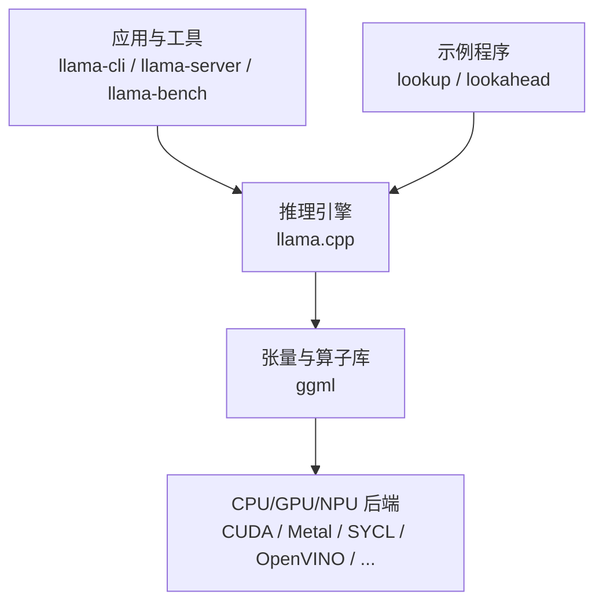
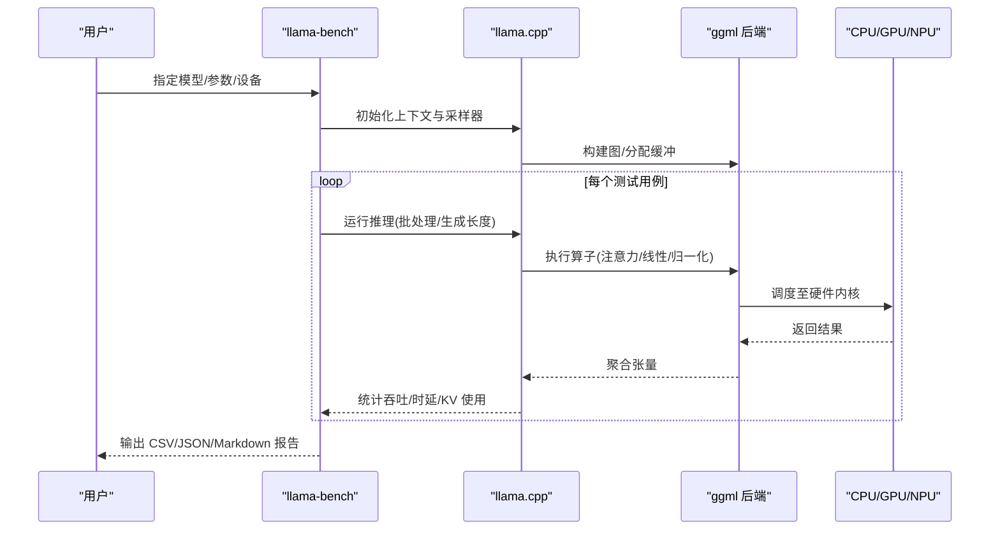
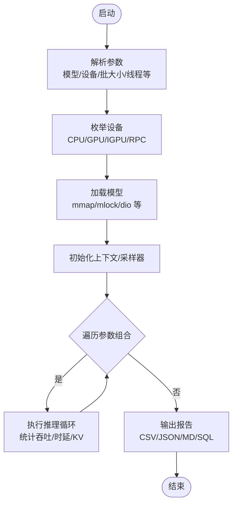
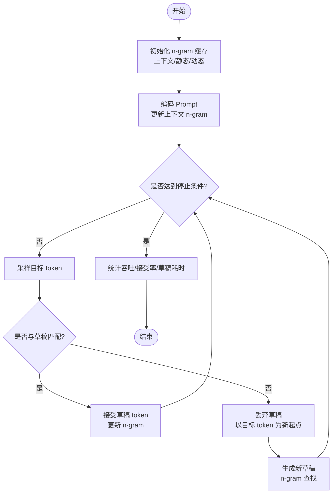
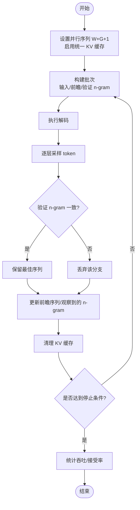
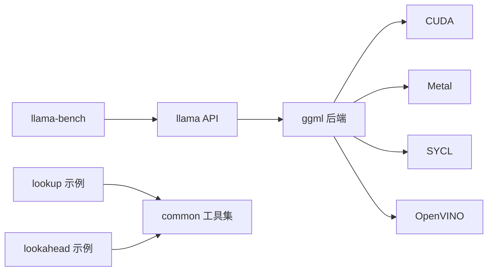

# 性能优化实践

<cite>
**本文引用的文件**   
- [README.md](file://README.md)
- [llama-bench.cpp](file://tools/llama-bench/llama-bench.cpp)
- [main.cpp](file://tools/llama-bench/main.cpp)
- [lookup.cpp](file://examples/lookup/lookup.cpp)
- [lookahead.cpp](file://examples/lookahead/lookahead.cpp)
- [completion README.md](file://tools/completion/README.md)
- [fattn-tile.cuh](file://ggml/src/ggml-cuda/fattn-tile.cuh)
- [ggml-metal-ops.cpp](file://ggml/src/ggml-metal/ggml-metal-ops.cpp)
- [flash_attn_ext.cpp](file://ggml/src/ggml-openvino/openvino/op/flash_attn_ext.cpp)
- [ggml-sycl.cpp](file://ggml/src/ggml-sycl/ggml-sycl.cpp)
</cite>

## 目录
1. [引言](#引言)
2. [项目结构](#项目结构)
3. [核心组件](#核心组件)
4. [架构总览](#架构总览)
5. [详细组件分析](#详细组件分析)
6. [依赖关系分析](#依赖关系分析)
7. [性能考量](#性能考量)
8. [故障排查指南](#故障排查指南)
9. [结论](#结论)
10. [附录](#附录)

## 引言
本指南面向希望在不同硬件平台上对 llama.cpp 进行端到端性能优化的工程师与研究者。内容覆盖：
- 查找表优化（Lookup）与前瞻解码（Lookahead）的原理与实践
- KV 缓存与内存管理策略
- llama-bench 基准测试工具的使用、指标采集与瓶颈分析
- CPU 向量化、GPU 加速与多线程调优的实操建议
- 从基线到优化的完整案例研究路径

## 项目结构
本项目围绕推理引擎（llama.cpp）、底层张量计算库（ggml）、示例与工具三大层次组织：
- 顶层入口与文档：README 提供安装、后端支持与快速上手指引
- 工具层：llama-bench 用于系统级性能基准；examples 提供 lookup/lookahead 等优化示例
- 内核层：ggml 为各后端（CUDA、Metal、SYCL、OpenVINO 等）提供高性能算子实现

图表来源
- [README.md:60-96](file://README.md#L60-L96)
- [llama-bench.cpp:218-494](file://tools/llama-bench/llama-bench.cpp#L218-L494)

章节来源
- [README.md:60-96](file://README.md#L60-L96)

## 核心组件
- llama-bench：跨设备、跨参数的系统化基准测试工具，支持多模型、多批次、多 GPU/CPU 配置与多种输出格式
- Lookup（查找表）：基于 n-gram 的草稿生成与接受机制，减少目标模型解码次数
- Lookahead（前瞻解码）：并行 Jacobi 解码 + n-gram 验证，提升吞吐
- ggml 后端：针对 CUDA、Metal、SYCL、OpenVINO 等的高效注意力与矩阵运算实现

章节来源
- [llama-bench.cpp:218-494](file://tools/llama-bench/llama-bench.cpp#L218-L494)
- [lookup.cpp:18-255](file://examples/lookup/lookup.cpp#L18-L255)
- [lookahead.cpp:41-487](file://examples/lookahead/lookahead.cpp#L41-L487)

## 架构总览
llama-bench 通过统一参数解析、设备枚举、模型加载与推理循环，收集吞吐、时延、KV 缓存占用等指标；Lookup/Lookahead 在推理循环中引入草稿与验证阶段，降低目标模型调用频率；ggml 后端将关键算子映射到具体硬件。

图表来源
- [llama-bench.cpp:120-142](file://tools/llama-bench/llama-bench.cpp#L120-L142)
- [llama-bench.cpp:335-425](file://tools/llama-bench/llama-bench.cpp#L335-L425)
- [llama-bench.cpp:427-494](file://tools/llama-bench/llama-bench.cpp#L427-L494)

## 详细组件分析

### llama-bench 基准测试工具
- 功能要点
  - 设备枚举与选择：自动发现 CPU/GPU/IGPU，支持 RPC 远程设备
  - 参数扫描：prompt/gen 长度、batch/ubatch、线程数、GPU 层数、KV 类型、加载模式、NUMA 策略等
  - 指标采集：吞吐、时延、KV 缓存命中率、设备利用率（由上层 common_perf_print 汇总）
  - 输出格式：CSV/JSON/JSONL/Markdown/SQL，便于自动化对比
- 关键流程
  - 解析命令行参数并校验
  - 枚举设备、注册 RPC 服务器（可选）
  - 加载模型、初始化上下文与采样器
  - 按参数组合执行推理循环，记录时间戳与统计信息
  - 汇总并输出报告

图表来源
- [llama-bench.cpp:120-142](file://tools/llama-bench/llama-bench.cpp#L120-L142)
- [llama-bench.cpp:335-425](file://tools/llama-bench/llama-bench.cpp#L335-L425)
- [llama-bench.cpp:427-494](file://tools/llama-bench/llama-bench.cpp#L427-L494)

章节来源
- [llama-bench.cpp:120-142](file://tools/llama-bench/llama-bench.cpp#L120-L142)
- [llama-bench.cpp:335-425](file://tools/llama-bench/llama-bench.cpp#L335-L425)
- [llama-bench.cpp:427-494](file://tools/llama-bench/llama-bench.cpp#L427-L494)

### 查找表优化（Lookup）
- 原理
  - 维护静态/动态 n-gram 缓存，根据当前上下文生成候选草稿序列
  - 目标模型仅对不匹配的 token 进行解码，已匹配草稿直接接受，减少解码次数
- 关键步骤
  - 初始化 n-gram 缓存（上下文/静态/动态）
  - 编码 prompt，更新上下文 n-gram
  - 解码循环：采样目标 token，与草稿比对；接受或回退
  - 清理未接受的草稿 KV，继续下一轮草稿生成
- 指标
  - 草稿数量、接受率、草稿生成耗时、目标解码速度

图表来源
- [lookup.cpp:52-79](file://examples/lookup/lookup.cpp#L52-L79)
- [lookup.cpp:127-221](file://examples/lookup/lookup.cpp#L127-L221)
- [lookup.cpp:225-245](file://examples/lookup/lookup.cpp#L225-L245)

章节来源
- [lookup.cpp:18-255](file://examples/lookup/lookup.cpp#L18-L255)

### 前瞻解码（Lookahead）
- 原理
  - 利用窗口 W 与层级 N 的 Jacobi 并行解码，结合 G 个验证 n-gram 进行一致性检查
  - 通过统一 KV 缓存与批量序列，减少碎片化，提高吞吐
- 关键步骤
  - 设置并行序列数 W+G+1，启用统一 KV 缓存
  - 构建掩码与批次，包含输入、前瞻序列与验证 n-gram
  - 解码后按层级采样，验证 n-gram 一致性，保留最佳序列
  - 清理 KV 缓存，推进时间步
- 指标
  - 窗口/层级/验证规模、接受率、解码吞吐

图表来源
- [lookahead.cpp:52-64](file://examples/lookahead/lookahead.cpp#L52-L64)
- [lookahead.cpp:185-266](file://examples/lookahead/lookahead.cpp#L185-L266)
- [lookahead.cpp:322-458](file://examples/lookahead/lookahead.cpp#L322-L458)

章节来源
- [lookahead.cpp:41-487](file://examples/lookahead/lookahead.cpp#L41-L487)

### 内存管理与 KV 缓存策略
- 加载模式
  - mmap/mlock/dio 等模式影响加载速度与运行时页错误行为
- NUMA 与线程绑定
  - distribute/isolate/numactl 策略可改善非均匀内存访问
- KV 缓存
  - 统一 KV 缓存可减少碎片；合理设置 ctx 大小避免溢出
- 设备卸载
  - KV offload、op offload、host offload 控制数据驻留位置

章节来源
- [completion README.md:523-544](file://tools/completion/README.md#L523-L544)
- [lookahead.cpp:52-64](file://examples/lookahead/lookahead.cpp#L52-L64)

### 硬件平台优化配置

#### CPU 向量化
- 启用 AVX/AVX2/AVX512/AMX（x86），ARM NEON（Apple Silicon），RISC-V RVV/ZVFH/ZFH 等
- 调整线程数与批处理线程数，物理核更优
- 使用 BLIS/ZenDNN 等 BLAS 后端提升矩阵运算效率

章节来源
- [README.md:66-69](file://README.md#L66-L69)
- [completion README.md:523-527](file://tools/completion/README.md#L523-L527)

#### GPU 加速
- CUDA/HIP/MUSA/Vulkan/SYCL/OpenCL 后端
- 合理设置 n_gpu_layers、tensor_split、split_mode
- 注意显存容量与 KV 缓存大小，必要时开启 KV offload

章节来源
- [README.md:70-96](file://README.md#L70-L96)
- [llama-bench.cpp:473-488](file://tools/llama-bench/llama-bench.cpp#L473-L488)

#### 多线程调优
- 生成线程与批处理线程分离，批处理可适当增大
- NUMA 策略与 CPU mask 精细控制
- poll 参数调节忙等待粒度

章节来源
- [completion README.md:523-544](file://tools/completion/README.md#L523-L544)

## 依赖关系分析
- llama-bench 依赖 llama API 与 ggml 后端
- Lookup/Lookahead 示例依赖 common 工具集与采样器
- ggml 后端在不同硬件上提供高效内核实现

图表来源
- [llama-bench.cpp:218-494](file://tools/llama-bench/llama-bench.cpp#L218-L494)
- [lookup.cpp:1-9](file://examples/lookup/lookup.cpp#L1-L9)
- [lookahead.cpp:1-5](file://examples/lookahead/lookahead.cpp#L1-L5)

章节来源
- [llama-bench.cpp:218-494](file://tools/llama-bench/llama-bench.cpp#L218-L494)

## 性能考量
- 注意力算子优化
  - CUDA 后端采用分块迭代与共享内存优化，减少全局访存
  - Metal 后端对小 batch 的 mat-mv 内核有专门路径
  - OpenVINO 后端对 KV 布局做 reshape/transpose 适配 SDPA
  - SYCL 后端在多设备场景下协调主设备与 GPU 缓冲区
- 批处理与并行
  - 合理设置 batch/ubatch，平衡吞吐与时延
  - 前瞻/查找表需权衡草稿长度与接受率
- 内存与 I/O
  - 大模型优先 mmap，必要时 mlock 提升稳定性
  - NUMA 与 DirectIO 在特定系统上有效

章节来源
- [fattn-tile.cuh:707-971](file://ggml/src/ggml-cuda/fattn-tile.cuh#L707-L971)
- [ggml-metal-ops.cpp:2620-2653](file://ggml/src/ggml-metal/ggml-metal-ops.cpp#L2620-L2653)
- [flash_attn_ext.cpp:46-68](file://ggml/src/ggml-openvino/openvino/op/flash_attn_ext.cpp#L46-L68)
- [ggml-sycl.cpp:3084-3107](file://ggml/src/ggml-sycl/ggml-sycl.cpp#L3084-L3107)

## 故障排查指南
- 常见问题
  - KV 缓存不足导致解码失败：增大 ctx 或减少并发序列
  - 设备选择错误：确认 --device 与 --list-devices 输出
  - 加载模式不当：切换 mmap/mlock/dio 观察加载与运行时表现
  - 线程数过高：降至物理核数，或分离批处理线程
- 定位方法
  - 使用 llama-bench 的 verbose/progress 输出定位慢点
  - 对比不同后端（CUDA/Metal/SYCL）的吞吐差异
  - 通过日志中的 accept 率与草稿耗时评估草稿质量

章节来源
- [lookahead.cpp:263-266](file://examples/lookahead/lookahead.cpp#L263-L266)
- [llama-bench.cpp:427-494](file://tools/llama-bench/llama-bench.cpp#L427-L494)

## 结论
- 通过 llama-bench 建立基线，结合 Lookup/Lookahead 降低目标模型解码压力
- 依据硬件特性选择合适的后端与参数（线程、批大小、GPU 层数、KV 类型）
- 关注内存与 I/O 策略，确保稳定与高吞吐
- 持续用基准对比优化效果，形成闭环

## 附录

### 基准测试与优化案例研究（从基线到优化）
- 基线
  - 使用 llama-bench 默认参数运行，记录吞吐与时延
- 优化步骤
  - 调整线程与批大小，观察吞吐变化
  - 启用 CUDA/Metal/SYCL 后端，比较性能
  - 调整 n_gpu_layers 与 tensor_split，最大化 GPU 利用率
  - 启用 KV offload 与统一 KV 缓存，缓解显存压力
  - 启用 Lookup/Lookahead，观察接受率与整体吞吐提升
- 评估
  - 对比优化前后吞吐、时延、KV 命中率与草稿接受率
  - 使用 CSV/JSON/Markdown 输出进行可视化对比

章节来源
- [llama-bench.cpp:427-494](file://tools/llama-bench/llama-bench.cpp#L427-L494)
- [lookup.cpp:225-245](file://examples/lookup/lookup.cpp#L225-L245)
- [lookahead.cpp:465-477](file://examples/lookahead/lookahead.cpp#L465-L477)