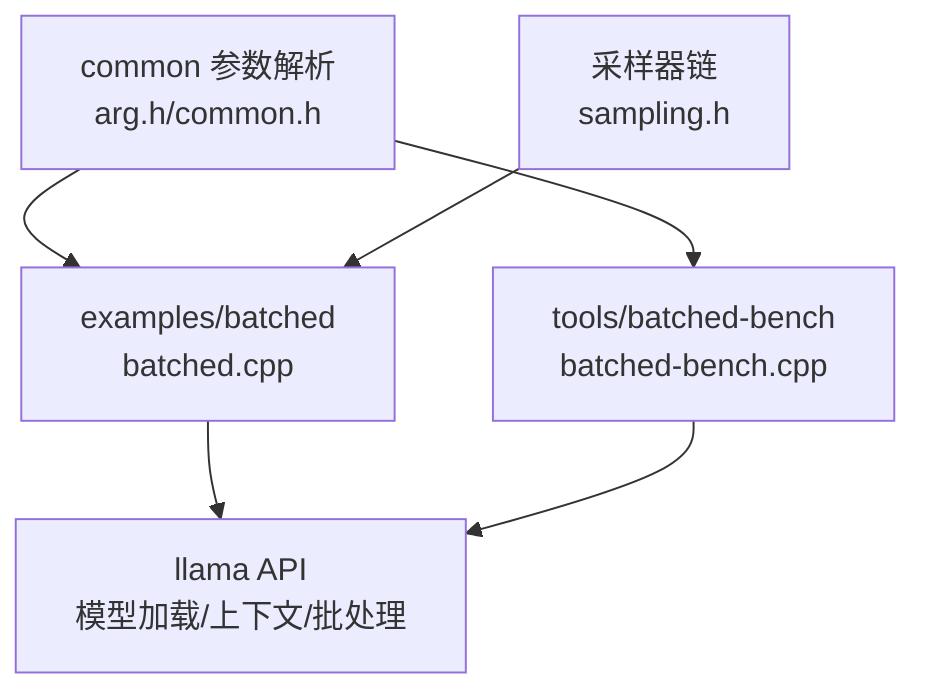
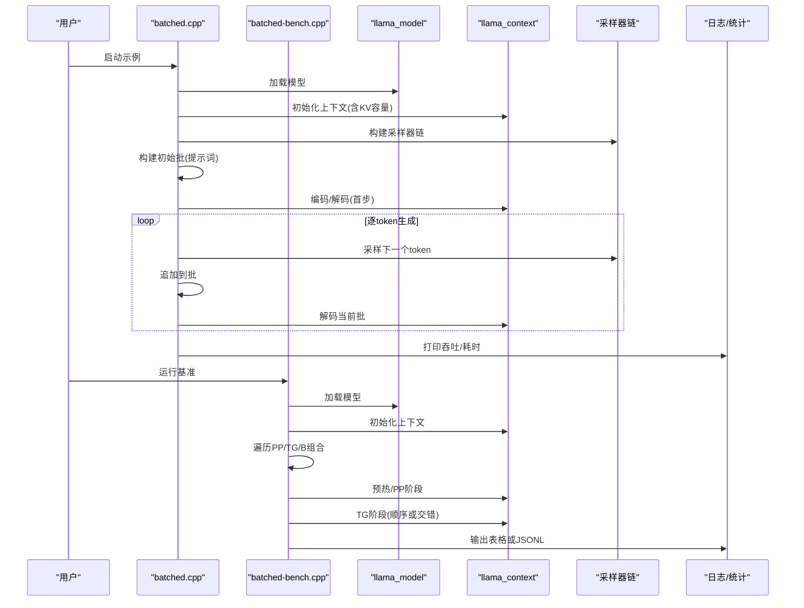
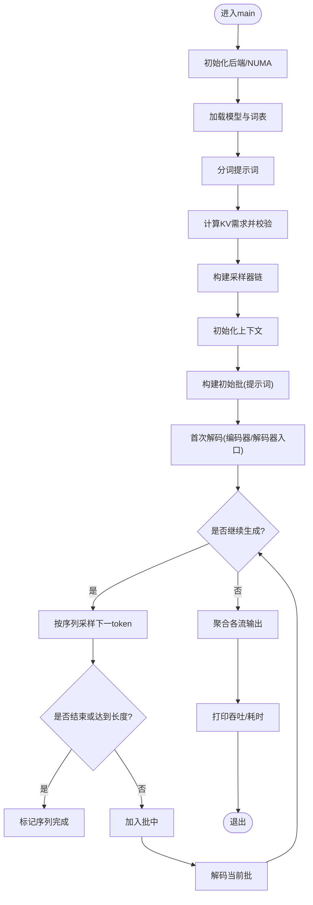
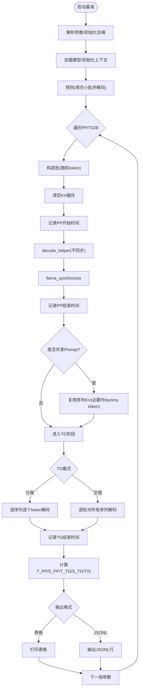
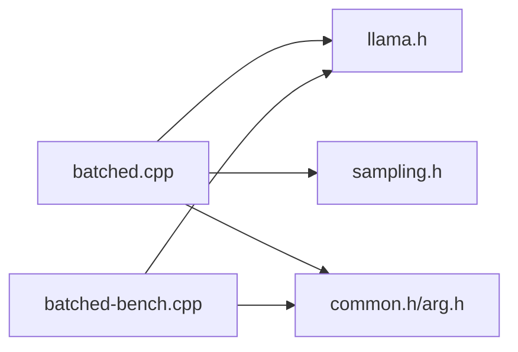

# 批处理推理

<cite>
**本文引用的文件**   
- [examples/batched/batched.cpp](file://examples/batched/batched.cpp)
- [examples/batched/README.md](file://examples/batched/README.md)
- [tools/batched-bench/batched-bench.cpp](file://tools/batched-bench/batched-bench.cpp)
- [tools/batched-bench/README.md](file://tools/batched-bench/README.md)
</cite>

## 目录
1. [引言](#引言)
2. [项目结构](#项目结构)
3. [核心组件](#核心组件)
4. [架构总览](#架构总览)
5. [详细组件分析](#详细组件分析)
6. [依赖关系分析](#依赖关系分析)
7. [性能与基准测试](#性能与基准测试)
8. [故障排查指南](#故障排查指南)
9. [结论](#结论)
10. [附录：使用示例与最佳实践](#附录使用示例与最佳实践)

## 引言
本文件面向希望理解并应用 llama.cpp 批处理推理的读者，系统阐述以下主题：
- 批处理推理的概念、优势与典型场景
- examples/batched/batched.cpp 的实现原理：批量数据准备、并行解码执行、结果聚合
- tools/batched-bench/batched-bench.cpp 的性能基准方法：吞吐优化、内存分析与硬件利用率监控
- 实际应用场景的代码组织思路（并发聊天机器人、批量文本分析等）

## 项目结构
围绕“批处理推理”的核心代码位于两个位置：
- 示例程序：examples/batched/batched.cpp，演示从提示词开始的多路并行生成
- 基准工具：tools/batched-bench/batched-bench.cpp，系统化评估不同 PP/TG/B 组合下的吞吐与时延

图表来源
- [examples/batched/batched.cpp:1-12](file://examples/batched/batched.cpp#L1-L12)
- [tools/batched-bench/batched-bench.cpp:1-11](file://tools/batched-bench/batched-bench.cpp#L1-L11)

章节来源
- [examples/batched/batched.cpp:1-264](file://examples/batched/batched.cpp#L1-L264)
- [tools/batched-bench/batched-bench.cpp:1-252](file://tools/batched-bench/batched-bench.cpp#L1-L252)

## 核心组件
- 批处理推理示例（batched.cpp）
  - 负责：模型加载、上下文配置、KV 缓存容量规划、多序列并行采样与输出、性能统计
- 批处理基准（batched-bench.cpp）
  - 负责：遍历 PP/TG/B 组合，测量 Prompt Processing（PP）与 Text Generation（TG）阶段时延与吞吐，支持共享 Prompt 模式与 JSONL 输出

章节来源
- [examples/batched/batched.cpp:19-108](file://examples/batched/batched.cpp#L19-L108)
- [tools/batched-bench/batched-bench.cpp:21-79](file://tools/batched-bench/batched-bench.cpp#L21-L79)

## 架构总览
下图展示批处理推理在示例与基准中的关键流程：模型加载、上下文创建、批构建、解码循环、结果聚合与统计。

图表来源
- [examples/batched/batched.cpp:41-154](file://examples/batched/batched.cpp#L41-L154)
- [examples/batched/batched.cpp:166-231](file://examples/batched/batched.cpp#L166-L231)
- [tools/batched-bench/batched-bench.cpp:39-98](file://tools/batched-bench/batched-bench.cpp#L39-L98)
- [tools/batched-bench/batched-bench.cpp:122-213](file://tools/batched-bench/batched-bench.cpp#L122-L213)

## 详细组件分析

### 批处理推理示例 batched.cpp
该示例展示了如何对同一提示词进行多路并行生成，并在每步将新 token 加入批中进行解码。

- 关键流程
  - 参数解析与后端初始化
  - 模型加载与分词
  - KV 缓存容量计算与校验
  - 采样器链构建（top-k/top-p/temp/distribution）
  - 初始批构建与首次解码
  - 主循环：采样 -> 追加到批 -> 解码 -> 聚合输出
  - 性能统计与资源释放

图表来源
- [examples/batched/batched.cpp:19-108](file://examples/batched/batched.cpp#L19-L108)
- [examples/batched/batched.cpp:118-154](file://examples/batched/batched.cpp#L118-L154)
- [examples/batched/batched.cpp:166-231](file://examples/batched/batched.cpp#L166-L231)

- 设计要点
  - 通过 common_batch 累积待解码 token，减少调用开销
  - 每个序列维护独立的采样器链，保证随机性独立
  - 根据 n_parallel 与 n_predict 估算 KV 需求，避免 OOM
  - 单流直接实时输出；多流则缓冲后统一打印

章节来源
- [examples/batched/batched.cpp:19-108](file://examples/batched/batched.cpp#L19-L108)
- [examples/batched/batched.cpp:118-154](file://examples/batched/batched.cpp#L118-L154)
- [examples/batched/batched.cpp:166-231](file://examples/batched/batched.cpp#L166-L231)

### 批处理基准 batched-bench.cpp
该工具用于系统性评估不同 PP/TG/B 组合下的性能，支持两种模式：
- 非共享 Prompt：N_KV = B*(PP + TG)
- 共享 Prompt：N_KV = PP + B*TG

- 关键流程
  - 参数解析与后端初始化
  - 模型与上下文初始化，设置最大序列数
  - 定义 decode_helper：按 n_batch 切分批并调用 llama_process
  - 预热阶段
  - 遍历 PP/TG/B 组合，分别测量 PP 与 TG 阶段
  - 支持共享 Prompt 时的 KV 复制与清理
  - 输出表格或 JSONL

图表来源
- [tools/batched-bench/batched-bench.cpp:21-79](file://tools/batched-bench/batched-bench.cpp#L21-L79)
- [tools/batched-bench/batched-bench.cpp:81-98](file://tools/batched-bench/batched-bench.cpp#L81-L98)
- [tools/batched-bench/batched-bench.cpp:100-120](file://tools/batched-bench/batched-bench.cpp#L100-L120)
- [tools/batched-bench/batched-bench.cpp:122-213](file://tools/batched-bench/batched-bench.cpp#L122-L213)
- [tools/batched-bench/batched-bench.cpp:217-236](file://tools/batched-bench/batched-bench.cpp#L217-L236)

- 设计要点
  - decode_helper 封装了按 n_batch 切分批与可选同步的逻辑，便于复用
  - 通过 is_pp_shared 控制 KV 复用策略，减少重复 Prompt 的 KV 占用
  - 通过 is_tg_separate 控制 TG 阶段的调度模式（顺序 vs 交错），影响吞吐与延迟特性
  - 支持 JSONL 输出，便于自动化分析与可视化

章节来源
- [tools/batched-bench/batched-bench.cpp:21-79](file://tools/batched-bench/batched-bench.cpp#L21-L79)
- [tools/batched-bench/batched-bench.cpp:81-98](file://tools/batched-bench/batched-bench.cpp#L81-L98)
- [tools/batched-bench/batched-bench.cpp:100-120](file://tools/batched-bench/batched-bench.cpp#L100-L120)
- [tools/batched-bench/batched-bench.cpp:122-213](file://tools/batched-bench/batched-bench.cpp#L122-L213)
- [tools/batched-bench/batched-bench.cpp:217-236](file://tools/batched-bench/batched-bench.cpp#L217-L236)

## 依赖关系分析
- 公共依赖
  - arg.h/common.h：命令行参数解析与通用参数结构
  - log.h：日志输出
  - llama.h：模型/上下文/批处理/采样器等核心 API
  - sampling.h：采样器链接口
- 模块耦合
  - batched.cpp 与 batched-bench.cpp 均依赖 llama API 与 common 参数解析
  - batched.cpp 额外依赖采样器链以支持多序列独立采样
  - batched-bench.cpp 更侧重性能度量与参数空间遍历

图表来源
- [examples/batched/batched.cpp:1-6](file://examples/batched/batched.cpp#L1-L6)
- [tools/batched-bench/batched-bench.cpp:1-5](file://tools/batched-bench/batched-bench.cpp#L1-L5)

章节来源
- [examples/batched/batched.cpp:1-6](file://examples/batched/batched.cpp#L1-L6)
- [tools/batched-bench/batched-bench.cpp:1-5](file://tools/batched-bench/batched-bench.cpp#L1-L5)

## 性能与基准测试
- 吞吐量优化建议
  - 增大 n_batch 以提升 GPU/CPU 并行度，但需平衡显存/内存占用
  - 合理选择 n_ubatch（微批次）以适配后端实现
  - 启用 flash attention（若可用）以降低注意力计算开销
  - 共享 Prompt 模式可显著降低 KV 占用，适合高并发场景
- 内存使用分析
  - KV 缓存大小由 N_KV 决定：非共享为 B*(PP+TG)，共享为 PP+B*TG
  - 当 N_KV > n_ctx 时会报错，需要调整 n_ctx 或减小 B/PP/TG
  - 共享模式下，必要时通过 dummy token 触发一次解码以完成 KV 复制
- 硬件利用率监控
  - 通过 llama_perf_context_print 获取上下文级性能统计
  - 结合系统工具（如 nvidia-smi、htop）观察 CPU/GPU 利用率
  - 使用 JSONL 输出配合脚本进行自动化分析

章节来源
- [tools/batched-bench/batched-bench.cpp:114-120](file://tools/batched-bench/batched-bench.cpp#L114-L120)
- [tools/batched-bench/batched-bench.cpp:122-175](file://tools/batched-bench/batched-bench.cpp#L122-L175)
- [tools/batched-bench/batched-bench.cpp:217-236](file://tools/batched-bench/batched-bench.cpp#L217-L236)
- [examples/batched/batched.cpp:241-249](file://examples/batched/batched.cpp#L241-L249)

## 故障排查指南
- KV 缓存不足
  - 现象：提示 KV 需求大于上下文容量时报错
  - 解决：增大 n_ctx 或减少 n_parallel/PP/TG
  - 参考路径
    - [examples/batched/batched.cpp:103-108](file://examples/batched/batched.cpp#L103-L108)
- 解码失败
  - 现象：llama_process 返回非零
  - 解决：检查批大小、n_batch 切分逻辑、设备内存与线程配置
  - 参考路径
    - [examples/batched/batched.cpp:226-230](file://examples/batched/batched.cpp#L226-L230)
    - [tools/batched-bench/batched-bench.cpp:86-98](file://tools/batched-bench/batched-bench.cpp#L86-L98)
- 共享 Prompt 模式异常
  - 现象：KV 复制未生效或后续解码不稳定
  - 解决：确保 dummy token 解码被执行以触发复制，随后清理多余 KV
  - 参考路径
    - [tools/batched-bench/batched-bench.cpp:158-175](file://tools/batched-bench/batched-bench.cpp#L158-L175)

章节来源
- [examples/batched/batched.cpp:103-108](file://examples/batched/batched.cpp#L103-L108)
- [examples/batched/batched.cpp:226-230](file://examples/batched/batched.cpp#L226-L230)
- [tools/batched-bench/batched-bench.cpp:86-98](file://tools/batched-bench/batched-bench.cpp#L86-L98)
- [tools/batched-bench/batched-bench.cpp:158-175](file://tools/batched-bench/batched-bench.cpp#L158-L175)

## 结论
- 批处理推理通过在同一批中并行解码多个序列，显著提升吞吐与硬件利用率
- batched.cpp 提供了清晰的端到端示例，涵盖数据准备、并行采样与结果聚合
- batched-bench.cpp 提供系统化的性能评估能力，支持多种调度模式与输出格式
- 在实际应用中，应结合业务负载特征（PP/TG/B 分布）调优 n_batch、n_ubatch、flash attention 与 KV 共享策略

## 附录：使用示例与最佳实践
- 运行示例
  - 示例程序：参见 README 中的命令与输出样例
    - [examples/batched/README.md:5-44](file://examples/batched/README.md#L5-L44)
  - 基准工具：支持表格与 JSONL 输出，便于自动化分析
    - [tools/batched-bench/README.md:5-23](file://tools/batched-bench/README.md#L5-L23)
    - [tools/batched-bench/README.md:53-60](file://tools/batched-bench/README.md#L53-L60)
- 并发聊天机器人
  - 思路：为每个会话分配一个序列 ID，使用 batched.cpp 的模式在多轮对话中持续追加 token 到批中
  - 关键点：会话级采样器链、动态批构建、结束符检测与流式输出
- 批量文本分析
  - 思路：将多条输入文本作为独立序列，统一送入批处理流水线
  - 关键点：合理设置 n_parallel 与 n_ctx，避免 KV 溢出；使用 JSONL 输出便于下游处理

章节来源
- [examples/batched/README.md:5-44](file://examples/batched/README.md#L5-L44)
- [tools/batched-bench/README.md:5-23](file://tools/batched-bench/README.md#L5-L23)
- [tools/batched-bench/README.md:53-60](file://tools/batched-bench/README.md#L53-L60)