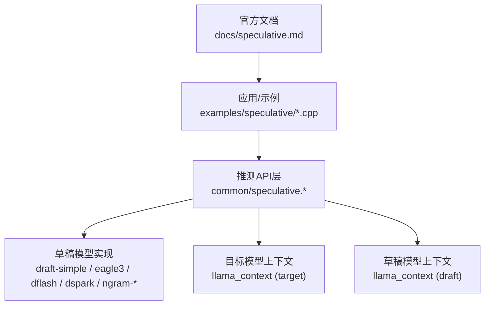
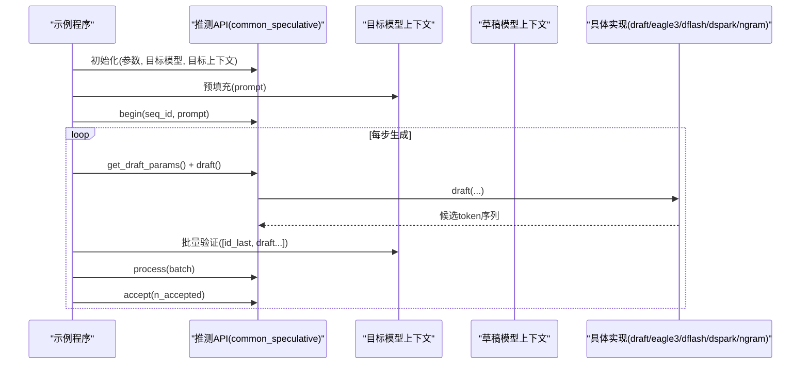
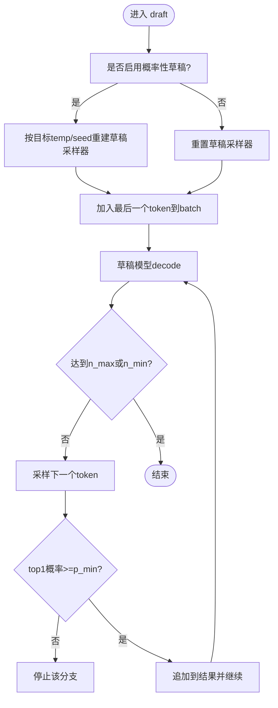
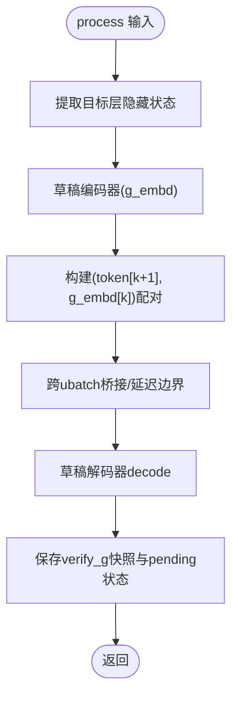
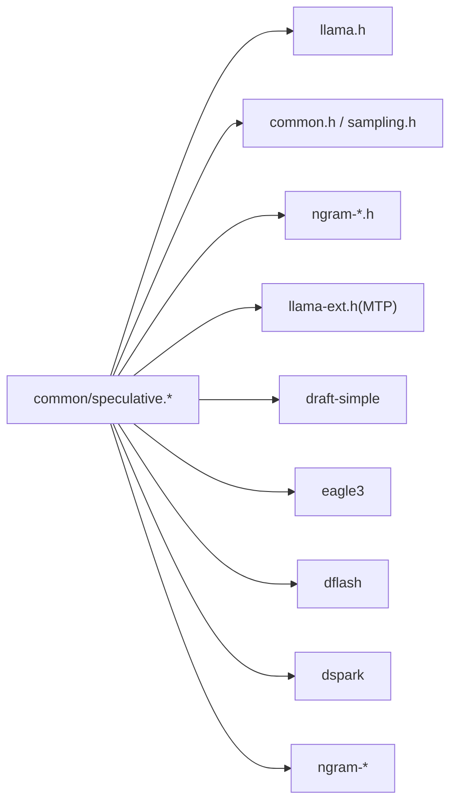

# 推测性解码

<cite>
**本文引用的文件**   
- [common/speculative.h](file://common/speculative.h)
- [common/speculative.cpp](file://common/speculative.cpp)
- [examples/speculative/speculative.cpp](file://examples/speculative/speculative.cpp)
- [examples/speculative-simple/speculative-simple.cpp](file://examples/speculative-simple/speculative-simple.cpp)
- [docs/speculative.md](file://docs/speculative.md)
</cite>

## 目录
1. [简介](#简介)
2. [项目结构](#项目结构)
3. [核心组件](#核心组件)
4. [架构总览](#架构总览)
5. [详细组件分析](#详细组件分析)
6. [依赖关系分析](#依赖关系分析)
7. [性能与适用场景](#性能与适用场景)
8. [主模型与草稿模型配置指南](#主模型与草稿模型配置指南)
9. [最佳实践：训练、验证与生产部署](#最佳实践训练验证与生产部署)
10. [故障排查](#故障排查)
11. [结论](#结论)

## 简介
推测性解码通过“小模型快速生成候选，大模型批量验证”的方式，将顺序生成的瓶颈转化为批处理计算，从而在草稿命中率较高时获得显著吞吐提升。llama.cpp 提供了多种推测实现：基于独立草稿模型的 draft-simple、读取目标隐藏状态的 EAGLE-3、块扩散的 DFlash、带半自回归 Markov 头的 DSpark，以及无需额外模型的 n-gram 系列方案。

本文件面向希望理解并落地 llama.cpp 推测性解码的读者，覆盖工作原理、代码级实现差异、参数调优、性能对比与生产建议。

## 项目结构
与推测性解码直接相关的代码与文档分布如下：
- common/speculative.{h,cpp}：推测框架与多实现（draft-simple、EAGLE-3、DFlash、DSpark、n-gram 等）的统一接口与调度。
- examples/speculative/speculative.cpp：示例程序，显式加载主模型与草稿模型，自行管理双上下文与树状分支。
- examples/speculative-simple/speculative-simple.cpp：简化示例，使用统一 API 初始化推测器，自动选择实现并驱动流程。
- docs/speculative.md：官方说明文档，涵盖类型、命令行参数、统计与基准测试入口。



图表来源
- [common/speculative.h:1-126](file://common/speculative.h#L1-L126)
- [common/speculative.cpp:72-84](file://common/speculative.cpp#L72-L84)
- [examples/speculative/speculative.cpp:34-109](file://examples/speculative/speculative.cpp#L34-L109)
- [examples/speculative-simple/speculative-simple.cpp:17-66](file://examples/speculative-simple/speculative-simple.cpp#L17-L66)
- [docs/speculative.md:1-10](file://docs/speculative.md#L1-L10)

章节来源
- [docs/speculative.md:1-10](file://docs/speculative.md#L1-L10)

## 核心组件
- 推测类型系统：支持 none、draft-simple、draft-eagle3、draft-mtp、draft-dflash、draft-dspark、ngram-simple、ngram-map-k、ngram-map-k4v、ngram-mod、ngram-cache 等。
- 统一抽象：common_speculative 提供 begin/process/draft/accept 生命周期，屏蔽具体实现差异。
- 草稿参数：common_speculative_draft_params 描述当前序列的草稿状态、采样温度/种子、候选分布等。
- 输出容量估算：common_speculative_get_output_limits 根据 batch、并行数与最大草稿长度估算输出缓冲上限。
- 词表兼容性校验：common_speculative_are_compatible 确保主模型与草稿模型词表一致或高度接近。

章节来源
- [common/speculative.h:6-50](file://common/speculative.h#L6-L50)
- [common/speculative.h:56-103](file://common/speculative.h#L56-L103)
- [common/speculative.cpp:72-84](file://common/speculative.cpp#L72-L84)
- [common/speculative.cpp:106-169](file://common/speculative.cpp#L106-L169)

## 架构总览
推测性解码的整体调用链如下：
- 示例程序负责加载主/草稿模型、构建 prompt、设置采样器。
- 统一推测 API 负责：
  - 解析 spec-type 列表，实例化对应实现；
  - 在 begin 阶段准备草稿上下文；
  - 在 process 阶段把目标批次喂给草稿实现（如 MTP/EAGLE3/DFlash/DSpark/n-gram）；
  - 在 draft 阶段生成候选 token 序列；
  - 在 accept 阶段统计被接受的 token 数量。



图表来源
- [examples/speculative-simple/speculative-simple.cpp:111-150](file://examples/speculative-simple/speculative-simple.cpp#L111-L150)
- [examples/speculative-simple/speculative-simple.cpp:162-239](file://examples/speculative-simple/speculative-simple.cpp#L162-L239)
- [common/speculative.h:84-103](file://common/speculative.h#L84-L103)

## 详细组件分析

### 统一推测接口与实现注册
- 类型映射：common_speculative_type_from_name_map 将字符串名映射到枚举类型，便于命令行解析。
- 实现基类：common_speculative_impl 定义 begin/process/draft/accept 虚函数，各实现继承并重写。
- 统计与设备信息：实现内部维护调用次数、时间统计、设备名称拼接等。

```mermaid
classDiagram
class common_speculative_impl {
+type
+n_seq
+n_max
+begin(seq_id, prompt)
+process(batch) bool
+draft(params_vec)
+accept(seq_id, n_accepted, is_other)
+get_state(seq_id, data) bool
+set_state(seq_id, data) void
}
class common_speculative_impl_draft_simple
class common_speculative_impl_draft_eagle3
class common_speculative_impl_draft_dflash
class common_speculative_impl_draft_dspark
class common_speculative_impl_ngram_*
common_speculative_impl <|-- common_speculative_impl_draft_simple
common_speculative_impl <|-- common_speculative_impl_draft_eagle3
common_speculative_impl <|-- common_speculative_impl_draft_dflash
common_speculative_impl <|-- common_speculative_impl_draft_dspark
common_speculative_impl <|-- common_speculative_impl_ngram_*
```

图表来源
- [common/speculative.cpp:173-216](file://common/speculative.cpp#L173-L216)
- [common/speculative.cpp:218-477](file://common/speculative.cpp#L218-L477)
- [common/speculative.cpp:480-795](file://common/speculative.cpp#L480-L795)

章节来源
- [common/speculative.cpp:72-84](file://common/speculative.cpp#L72-L84)
- [common/speculative.cpp:173-216](file://common/speculative.cpp#L173-L216)

### draft-simple 实现要点
- 需要独立的草稿上下文 ctx_dft；若未提供则抛出异常。
- 对多模态输入进行嵌入宽度适配：当目标嵌入宽度与草稿不匹配时用零行占位，避免崩溃但会影响后续草稿质量。
- 支持概率性草稿与贪婪草稿两种模式；当需要拒绝采样时，会按目标温度重建草稿采样器以保证一致性。
- 通过 p_min 阈值提前终止低置信度分支；通过 n_min/n_max 控制最小/最大草稿长度。



图表来源
- [common/speculative.cpp:350-472](file://common/speculative.cpp#L350-L472)

章节来源
- [common/speculative.cpp:218-477](file://common/speculative.cpp#L218-L477)

### EAGLE-3 实现要点
- 从目标模型提取若干层的隐藏状态作为特征 g，送入轻量草稿编码器得到 g_embd。
- 草稿解码器以“下一token + g_embd”为输入，位置对齐需跨 ubatch 桥接与延迟边界处理。
- 支持后端采样 offload；若失败回退 CPU。
- 维护 per-seq 的 pending_g_last/pending_pos_last 与 verify_g 快照，用于接受阶段的正确恢复。



图表来源
- [common/speculative.cpp:480-795](file://common/speculative.cpp#L480-L795)

章节来源
- [common/speculative.cpp:480-795](file://common/speculative.cpp#L480-L795)

### DFlash 与 DSpark 概览
- DFlash：一次前向输出整块草稿 token，将目标隐藏状态注入注意力，GPU友好且保持草稿模型较小。
- DSpark：在 DFlash 基础上增加半自回归 Markov 头，用低秩项偏置每个块位置的 logits，恢复部分从左到右信号。
- 两者均要求专用草稿模型，并通过 --spec-draft-n-max 限制块大小。

章节来源
- [docs/speculative.md:55-115](file://docs/speculative.md#L55-L115)

### n-gram 系列（ngram-simple/map/mod/cache）
- 无需额外模型，基于历史 token 的模式匹配或哈希池生成草稿。
- ngram-simple：查找最近匹配的 n-gram，插入其后 m-gram。
- ngram-map-k/k4v：维护键值映射，支持多值与最低命中阈值。
- ngram-mod：共享哈希池，常数内存与复杂度，适合重复文本/推理总结等场景。

章节来源
- [docs/speculative.md:117-204](file://docs/speculative.md#L117-L204)

### 示例程序对比：speculative vs speculative-simple

#### speculative（显式双上下文、树状分支）
- 手动加载主模型与草稿模型，分别创建 llama_context。
- 自行维护多个草稿分支（tree-based sampling），按概率阈值分裂分支。
- 对每个分支维护 i_batch_tgt/i_batch_dft，并在验证失败时清理与复制 KV。
- 优点：灵活可控，便于实验不同分支策略；缺点：样板代码较多。

章节来源
- [examples/speculative/speculative.cpp:34-109](file://examples/speculative/speculative.cpp#L34-L109)
- [examples/speculative/speculative.cpp:247-641](file://examples/speculative/speculative.cpp#L247-L641)

#### speculative-simple（统一API、自动实现选择）
- 通过 common_speculative_init_from_params 自动选择实现（可含 MTP）。
- 使用 common_speculative_begin/process/draft/accept 驱动循环。
- 支持检查点机制：当上下文不支持部分序列删除时，回滚到检查点并复用部分草稿。
- 优点：简洁、易集成；缺点：分支策略不如示例程序直观。

章节来源
- [examples/speculative-simple/speculative-simple.cpp:17-66](file://examples/speculative-simple/speculative-simple.cpp#L17-L66)
- [examples/speculative-simple/speculative-simple.cpp:111-239](file://examples/speculative-simple/speculative-simple.cpp#L111-L239)
- [examples/speculative-simple/speculative-simple.cpp:247-341](file://examples/speculative-simple/speculative-simple.cpp#L247-L341)

## 依赖关系分析
- 推测API依赖：
  - llama.h：模型/上下文/批处理/采样器等基础能力。
  - common.h/common/sampling.h：通用参数、采样器封装。
  - ngram-*.h：n-gram 相关数据结构与算法。
  - llama-ext.h：MTP 所需的 staging API（如设置/获取 embeddings_nextn）。
- 实现间耦合：
  - draft-simple 仅依赖 ctx_dft 与采样器。
  - EAGLE-3 强依赖目标模型层索引与 hidden state 提取。
  - DFlash/DSpark 依赖专用草稿模型结构与 block diffusion 逻辑。
  - n-gram 系列依赖历史 token 与哈希/映射结构。



图表来源
- [common/speculative.cpp:1-13](file://common/speculative.cpp#L1-L13)
- [common/speculative.cpp:72-84](file://common/speculative.cpp#L72-L84)

章节来源
- [common/speculative.cpp:1-13](file://common/speculative.cpp#L1-L13)

## 性能与适用场景
- 吞吐提升条件：草稿命中率越高，批量验证的收益越大；当草稿命中率低时，额外草稿开销可能抵消收益。
- 典型加速场景：
  - 重复性强的文本（代码重写、模板生成、推理总结）。
  - 长上下文下稳定段落（n-gram 系列表现较好）。
  - 针对特定目标的专用草稿模型（EAGLE-3/DFlash/DSpark）通常有更高接受率。
- 关键指标：
  - 草稿接受率（accepted/generated）。
  - 每步平均接受长度（含目标 token）。
  - 各实现耗时（begin/generate/accept）。

章节来源
- [docs/speculative.md:423-448](file://docs/speculative.md#L423-L448)

## 主模型与草稿模型配置指南

### 模型选择
- 草稿模型应与主模型词表兼容（类型、BOS/EOS、词表大小差与内容一致性）。
- 专用草稿模型（EAGLE-3/DFlash/DSpark）需使用目标模型目录转换，以继承 tokenizer 与层索引/嵌入映射。

章节来源
- [common/speculative.cpp:106-169](file://common/speculative.cpp#L106-L169)
- [docs/speculative.md:16-53](file://docs/speculative.md#L16-L53)
- [docs/speculative.md:55-115](file://docs/speculative.md#L55-L115)

### 参数调优
- 通用推测参数：
  - --spec-type：选择一种或多种推测实现（逗号分隔）。
  - --spec-default：启用默认配置（包含 ngram-mod）。
- 草稿模型参数：
  - --spec-draft-model/-md：草稿模型路径。
  - --spec-draft-n-max/--spec-draft-n-min：最大/最小草稿长度。
  - --spec-draft-p-split：分支分裂概率（多分支时）。
  - --spec-draft-p-min：贪婪草稿的最小 top1 概率阈值。
  - --spec-draft-ngl/-ngld：草稿模型 GPU 层数。
  - --spec-draft-device：草稿模型设备分配。
- n-gram 系列参数：
  - size-n/size-m/min-hits 等按实现区分。

章节来源
- [docs/speculative.md:205-359](file://docs/speculative.md#L205-L359)

### 性能对比方法
- 使用 SPEED-Bench 客户端对比基线与推测模式的端到端吞吐、延迟与接受率。
- 观察各实现的统计输出（调用次数、生成/接受草稿与 token 数、耗时）。

章节来源
- [docs/speculative.md:449-453](file://docs/speculative.md#L449-L453)
- [docs/speculative.md:423-448](file://docs/speculative.md#L423-L448)

## 最佳实践：训练、验证与生产部署

### 草稿模型训练
- 专用草稿模型（EAGLE-3/DFlash/DSpark）：
  - 使用目标模型目录转换，确保继承 tokenizer 与层索引/嵌入映射。
  - 针对目标模型微调，提高隐藏状态预测与块扩散质量。
- 无模型方案（n-gram 系列）：
  - 调整 n/m 与 min-hits 以平衡准确率与速度。
  - 在重复性强的任务中优先尝试 ngram-mod 或 ngram-map-k4v。

章节来源
- [docs/speculative.md:16-53](file://docs/speculative.md#L16-L53)
- [docs/speculative.md:55-115](file://docs/speculative.md#L55-L115)
- [docs/speculative.md:117-204](file://docs/speculative.md#L117-L204)

### 验证策略
- 词表兼容性校验：确保 BOS/EOS 与词表内容一致或差异在允许范围内。
- 接受率监控：关注 accepted/generated 比率与平均接受长度。
- 分场景压测：短提示、长上下文、重复文本、推理总结等。

章节来源
- [common/speculative.cpp:106-169](file://common/speculative.cpp#L106-L169)
- [docs/speculative.md:423-448](file://docs/speculative.md#L423-L448)

### 生产环境部署建议
- 合理设置 --spec-draft-n-max：过大降低接受率，过小减少加速空间。
- 设备与线程：
  - 草稿模型可使用独立设备与线程池，避免与主模型争抢资源。
  - 在多卡/多进程环境中，注意 kv cache 与批大小的协调。
- 检查点与回滚：
  - 当上下文不支持部分序列删除时，启用检查点机制以避免状态不一致。
- 合成接受率（基准）：
  - 使用 --spec-synth-rates 或 --spec-synth-len 进行纯吞吐基准，忽略真实接受逻辑。

章节来源
- [examples/speculative-simple/speculative-simple.cpp:171-213](file://examples/speculative-simple/speculative-simple.cpp#L171-L213)
- [docs/speculative.md:209-223](file://docs/speculative.md#L209-L223)

## 故障排查
- 词表不兼容：
  - 现象：启动时报错 vocab type/BOS/EOS 不匹配或词表大小差异过大。
  - 解决：使用相同 tokenizer 的草稿模型，或重新转换专用草稿模型。
- 多模态嵌入宽度不匹配：
  - 现象：警告目标嵌入宽度与草稿输入宽度不一致，后续草稿质量下降。
  - 解决：尽量使用与目标模型一致的嵌入宽度，或避免在草稿中使用多模态输入。
- 草稿上下文序列数不匹配：
  - 现象：报错 n_seq mismatch。
  - 解决：确保草稿上下文的 max sequences 与推测配置的 n_seq 一致。
- 部分接受导致的状态不一致：
  - 现象：KV 缓存中出现多余 token，影响后续生成。
  - 解决：启用检查点机制或在每次完整接受后清理 KV。

章节来源
- [common/speculative.cpp:106-169](file://common/speculative.cpp#L106-L169)
- [common/speculative.cpp:318-332](file://common/speculative.cpp#L318-L332)
- [examples/speculative/speculative.cpp:120-170](file://examples/speculative/speculative.cpp#L120-L170)
- [examples/speculative-simple/speculative-simple.cpp:263-289](file://examples/speculative-simple/speculative-simple.cpp#L263-L289)

## 结论
llama.cpp 的推测性解码通过统一的 common_speculative 接口，将多种草稿策略（独立草稿模型、隐藏状态读取、块扩散、n-gram 模式）整合在一起。对于生产环境，建议：
- 优先评估专用草稿模型（EAGLE-3/DFlash/DSpark）在目标模型上的接受率与吞吐增益。
- 在重复性强、模式稳定的场景中，结合 n-gram 系列以获得低成本加速。
- 严格校验词表兼容性，合理设置草稿长度与概率阈值，并使用检查点机制保证状态一致性。
- 借助 SPEED-Bench 与统计输出持续监控与优化端到端性能。