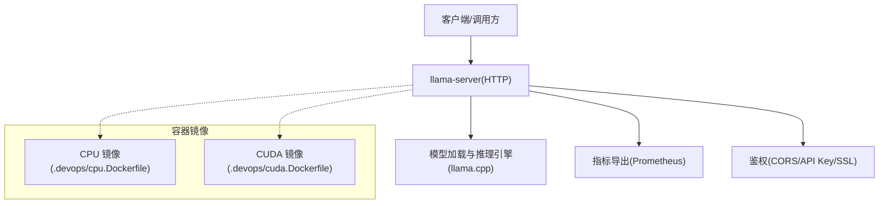
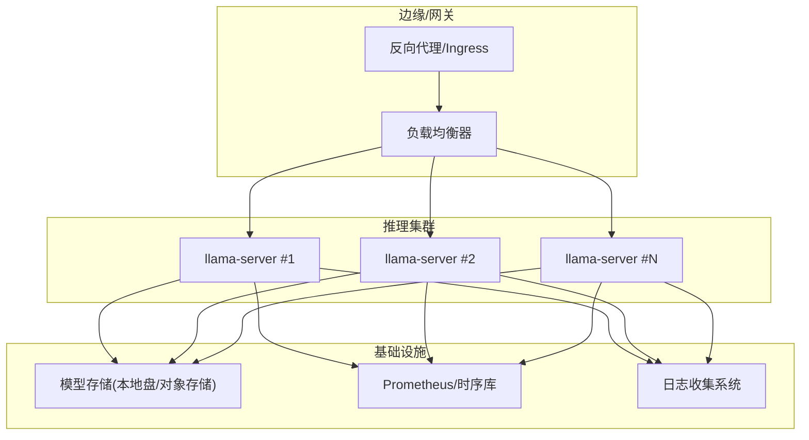
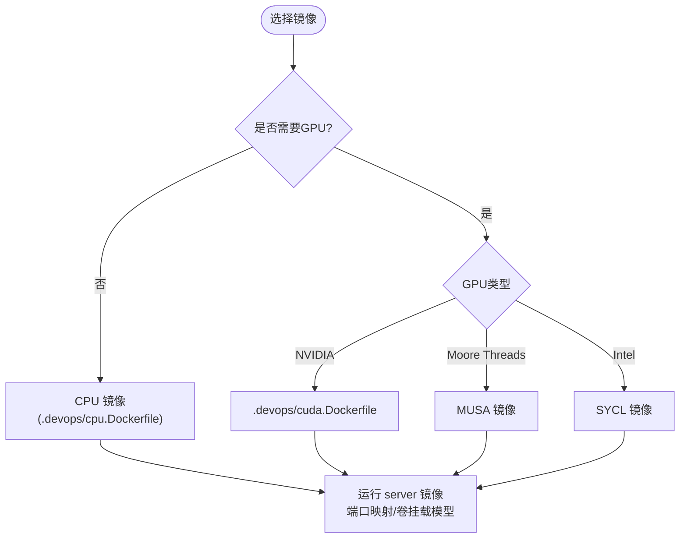
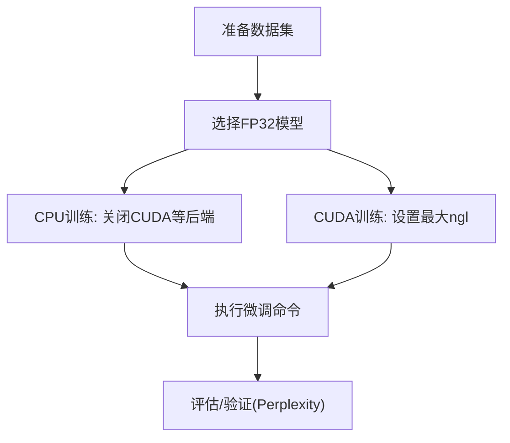
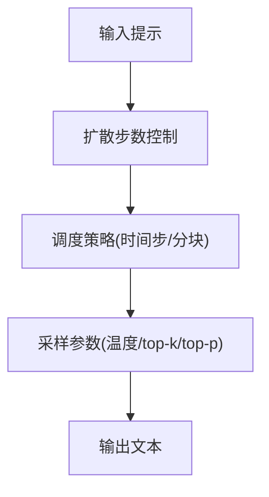
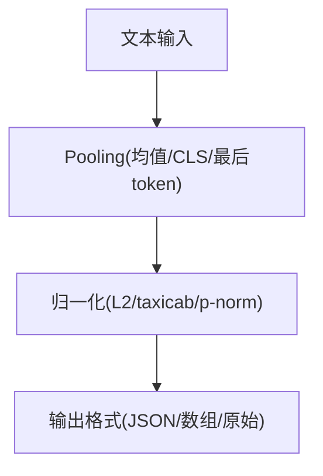
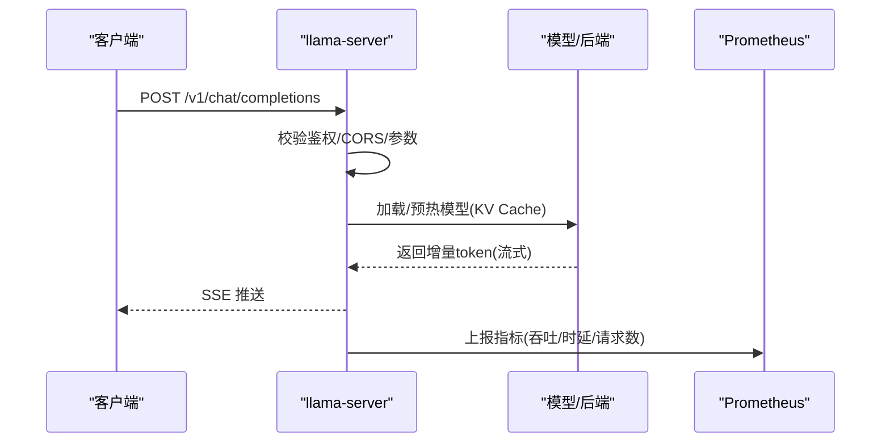
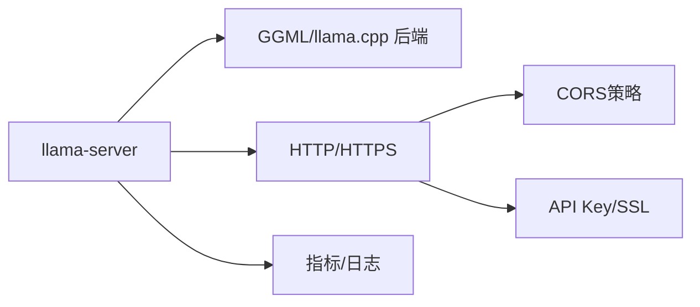
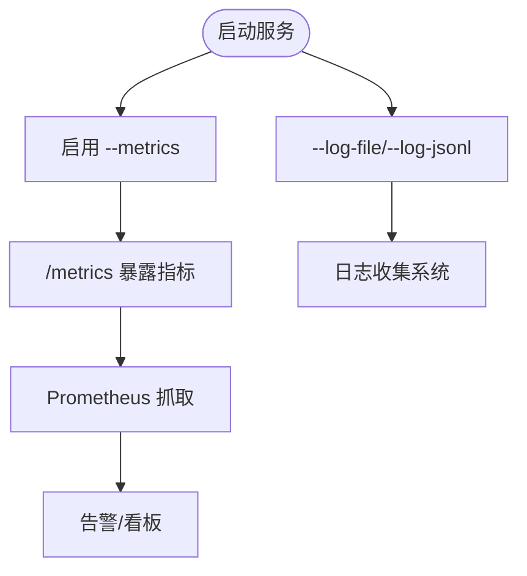

# 生产环境部署

<cite>
**本文引用的文件**   
- [README.md](file://README.md)
- [docker.md](file://docs/docker.md)
- [.devops/cpu.Dockerfile](file://.devops/cpu.Dockerfile)
- [.devops/cuda.Dockerfile](file://.devops/cuda.Dockerfile)
- [tools/server/README.md](file://tools/server/README.md)
- [tools/server/server-task.cpp](file://tools/server/server-task.cpp)
- [examples/training/README.md](file://examples/training/README.md)
- [examples/diffusion/README.md](file://examples/diffusion/README.md)
- [examples/embedding/README.md](file://examples/embedding/README.md)
- [tools/server/tests/unit/test_metrics.py](file://tools/server/tests/unit/test_metrics.py)
- [tools/server/bench/bench.py](file://tools/server/bench/bench.py)
- [common/arg.cpp](file://common/arg.cpp)
</cite>

## 目录
1. [简介](#简介)
2. [项目结构](#项目结构)
3. [核心组件](#核心组件)
4. [架构总览](#架构总览)
5. [详细组件分析](#详细组件分析)
6. [依赖关系分析](#依赖关系分析)
7. [性能与容量规划](#性能与容量规划)
8. [监控与日志](#监控与日志)
9. [安全与合规](#安全与合规)
10. [故障排查指南](#故障排查指南)
11. [结论](#结论)
12. [附录](#附录)

## 简介
本指南面向将 llama.cpp 从示例应用扩展到生产级服务，覆盖容器化、负载均衡与高可用、训练微调、扩散模型与嵌入等高级功能的部署注意事项；并提供监控、日志、安全与数据保护的最佳实践。llama.cpp 提供轻量 HTTP 服务器（llama-server），支持 OpenAI/Anthropic 兼容接口、多模态、连续批处理、Prometheus 指标、CORS、API Key 鉴权与 SSL 等能力，便于在云原生环境中进行水平扩展与弹性伸缩。

## 项目结构
- 文档与镜像：docs/docker.md 提供官方镜像族谱与用法；.devops/*.Dockerfile 提供 CPU/CUDA/MUSA/SYCL/Vulkan/OpenVINO 等多后端构建模板
- 服务端：tools/server/* 实现 HTTP 服务、路由、任务调度、指标导出、CORS、鉴权等
- 示例：examples/{training,diffusion,embedding} 分别给出微调、扩散生成、向量嵌入的 CLI 示例与参数说明
- 通用配置：common/arg.cpp 集中解析命令行与环境变量（含 API Key、SSL 等）

图示来源
- [tools/server/README.md:1-22](file://tools/server/README.md#L1-L22)
- [.devops/cpu.Dockerfile:81-125](file://.devops/cpu.Dockerfile#L81-L125)
- [.devops/cuda.Dockerfile:89-134](file://.devops/cuda.Dockerfile#L89-L134)

章节来源
- [README.md:60-97](file://README.md#L60-L97)
- [docs/docker.md:7-41](file://docs/docker.md#L7-L41)

## 核心组件
- llama-server：HTTP 服务入口，提供聊天补全、补全、Embedding、Rerank、工具调用、MCP 等端点，支持流式响应与 SSE ping
- 推理内核：基于 ggml/llama.cpp 的多后端（CPU/GPU/NPU/WebGPU 等）与量化权重加载、KV Cache、连续批处理
- 指标与可观测性：内置 Prometheus 指标端点，暴露吞吐、时延、请求数、上下文长度水位、推测解码统计等
- 安全能力：API Key、CORS、SSL/TLS、离线模式、媒体路径限制、工具沙箱运行（可选）

章节来源
- [tools/server/README.md:1-22](file://tools/server/README.md#L1-L22)
- [tools/server/README.md:159-224](file://tools/server/README.md#L159-L224)
- [tools/server/server-task.cpp:1525-1619](file://tools/server/server-task.cpp#L1525-L1619)

## 架构总览
下图展示生产环境的典型分层：前端/网关通过反向代理或 Service Mesh 接入多个 llama-server 实例，共享模型存储与缓存，统一采集指标与日志。

[该图为概念图，不直接映射具体源码文件]

## 详细组件分析

### 容器化与镜像选择
- 官方镜像族谱：full/light/server 三套基础镜像，并附带 CUDA/ROCm/MUSA/SYCL/Vulkan/OpenVINO 变体
- 最小化运行：server 镜像仅包含 llama-server，适合无头服务部署
- GPU 运行时：CUDA 使用 nvidia-container-toolkit，MUSA 使用 mthreads runtime，SYCL 需挂载 /dev/dri
- 健康检查：server 镜像默认 HEALTHCHECK 探测 /health

图示来源
- [docs/docker.md:7-41](file://docs/docker.md#L7-L41)
- [.devops/cpu.Dockerfile:113-125](file://.devops/cpu.Dockerfile#L113-L125)
- [.devops/cuda.Dockerfile:122-134](file://.devops/cuda.Dockerfile#L122-L134)

章节来源
- [docs/docker.md:43-108](file://docs/docker.md#L43-L108)
- [docs/docker.md:110-174](file://docs/docker.md#L110-L174)

### 负载均衡与高可用
- 多副本部署：每个副本独立进程，通过外部负载均衡器分发请求
- 会话亲和性：若使用 KV 缓存复用（cache_prompt/cache-reuse），建议按模型别名或请求特征做亲和路由，避免跨实例重复预填充
- 优雅扩缩容：结合 Kubernetes HPA 基于请求延迟/吞吐/队列长度触发扩容
- 健康探针：利用 /health 与 /metrics 作为就绪/存活探针

章节来源
- [tools/server/README.md:473-484](file://tools/server/README.md#L473-L484)
- [tools/server/README.md:220-224](file://tools/server/README.md#L220-L224)

### 训练微调（Finetuning）
- 当前为实验性能力，适用于 FP32 模型与有限硬件场景；CPU 训练需关闭额外后端；CUDA 训练需最大化 GPU 层数
- 注意 Flash Attention 在训练中禁用（无反向传播）
- 生产建议：将微调与推理解耦，单独资源池与镜像，避免相互抢占

图示来源
- [examples/training/README.md:1-20](file://examples/training/README.md#L1-L20)

章节来源
- [examples/training/README.md:1-20](file://examples/training/README.md#L1-L20)

### 扩散模型（Diffusion）
- 支持多种算法与调度策略（时间步/分块），可开启可视化
- 生产建议：扩散步骤较多，需预留更高内存与更长超时；对并发进行限流与排队

图示来源
- [examples/diffusion/README.md:9-59](file://examples/diffusion/README.md#L9-L59)

章节来源
- [examples/diffusion/README.md:1-60](file://examples/diffusion/README.md#L1-L60)

### 嵌入（Embedding）
- 支持多种 pooling 与归一化方式，输出格式可选 JSON/数组/原始文本
- 生产建议：使用专用 embedding 模型与服务端 --embedding 模式，隔离计算资源与 KV 缓存

图示来源
- [examples/embedding/README.md:1-62](file://examples/embedding/README.md#L1-L62)

章节来源
- [examples/embedding/README.md:1-62](file://examples/embedding/README.md#L1-L62)

### 服务端关键流程（OpenAI 兼容聊天）

图示来源
- [tools/server/README.md:473-484](file://tools/server/README.md#L473-L484)
- [tools/server/server-task.cpp:1525-1619](file://tools/server/server-task.cpp#L1525-L1619)

## 依赖关系分析
- 运行时依赖：根据后端不同需要 CUDA/MUSA/SYCL/OpenVINO 驱动与容器运行时
- 网络与安全：CORS、API Key、SSL 证书/私钥
- 可观测性：Prometheus 抓取 /metrics；日志可通过 --log-file/--log-jsonl 输出

图示来源
- [tools/server/README.md:159-224](file://tools/server/README.md#L159-L224)
- [common/arg.cpp:3512-3547](file://common/arg.cpp#L3512-L3547)

章节来源
- [tools/server/README.md:159-224](file://tools/server/README.md#L159-L224)
- [common/arg.cpp:3512-3547](file://common/arg.cpp#L3512-L3547)

## 性能与容量规划
- 线程与批大小：合理设置 threads、batch-size、ubatch-size；启用连续批处理（cont-batching）提升吞吐
- KV Cache：根据并发与上下文长度调整 ctx-size、kv-offload、cache-type-k/v；必要时启用 unified KV 与 idle slot 缓存
- 设备卸载：按显存容量设置 n-gpu-layers、split-mode、tensor-split；大模型考虑 CPU+GPU 混合
- 推测解码：按需启用 spec-draft-* 系列参数，平衡吞吐与时延
- 资源隔离：为微调/扩散/推理分别分配节点池，避免互相干扰

章节来源
- [tools/server/README.md:30-117](file://tools/server/README.md#L30-L117)
- [tools/server/README.md:159-224](file://tools/server/README.md#L159-L224)

## 监控与日志
- 指标端点：启用 --metrics 暴露 Prometheus 指标，包括 prompt/predict 吞吐、请求数、decode 次数、上下文水位、推测解码接受率等
- 指标测试：单元测试验证指标名称与类型，确保 HELP/TYPE 行存在
- 基准脚本：bench.py 可从 Prometheus 拉取指标并绘图
- 日志：支持 --log-file、--log-jsonl、--log-colors、--log-timestamps、--log-prefix、--log-verbosity

图示来源
- [tools/server/README.md:220-224](file://tools/server/README.md#L220-L224)
- [tools/server/server-task.cpp:1525-1619](file://tools/server/server-task.cpp#L1525-L1619)
- [tools/server/tests/unit/test_metrics.py:51-84](file://tools/server/tests/unit/test_metrics.py#L51-L84)
- [tools/server/bench/bench.py:121-140](file://tools/server/bench/bench.py#L121-L140)

章节来源
- [tools/server/README.md:1131-1149](file://tools/server/README.md#L1131-L1149)
- [tools/server/tests/unit/test_metrics.py:51-84](file://tools/server/tests/unit/test_metrics.py#L51-L84)
- [tools/server/bench/bench.py:121-140](file://tools/server/bench/bench.py#L121-L140)

## 安全与合规
- 访问控制
  - API Key：通过 --api-key 或 --api-key-file 配置密钥，配合环境变量 LLAMA_API_KEY
  - CORS：根据部署位置设置 --cors-origins、--cors-methods、--cors-headers、--cors-credentials；启用 --agent/--tools 时默认限制为 localhost
  - SSL/TLS：通过 --ssl-key-file 与 --ssl-cert-file 启用 HTTPS
- 功能开关
  - 工具与 MCP：谨慎启用 --tools/--mcp-servers-config/--ui-mcp-proxy，仅在可信环境开放
  - 媒体路径：--media-path 限制本地文件访问范围
  - 离线模式：--offline 禁止网络访问，强制使用缓存
- 权限与最小化
  - 容器以非 root 用户运行，只挂载必要目录与设备
  - 镜像裁剪：server 镜像仅包含必要二进制与依赖

章节来源
- [tools/server/README.md:193-224](file://tools/server/README.md#L193-L224)
- [tools/server/README.md:392-406](file://tools/server/README.md#L392-L406)
- [common/arg.cpp:3512-3547](file://common/arg.cpp#L3512-L3547)

## 故障排查指南
- 模型未就绪：/health 返回 503 表示仍在加载，等待至 200
- 指标缺失：确认已启用 --metrics，并通过单元测试断言指标 HELP/TYPE 行
- 并发异常：检查 --parallel、--cont-batching、KV Cache 相关参数是否匹配负载
- GPU 显存不足：降低 n-gpu-layers、增大 fit-target、启用 kv-offload 或使用 split-mode
- 日志定位：开启 --log-jsonl 与 --log-timestamps，结合 --log-file 输出到持久卷

章节来源
- [tools/server/README.md:473-484](file://tools/server/README.md#L473-L484)
- [tools/server/tests/unit/test_metrics.py:51-84](file://tools/server/tests/unit/test_metrics.py#L51-L84)

## 结论
通过将 llama-server 容器化、置于负载均衡之后，并结合 Prometheus 指标与结构化日志，可实现可扩展、可观测、安全的推理服务。针对训练微调、扩散与嵌入等高级能力，建议采用独立资源池与专用镜像，配合合理的批大小、KV Cache 与设备卸载策略，达到稳定与高性能的生产目标。

## 附录
- 常用环境变量（部分）
  - LLAMA_ARG_MODEL / LLAMA_ARG_CTX_SIZE / LLAMA_ARG_N_PARALLEL / LLAMA_ARG_PORT / LLAMA_ARG_ENDPOINT_METRICS
- 参考命令（容器）
  - CPU：docker run -p 8080:8080 -v /models:/models ghcr.io/ggml-org/llama.cpp:server -m /models/model.gguf --host 0.0.0.0 --port 8080
  - CUDA：docker run --gpus all -p 8080:8080 -v /models:/models ghcr.io/ggml-org/llama.cpp:server-cuda -m /models/model.gguf --host 0.0.0.0 --port 8080 --n-gpu-layers 99

章节来源
- [docs/docker.md:67-108](file://docs/docker.md#L67-L108)
- [tools/server/README.md:321-338](file://tools/server/README.md#L321-L338)