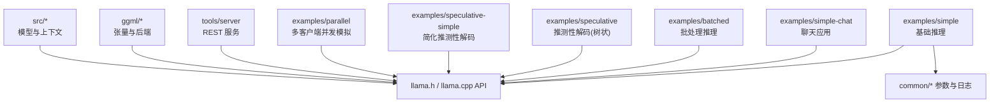
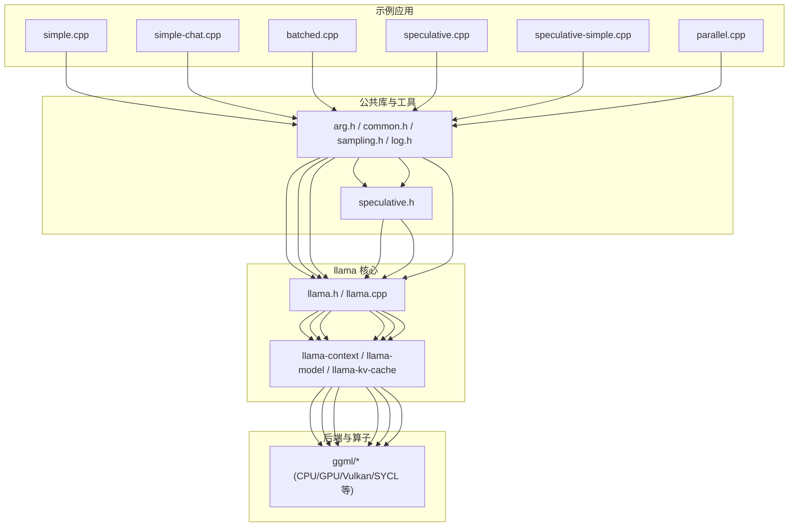
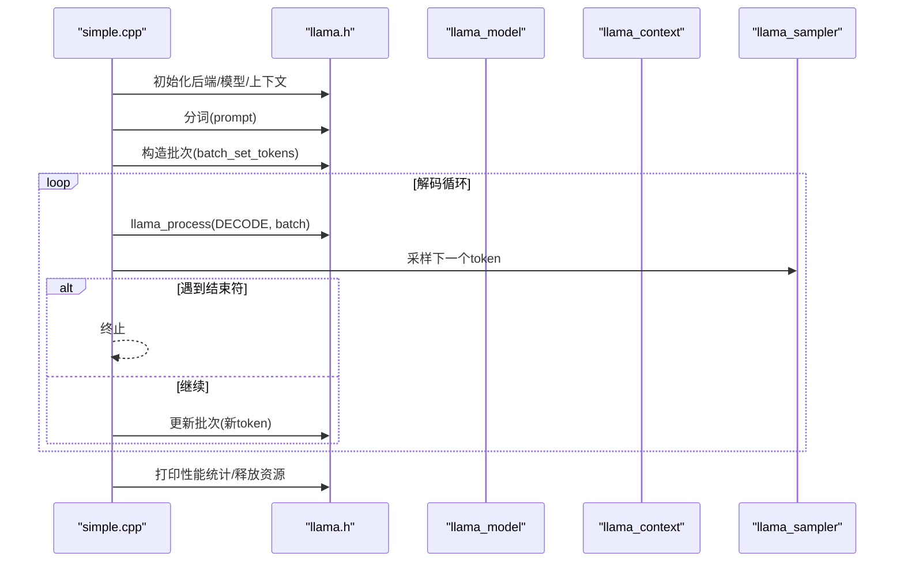
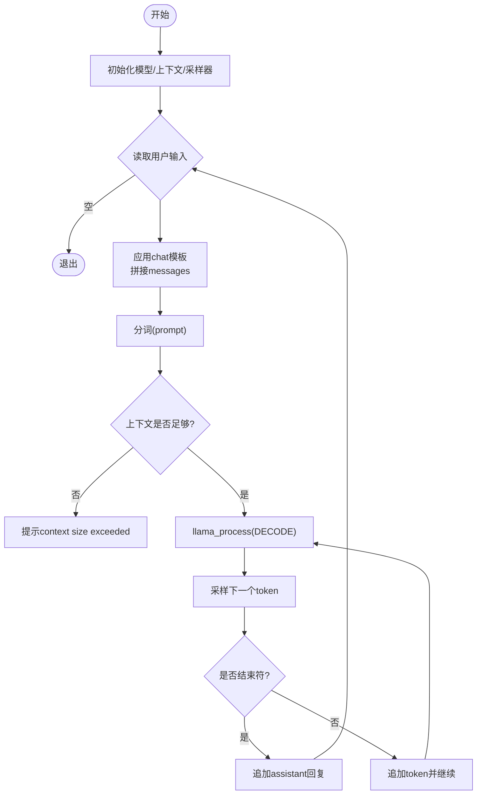
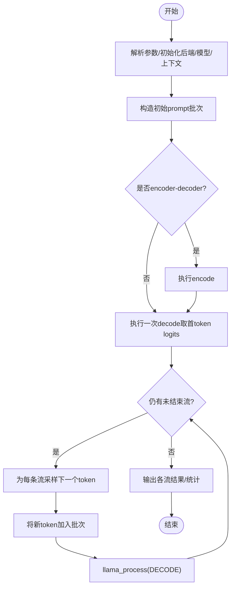
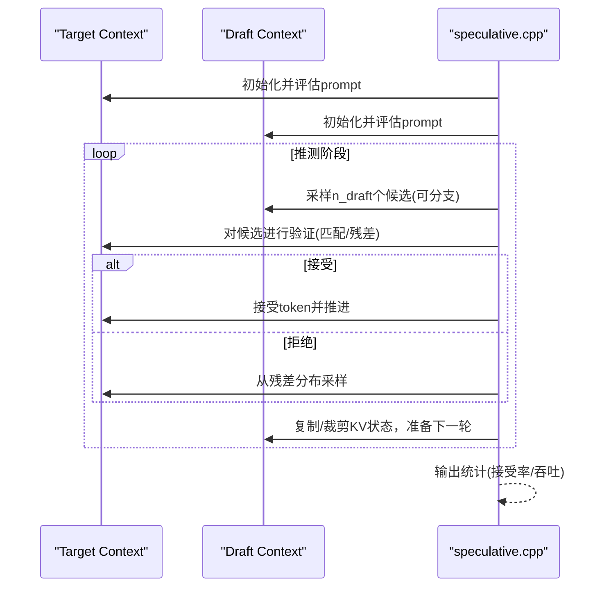
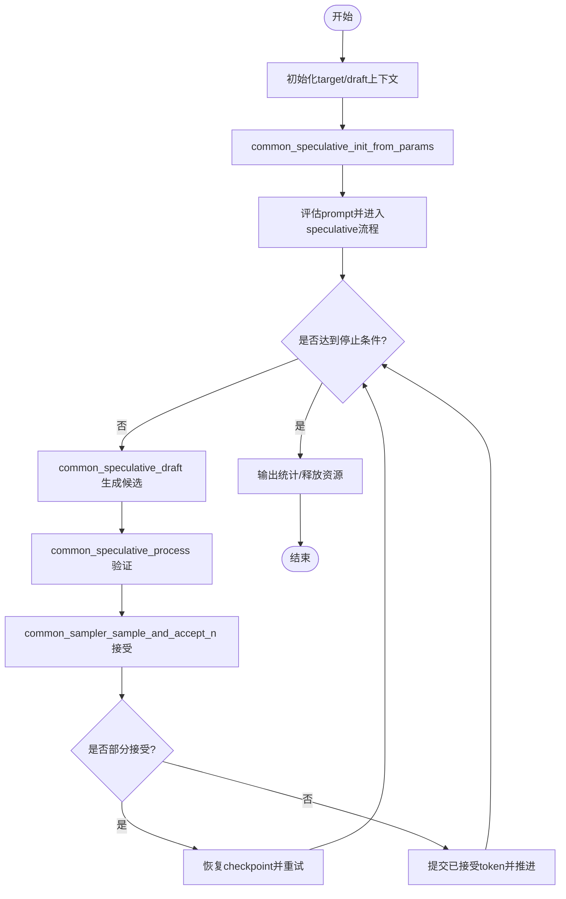
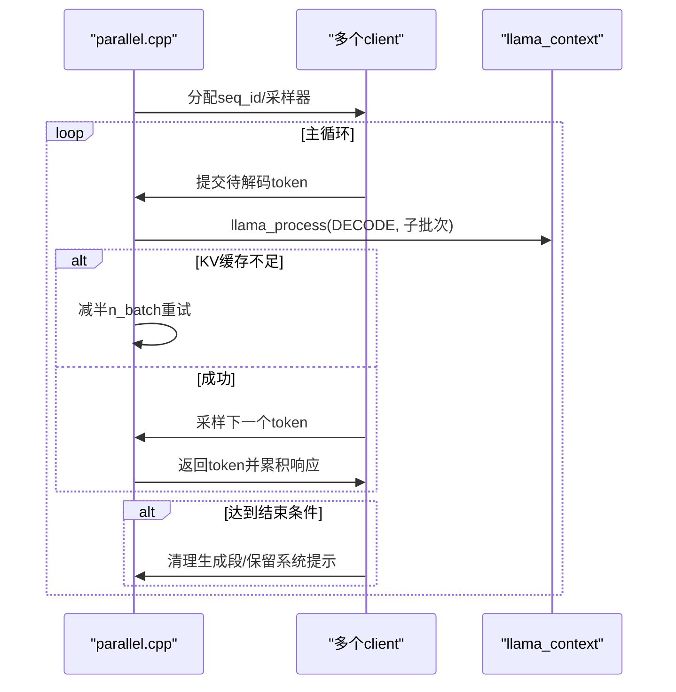
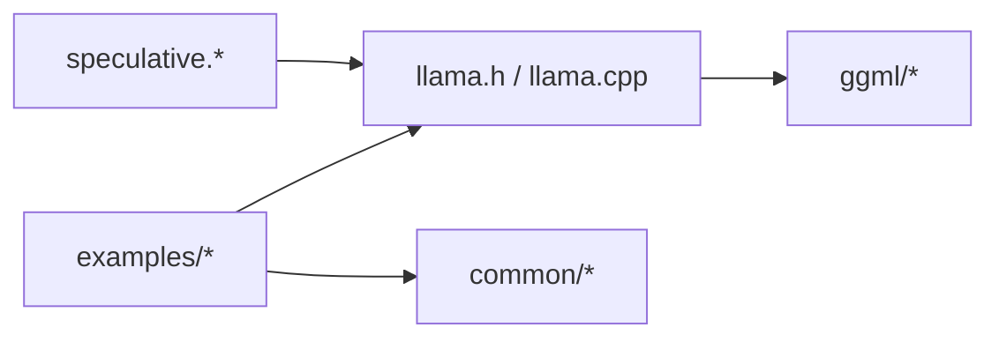

# 示例与最佳实践

<cite>
**本文引用的文件**   
- [README.md](file://README.md)
- [simple.cpp](file://examples/simple/simple.cpp)
- [simple-chat.cpp](file://examples/simple-chat/simple-chat.cpp)
- [batched.cpp](file://examples/batched/batched.cpp)
- [speculative.cpp](file://examples/speculative/speculative.cpp)
- [speculative-simple.cpp](file://examples/speculative-simple/speculative-simple.cpp)
- [parallel.cpp](file://examples/parallel/parallel.cpp)
</cite>

## 目录
1. [简介](#简介)
2. [项目结构](#项目结构)
3. [核心组件](#核心组件)
4. [架构总览](#架构总览)
5. [详细组件分析](#详细组件分析)
6. [依赖关系分析](#依赖关系分析)
7. [性能优化与实战经验](#性能优化与实战经验)
8. [生产环境部署建议](#生产环境部署建议)
9. [故障排查与调试技巧](#故障排查与调试技巧)
10. [结论](#结论)

## 简介
本指南面向希望在 llama.cpp 上构建从简单推理到复杂服务化场景的开发者，提供循序渐进的示例与最佳实践。内容覆盖：
- 基础文本生成、聊天应用、批处理推理、推测性解码（含树状分支）以及多客户端并发模拟
- 关键实现思路、调用链路与设计模式
- 内存管理、并行计算与硬件加速配置要点
- 容器化、负载均衡与监控告警的生产建议
- 常见问题定位与调试方法

## 项目结构
llama.cpp 仓库以 C/C++ 为核心，示例位于 examples 目录，涵盖多种典型用法；工具与文档在 tools 与 docs 中；底层算子与后端在 ggml 与 src 中。

图表来源
- [simple.cpp:1-239](file://examples/simple/simple.cpp#L1-L239)
- [simple-chat.cpp:1-230](file://examples/simple-chat/simple-chat.cpp#L1-L230)
- [batched.cpp:1-264](file://examples/batched/batched.cpp#L1-L264)
- [speculative.cpp:1-678](file://examples/speculative/speculative.cpp#L1-L678)
- [speculative-simple.cpp:1-376](file://examples/speculative-simple/speculative-simple.cpp#L1-L376)
- [parallel.cpp:1-509](file://examples/parallel/parallel.cpp#L1-L509)

章节来源
- [README.md:20-45](file://README.md#L20-L45)

## 核心组件
- 模型加载与上下文初始化：通过 llama_model_load_from_file 与 llama_init_from_model 完成
- Tokenizer 与采样器：llama_tokenize、llama_sampler_chain_* 等
- 批次构造与解码：llama_batch_ext/common_batch + llama_process(LLAMA_PROCESS_TYPE_DECODE/ENCODE)
- KV 缓存与序列管理：llama_get_memory、llama_memory_seq_*
- 推测性解码：draft/target 双上下文、候选验证与接受策略、部分接受回滚

章节来源
- [simple.cpp:91-128](file://examples/simple/simple.cpp#L91-L128)
- [simple-chat.cpp:79-109](file://examples/simple-chat/simple-chat.cpp#L79-L109)
- [batched.cpp:41-92](file://examples/batched/batched.cpp#L41-L92)
- [speculative.cpp:77-109](file://examples/speculative/speculative.cpp#L77-L109)
- [speculative-simple.cpp:38-66](file://examples/speculative-simple/speculative-simple.cpp#L38-L66)

## 架构总览
下图展示从示例程序到核心 API 的调用关系，体现“应用层 -> 公共库 -> llama API -> 模型/上下文 -> 后端”的分层。

图表来源
- [simple.cpp:1-239](file://examples/simple/simple.cpp#L1-L239)
- [simple-chat.cpp:1-230](file://examples/simple-chat/simple-chat.cpp#L1-L230)
- [batched.cpp:1-264](file://examples/batched/batched.cpp#L1-L264)
- [speculative.cpp:1-678](file://examples/speculative/speculative.cpp#L1-L678)
- [speculative-simple.cpp:1-376](file://examples/speculative-simple/speculative-simple.cpp#L1-L376)
- [parallel.cpp:1-509](file://examples/parallel/parallel.cpp#L1-L509)

## 详细组件分析

### 基础推理示例（simple）
- 目标：最小化地加载模型、分词、构造批次并逐 token 解码输出
- 关键点：
  - 命令行解析与参数校验
  - 模型与上下文初始化（GPU 层数、上下文大小、批大小）
  - 采样器链（贪心采样）
  - 编码器/解码器统一流程（支持 encoder-decoder 模型）
  - 性能统计打印

图表来源
- [simple.cpp:91-128](file://examples/simple/simple.cpp#L91-L128)
- [simple.cpp:156-218](file://examples/simple/simple.cpp#L156-L218)
- [simple.cpp:222-235](file://examples/simple/simple.cpp#L222-L235)

章节来源
- [simple.cpp:1-239](file://examples/simple/simple.cpp#L1-L239)

### 聊天应用示例（simple-chat）
- 目标：基于 GGUF 内置 chat template 的多轮对话
- 关键点：
  - 使用 llama_chat_apply_template 格式化消息
  - 动态扩展缓冲区避免溢出
  - 采样器链（min_p + temp + 随机）
  - 上下文长度检查与提示

图表来源
- [simple-chat.cpp:79-109](file://examples/simple-chat/simple-chat.cpp#L79-L109)
- [simple-chat.cpp:112-173](file://examples/simple-chat/simple-chat.cpp#L112-L173)
- [simple-chat.cpp:175-217](file://examples/simple-chat/simple-chat.cpp#L175-L217)

章节来源
- [simple-chat.cpp:1-230](file://examples/simple-chat/simple-chat.cpp#L1-L230)

### 批处理推理示例（batched）
- 目标：对同一 prompt 并行生成多条序列，复用 KV 缓存
- 关键点：
  - 多采样器链（top_k/top_p/temp/dist）
  - 统一 KV 缓存（kv_unified）与 n_kv_req 估算
  - 按步推进，维护每个流的 i_batch 索引
  - 流结束标记与批量清理

图表来源
- [batched.cpp:41-92](file://examples/batched/batched.cpp#L41-L92)
- [batched.cpp:118-154](file://examples/batched/batched.cpp#L118-L154)
- [batched.cpp:166-231](file://examples/batched/batched.cpp#L166-L231)

章节来源
- [batched.cpp:1-264](file://examples/batched/batched.cpp#L1-L264)

### 推测性解码（speculative，树状分支）
- 目标：使用 draft 模型快速生成候选，再由 target 模型验证并接受
- 关键点：
  - 双上下文（target/draft），词汇表一致性校验
  - 树状分支：按概率阈值分裂分支，维护 active_seqs
  - 概率匹配或残差分布重采样
  - 状态同步与 KV 拷贝/裁剪

图表来源
- [speculative.cpp:77-109](file://examples/speculative/speculative.cpp#L77-L109)
- [speculative.cpp:247-454](file://examples/speculative/speculative.cpp#L247-L454)
- [speculative.cpp:456-630](file://examples/speculative/speculative.cpp#L456-L630)

章节来源
- [speculative.cpp:1-678](file://examples/speculative/speculative.cpp#L1-L678)

### 简化版推测性解码（speculative-simple）
- 目标：封装 common_speculative_* 接口，简化草稿生成与验证流程
- 关键点：
  - common_speculative_init_from_params 自动选择 draft 类型（MTP/Eagle3/DFlash/DSpark 等）
  - 支持部分接受回滚（checkpoint）
  - 统一的 accept 与统计输出

图表来源
- [speculative-simple.cpp:38-66](file://examples/speculative-simple/speculative-simple.cpp#L38-L66)
- [speculative-simple.cpp:116-150](file://examples/speculative-simple/speculative-simple.cpp#L116-L150)
- [speculative-simple.cpp:162-341](file://examples/speculative-simple/speculative-simple.cpp#L162-L341)

章节来源
- [speculative-simple.cpp:1-376](file://examples/speculative-simple/speculative-simple.cpp#L1-L376)

### 多客户端并发模拟（parallel）
- 目标：模拟服务端同时处理多个客户端请求，共享系统提示的 KV 缓存
- 关键点：
  - 每客户端独立采样器与序列 ID
  - 连续批处理（cont_batching）与分批 chunk 解码
  - KV 缓存命中/缺失与自适应重试（减半 n_batch）
  - 系统提示共享（is_pp_shared）减少重复计算

图表来源
- [parallel.cpp:194-203](file://examples/parallel/parallel.cpp#L194-L203)
- [parallel.cpp:265-283](file://examples/parallel/parallel.cpp#L265-L283)
- [parallel.cpp:287-478](file://examples/parallel/parallel.cpp#L287-L478)

章节来源
- [parallel.cpp:1-509](file://examples/parallel/parallel.cpp#L1-L509)

## 依赖关系分析
- 示例代码依赖 llama.h 提供的模型/上下文/采样器/批次 API
- 公共库 arg/common/sampling/log 提供参数解析、通用工具与日志
- 推测性解码依赖 speculative.h 的统一抽象
- 底层由 ggml 提供张量运算与多后端（CUDA/Metal/Vulkan/SYCL 等）

图表来源
- [simple.cpp:1-239](file://examples/simple/simple.cpp#L1-L239)
- [batched.cpp:1-264](file://examples/batched/batched.cpp#L1-L264)
- [speculative.cpp:1-678](file://examples/speculative/speculative.cpp#L1-L678)
- [speculative-simple.cpp:1-376](file://examples/speculative-simple/speculative-simple.cpp#L1-L376)
- [parallel.cpp:1-509](file://examples/parallel/parallel.cpp#L1-L509)

章节来源
- [README.md:60-96](file://README.md#L60-L96)

## 性能优化与实战经验
- 内存管理
  - 合理设置 n_ctx/n_batch，避免 KV 缓存不足导致的频繁回退
  - 使用 kv_unified 提升批处理效率
  - 及时清理已生成序列，仅保留系统提示（如 parallel 示例）
- 并行计算
  - 多流并行（batched）与多客户端（parallel）结合，提高吞吐
  - 控制 n_parallel 与 n_predict 的比例，避免过度占用显存
- 硬件加速
  - 根据设备选择后端（CUDA/Metal/Vulkan/SYCL/OpenVINO 等）
  - 调整 n_gpu_layers 平衡显存与速度
  - 量化模型（Q8_0/Q5_1 等）降低内存占用，提升推理速度
- 推测性解码
  - 选择合适的 draft 类型（draft-simple/mtp/eagle3/dflash/dspark）
  - 调参 n_max/p_split 平衡分支数量与接受率
  - 利用 checkpoint 机制处理部分接受，减少无效计算

章节来源
- [batched.cpp:62-70](file://examples/batched/batched.cpp#L62-L70)
- [parallel.cpp:379-410](file://examples/parallel/parallel.cpp#L379-L410)
- [speculative-simple.cpp:170-219](file://examples/speculative-simple/speculative-simple.cpp#L170-L219)

## 生产环境部署建议
- 容器化
  - 使用官方 Dockerfile（cuda/openvino/vulkan/sycl 等）构建镜像
  - 挂载模型卷与日志卷，便于持久化与观测
- 负载均衡
  - 使用反向代理（Nginx/Traefik）分发请求至多个 llama-server 实例
  - 依据 GPU 显存与 CPU 核数水平扩容
- 监控告警
  - 采集 llama_perf_context_print 指标（load/eval/sample/total time）
  - 监控 KV 缓存命中率、n_batch 重试次数、accept 比率（推测性解码）
  - 设置超时与熔断，防止长尾请求拖垮服务

[本节为通用指导，不直接分析具体文件]

## 故障排查与调试技巧
- 常见错误
  - 无法加载模型：检查路径与权限，确认 GGUF 格式正确
  - 上下文不足：增大 n_ctx 或减少 n_parallel/n_predict
  - 批处理失败：减小 n_batch 或启用 kv_unified
  - 推测性解码失败：确保 draft/target 词汇表一致，BOS/EOS 对齐
- 调试手段
  - 开启日志级别（lv=4）观察内部流程
  - 打印 llama_perf_sampler_print 与 llama_perf_context_print 定位瓶颈
  - 使用 spec-type 切换不同 draft 算法对比效果

章节来源
- [simple.cpp:98-103](file://examples/simple/simple.cpp#L98-L103)
- [simple-chat.cpp:131-138](file://examples/simple-chat/simple-chat.cpp#L131-L138)
- [parallel.cpp:394-410](file://examples/parallel/parallel.cpp#L394-L410)
- [speculative.cpp:120-142](file://examples/speculative/speculative.cpp#L120-L142)

## 结论
通过本指南中的示例与最佳实践，你可以从零开始搭建稳定高效的本地 LLM 推理服务。建议从 simple/simple-chat 起步，逐步过渡到 batched/parallel/speculative，并结合硬件特性与业务需求调优参数。在生产环境中，重视容器化、负载均衡与监控告警，持续跟踪性能指标，迭代优化系统稳定性与吞吐能力。