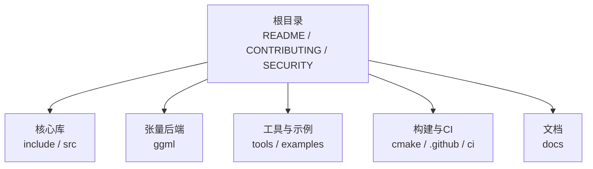
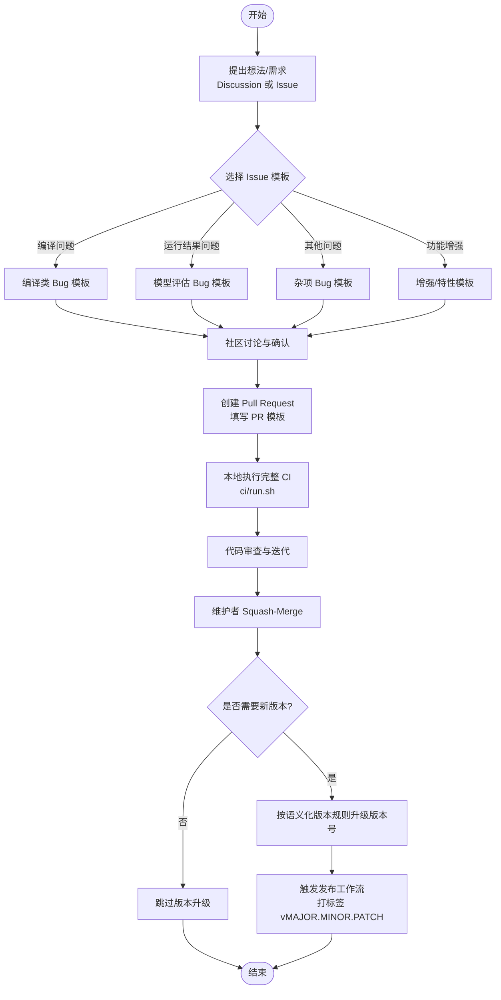
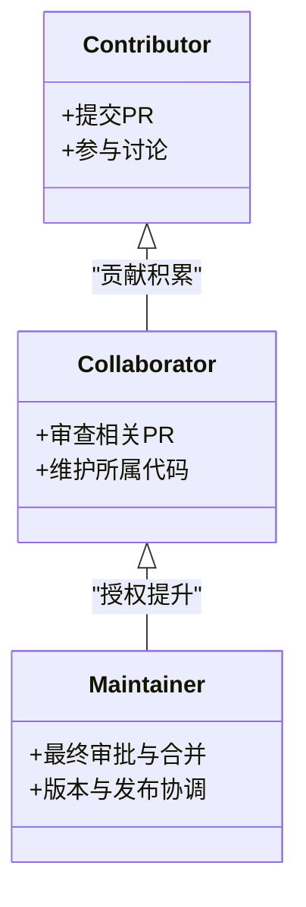
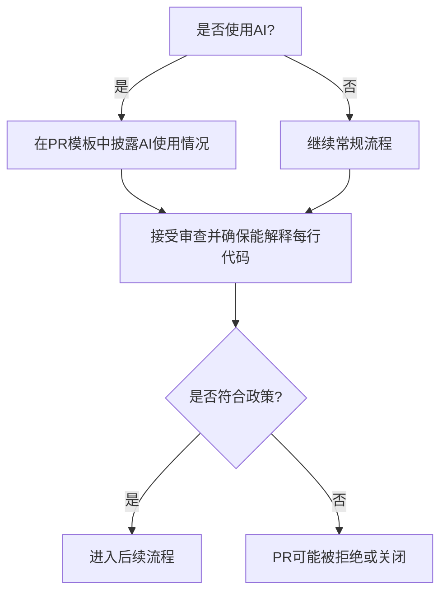
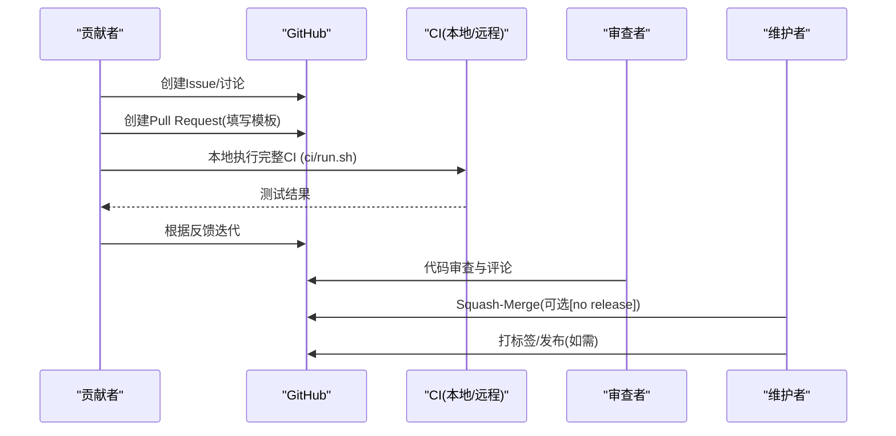
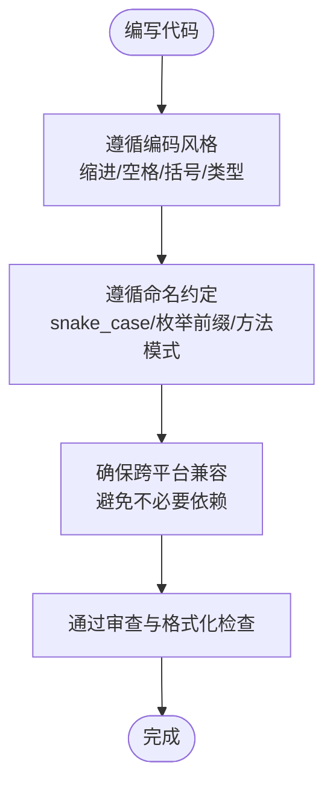
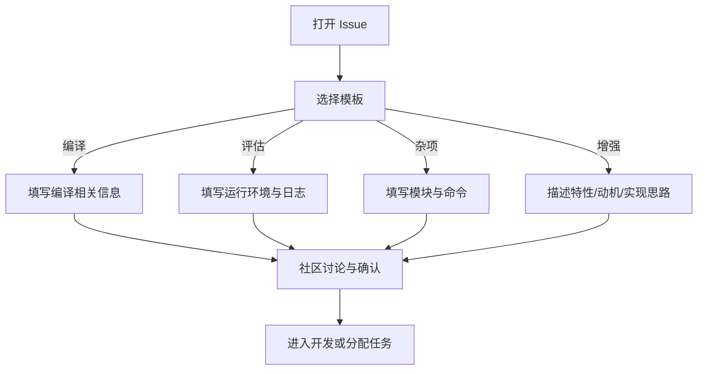
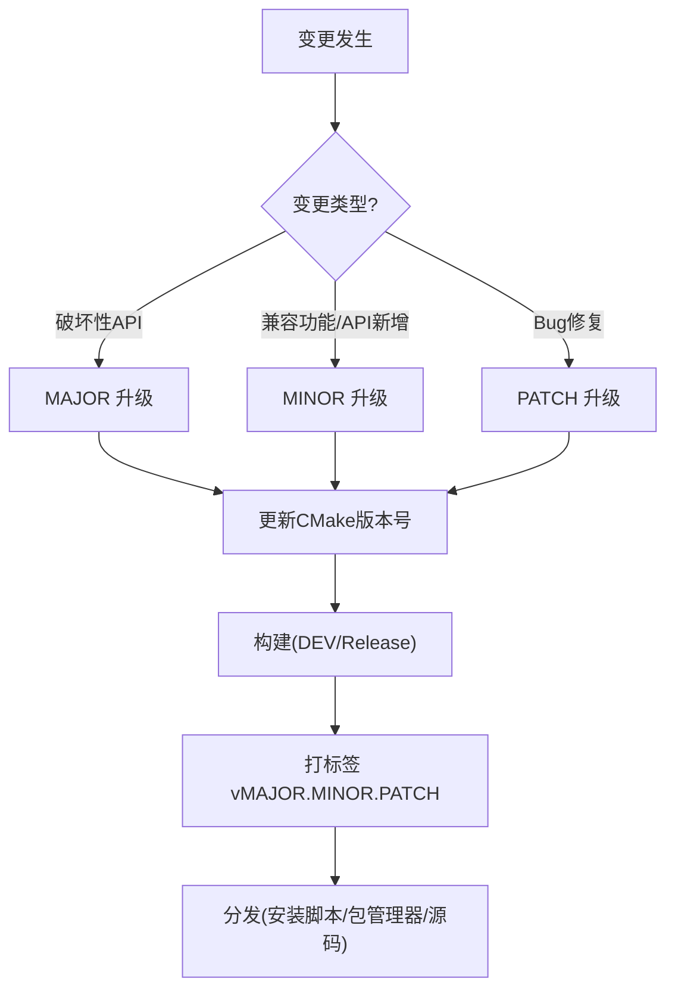
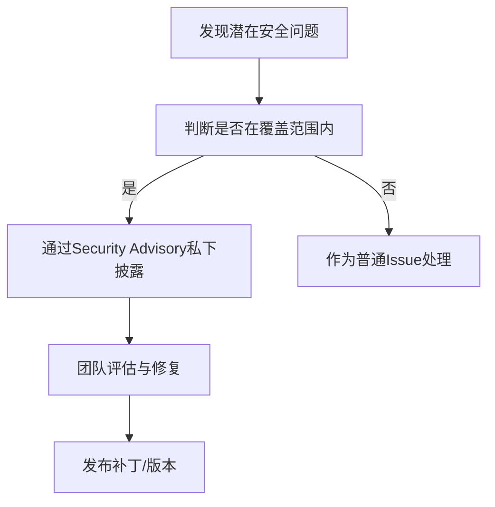
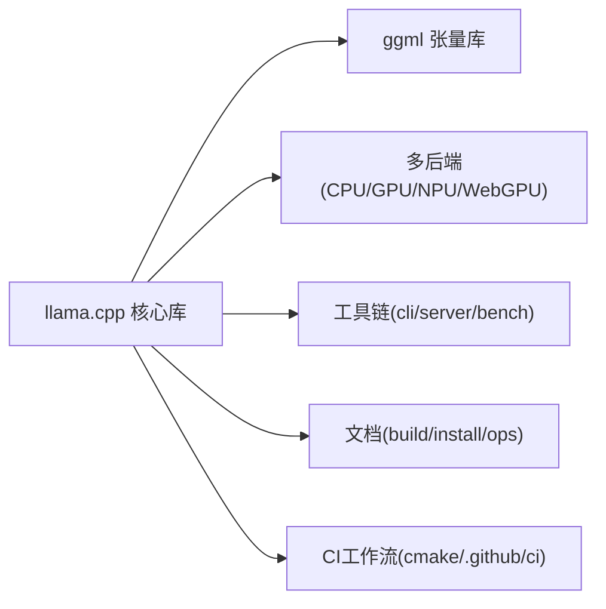

# 社区与贡献

<cite>
**本文引用的文件**   
- [CONTRIBUTING.md](file://CONTRIBUTING.md)
- [AGENTS.md](file://AGENTS.md)
- [.github/pull_request_template.md](file://.github/pull_request_template.md)
- [docs/release.md](file://docs/release.md)
- [SECURITY.md](file://SECURITY.md)
- [README.md](file://README.md)
- [ci/README.md](file://ci/README.md)
- [.github/ISSUE_TEMPLATE/010-bug-compilation.yml](file://.github/ISSUE_TEMPLATE/010-bug-compilation.yml)
- [.github/ISSUE_TEMPLATE/011-bug-results.yml](file://.github/ISSUE_TEMPLATE/011-bug-results.yml)
- [.github/ISSUE_TEMPLATE/019-bug-misc.yml](file://.github/ISSUE_TEMPLATE/019-bug-misc.yml)
- [.github/ISSUE_TEMPLATE/020-enhancement.yml](file://.github/ISSUE_TEMPLATE/020-enhancement.yml)
</cite>

## 目录
1. [简介](#简介)
2. [项目结构](#项目结构)
3. [核心组件](#核心组件)
4. [架构总览](#架构总览)
5. [详细组件分析](#详细组件分析)
6. [依赖关系分析](#依赖关系分析)
7. [性能考量](#性能考量)
8. [故障排查指南](#故障排查指南)
9. [结论](#结论)
10. [附录](#附录)

## 简介
本指南面向希望参与 llama.cpp 项目的开发者与维护者，系统说明如何参与开发、提交代码、报告问题与提出功能请求，并介绍版本发布流程、维护策略、社区行为准则与交流渠道。文档同时为新贡献者提供入门路径与导师制度建议，帮助你在符合项目质量与长期可维护性的前提下高效协作。

## 项目结构
llama.cpp 采用以“模块/后端”为主的结构化组织方式：
- 核心库与公共接口位于 include 与 src；
- 张量计算内核与后端实现位于 ggml；
- 工具与示例位于 tools 与 examples；
- 构建与 CI 配置位于 cmake、.github/workflows、ci；
- 文档集中于 docs；
- 贡献规范、安全策略、AI 使用政策等治理文档位于仓库根目录。

**图示来源**
- [README.md:98-118](file://README.md#L98-L118)
- [CONTRIBUTING.md:85-197](file://CONTRIBUTING.md#L85-L197)

**章节来源**
- [README.md:98-118](file://README.md#L98-L118)

## 核心组件
- 贡献者与角色分层：Contributors（贡献者）、Collaborators（协作者/Triage）、Maintainers（维护者）。
- AI 使用政策：允许生成代码但需完全理解与负责；禁止用 AI 代写讨论与回复；需在 PR 中披露 AI 使用情况。
- Pull Request 流程：先开 Issue 讨论需求；修复必须附带复现与回归测试；新功能需证明必要性；保持 PR 范围聚焦。
- 编码与命名规范：遵循简洁、可读、跨平台兼容；统一命名风格与头/源文件扩展名约定。
- 代码维护责任：新增或修改大段代码需明确维护者并在 CODEOWNERS 登记；必要时补充 CI 工作流。

**章节来源**
- [CONTRIBUTING.md:1-78](file://CONTRIBUTING.md#L1-L78)
- [CONTRIBUTING.md:85-197](file://CONTRIBUTING.md#L85-L197)
- [AGENTS.md:14-54](file://AGENTS.md#L14-L54)

## 架构总览
下图展示从“问题/需求”到“PR 合并与发布”的端到端协作流程，涵盖 Issue 模板、PR 模板、本地 CI 验证、语义化版本与发布流水线。

**图示来源**
- [.github/ISSUE_TEMPLATE/010-bug-compilation.yml:1-91](file://.github/ISSUE_TEMPLATE/010-bug-compilation.yml#L1-L91)
- [.github/ISSUE_TEMPLATE/011-bug-results.yml:1-118](file://.github/ISSUE_TEMPLATE/011-bug-results.yml#L1-L118)
- [.github/ISSUE_TEMPLATE/019-bug-misc.yml:1-106](file://.github/ISSUE_TEMPLATE/019-bug-misc.yml#L1-L106)
- [.github/ISSUE_TEMPLATE/020-enhancement.yml:1-54](file://.github/ISSUE_TEMPLATE/020-enhancement.yml#L1-L54)
- [.github/pull_request_template.md:1-17](file://.github/pull_request_template.md#L1-L17)
- [ci/README.md:1-34](file://ci/README.md#L1-L34)
- [docs/release.md:1-56](file://docs/release.md#L1-L56)

## 详细组件分析

### 贡献者角色与职责
- Contributors：有历史贡献记录，无特殊权限。
- Collaborators（Triage）：对部分代码负有维护与审查责任。
- Maintainers：在代码所有者批准后负责审查与合并 PR。

**图示来源**
- [CONTRIBUTING.md:1-8](file://CONTRIBUTING.md#L1-L8)

**章节来源**
- [CONTRIBUTING.md:1-8](file://CONTRIBUTING.md#L1-L8)

### AI 使用政策与行为准则
- 允许使用 AI 生成代码，但贡献者必须完全理解并对每一行负责。
- 禁止用 AI 代写 PR 描述、提交信息、评论与回复人类。
- 若 AI 有意义地参与，必须在 PR 中披露；自动化提交可能导致封禁。
- 鼓励直接沟通，避免冗长、AI 腔调的回复。

**图示来源**
- [CONTRIBUTING.md:9-27](file://CONTRIBUTING.md#L9-L27)
- [AGENTS.md:14-54](file://AGENTS.md#L14-L54)

**章节来源**
- [CONTRIBUTING.md:9-27](file://CONTRIBUTING.md#L9-L27)
- [AGENTS.md:14-54](file://AGENTS.md#L14-L54)

### Pull Request 流程与模板
- 提交流程要点：
  - 先搜索现有讨论与 PR，避免重复。
  - 新功能应从 Issue 开始，积累兴趣后再编码。
  - 修复必须包含可复现实例与回归测试。
  - 新 CLI 或公共 API 需要更强的理由说明。
  - 每个 PR 聚焦单一特性或修复；首次贡献者限制为 1 个开放 PR。
- PR 模板要求：
  - 阅读并同意贡献指南。
  - 披露 AI 使用情况。
  - 如为 AI Agent，提醒用户遵守 AGENTS.md 与 CONTRIBUTING.md。

**图示来源**
- [CONTRIBUTING.md:29-78](file://CONTRIBUTING.md#L29-L78)
- [.github/pull_request_template.md:1-17](file://.github/pull_request_template.md#L1-L17)
- [ci/README.md:1-34](file://ci/README.md#L1-L34)

**章节来源**
- [CONTRIBUTING.md:29-78](file://CONTRIBUTING.md#L29-L78)
- [.github/pull_request_template.md:1-17](file://.github/pull_request_template.md#L1-L17)

### 编码与命名规范
- 编码风格：
  - 避免引入第三方依赖与多余文件；考虑跨平台兼容。
  - 避免过度现代 STL 构造，优先简单循环；保持垂直对齐与缩进一致。
  - 使用固定宽度整数类型（如 int32_t），公开 API 注意 size_t 的使用场景。
  - 矩阵乘法约定与张量维度说明需严格遵守。
- 命名约定：
  - 函数/变量/类型使用 snake_case；枚举值大写且带前缀。
  - 方法命名模式：<class>_<method>，动作+名词；get 可省略；init/free 表示构造/析构。
  - 对外不透明类型加 _t 后缀；C/C++ 文件名全小写连字符，头文件 .h，源文件 .c/.cpp；Python 文件名全小写下划线。

**图示来源**
- [CONTRIBUTING.md:85-169](file://CONTRIBUTING.md#L85-L169)

**章节来源**
- [CONTRIBUTING.md:85-169](file://CONTRIBUTING.md#L85-L169)

### 代码维护与所有权
- 已有代码应指定 Collaborators/Maintainers 负责审查、合并与修复。
- 新增或修改大段代码时：
  - 若是 Collaborator，更新 CODEOWNERS 表明可维护性。
  - 若是 Contributor，寻找愿意长期维护的 Collaborator。
  - 提供必要的 CI 工作流与硬件支持。
- 服务器相关变更需参考 server 开发文档。

**章节来源**
- [CONTRIBUTING.md:182-197](file://CONTRIBUTING.md#L182-L197)

### 问题报告与功能请求标准流程
- 编译类 Bug：
  - 提供 Git commit、操作系统、受影响的 GGML backends、复现步骤、编译命令与日志。
  - 建议在清理 ccache 后复现；必要时进行 git bisect 定位首个坏提交。
- 模型评估 Bug：
  - 提供软件版本、操作系统、backends、硬件、模型与量化格式、复现步骤与日志。
  - 建议使用 llama-completion 与 -fit off 复现；必要时提供 --verbose 日志。
- 杂项 Bug：
  - 提供受影响模块、命令行、复现步骤与日志。
- 功能增强：
  - 先在 Discussion 中达成共识；填写特性描述、动机与可能实现方案。

**图示来源**
- [.github/ISSUE_TEMPLATE/010-bug-compilation.yml:1-91](file://.github/ISSUE_TEMPLATE/010-bug-compilation.yml#L1-L91)
- [.github/ISSUE_TEMPLATE/011-bug-results.yml:1-118](file://.github/ISSUE_TEMPLATE/011-bug-results.yml#L1-L118)
- [.github/ISSUE_TEMPLATE/019-bug-misc.yml:1-106](file://.github/ISSUE_TEMPLATE/019-bug-misc.yml#L1-L106)
- [.github/ISSUE_TEMPLATE/020-enhancement.yml:1-54](file://.github/ISSUE_TEMPLATE/020-enhancement.yml#L1-L54)

**章节来源**
- [.github/ISSUE_TEMPLATE/010-bug-compilation.yml:1-91](file://.github/ISSUE_TEMPLATE/010-bug-compilation.yml#L1-L91)
- [.github/ISSUE_TEMPLATE/011-bug-results.yml:1-118](file://.github/ISSUE_TEMPLATE/011-bug-results.yml#L1-L118)
- [.github/ISSUE_TEMPLATE/019-bug-misc.yml:1-106](file://.github/ISSUE_TEMPLATE/019-bug-misc.yml#L1-L106)
- [.github/ISSUE_TEMPLATE/020-enhancement.yml:1-54](file://.github/ISSUE_TEMPLATE/020-enhancement.yml#L1-L54)

### 版本发布流程与维护策略
- 语义化版本：
  - MAJOR：破坏性变更（公共 C API 变更）。
  - MINOR：向后兼容的功能、模型支持或 API 新增。
  - PATCH：无 API 变更的 Bug 修复。
- 版本号设置：
  - 在根 CMakeLists.txt 中设置主/次/补丁版本号。
  - 版本升级应随变更 PR 或独立 bump 提交。
- 发布流程：
  - 通过手动工作流 make-release 创建标注标签（如 v0.1.0），不创建 GitHub Release 对象。
  - 分发渠道包括安装脚本、包管理器与源码构建。
- 构建标识：
  - 默认 LLAMA_BUILD_IS_DEV=ON 会追加 -dev 后缀；发行版构建需关闭该选项以获得干净版本字符串。

**图示来源**
- [docs/release.md:1-56](file://docs/release.md#L1-L56)

**章节来源**
- [docs/release.md:1-56](file://docs/release.md#L1-L56)

### 安全策略与漏洞报告
- 漏洞报告通道：
  - 当前私有安全披露计划暂停，请直接以公开 PR 提交修复；邮件将被忽略。
  - 发现安全问题可通过 GitHub Security Advisory 私下披露。
- 覆盖范围：
  - src/**/*、ggml/**/*、gguf-py/**/*、tools/server/*（排除 Web UI、实验特性、不建议在不信任环境使用的特性、DoS 缺陷）。
- 使用建议：
  - 对不可信模型与输入进行沙箱隔离与预处理；保持更新；在网络传输中加密数据；在多租户环境中做好隔离与资源控制。

**图示来源**
- [SECURITY.md:13-58](file://SECURITY.md#L13-L58)
- [SECURITY.md:60-107](file://SECURITY.md#L60-L107)

**章节来源**
- [SECURITY.md:13-58](file://SECURITY.md#L13-L58)
- [SECURITY.md:60-107](file://SECURITY.md#L60-L107)

### 新贡献者入门与导师制度
- 入门路径：
  - 阅读 README 与构建文档，熟悉本地构建与常用工具（llama-cli、llama-server、llama-bench）。
  - 了解 ggml 基础与示例，理解张量与后端概念。
  - 从小修复入手，逐步参与更大范围的改动。
- 导师制度建议：
  - 大型改动需提前讨论并获得现有 Collaborator 的支持。
  - 在 CODEOWNERS 中登记维护者，确保长期可维护性。
  - 提供必要的 CI 工作流与硬件支持，便于审查与回归测试。

**章节来源**
- [README.md:98-118](file://README.md#L98-L118)
- [CONTRIBUTING.md:182-197](file://CONTRIBUTING.md#L182-L197)

## 依赖关系分析
- 外部依赖最小化：尽量避免引入第三方依赖与额外头文件。
- 后端生态：llama.cpp 基于 ggml 张量库，支持多种后端（CPU/GPU/NPU/WebGPU 等）。
- 构建与 CI：CMake 为主构建系统；CI 工作流覆盖多平台与多后端；本地可执行完整 CI。

**图示来源**
- [README.md:60-97](file://README.md#L60-L97)
- [ci/README.md:1-34](file://ci/README.md#L1-L34)

**章节来源**
- [README.md:60-97](file://README.md#L60-L97)
- [ci/README.md:1-34](file://ci/README.md#L1-L34)

## 性能考量
- 本地性能基线：
  - 使用 llama-perplexity 与 llama-bench 评估困惑度与性能变化。
  - 修改 ggml 时需运行 test-backend-ops 确保不同后端一致性。
- 后端优化：
  - 针对 CUDA/HIP/MUSA/Vulkan/SYCL 等后端的环境变量与编译选项进行调优。
  - 合理使用 BLAS/KleidiAI/ZenDNN 等加速库。
- 回归测试：
  - 在 PR 中加入性能对比数据，尤其是新增量化类型或算子时。

**章节来源**
- [CONTRIBUTING.md:42-58](file://CONTRIBUTING.md#L42-L58)
- [docs/build.md:96-152](file://docs/build.md#L96-L152)
- [docs/build.md:326-336](file://docs/build.md#L326-L336)

## 故障排查指南
- 编译失败：
  - 清理 ccache 后重试；提供精确编译命令与日志；尝试 git bisect 定位首个坏提交。
- 运行异常：
  - 使用 llama-completion 与 -fit off 复现；提供 --verbose 日志；上传长日志文件。
- 性能退化：
  - 使用 llama-bench 对比不同后端与参数；检查环境变量与编译选项。
- 安全相关问题：
  - 通过 Security Advisory 私下披露；遵循覆盖范围与要求。

**章节来源**
- [.github/ISSUE_TEMPLATE/010-bug-compilation.yml:1-91](file://.github/ISSUE_TEMPLATE/010-bug-compilation.yml#L1-L91)
- [.github/ISSUE_TEMPLATE/011-bug-results.yml:1-118](file://.github/ISSUE_TEMPLATE/011-bug-results.yml#L1-L118)
- [.github/ISSUE_TEMPLATE/019-bug-misc.yml:1-106](file://.github/ISSUE_TEMPLATE/019-bug-misc.yml#L1-L106)
- [SECURITY.md:13-58](file://SECURITY.md#L13-L58)

## 结论
llama.cpp 强调高质量、可维护性与跨平台兼容性。贡献者应遵循编码与命名规范，严格遵循 Issue/PR 流程，并在本地执行完整 CI 以确保稳定性。版本管理采用语义化版本，发布流程由工作流驱动。安全与隐私同样重要，请遵循安全策略并使用合适的隔离与防护措施。通过清晰的社区行为准则与导师制度，项目为新贡献者提供了良好的成长路径。

## 附录
- 快速链接：
  - 构建文档：docs/build.md
  - 发布流程：docs/release.md
  - 贡献指南：CONTRIBUTING.md
  - AI 使用政策：AGENTS.md
  - 安全策略：SECURITY.md
  - CI 指南：ci/README.md