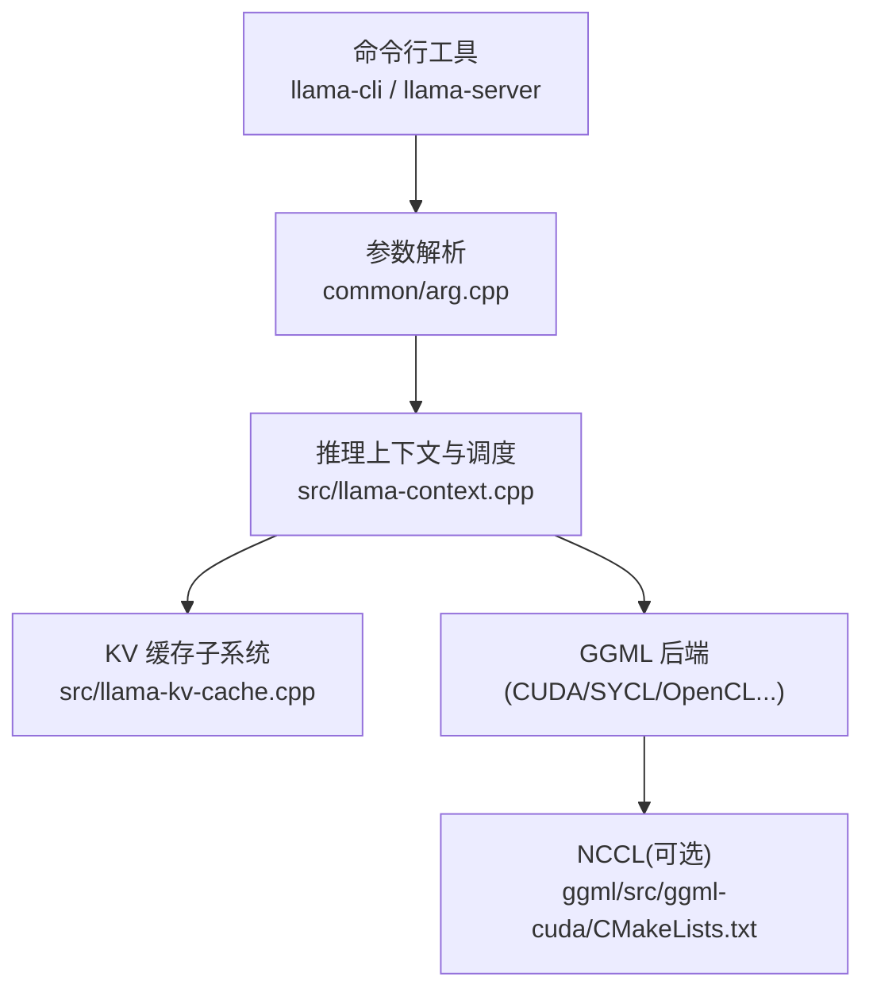
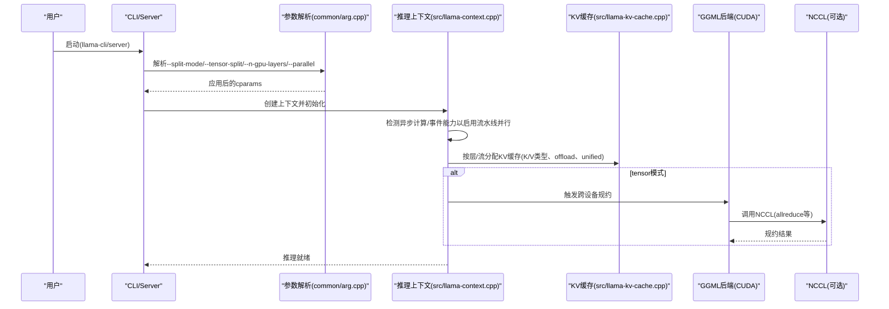
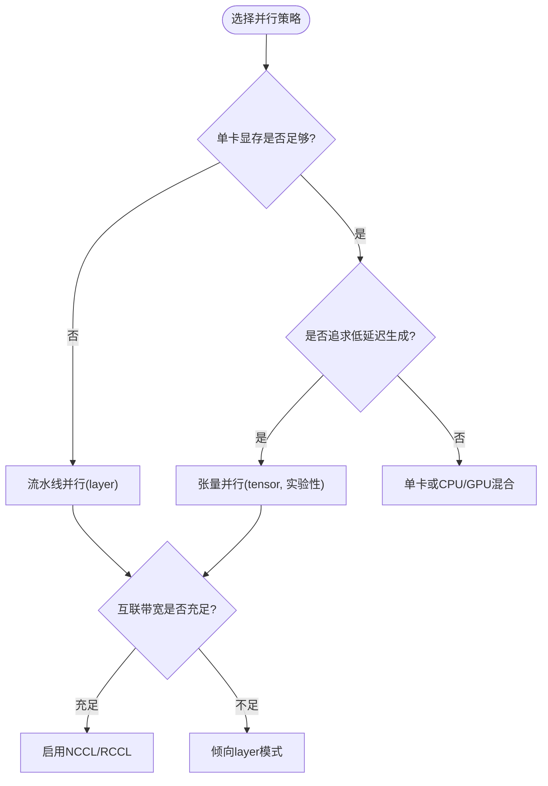
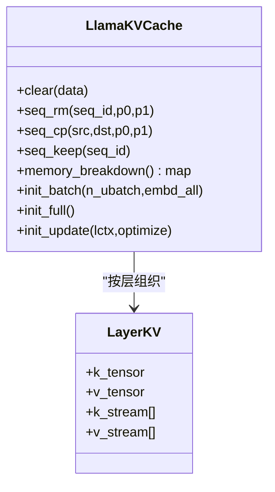
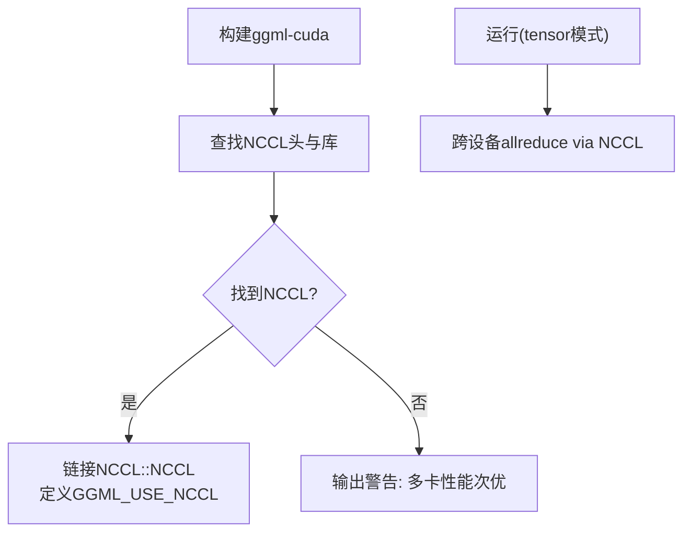
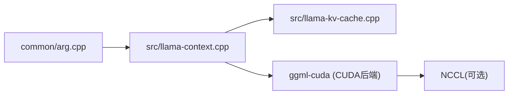

# 多GPU集群部署

<cite>
**本文引用的文件**   
- [docs/multi-gpu.md](file://docs/multi-gpu.md)
- [src/llama-context.cpp](file://src/llama-context.cpp)
- [src/llama-kv-cache.cpp](file://src/llama-kv-cache.cpp)
- [ggml/src/ggml-cuda/CMakeLists.txt](file://ggml/src/ggml-cuda/CMakeLists.txt)
- [ggml/cmake/FindNCCL.cmake](file://ggml/cmake/FindNCCL.cmake)
- [common/arg.cpp](file://common/arg.cpp)
</cite>

## 目录
1. [引言](#引言)
2. [项目结构](#项目结构)
3. [核心组件](#核心组件)
4. [架构总览](#架构总览)
5. [详细组件分析](#详细组件分析)
6. [依赖关系分析](#依赖关系分析)
7. [性能与调优](#性能与调优)
8. [故障排查与高可用](#故障排查与高可用)
9. [结论](#结论)
10. [附录：常用命令与参数速查](#附录常用命令与参数速查)

## 引言
本指南面向在多GPU环境下部署和运行 llama.cpp 的工程师与运维人员，系统阐述模型并行、数据并行与流水线并行的实现原理与配置方法；说明 NVLink 与 NCCL 通信库的集成方式；给出单机多卡与多机多卡的拓扑配置方案；解释 KV 缓存的分布式管理与内存优化策略；提供性能调优参数与监控指标建议；并包含故障转移、高可用实践以及常见问题诊断。

## 项目结构
本项目在推理侧对多 GPU 的支持主要分布在以下位置：
- 文档与用户指南：docs/multi-gpu.md
- 上下文与调度：src/llama-context.cpp（流水线并行能力检测与启用）
- KV 缓存实现：src/llama-kv-cache.cpp（KV 缓存分配、流式管理、跨序列复制等）
- CUDA 后端与 NCCL 集成：ggml/src/ggml-cuda/CMakeLists.txt、ggml/cmake/FindNCCL.cmake
- CLI 参数解析：common/arg.cpp（--split-mode、--tensor-split、--n-gpu-layers、--parallel 等）

图表来源
- [docs/multi-gpu.md:1-128](file://docs/multi-gpu.md#L1-L128)
- [src/llama-context.cpp:525-549](file://src/llama-context.cpp#L525-L549)
- [src/llama-kv-cache.cpp:65-389](file://src/llama-kv-cache.cpp#L65-L389)
- [ggml/src/ggml-cuda/CMakeLists.txt:184-192](file://ggml/src/ggml-cuda/CMakeLists.txt#L184-L192)
- [common/arg.cpp:2547-2558](file://common/arg.cpp#L2547-L2558)

章节来源
- [docs/multi-gpu.md:1-128](file://docs/multi-gpu.md#L1-L128)
- [common/arg.cpp:2547-2558](file://common/arg.cpp#L2547-L2558)

## 核心组件
- 多 GPU 分割模式与参数
  - 支持 none、layer（默认）、row（已弃用）、tensor（实验性）四种分割模式，通过 --split-mode/-sm 控制。
  - 张量切分比例由 --tensor-split/-ts 指定；主设备选择 --main-gpu/-mg；可见设备过滤 --device/-dev；自动适配 --fit/-fit。
- 流水线并行（层并行）
  - 将连续层切片分配到不同 GPU，每层的 KV 缓存驻留在拥有该层的 GPU 上，适合大模型显存不足且优先预填充吞吐的场景。
- 张量并行（实验性）
  - 权重与 KV 均按“元设备”抽象切分到多个 GPU，借助 NCCL 进行跨 GPU 规约，适合追求低延迟生成且互联带宽充足的场景。
- KV 缓存
  - 按层、按流（stream）组织，支持统一缓存与多流缓存、共享与复用、量化类型配置（K/V 类型），以及与 offload 配合的设备亲和性。
- NCCL 集成
  - 构建时开启 GGML_CUDA_NCCL=ON（默认），运行时自动用于 tensor 模式的跨 GPU 规约；未找到 NCCL 会降级并提示性能下降。

章节来源
- [docs/multi-gpu.md:18-47](file://docs/multi-gpu.md#L18-L47)
- [src/llama-context.cpp:525-549](file://src/llama-context.cpp#L525-L549)
- [src/llama-kv-cache.cpp:65-389](file://src/llama-kv-cache.cpp#L65-L389)
- [ggml/src/ggml-cuda/CMakeLists.txt:184-192](file://ggml/src/ggml-cuda/CMakeLists.txt#L184-L192)

## 架构总览
下图展示从命令行到推理执行的多 GPU 关键路径，包括参数解析、上下文初始化、流水线并行检测、KV 缓存分配与 NCCL 使用点。

图表来源
- [common/arg.cpp:2547-2558](file://common/arg.cpp#L2547-L2558)
- [src/llama-context.cpp:525-549](file://src/llama-context.cpp#L525-L549)
- [src/llama-kv-cache.cpp:65-389](file://src/llama-kv-cache.cpp#L65-L389)
- [ggml/src/ggml-cuda/CMakeLists.txt:184-192](file://ggml/src/ggml-cuda/CMakeLists.txt#L184-L192)

## 详细组件分析

### 分割模式与并行策略
- 流水线并行（layer）
  - 将模型层按顺序切分至各 GPU，KV 缓存随层放置。优点是跨设备通信少，适合预填充阶段吞吐优先；缺点是对长上下文批量的扩展更依赖层间流水线效率。
- 张量并行（tensor，实验性）
  - 将单层内的张量切分至多个 GPU，并在每层内做多次跨设备规约。优点是可并行化任意负载，延迟更低；缺点是强依赖互联带宽（NVLink/PCIe/NVSwitch），需启用 Flash Attention 与非量化 KV 类型。
- 数据并行
  - 当前仓库未提供独立的数据并行实现入口；可通过多进程/多实例分别加载完整模型，结合外部负载均衡器实现请求级数据并行。

图表来源
- [docs/multi-gpu.md:18-47](file://docs/multi-gpu.md#L18-L47)

章节来源
- [docs/multi-gpu.md:18-47](file://docs/multi-gpu.md#L18-L47)

### KV 缓存的分布式管理与内存优化
- 分层与分流
  - KV 缓存按层与流（stream）组织；统一缓存模式下 n_stream=1，否则为并发序列数。
- 设备亲和性与 offload
  - 当 offload 开启时，KV 缓存按层映射到对应设备的 buffer type，从而与模型层所在的 GPU 一致。
- 类型与量化
  - 支持 f32/f16/bf16 及多种量化类型；tensor 模式要求非量化 KV（f32/f16/bf16）。
- 共享与复用
  - 支持层共享与重用机制，减少重复分配；支持跨流序列复制（seq_cp）与范围裁剪（seq_rm/seq_keep）。
- 内存统计
  - 可按 buffer type 输出 KV 内存占用明细，便于定位瓶颈。

图表来源
- [src/llama-kv-cache.cpp:65-389](file://src/llama-kv-cache.cpp#L65-L389)
- [src/llama-kv-cache.cpp:707-722](file://src/llama-kv-cache.cpp#L707-L722)

章节来源
- [src/llama-kv-cache.cpp:65-389](file://src/llama-kv-cache.cpp#L65-L389)
- [src/llama-kv-cache.cpp:707-722](file://src/llama-kv-cache.cpp#L707-L722)

### NCCL 与 NVLink 集成
- 构建期集成
  - ggml-cuda 模块在构建时查找 NCCL，若找到则定义 GGML_USE_NCCL 并链接 NCCL::NCCL；未找到则输出警告，多卡性能可能次优。
- 运行时行为
  - 在 tensor 模式下，跨 GPU 规约自动走 NCCL；ROCm 后端可使用 RCCL（编译选项 GGML_HIP_RCCL=ON）。
- NVLink
  - 文档未直接提及 NVLink 开关；但 NCCL 可充分利用 NVLink/NVSwitch 提升多卡规约带宽。建议在具备 NVLink 的机器上优先使用 tensor 模式以获得更低延迟。

图表来源
- [ggml/src/ggml-cuda/CMakeLists.txt:184-192](file://ggml/src/ggml-cuda/CMakeLists.txt#L184-L192)
- [ggml/cmake/FindNCCL.cmake:1-36](file://ggml/cmake/FindNCCL.cmake#L1-L36)

章节来源
- [ggml/src/ggml-cuda/CMakeLists.txt:184-192](file://ggml/src/ggml-cuda/CMakeLists.txt#L184-L192)
- [ggml/cmake/FindNCCL.cmake:1-36](file://ggml/cmake/FindNCCL.cmake#L1-L36)

### 流水线并行能力检测
- 上下文初始化时会检查所有非 CPU 后端是否支持异步计算与事件；若不满足，则禁用流水线并行。
- 启用后会打印日志，便于确认实际生效的并行策略。

章节来源
- [src/llama-context.cpp:525-549](file://src/llama-context.cpp#L525-L549)

## 依赖关系分析
- 参数层
  - common/arg.cpp 暴露 --split-mode、--tensor-split、--n-gpu-layers、--parallel 等参数，供上层工具使用。
- 上下文层
  - src/llama-context.cpp 负责根据 cparams 决定流水线并行是否启用，并协调后端能力。
- KV 层
  - src/llama-kv-cache.cpp 负责 KV 缓存的分配、布局、共享与统计。
- 后端层
  - ggml-cuda 在构建期决定是否启用 NCCL；运行时在 tensor 模式下使用 NCCL 完成跨设备规约。

图表来源
- [common/arg.cpp:2547-2558](file://common/arg.cpp#L2547-L2558)
- [src/llama-context.cpp:525-549](file://src/llama-context.cpp#L525-L549)
- [src/llama-kv-cache.cpp:65-389](file://src/llama-kv-cache.cpp#L65-L389)
- [ggml/src/ggml-cuda/CMakeLists.txt:184-192](file://ggml/src/ggml-cuda/CMakeLists.txt#L184-L192)

章节来源
- [common/arg.cpp:2547-2558](file://common/arg.cpp#L2547-L2558)
- [src/llama-context.cpp:525-549](file://src/llama-context.cpp#L525-L549)
- [src/llama-kv-cache.cpp:65-389](file://src/llama-kv-cache.cpp#L65-L389)
- [ggml/src/ggml-cuda/CMakeLists.txt:184-192](file://ggml/src/ggml-cuda/CMakeLists.txt#L184-L192)

## 性能与调优
- 模式选择
  - 预填充吞吐优先：优先 layer（流水线并行）。
  - 生成延迟优先：在互联带宽充足时使用 tensor（张量并行），并确保 Flash Attention 与非量化 KV。
- 关键参数
  - --split-mode/-sm：none/layer/tensor
  - --tensor-split/-ts：按比例分配权重/KV
  - --n-gpu-layers/-ngl：尽量 all 或 999，避免回退 CPU
  - --cache-type-k/-ctk 与 --cache-type-v/-ctv：tensor 模式必须 f32/f16/bf16
  - --fit/-fit：自动适配设备内存（tensor 模式不支持）
  - --parallel/-np：并发序列数，影响 KV 缓存总量
- 互联与通信
  - 确保构建时启用 NCCL；在具备 NVLink/NVSwitch 的集群中，tensor 模式收益更大。
  - 可尝试 CUDA P2P（环境变量 GGML_CUDA_P2P=1）以提升多卡直连传输，但需评估主板/BIOS/IOMMU 稳定性。
- 监控指标建议
  - 每卡显存占用与碎片率（通过 memory_breakdown 与后端工具）
  - 预填充耗时与首 token 延迟（TTFT）
  - 每秒 token 生成速率（TPS）
  - NCCL 通信开销（如 allreduce 耗时、带宽利用率）
  - 队列长度与并发度（--parallel 下的 slot 使用率）

[本节为通用指导，不直接分析具体文件]

## 故障排查与高可用
- 常见错误与修复
  - “SPLIT_MODE_TENSOR requires flash_attn to be enabled”：添加 -fa on 或移除 -fa off。
  - “simultaneous use of SPLIT_MODE_TENSOR and KV cache quantization not implemented”：tensor 模式使用 f32/f16/bf16 KV。
  - “LLAMA_SPLIT_MODE_TENSOR not implemented for architecture 'X'”：架构不支持 tensor，改用 layer。
  - “NCCL is unavailable...”：重新构建并安装 NCCL，或接受性能降级。
  - tensor 模式 OOM：降低 --ctx-size/-c；降低 --parallel/-np；必要时降低 --n-gpu-layers/-ngl。
  - 多卡性能不如单卡：互联带宽瓶颈；确认 NCCL 启用；考虑切换 layer 模式或升级互联。
  - GPU 未被使用：检查 -ngl 是否为 0 或过低；确认 CUDA_VISIBLE_DEVICES 未隐藏 GPU；确认后端支持。
  - 设置 GGML_CUDA_P2P=1 后崩溃或不稳定：关闭该环境变量。
- 高可用与故障转移
  - 多实例冗余：在同一节点或多节点部署多个 llama-server 实例，通过负载均衡器（如 Nginx/HAProxy）分发请求。
  - 健康检查与自动重启：结合容器编排（Kubernetes/Docker Compose）进行存活探针与失败重启。
  - 状态隔离：每个实例独立加载模型与 KV 缓存，避免共享状态导致的竞态。
  - 优雅降级：当某节点不可用时，流量自动切换到其他节点；必要时回退到 CPU 或较小模型。

章节来源
- [docs/multi-gpu.md:116-128](file://docs/multi-gpu.md#L116-L128)

## 结论
- 对于显存不足且重视预填充吞吐的场景，优先采用流水线并行（layer）。
- 对于互联带宽充足且追求低延迟生成的场景，可在具备 NVLink/NVSwitch 的集群上使用张量并行（tensor），并确保 Flash Attention 与非量化 KV。
- KV 缓存应按层与流合理组织，结合 offload 与量化类型优化显存占用。
- 构建时启用 NCCL，运行时在 tensor 模式下自动利用其加速跨设备规约。
- 通过合理的参数组合与监控指标，持续优化吞吐与延迟，并结合多实例与编排平台实现高可用与弹性伸缩。

[本节为总结性内容，不直接分析具体文件]

## 附录：常用命令与参数速查
- 基础多卡（默认流水线并行）
  - llama-cli -m model.gguf
  - llama-server -m model.gguf
- 自定义切分比例
  - llama-cli -m model.gguf -ts 3,1
- 指定单卡
  - llama-cli --list-devices
  - llama-cli -m model.gguf -dev CUDA1
- 张量并行（实验性）
  - llama-cli -m model.gguf -sm tensor -ctk f16 -ctv f16
- NCCL 与 P2P
  - 构建时启用 NCCL（默认）；运行时 tensor 模式自动使用。
  - GGML_CUDA_P2P=1 llama-cli -m model.gguf -sm tensor

章节来源
- [docs/multi-gpu.md:52-113](file://docs/multi-gpu.md#L52-L113)