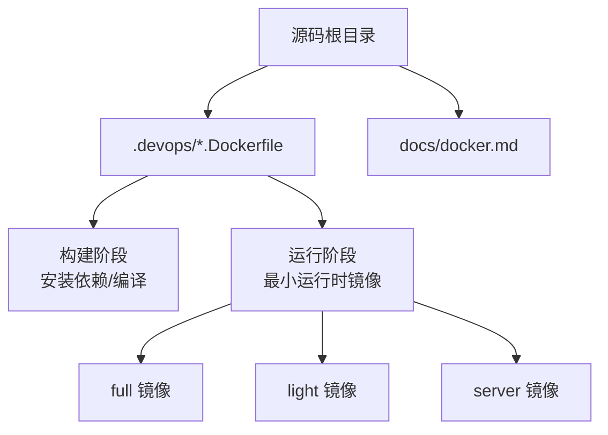
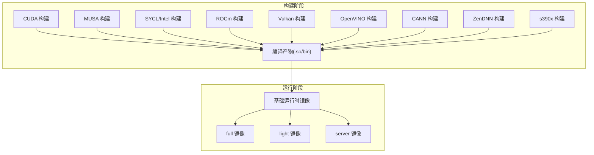
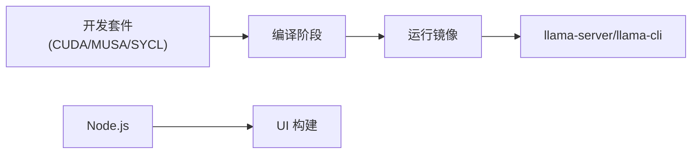
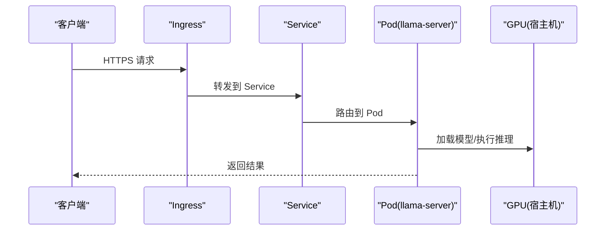

# 容器化部署

<cite>
**本文引用的文件**   
- [docs/docker.md](file://docs/docker.md)
- [.devops/cuda.Dockerfile](file://.devops/cuda.Dockerfile)
- [.devops/cpu.Dockerfile](file://.devops/cpu.Dockerfile)
- [.devops/musa.Dockerfile](file://.devops/musa.Dockerfile)
- [.devops/intel.Dockerfile](file://.devops/intel.Dockerfile)
- [.devops/vulkan.Dockerfile](file://.devops/vulkan.Dockerfile)
- [.devops/openvino.Dockerfile](file://.devops/openvino.Dockerfile)
- [.devops/rocm.Dockerfile](file://.devops/rocm.Dockerfile)
- [.devops/cann.Dockerfile](file://.devops/cann.Dockerfile)
- [.devops/zendnn.Dockerfile](file://.devops/zendnn.Dockerfile)
- [.devops/s390x.Dockerfile](file://.devops/s390x.Dockerfile)
- [.devops/tools.sh](file://.devops/tools.sh)
- [examples/sycl/test.sh](file://examples/sycl/test.sh)
- [examples/sycl/start-svr.sh](file://examples/sycl/start-svr.sh)
</cite>

## 目录
1. [简介](#简介)
2. [项目结构](#项目结构)
3. [核心组件](#核心组件)
4. [架构总览](#架构总览)
5. [详细组件分析](#详细组件分析)
6. [依赖关系分析](#依赖关系分析)
7. [性能与资源调优](#性能与资源调优)
8. [编排与生产部署](#编排与生产部署)
9. [数据持久化与模型挂载](#数据持久化与模型挂载)
10. [安全加固与网络配置](#安全加固与网络配置)
11. [故障排除指南](#故障排除指南)
12. [结论](#结论)

## 简介
本章节面向希望在容器中运行 llama.cpp 的工程师与运维人员，提供从镜像构建、环境变量配置、GPU 资源分配、到 Kubernetes 编排与服务发现、负载均衡、数据持久化、安全加固与网络配置的完整实践指南。文档基于仓库内提供的 Dockerfile 与官方 Docker 使用说明进行归纳与扩展，确保可操作且可追溯。

## 项目结构
llama.cpp 在 .devops 目录下提供了多后端（CUDA、MUSA、SYCL/Intel、ROCm、Vulkan、OpenVINO、CANN、ZenDNN、s390x）的 Dockerfile，并在 docs/docker.md 中给出了镜像清单与使用示例。每个 Dockerfile 均遵循“构建阶段 + 运行阶段”的多阶段构建模式，并输出 full/light/server 三种目标镜像。

图示来源
- [.devops/cuda.Dockerfile:28-64](file://.devops/cuda.Dockerfile#L28-L64)
- [.devops/cpu.Dockerfile:20-56](file://.devops/cpu.Dockerfile#L20-L56)
- [.devops/musa.Dockerfile:26-69](file://.devops/musa.Dockerfile#L26-L69)
- [.devops/intel.Dockerfile:22-62](file://.devops/intel.Dockerfile#L22-L62)
- [docs/docker.md:7-41](file://docs/docker.md#L7-L41)

章节来源
- [docs/docker.md:7-41](file://docs/docker.md#L7-L41)
- [.devops/cuda.Dockerfile:1-135](file://.devops/cuda.Dockerfile#L1-L135)
- [.devops/cpu.Dockerfile:1-126](file://.devops/cpu.Dockerfile#L1-L126)
- [.devops/musa.Dockerfile:1-142](file://.devops/musa.Dockerfile#L1-L142)
- [.devops/intel.Dockerfile:1-164](file://.devops/intel.Dockerfile#L1-L164)

## 核心组件
- 镜像类型
  - full：包含推理 CLI、补全工具与模型转换工具链
  - light：仅包含推理 CLI 与补全工具
  - server：仅包含 HTTP 服务进程
- 后端支持
  - CUDA、MUSA、SYCL/Intel、ROCm、Vulkan、OpenVINO、CANN、ZenDNN、s390x
- 入口与健康检查
  - server 镜像默认监听 8080 端口，内置 /health 健康检查

章节来源
- [docs/docker.md:7-41](file://docs/docker.md#L7-L41)
- [.devops/cuda.Dockerfile:122-135](file://.devops/cuda.Dockerfile#L122-L135)
- [.devops/cpu.Dockerfile:113-126](file://.devops/cpu.Dockerfile#L113-L126)
- [.devops/musa.Dockerfile:129-142](file://.devops/musa.Dockerfile#L129-L142)
- [.devops/intel.Dockerfile:150-164](file://.devops/intel.Dockerfile#L150-L164)

## 架构总览
下图展示不同后端的镜像构建路径与产物关系，以及运行时的主要组件交互。

图示来源
- [.devops/cuda.Dockerfile:28-64](file://.devops/cuda.Dockerfile#L28-L64)
- [.devops/musa.Dockerfile:26-69](file://.devops/musa.Dockerfile#L26-L69)
- [.devops/intel.Dockerfile:22-62](file://.devops/intel.Dockerfile#L22-L62)
- [.devops/cpu.Dockerfile:20-56](file://.devops/cpu.Dockerfile#L20-L56)

## 详细组件分析

### Docker 镜像构建与多后端配置
- CUDA
  - 构建基镜像：nvidia/cuda:${CUDA_VERSION}-devel-ubuntu${UBU}
  - 运行基镜像：nvidia/cuda:${CUDA_VERSION}-runtime-ubuntu${UBU}
  - 关键参数：CUDA_DOCKER_ARCH、GGML_CUDA=ON、GGML_BACKEND_DL=ON
- MUSA
  - 构建基镜像：registry.mthreads.com/mcconline/musa_sdk:5.2.0-devel-...
  - 运行基镜像：registry.mthreads.com/mcconline/musa_sdk:5.2.0-runtime-...
  - 关键参数：MUSA_DOCKER_ARCH、GGML_MUSA=ON、GGML_BACKEND_DL=ON
- Intel SYCL
  - 构建基镜像：intel/oneapi-toolkit:${ONEAPI_VERSION}
  - 关键参数：GGML_SYCL=ON、GGML_SYCL_F16、Level Zero 驱动包
- CPU
  - 构建基镜像：ubuntu:${UBUNTU_VERSION}
  - 关键参数：GGML_CPU_ALL_VARIANTS=ON、GGML_BACKEND_DL=ON
- 其他后端
  - ROCm、Vulkan、OpenVINO、CANN、ZenDNN、s390x 均有对应 Dockerfile，结构与上述类似

章节来源
- [.devops/cuda.Dockerfile:1-135](file://.devops/cuda.Dockerfile#L1-L135)
- [.devops/musa.Dockerfile:1-142](file://.devops/musa.Dockerfile#L1-L142)
- [.devops/intel.Dockerfile:1-164](file://.devops/intel.Dockerfile#L1-L164)
- [.devops/cpu.Dockerfile:1-126](file://.devops/cpu.Dockerfile#L1-L126)
- [.devops/rocm.Dockerfile](file://.devops/rocm.Dockerfile)
- [.devops/vulkan.Dockerfile](file://.devops/vulkan.Dockerfile)
- [.devops/openvino.Dockerfile](file://.devops/openvino.Dockerfile)
- [.devops/cann.Dockerfile](file://.devops/cann.Dockerfile)
- [.devops/zendnn.Dockerfile](file://.devops/zendnn.Dockerfile)
- [.devops/s390x.Dockerfile](file://.devops/s390x.Dockerfile)

### 环境变量与运行时配置
- 通用服务变量
  - LLAMA_ARG_HOST、LLAMA_ARG_PORT：用于 server 镜像暴露地址与端口
- GPU 设备与环境
  - CUDA：通过 --gpus all 或指定 GPU 集；需 nvidia-container-toolkit
  - MUSA：设置 mthreads 为默认 runtime，并通过 --n-gpu-layers 控制层卸载
  - Intel SYCL：通过 --device 映射 /dev/dri/*；参考脚本设置 ONEAPI_DEVICE_SELECTOR、UR_L0_ENABLE_RELAXED_ALLOCATION_LIMITS、ZES_ENABLE_SYSMAN
- VirtGPU 相关（VM 场景）
  - GGML_REMOTING_USE_APIR_CAPSET、VIRGL_ROUTE_VENUS_TO_APIR、VIRGL_APIR_LOG_TO_FILE 等

章节来源
- [.devops/cuda.Dockerfile:122-135](file://.devops/cuda.Dockerfile#L122-L135)
- [.devops/musa.Dockerfile:129-142](file://.devops/musa.Dockerfile#L129-L142)
- [.devops/intel.Dockerfile:150-164](file://.devops/intel.Dockerfile#L150-L164)
- [docs/docker.md:75-179](file://docs/docker.md#L75-L179)
- [examples/sycl/test.sh:115-137](file://examples/sycl/test.sh#L115-L137)
- [examples/sycl/start-svr.sh:105-128](file://examples/sycl/start-svr.sh#L105-L128)

### 命令行参数与模型加载
- 常用参数
  - -m/--model：模型路径
  - -p/--prompt：提示词
  - -n/--num-predict：生成 token 数
  - --n-gpu-layers/-ngl：GPU 层卸载数量
  - --host/--port：服务监听地址与端口
- 模型格式
  - 使用 gguf 格式模型文件

章节来源
- [docs/docker.md:43-73](file://docs/docker.md#L43-L73)
- [docs/docker.md:100-108](file://docs/docker.md#L100-L108)
- [docs/docker.md:134-142](file://docs/docker.md#L134-L142)
- [docs/docker.md:163-174](file://docs/docker.md#L163-L174)

### 入口点与工具脚本
- tools.sh：作为 full 镜像的默认入口，封装常用命令与工作目录初始化
- server 镜像默认 HEALTHCHECK 调用 /health 端点

章节来源
- [.devops/cuda.Dockerfile:111-135](file://.devops/cuda.Dockerfile#L111-L135)
- [.devops/cpu.Dockerfile:102-126](file://.devops/cpu.Dockerfile#L102-L126)
- [.devops/musa.Dockerfile:118-142](file://.devops/musa.Dockerfile#L118-L142)
- [.devops/intel.Dockerfile:138-164](file://.devops/intel.Dockerfile#L138-L164)

## 依赖关系分析
- 构建期依赖
  - CUDA/MUSA/SYCL 开发套件、编译器、CMake、Python 环境
  - UI 前端构建依赖 Node.js
- 运行期依赖
  - CUDA/MUSA/SYCL 运行时库
  - OpenMP/GOMP、curl、ffmpeg（部分镜像）
  - Python 依赖（full 镜像）

图示来源
- [.devops/cuda.Dockerfile:16-49](file://.devops/cuda.Dockerfile#L16-L49)
- [.devops/musa.Dockerfile:14-54](file://.devops/musa.Dockerfile#L14-L54)
- [.devops/intel.Dockerfile:10-48](file://.devops/intel.Dockerfile#L10-L48)
- [.devops/cpu.Dockerfile:8-41](file://.devops/cpu.Dockerfile#L8-L41)

章节来源
- [.devops/cuda.Dockerfile:16-49](file://.devops/cuda.Dockerfile#L16-L49)
- [.devops/musa.Dockerfile:14-54](file://.devops/musa.Dockerfile#L14-L54)
- [.devops/intel.Dockerfile:10-48](file://.devops/intel.Dockerfile#L10-L48)
- [.devops/cpu.Dockerfile:8-41](file://.devops/cpu.Dockerfile#L8-L41)

## 性能与资源调优
- GPU 层卸载
  - 通过 --n-gpu-layers 控制将多少层放到 GPU，以平衡显存与吞吐
- 线程与并行
  - 结合宿主 CPU 核数与 GPU 能力调整并发请求与批大小
- 内存限制
  - 容器层面通过 --memory 与 --memory-swap 限制；GPU 侧通过 --n-gpu-layers 控制显存占用
- 后端特定优化
  - Intel SYCL：启用 UR_L0_ENABLE_RELAXED_ALLOCATION_LIMITS 以支持更大设备内存分配；ZES_ENABLE_SYSMAN 辅助获取空闲显存信息
  - MUSA：确保 mthreads runtime 已注册并使用 --n-gpu-layers
  - CUDA：确保 nvidia-container-toolkit 可用并按需选择 GPU

章节来源
- [docs/docker.md:100-108](file://docs/docker.md#L100-L108)
- [docs/docker.md:134-142](file://docs/docker.md#L134-L142)
- [examples/sycl/test.sh:115-137](file://examples/sycl/test.sh#L115-L137)
- [examples/sycl/start-svr.sh:105-128](file://examples/sycl/start-svr.sh#L105-L128)

## 编排与生产部署
- Kubernetes 部署要点
  - Deployment：定义副本数、资源请求/限制（CPU、内存）、探针（liveness/readiness）
  - Service：ClusterIP/LoadBalancer/NodePort 暴露服务
  - Ingress：对外暴露 HTTP API，配合 TLS 与域名
  - ConfigMap/Secret：注入 LLAMA_ARG_HOST、LLAMA_ARG_PORT 等配置
  - Volumes/PersistentVolumeClaim：挂载模型与缓存目录
  - GPU 调度：使用 nodeSelector/tolerations 与 GPU 节点池；根据后端选择相应注解或 Device Plugin
- 服务发现与负载均衡
  - 使用 Service 名称进行内部 DNS 解析
  - 通过 Ingress Controller 实现外部负载均衡与证书管理
- 健康检查
  - 利用 server 镜像内置 /health 端点配置 liveness/readiness 探针

[该图为概念性流程示意，不直接映射具体源码文件]

## 数据持久化与模型挂载
- 模型目录挂载
  - 将宿主机的模型目录挂载到容器内的固定路径（如 /models），便于复用与更新
- 中间文件与缓存
  - 可将临时目录（如 /tmp 或自定义路径）挂载到 PVC，避免容器重建丢失
- 只读挂载
  - 对模型文件建议使用只读挂载，防止误写

章节来源
- [docs/docker.md:43-73](file://docs/docker.md#L43-L73)

## 安全加固与网络配置
- 最小权限原则
  - 使用非 root 用户运行容器（可在 Dockerfile 中创建用户并切换）
  - 仅暴露必要端口（默认 8080）
- 网络安全
  - 通过 Service/Ingress 控制访问范围，启用 TLS
  - 使用 NetworkPolicy 限制 Pod 间通信
- 镜像安全
  - 使用精简基础镜像，定期扫描漏洞
  - 固定镜像标签与摘要，避免漂移

[本节为通用安全建议，不直接分析具体源码文件]

## 故障排除指南
- 无法访问 GPU
  - CUDA：确认 nvidia-container-toolkit 已安装，容器启动时传入 --gpus
  - MUSA：确认 mthreads runtime 已注册，并使用 --n-gpu-layers
  - Intel SYCL：确认 /dev/dri 设备已映射，并设置 ONEAPI_DEVICE_SELECTOR、UR_L0_ENABLE_RELAXED_ALLOCATION_LIMITS、ZES_ENABLE_SYSMAN
- 服务不可用
  - 检查 /health 端点是否可达
  - 检查 LLAMA_ARG_HOST/PORT 是否正确
- 模型加载失败
  - 确认模型路径正确且可读
  - 确认模型格式为 gguf

章节来源
- [docs/docker.md:75-179](file://docs/docker.md#L75-L179)
- [.devops/cuda.Dockerfile:122-135](file://.devops/cuda.Dockerfile#L122-L135)
- [.devops/musa.Dockerfile:129-142](file://.devops/musa.Dockerfile#L129-L142)
- [.devops/intel.Dockerfile:150-164](file://.devops/intel.Dockerfile#L150-L164)

## 结论
通过仓库提供的多后端 Dockerfile 与文档说明，可以便捷地构建和运行 llama.cpp 的容器镜像。在生产环境中，建议结合 Kubernetes 的资源管理、服务发现与负载均衡能力，配合数据持久化与安全加固策略，实现稳定高效的 LLM 推理服务。对于不同硬件后端，应严格遵循对应的运行时要求与环境变量配置，以获得最佳性能与稳定性。