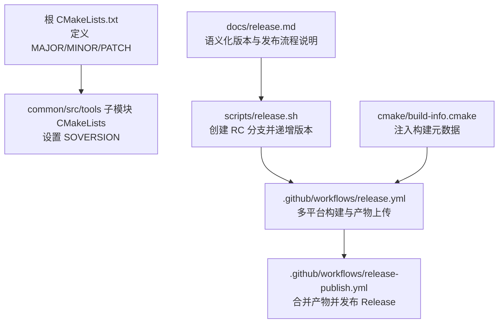
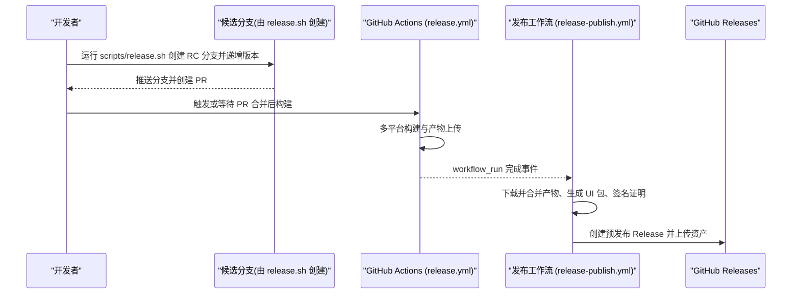
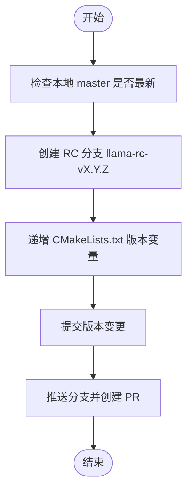
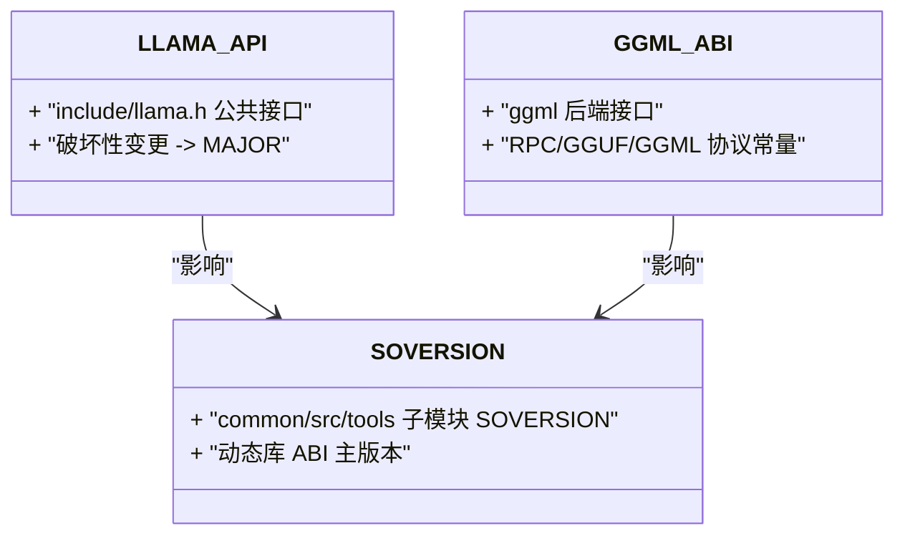
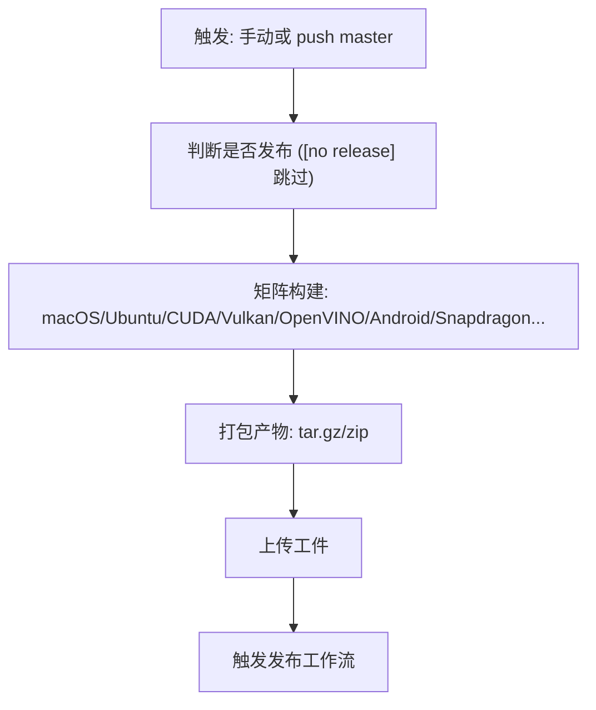
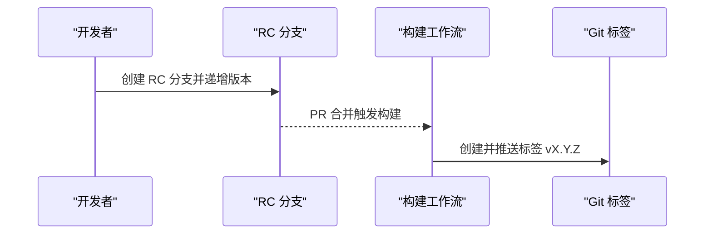
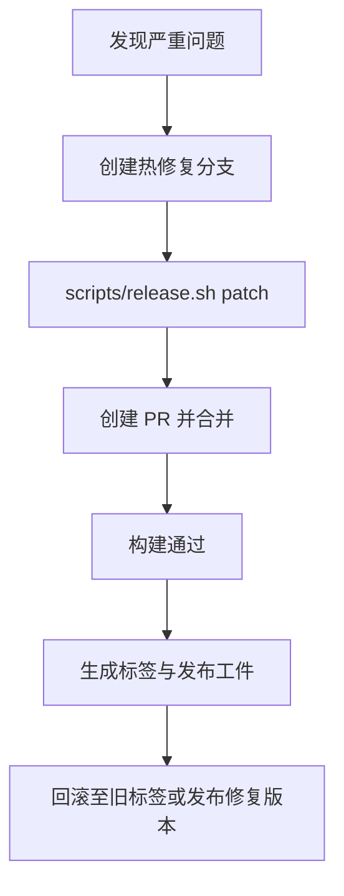
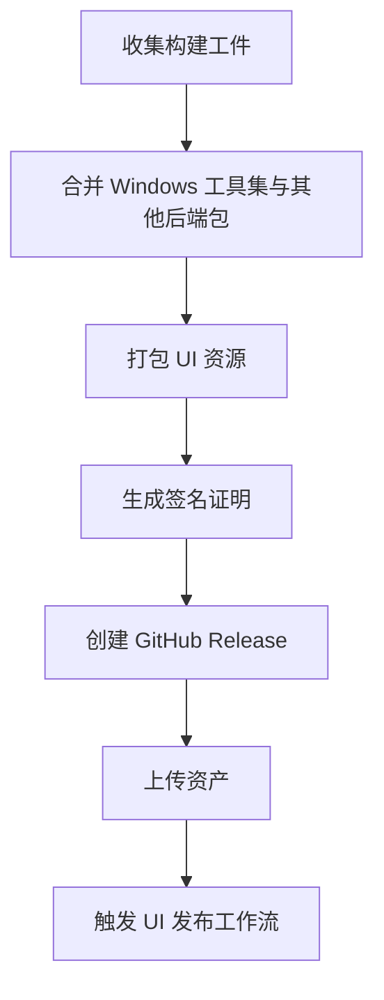
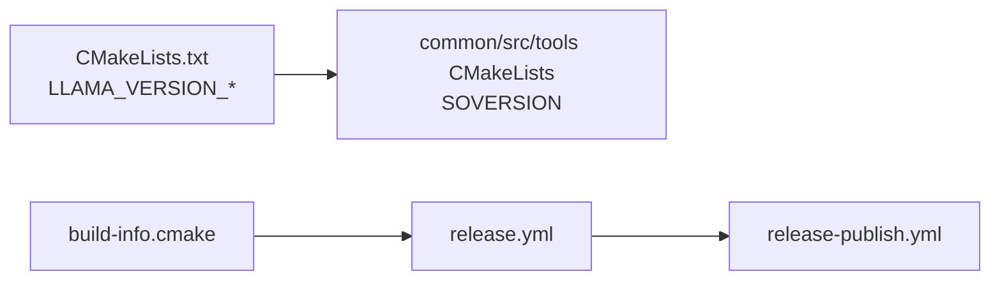

# 版本管理与发布

<cite>
**本文引用的文件**   
- [README.md](file://README.md)
- [release.md](file://docs/release.md)
- [release.sh](file://scripts/release.sh)
- [release.yml](file://.github/workflows/release.yml)
- [release-publish.yml](file://.github/workflows/release-publish.yml)
- [build-info.cmake](file://cmake/build-info.cmake)
- [CMakeLists.txt](file://CMakeLists.txt)
- [common/CMakeLists.txt](file://common/CMakeLists.txt)
- [src/CMakeLists.txt](file://src/CMakeLists.txt)
- [tools/mtmd/CMakeLists.txt](file://tools/mtmd/CMakeLists.txt)
</cite>

## 目录
1. [简介](#简介)
2. [项目结构](#项目结构)
3. [核心组件](#核心组件)
4. [架构总览](#架构总览)
5. [详细组件分析](#详细组件分析)
6. [依赖关系分析](#依赖关系分析)
7. [性能与构建优化](#性能与构建优化)
8. [故障排查指南](#故障排查指南)
9. [结论](#结论)
10. [附录](#附录)

## 简介
本文件面向 llama.cpp 的版本管理与发布流程，覆盖语义化版本控制、分支管理策略、API/ABI 稳定性验证、自动化构建与测试流水线、候选版本验证、回滚与热修复流程、发布清单与变更日志生成方法、依赖包与第三方库更新策略，以及发布后的质量监控与用户反馈处理。文档基于仓库现有脚本与工作流进行说明，确保可操作且与代码一致。

## 项目结构
围绕版本与发布的工程要素分布如下：
- 版本定义与 ABI 主版本号：根 CMakeLists.txt 与子模块 CMakeLists（SOVERSION）
- 版本递增与候选分支准备：scripts/release.sh
- 发布规范与语义化版本规则：docs/release.md
- 自动化构建与打包：.github/workflows/release.yml
- 发布产物合并与 GitHub Release 创建：.github/workflows/release-publish.yml
- 构建信息注入（提交号、编译器、目标平台等）：cmake/build-info.cmake

**图示来源**
- [CMakeLists.txt:6-9](file://CMakeLists.txt#L6-L9)
- [common/CMakeLists.txt:132](file://common/CMakeLists.txt#L132)
- [src/CMakeLists.txt:56](file://src/CMakeLists.txt#L56)
- [tools/mtmd/CMakeLists.txt:80](file://tools/mtmd/CMakeLists.txt#L80)
- [release.sh:1-205](file://scripts/release.sh#L1-L205)
- [release.yml:1-800](file://.github/workflows/release.yml#L1-L800)
- [release-publish.yml:1-248](file://.github/workflows/release-publish.yml#L1-L248)
- [build-info.cmake:1-49](file://cmake/build-info.cmake#L1-L49)
- [release.md:1-56](file://docs/release.md#L1-L56)

**章节来源**
- [CMakeLists.txt:6-9](file://CMakeLists.txt#L6-L9)
- [common/CMakeLists.txt:132](file://common/CMakeLists.txt#L132)
- [src/CMakeLists.txt:56](file://src/CMakeLists.txt#L56)
- [tools/mtmd/CMakeLists.txt:80](file://tools/mtmd/CMakeLists.txt#L80)
- [release.sh:1-205](file://scripts/release.sh#L1-L205)
- [release.yml:1-800](file://.github/workflows/release.yml#L1-L800)
- [release-publish.yml:1-248](file://.github/workflows/release-publish.yml#L1-L248)
- [build-info.cmake:1-49](file://cmake/build-info.cmake#L1-L49)
- [release.md:1-56](file://docs/release.md#L1-L56)

## 核心组件
- 语义化版本控制与分支策略
  - 遵循 semver（MAJOR.MINOR.PATCH），破坏性 API 变更升 MAJOR，向后兼容功能/模型支持/API 新增升 MINOR，无 API 变更的缺陷修复升 PATCH。
  - 版本变量位于根 CMakeLists.txt；通过 scripts/release.sh 在候选分支上自动递增并创建 PR。
- 自动化构建与发布流水线
  - release.yml 负责多平台构建（macOS、Ubuntu、CUDA、Vulkan、OpenVINO、Android、Snapdragon 等）与产物上传。
  - release-publish.yml 监听 release.yml 完成，合并产物、签名证明、创建 GitHub Release 并分发链接。
- 构建信息与版本后缀
  - build-info.cmake 注入构建号、提交哈希、编译器与目标平台信息。
  - 开发构建默认附加 -dev 后缀；从标签构建需关闭开发模式以输出干净版本字符串。

**章节来源**
- [release.md:1-56](file://docs/release.md#L1-L56)
- [CMakeLists.txt:6-9](file://CMakeLists.txt#L6-L9)
- [release.sh:1-205](file://scripts/release.sh#L1-L205)
- [release.yml:1-800](file://.github/workflows/release.yml#L1-L800)
- [release-publish.yml:1-248](file://.github/workflows/release-publish.yml#L1-L248)
- [build-info.cmake:1-49](file://cmake/build-info.cmake#L1-L49)

## 架构总览
下图展示从候选分支到最终发布的端到端流程，包括版本递增、CI 构建、产物合并与发布。

**图示来源**
- [release.sh:1-205](file://scripts/release.sh#L1-L205)
- [release.yml:1-800](file://.github/workflows/release.yml#L1-L800)
- [release-publish.yml:1-248](file://.github/workflows/release-publish.yml#L1-L248)

## 详细组件分析

### 语义化版本与分支管理
- 版本递增
  - 使用 scripts/release.sh 指定 major/minor/patch，自动计算新版本、创建 RC 分支（llama-rc-vX.Y.Z）、修改 CMakeLists.txt 中的版本变量并提交。
  - 建议在引入版本变更的 PR 中附带版本递增，或在发布前单独提交版本 bump。
- 分支策略
  - 主干为 master；发布候选在独立 RC 分支上进行，PR 合并并通过 CPU 构建后再执行发布。
  - 发布工作流支持手动触发，并可指定 commit SHA（需在分支内且不早于 HEAD 超过 3 天）。

**图示来源**
- [release.sh:54-95](file://scripts/release.sh#L54-L95)
- [release.sh:118-181](file://scripts/release.sh#L118-L181)

**章节来源**
- [release.md:1-56](file://docs/release.md#L1-L56)
- [release.sh:1-205](file://scripts/release.sh#L1-L205)

### API 兼容性检查与 ABI 稳定性验证
- ABI 主版本号
  - 子模块 CMakeLists 通过 SOVERSION 暴露主版本号，用于动态库 ABI 稳定性的外部可见标识。
- API/ABI 检查脚本
  - 仓库提供 check-release-apiabi.sh 用于发布前的 API/ABI 一致性校验（路径存在，具体实现以仓库为准）。
- 建议实践
  - 对 include/llama.h 的破坏性变更必须升 MAJOR。
  - 对 ggml 后端接口变更应同步评估 RPC/GGUF/GGML 协议版本常量，避免下游不兼容。

**图示来源**
- [common/CMakeLists.txt:132](file://common/CMakeLists.txt#L132)
- [src/CMakeLists.txt:56](file://src/CMakeLists.txt#L56)
- [tools/mtmd/CMakeLists.txt:80](file://tools/mtmd/CMakeLists.txt#L80)

**章节来源**
- [common/CMakeLists.txt:132](file://common/CMakeLists.txt#L132)
- [src/CMakeLists.txt:56](file://src/CMakeLists.txt#L56)
- [tools/mtmd/CMakeLists.txt:80](file://tools/mtmd/CMakeLists.txt#L80)

### 自动化构建与测试流水线配置示例
- 触发条件
  - release.yml 支持手动触发与 push 到 master 时自动检测（可通过提交消息禁用发布）。
- 矩阵构建
  - macOS（arm64/x64）、Ubuntu（x64/arm64/s390x）、Vulkan、CUDA（多版本）、OpenVINO、SYCL、ROCm、Android、Snapdragon 等多平台并行构建。
- 产物打包
  - 各平台将二进制与依赖库打包为 tar.gz/zip，并上传为构建工件。
- 缓存优化
  - 使用 ccache 加速重复构建，按平台/后端维度缓存键隔离。

**图示来源**
- [release.yml:1-800](file://.github/workflows/release.yml#L1-L800)

**章节来源**
- [release.yml:1-800](file://.github/workflows/release.yml#L1-L800)

### 发布候选版本的测试与验证流程
- 候选分支
  - 由 scripts/release.sh 创建 llama-rc-vX.Y.Z 分支，递增版本并创建 PR。
- 构建验证
  - PR 合并后，CPU 构建工作流通过即视为候选版本构建成功。
- 发布标记
  - release.yml 在满足条件时创建并推送带注释的 Git 标签（如 v0.1.0），作为发布工件锚点。

**图示来源**
- [release.sh:151-181](file://scripts/release.sh#L151-L181)
- [release.yml:81-95](file://.github/workflows/release.yml#L81-L95)

**章节来源**
- [release.sh:151-181](file://scripts/release.sh#L151-L181)
- [release.yml:81-95](file://.github/workflows/release.yml#L81-L95)

### 回滚策略与热修复发布流程
- 回滚策略
  - 由于发布以 Git 标签为锚点，回滚可直接检出旧标签并重新发布（或通过包管理器指向旧标签）。
  - 若需要紧急修复，可在 master 上创建热修复分支，使用 scripts/release.sh patch 递增版本，走相同候选分支与发布流程。
- 热修复发布
  - 推荐步骤：
    1) 在 master 上拉取最新代码。
    2) 运行 ./scripts/release.sh patch 创建 RC 分支并递增补丁版本。
    3) 推送分支并创建 PR，合并后等待构建通过。
    4) 触发 release.yml 生成标签与发布工件。

**图示来源**
- [release.sh:127-143](file://scripts/release.sh#L127-L143)
- [release.yml:81-95](file://.github/workflows/release.yml#L81-L95)

**章节来源**
- [release.sh:127-143](file://scripts/release.sh#L127-L143)
- [release.yml:81-95](file://.github/workflows/release.yml#L81-L95)

### 发布清单与变更日志生成方法
- 发布清单
  - release-publish.yml 在下载并合并所有工件后，统一命名并上传至 GitHub Release，包含各平台二进制、UI 包与 CUDA/OpenVINO 运行时库等。
- 变更日志
  - 当前发布体直接引用最近一次提交的提交信息作为简要描述；如需结构化变更日志，可在发布前维护 CHANGELOG.md 并在发布脚本中注入到发布体中。
- 网站与静态资源
  - 发布完成后会触发 UI 发布工作流，将 UI 静态资源部署到站点。

**图示来源**
- [release-publish.yml:77-134](file://.github/workflows/release-publish.yml#L77-L134)
- [release-publish.yml:135-164](file://.github/workflows/release-publish.yml#L135-L164)
- [release-publish.yml:213-248](file://.github/workflows/release-publish.yml#L213-L248)

**章节来源**
- [release-publish.yml:77-134](file://.github/workflows/release-publish.yml#L77-L134)
- [release-publish.yml:135-164](file://.github/workflows/release-publish.yml#L135-L164)
- [release-publish.yml:213-248](file://.github/workflows/release-publish.yml#L213-L248)

### 依赖包管理与第三方库更新策略
- 依赖管理
  - 构建依赖通过 apt/ninja/cmake 等安装；特定后端（CUDA、OpenVINO、SYCL、ROCm）使用容器或专用工具链。
  - OpenVINO 版本在工作流中以环境变量集中声明，便于跨文件同步。
- 第三方库更新
  - 建议在独立 PR 中升级依赖，先运行相关后端构建与测试，再合并。
  - 对于 CUDA/OpenVINO 等强版本耦合的依赖，需同步更新工作流与环境变量，确保构建环境一致。

**章节来源**
- [release.yml:651-757](file://.github/workflows/release.yml#L651-L757)

### 发布后的质量监控与用户反馈处理流程
- 质量监控
  - 通过 GitHub Actions 状态与 Release 资产可用性进行基础监控；可结合外部服务（如下载统计、错误上报）建立告警。
- 用户反馈
  - 使用 Issues 与 Discussions 收集反馈；对严重问题优先评估是否需要热修复或回滚。
- 持续改进
  - 根据反馈调整构建矩阵、依赖版本与发布流程，提升稳定性与用户体验。

[本节为通用指导，不涉及具体文件分析]

## 依赖关系分析
- 版本与 ABI 主版本
  - 根 CMakeLists.txt 定义 MAJOR/MINOR/PATCH；common/src/tools 子模块通过 SOVERSION 暴露主版本，影响动态库 ABI 稳定性。
- 构建与发布工作流
  - release.yml 产出多平台工件；release-publish.yml 消费这些工件并创建 Release。
- 构建信息
  - build-info.cmake 注入构建元数据，辅助定位构建环境与版本。

**图示来源**
- [CMakeLists.txt:6-9](file://CMakeLists.txt#L6-L9)
- [common/CMakeLists.txt:132](file://common/CMakeLists.txt#L132)
- [src/CMakeLists.txt:56](file://src/CMakeLists.txt#L56)
- [tools/mtmd/CMakeLists.txt:80](file://tools/mtmd/CMakeLists.txt#L80)
- [release.yml:1-800](file://.github/workflows/release.yml#L1-L800)
- [release-publish.yml:1-248](file://.github/workflows/release-publish.yml#L1-L248)
- [build-info.cmake:1-49](file://cmake/build-info.cmake#L1-L49)

**章节来源**
- [CMakeLists.txt:6-9](file://CMakeLists.txt#L6-L9)
- [common/CMakeLists.txt:132](file://common/CMakeLists.txt#L132)
- [src/CMakeLists.txt:56](file://src/CMakeLists.txt#L56)
- [tools/mtmd/CMakeLists.txt:80](file://tools/mtmd/CMakeLists.txt#L80)
- [release.yml:1-800](file://.github/workflows/release.yml#L1-L800)
- [release-publish.yml:1-248](file://.github/workflows/release-publish.yml#L1-L248)
- [build-info.cmake:1-49](file://cmake/build-info.cmake#L1-L49)

## 性能与构建优化
- 缓存
  - 使用 ccache 按平台/后端维度缓存编译结果，显著缩短重复构建时间。
- 并行构建
  - 使用系统核数并行编译，提升构建吞吐。
- 构建开关
  - 通过 CMAKE_ARGS 控制示例、测试、工具与服务构建开关，减少不必要的构建开销。

**章节来源**
- [release.yml:135-169](file://.github/workflows/release.yml#L135-L169)
- [release.yml:212-248](file://.github/workflows/release.yml#L212-L248)

## 故障排查指南
- 未提交变更阻止发布
  - scripts/release.sh 会在非 dry-run 模式下检查未提交变更，如有则中止。
- 不在 master 分支
  - 脚本要求必须在 master 分支执行，否则会报错。
- 本地 master 落后远程
  - 脚本会拉取远程 master 并比较 HEAD，不一致则中止。
- 构建失败
  - 检查对应平台的依赖安装与工具链版本（如 Ubuntu 24.04 的 GCC 14 兼容性问题）。
- 发布未触发
  - 检查提交消息是否包含 [no release]；确认 workflow_dispatch 或 push master 触发条件。

**章节来源**
- [release.sh:54-95](file://scripts/release.sh#L54-L95)
- [release.yml:61-71](file://.github/workflows/release.yml#L61-L71)

## 结论
llama.cpp 的版本管理与发布流程以语义化版本为核心，通过脚本化的候选分支与版本递增、完善的 CI 矩阵构建与产物合并、以及明确的发布与回滚策略，确保发布物的稳定性与可追溯性。建议在每次版本变更时严格遵循 semver 规则，配合 API/ABI 检查与依赖更新策略，持续提升发布质量与用户体验。

## 附录
- 快速参考
  - 语义化版本规则：docs/release.md
  - 候选分支与版本递增：scripts/release.sh
  - 构建与发布工作流：.github/workflows/release.yml、.github/workflows/release-publish.yml
  - 构建信息注入：cmake/build-info.cmake
  - 版本变量位置：CMakeLists.txt

[本节为概览性内容，不涉及具体文件分析]