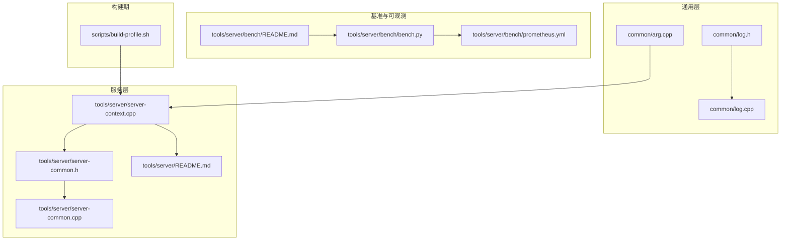
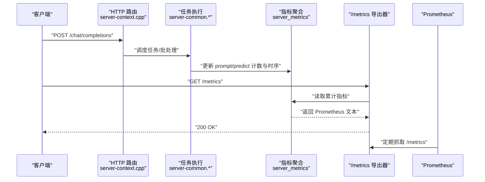
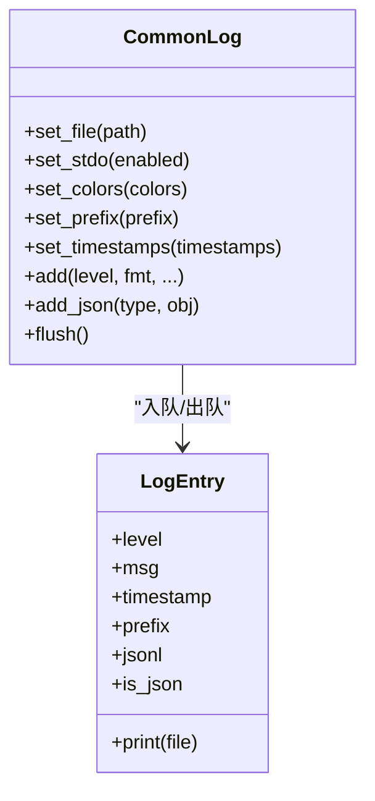
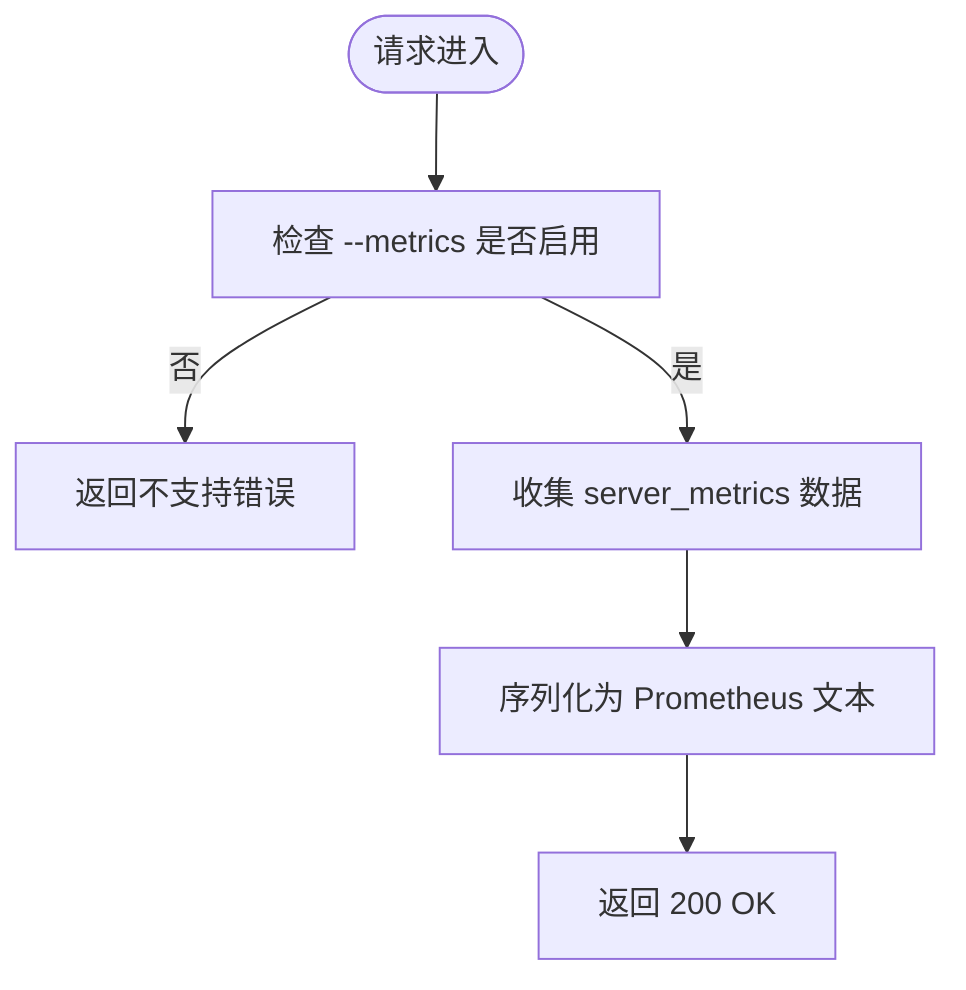
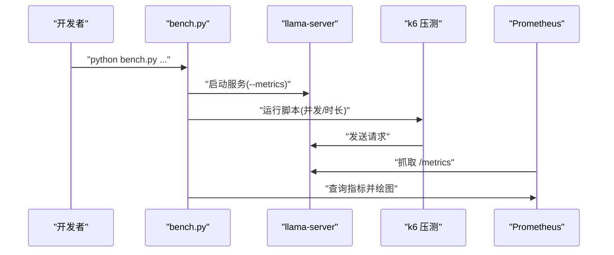
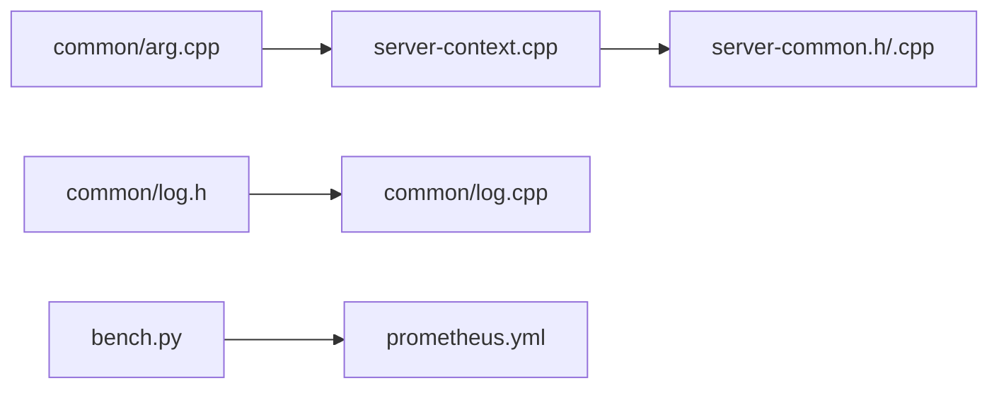

# 监控与日志管理

<cite>
**本文引用的文件**   
- [common/log.h](file://common/log.h)
- [common/log.cpp](file://common/log.cpp)
- [tools/server/server-common.h](file://tools/server/server-common.h)
- [tools/server/server-common.cpp](file://tools/server/server-common.cpp)
- [tools/server/server-context.cpp](file://tools/server/server-context.cpp)
- [tools/server/README.md](file://tools/server/README.md)
- [tools/server/bench/README.md](file://tools/server/bench/README.md)
- [tools/server/bench/bench.py](file://tools/server/bench/bench.py)
- [tools/server/bench/prometheus.yml](file://tools/server/bench/prometheus.yml)
- [common/arg.cpp](file://common/arg.cpp)
- [scripts/build-profile.sh](file://scripts/build-profile.sh)
</cite>

## 目录
1. [简介](#简介)
2. [项目结构](#项目结构)
3. [核心组件](#核心组件)
4. [架构总览](#架构总览)
5. [详细组件分析](#详细组件分析)
6. [依赖关系分析](#依赖关系分析)
7. [性能考量](#性能考量)
8. [故障排查指南](#故障排查指南)
9. [结论](#结论)
10. [附录](#附录)

## 简介
本指南面向在 llama.cpp 中构建生产级可观测性的工程师，聚焦以下目标：
- 收集推理延迟、吞吐量、内存使用率、GPU 利用率等关键指标
- 配置日志级别与结构化日志输出（JSONL）
- 集成 Prometheus 与 Grafana，提供自定义仪表板与告警规则示例
- 说明分布式追踪与调试工具使用方法
- 提供性能基准测试脚本的使用方式
- 识别常见性能瓶颈并给出优化建议
- 制定生产环境的日志轮转与存储策略

## 项目结构
llama.cpp 的可观测性能力主要分布在以下位置：
- 通用日志子系统：common/log.*
- 服务端指标与路由：tools/server/*（server-common.*、server-context.cpp、README.md）
- 基准与 Prometheus 集成：tools/server/bench/*
- 命令行参数解析：common/arg.cpp
- 构建期性能剖析：scripts/build-profile.sh

**图表来源**
- [common/log.h:1-149](file://common/log.h#L1-L149)
- [common/log.cpp:1-567](file://common/log.cpp#L1-L567)
- [tools/server/server-common.h:390-542](file://tools/server/server-common.h#L390-L542)
- [tools/server/server-common.cpp:84-105](file://tools/server/server-common.cpp#L84-L105)
- [tools/server/server-context.cpp:5177-5199](file://tools/server/server-context.cpp#L5177-L5199)
- [tools/server/README.md:1125-1149](file://tools/server/README.md#L1125-L1149)
- [tools/server/bench/README.md:1-120](file://tools/server/bench/README.md#L1-L120)
- [tools/server/bench/bench.py:121-208](file://tools/server/bench/bench.py#L121-L208)
- [tools/server/bench/prometheus.yml](file://tools/server/bench/prometheus.yml)
- [common/arg.cpp:3611-3617](file://common/arg.cpp#L3611-L3617)
- [scripts/build-profile.sh:103-122](file://scripts/build-profile.sh#L103-L122)

**章节来源**
- [common/log.h:1-149](file://common/log.h#L1-L149)
- [common/log.cpp:1-567](file://common/log.cpp#L1-L567)
- [tools/server/server-common.h:390-542](file://tools/server/server-common.h#L390-L542)
- [tools/server/server-common.cpp:84-105](file://tools/server/server-common.cpp#L84-L105)
- [tools/server/server-context.cpp:5177-5199](file://tools/server/server-context.cpp#L5177-L5199)
- [tools/server/README.md:1125-1149](file://tools/server/README.md#L1125-L1149)
- [tools/server/bench/README.md:1-120](file://tools/server/bench/README.md#L1-L120)
- [tools/server/bench/bench.py:121-208](file://tools/server/bench/bench.py#L121-L208)
- [common/arg.cpp:3611-3617](file://common/arg.cpp#L3611-L3617)
- [scripts/build-profile.sh:103-122](file://scripts/build-profile.sh#L103-L122)

## 核心组件
- 日志子系统（common/log.*）
  - 支持多级别（debug/info/warn/error/output）、颜色、前缀、时间戳
  - 支持 JSONL 结构化输出（--log-jsonl）
  - 后台工作线程异步写入，避免阻塞主流程
- 服务端指标（tools/server/*）
  - /metrics 端点暴露 Prometheus 兼容指标（需 --metrics）
  - server_slot_stats 与 server_metrics 聚合请求级与全局级统计
- 基准与可视化（tools/server/bench/*）
  - k6 压测脚本 + Python 脚本从 Prometheus 拉取指标并绘图
  - prometheus.yml 用于本地采集
- 命令行开关（common/arg.cpp）
  - --metrics 启用 /metrics 端点
  - 其他与性能测量相关的开关（如 no_perf）

**章节来源**
- [common/log.h:24-33](file://common/log.h#L24-L33)
- [common/log.h:40-100](file://common/log.h#L40-L100)
- [common/log.cpp:78-159](file://common/log.cpp#L78-L159)
- [common/log.cpp:161-217](file://common/log.cpp#L161-L217)
- [tools/server/server-common.h:394-479](file://tools/server/server-common.h#L394-L479)
- [tools/server/server-common.h:481-542](file://tools/server/server-common.h#L481-L542)
- [tools/server/server-common.cpp:84-105](file://tools/server/server-common.cpp#L84-L105)
- [tools/server/README.md:1125-1149](file://tools/server/README.md#L1125-L1149)
- [common/arg.cpp:3611-3617](file://common/arg.cpp#L3611-L3617)

## 架构总览
下图展示从请求到指标输出的端到端路径：客户端请求进入 HTTP 路由，任务执行过程中累积 slot 与全局指标；/metrics 端点将指标序列化为 Prometheus 文本格式供 Prometheus 抓取。

**图表来源**
- [tools/server/server-context.cpp:5177-5199](file://tools/server/server-context.cpp#L5177-L5199)
- [tools/server/server-common.h:481-542](file://tools/server/server-common.h#L481-L542)
- [tools/server/server-common.cpp:84-105](file://tools/server/server-common.cpp#L84-L105)
- [tools/server/README.md:1125-1149](file://tools/server/README.md#L1125-L1149)

## 详细组件分析

### 日志子系统（common/log.*）
- 设计要点
  - 通过 common_log_main() 获取单例 logger，内部维护环形队列与工作线程
  - 支持设置输出目标（stdout/stderr/文件）、颜色、前缀、时间戳
  - 支持 JSONL 模式，便于下游结构化解析
- 关键接口
  - common_log_set_file/set_stdo/set_colors/set_prefix/set_timestamps
  - common_log_add/common_log_add_json
  - common_log_flush 确保退出前落盘
- 典型用法
  - 开启 JSONL：common_log_set_jsonl(true)，随后使用 LOG_JSON(type, data) 输出结构化事件
  - 控制级别：common_log_set_verbosity_thold(...) 配合 LOG_* 宏

**图表来源**
- [common/log.h:40-100](file://common/log.h#L40-L100)
- [common/log.cpp:78-159](file://common/log.cpp#L78-L159)
- [common/log.cpp:161-217](file://common/log.cpp#L161-L217)
- [common/log.cpp:460-546](file://common/log.cpp#L460-L546)

**章节来源**
- [common/log.h:24-33](file://common/log.h#L24-L33)
- [common/log.h:40-100](file://common/log.h#L40-L100)
- [common/log.cpp:78-159](file://common/log.cpp#L78-L159)
- [common/log.cpp:161-217](file://common/log.cpp#L161-L217)
- [common/log.cpp:460-546](file://common/log.cpp#L460-L546)

### 服务端指标与路由（tools/server/*）
- /metrics 端点
  - 仅在启动时传入 --metrics 后启用
  - 返回 Prometheus 兼容的指标文本
- 指标定义
  - 请求级：server_slot_stats（prompt/predict 耗时、吞吐、草稿 token 统计等）
  - 全局级：server_metrics（累计 prompt/predict 计数、耗时、最大上下文长度、decode 调用次数、忙槽数、speculative decoding 统计等）
- 路由实现
  - server_routes::get_metrics 负责校验是否启用并返回指标

**图表来源**
- [tools/server/server-context.cpp:5177-5199](file://tools/server/server-context.cpp#L5177-L5199)
- [tools/server/server-common.h:481-542](file://tools/server/server-common.h#L481-L542)
- [tools/server/server-common.cpp:84-105](file://tools/server/server-common.cpp#L84-L105)
- [tools/server/README.md:1125-1149](file://tools/server/README.md#L1125-L1149)

**章节来源**
- [tools/server/server-context.cpp:5177-5199](file://tools/server/server-context.cpp#L5177-L5199)
- [tools/server/server-common.h:394-542](file://tools/server/server-common.h#L394-L542)
- [tools/server/server-common.cpp:84-105](file://tools/server/server-common.cpp#L84-L105)
- [tools/server/README.md:1125-1149](file://tools/server/README.md#L1125-L1149)

### 基准测试与 Prometheus 集成（tools/server/bench/*）
- k6 压测脚本
  - 通过 SERVER_BENCH_URL 指定服务地址
  - 计算 llamacpp_tokens_second、llamacpp_prompt_tokens 等趋势指标
- bench.py
  - 启动服务、运行 k6、从 Prometheus 拉取指标并绘制时序图
  - 输出 GitHub Actions 环境变量以便 CI 比较
- prometheus.yml
  - 定义 scrape_configs 以抓取 llama-server 的 /metrics

**图表来源**
- [tools/server/bench/README.md:1-120](file://tools/server/bench/README.md#L1-L120)
- [tools/server/bench/bench.py:121-208](file://tools/server/bench/bench.py#L121-L208)
- [tools/server/bench/prometheus.yml](file://tools/server/bench/prometheus.yml)

**章节来源**
- [tools/server/bench/README.md:1-120](file://tools/server/bench/README.md#L1-L120)
- [tools/server/bench/bench.py:121-208](file://tools/server/bench/bench.py#L121-L208)
- [tools/server/bench/prometheus.yml](file://tools/server/bench/prometheus.yml)

### 命令行参数与开关（common/arg.cpp）
- --metrics：启用 /metrics 端点
- 其他与性能测量相关的开关（例如 no_perf）影响采样与计时开销

**章节来源**
- [common/arg.cpp:3611-3617](file://common/arg.cpp#L3611-L3617)

### 构建期性能剖析（scripts/build-profile.sh）
- 使用 ClangBuildAnalyzer 生成编译期性能报告
- 适用于定位热点翻译单元与构建瓶颈

**章节来源**
- [scripts/build-profile.sh:103-122](file://scripts/build-profile.sh#L103-L122)

## 依赖关系分析
- 日志子系统被服务端广泛使用，用于记录请求、错误与诊断信息
- 指标聚合依赖 server_slot_stats 与 server_metrics 的数据结构
- /metrics 路由依赖 common/arg.cpp 中的 endpoint_metrics 标志位
- 基准脚本依赖 Prometheus API 拉取指标

**图表来源**
- [common/arg.cpp:3611-3617](file://common/arg.cpp#L3611-L3617)
- [tools/server/server-context.cpp:5177-5199](file://tools/server/server-context.cpp#L5177-L5199)
- [tools/server/server-common.h:394-542](file://tools/server/server-common.h#L394-L542)
- [tools/server/bench/bench.py:121-208](file://tools/server/bench/bench.py#L121-L208)
- [tools/server/bench/prometheus.yml](file://tools/server/bench/prometheus.yml)

**章节来源**
- [common/arg.cpp:3611-3617](file://common/arg.cpp#L3611-L3617)
- [tools/server/server-context.cpp:5177-5199](file://tools/server/server-context.cpp#L5177-L5199)
- [tools/server/server-common.h:394-542](file://tools/server/server-common.h#L394-L542)
- [tools/server/bench/bench.py:121-208](file://tools/server/bench/bench.py#L121-L208)
- [tools/server/bench/prometheus.yml](file://tools/server/bench/prometheus.yml)

## 性能考量
- 指标选择
  - 延迟：t_prompt_ms、t_gen_ms、predicted_per_token_ms
  - 吞吐：n_prompt_tps、n_gen_tps、tokens_predicted_seconds_total
  - 资源：n_busy_slots_per_decode、n_tokens_max、n_decode_total
- 采样与开销
  - 合理设置 no_perf 以减少计时开销
  - 在高吞吐场景下谨慎开启高频日志或 JSONL
- 批处理与并行
  - 调整 batch-size、parallel、cont-batching 提升吞吐
- GPU/CPU 利用
  - 结合系统工具（如 nvidia-smi、htop）观察 GPU 利用率与 CPU 占用
  - 针对后端（CUDA/Metal/SYCL 等）启用相应 profiling 环境变量

[本节为通用指导，不直接分析具体文件]

## 故障排查指南
- /metrics 不可用
  - 确认已添加 --metrics 启动参数
  - 检查路由返回的错误码与消息
- 指标缺失或不连续
  - 检查 server_metrics 的 bucket 重置逻辑与累计计数
  - 确认 Prometheus scrape 间隔与服务器负载
- 日志丢失
  - 程序退出前调用 common_log_flush 确保落盘
  - 检查 JSONL 输出是否开启以及文件大小限制
- 基准失败
  - 检查 k6 扩展安装与服务 URL 配置
  - 查看 bench.py 对 Prometheus 的查询结果与错误日志

**章节来源**
- [tools/server/server-context.cpp:5177-5199](file://tools/server/server-context.cpp#L5177-L5199)
- [tools/server/server-common.h:481-542](file://tools/server/server-common.h#L481-L542)
- [common/log.cpp:460-546](file://common/log.cpp#L460-L546)
- [tools/server/bench/README.md:1-120](file://tools/server/bench/README.md#L1-L120)
- [tools/server/bench/bench.py:121-208](file://tools/server/bench/bench.py#L121-L208)

## 结论
通过内置日志子系统与 /metrics 端点，llama.cpp 提供了开箱即用的可观测性基础。结合 Prometheus 与 Grafana，可实现延迟、吞吐、资源利用的全链路监控；借助 k6 与 bench.py 可进行标准化压测与回归对比。在生产环境中，应配合合理的日志轮转与存储策略，持续优化性能与稳定性。

[本节为总结性内容，不直接分析具体文件]

## 附录

### 指标清单（来自 /metrics）
- 提示词相关
  - prompt_tokens_total：处理的提示词 token 数量（不含缓存命中）
  - prompt_seconds_total：处理提示词的总秒数
  - prompt_tokens_seconds：平均提示词吞吐（tokens/s）
- 生成相关
  - tokens_predicted_total：生成的 token 总数
  - tokens_predicted_seconds_total：生成阶段的总秒数
  - predicted_tokens_seconds：平均生成吞吐（tokens/s）
- 系统级
  - requests_processing：正在处理的请求数
  - requests_deferred：延期的请求数
  - n_tokens_max：观测到的最大上下文长度
  - n_decode_total：llama_decode() 调用总数
  - n_busy_slots_per_decode：每次 decode 的平均忙碌槽数
- 推测解码（Speculative Decoding）
  - spec_decode_num_draft_tokens_total：生成的草稿 token 总数
  - spec_decode_num_accepted_tokens_total：被目标模型接受的草稿 token 总数
  - spec_decode_num_drafts_total：推测解码验证步骤总数
  - spec_decode_num_accepted_tokens_per_pos_total：按位置的接受 token 计数（标签 position="N"）

**章节来源**
- [tools/server/README.md:1125-1149](file://tools/server/README.md#L1125-L1149)

### Prometheus 抓取配置示例
- 在 prometheus.yml 中添加 scrape_configs，指向 llama-server 的 /metrics 端口
- 确保服务启动时包含 --metrics

**章节来源**
- [tools/server/bench/prometheus.yml](file://tools/server/bench/prometheus.yml)

### Grafana 仪表板与告警建议
- 仪表板面板
  - 延迟：t_prompt_ms、t_gen_ms、predicted_per_token_ms
  - 吞吐：n_prompt_tps、n_gen_tps、tokens_predicted_seconds_total
  - 资源：n_busy_slots_per_decode、n_tokens_max、n_decode_total
- 告警规则示例
  - 高延迟：p95(t_gen_ms) > 阈值
  - 低吞吐：n_gen_tps < 阈值
  - 资源紧张：n_busy_slots_per_decode 接近上限或 n_tokens_max 持续增长

[本节为概念性配置建议，不直接分析具体文件]

### 分布式追踪与调试工具
- 构建期剖析：scripts/build-profile.sh 使用 ClangBuildAnalyzer 生成报告
- 运行时调试：结合系统工具（nvidia-smi、htop、perf）与后端特定环境变量进行深度分析

**章节来源**
- [scripts/build-profile.sh:103-122](file://scripts/build-profile.sh#L103-L122)

### 生产环境日志轮转与存储策略
- 日志输出
  - 使用 common_log_set_file 将日志写入文件
  - 开启 JSONL 模式（common_log_set_jsonl(true)）以便结构化解析
- 轮转策略
  - 使用外部工具（如 logrotate）按大小/时间切分日志文件
  - 压缩归档历史日志，保留策略依据合规要求设定
- 存储建议
  - 将日志推送到集中式日志平台（ELK/Loki），建立索引与查询模板
  - 对敏感信息进行脱敏后再落盘

[本节为通用实践建议，不直接分析具体文件]