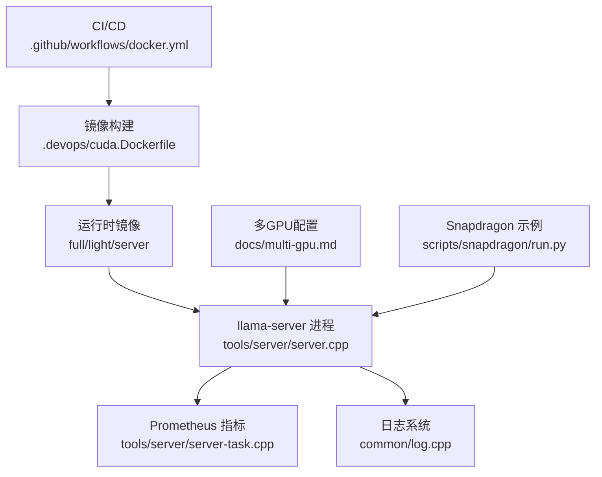
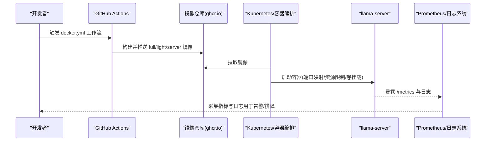
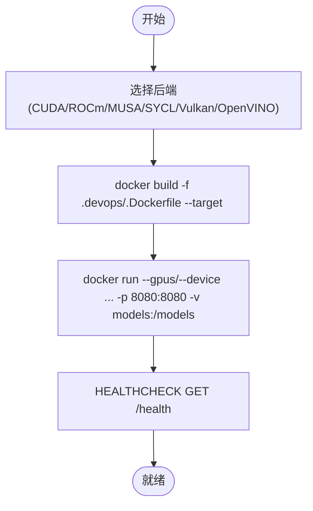
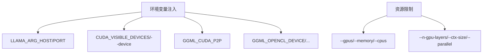
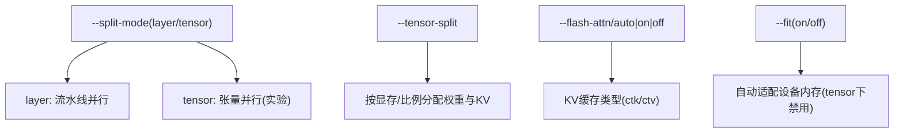
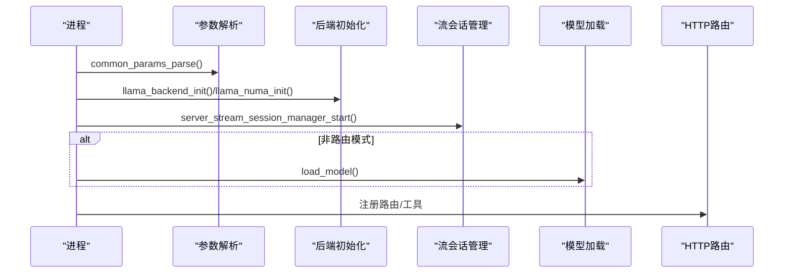
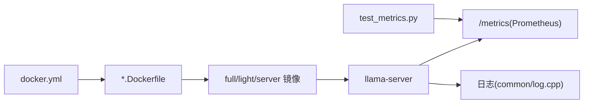
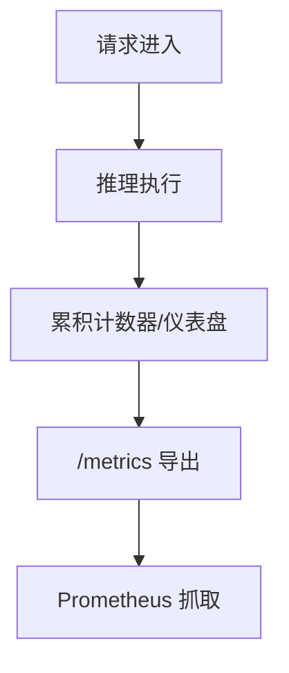
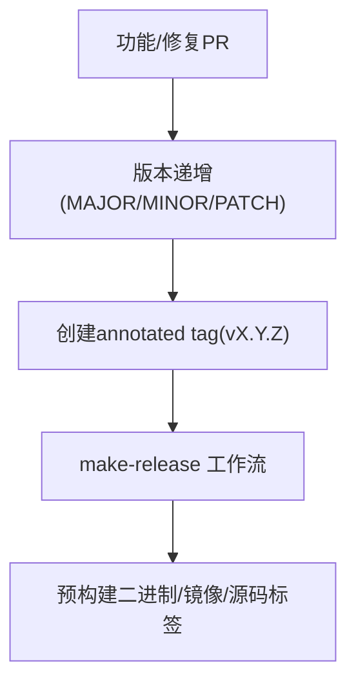

# 部署与运维

<cite>
**本文引用的文件**   
- [docs/docker.md](file://docs/docker.md)
- [.devops/cuda.Dockerfile](file://.devops/cuda.Dockerfile)
- [.github/workflows/docker.yml](file://.github/workflows/docker.yml)
- [docs/multi-gpu.md](file://docs/multi-gpu.md)
- [tools/server/server.cpp](file://tools/server/server.cpp)
- [tools/server/server-task.cpp](file://tools/server/server-task.cpp)
- [tools/server/README.md](file://tools/server/README.md)
- [tools/server/tests/unit/test_metrics.py](file://tools/server/tests/unit/test_metrics.py)
- [scripts/snapdragon/run.py](file://scripts/snapdragon/run.py)
- [docs/release.md](file://docs/release.md)
</cite>

## 目录
1. [简介](#简介)
2. [项目结构](#项目结构)
3. [核心组件](#核心组件)
4. [架构总览](#架构总览)
5. [详细组件分析](#详细组件分析)
6. [依赖关系分析](#依赖关系分析)
7. [性能与容量规划](#性能与容量规划)
8. [监控、日志与告警](#监控日志与告警)
9. [版本管理与发布流程](#版本管理与发布流程)
10. [安全加固与访问控制](#安全加固与访问控制)
11. [故障诊断与排错](#故障诊断与排错)
12. [结论](#结论)

## 简介
本指南面向生产环境，聚焦 llama.cpp 的容器化部署、多 GPU 集群扩展、性能监控与日志收集、版本管理与发布流程，以及安全加固与访问控制。文档基于仓库中的 Docker 构建脚本、工作流、服务端实现与文档进行系统化梳理，帮助你在不同硬件后端（CPU/GPU）上稳定、可观测、可演进地运行推理服务。

## 项目结构
与部署和运维直接相关的代码与文档主要分布在以下位置：
- 镜像与 CI/CD：`.devops/*.Dockerfile`、`.github/workflows/docker.yml`
- 多 GPU 使用指南：`docs/multi-gpu.md`
- 服务端入口与指标：`tools/server/server.cpp`、`tools/server/server-task.cpp`、`tools/server/README.md`
- 通用日志与参数处理：`common/log.cpp`、`common/common.cpp`
- 环境变量与设备选择示例：`scripts/snapdragon/run.py`
- 发布流程说明：`docs/release.md`

**图示来源**
- [.github/workflows/docker.yml:146-355](file://.github/workflows/docker.yml#L146-L355)
- [.devops/cuda.Dockerfile:28-134](file://.devops/cuda.Dockerfile#L28-L134)
- [tools/server/server.cpp:93-124](file://tools/server/server.cpp#L93-L124)
- [tools/server/server-task.cpp:1525-1620](file://tools/server/server-task.cpp#L1525-L1620)
- [common/log.cpp:69-141](file://common/log.cpp#L69-L141)

**章节来源**
- [.github/workflows/docker.yml:146-355](file://.github/workflows/docker.yml#L146-L355)
- [.devops/cuda.Dockerfile:28-134](file://.devops/cuda.Dockerfile#L28-L134)

## 核心组件
- 容器镜像族谱
  - full：包含 CLI、转换工具与 Python 依赖，适合模型下载/量化/调试一体化场景。
  - light：仅含 CLI 二进制，体积更小。
  - server：仅含 llama-server，默认监听 8080，提供健康检查与健康端点。
- 多后端支持
  - CUDA、ROCm、MUSA、SYCL、Vulkan、OpenVINO 等均有对应 Dockerfile 与工作流矩阵。
- 服务端
  - 标准 OpenAI 兼容接口，内置 Prometheus 指标导出，支持路由模式与单模型模式。
- 多 GPU
  - 支持流水线并行（layer）、张量并行（tensor，实验性），并提供 NCCL/RCCL 与 P2P 优化选项。

**章节来源**
- [docs/docker.md:7-41](file://docs/docker.md#L7-L41)
- [.devops/cuda.Dockerfile:89-134](file://.devops/cuda.Dockerfile#L89-L134)
- [tools/server/server.cpp:131-200](file://tools/server/server.cpp#L131-L200)
- [docs/multi-gpu.md:18-49](file://docs/multi-gpu.md#L18-L49)

## 架构总览
下图展示从 CI/CD 到运行时的关键路径：工作流触发镜像构建，产出 multi-arch manifest；运行时通过容器启动 llama-server，暴露 HTTP API 与 /metrics，并输出结构化日志。

**图示来源**
- [.github/workflows/docker.yml:146-355](file://.github/workflows/docker.yml#L146-L355)
- [.devops/cuda.Dockerfile:122-134](file://.devops/cuda.Dockerfile#L122-L134)
- [tools/server/server.cpp:93-124](file://tools/server/server.cpp#L93-L124)

## 详细组件分析

### 容器化部署与镜像构建
- 预构建镜像族
  - CPU/GPU/SYCL/Vulkan/OpenVINO/MUSA/ROCm 等多变体，按平台与后端组合发布。
- 本地构建
  - 通过 `.devops/<backend>.Dockerfile` 指定 target（full/light/server）。
  - CUDA 镜像默认使用 nvidia/cuda 基础镜像，编译时启用 GGML_CUDA、GGML_BACKEND_DL 等开关。
- 运行方式
  - server 镜像默认设置 LLAMA_ARG_HOST=0.0.0.0、LLAMA_ARG_PORT=8080，并提供 HEALTHCHECK。
  - 可通过 --gpus/--device 或后端特定参数选择设备。

**图示来源**
- [.devops/cuda.Dockerfile:28-134](file://.devops/cuda.Dockerfile#L28-L134)
- [docs/docker.md:79-108](file://docs/docker.md#L79-L108)

**章节来源**
- [docs/docker.md:7-41](file://docs/docker.md#L7-L41)
- [.devops/cuda.Dockerfile:28-134](file://.devops/cuda.Dockerfile#L28-L134)

### 环境变量与资源配置
- 运行时环境变量
  - LLAMA_ARG_HOST、LLAMA_ARG_PORT：由 server 镜像默认注入。
  - GGML_CUDA_P2P：开启 CUDA 设备间 P2P 传输（需驱动支持，可能不稳定）。
  - CUDA_VISIBLE_DEVICES：控制可见 GPU 集合。
  - GGML_OPENCL_DEVICE、GGML_HEXAGON_*：OpenCL/Hexagon 相关设备与调试开关。
- 资源限制
  - 容器层面：通过 --gpus、--memory、--cpus 限制 GPU/CPU/内存。
  - 应用层面：--n-gpu-layers、--ctx-size、--parallel、--kv-unified-per-slot 控制显存与并发。

**图示来源**
- [.devops/cuda.Dockerfile:122-134](file://.devops/cuda.Dockerfile#L122-L134)
- [docs/multi-gpu.md:33-49](file://docs/multi-gpu.md#L33-L49)
- [scripts/snapdragon/run.py:276-301](file://scripts/snapdragon/run.py#L276-L301)

**章节来源**
- [.devops/cuda.Dockerfile:122-134](file://.devops/cuda.Dockerfile#L122-L134)
- [docs/multi-gpu.md:33-49](file://docs/multi-gpu.md#L33-L49)
- [scripts/snapdragon/run.py:276-301](file://scripts/snapdragon/run.py#L276-L301)

### 多 GPU 集群部署方案
- 分割模式
  - layer（默认）：流水线并行，层切分，KV 随层分布，适合大模型与高吞吐。
  - tensor（实验）：张量并行，权重与 KV 均切分，延迟更优但受互联带宽影响显著。
  - row：已弃用，不建议新部署使用。
- 关键参数
  - --split-mode/-sm、--tensor-split/-ts、--main-gpu/-mg、--n-gpu-layers/-ngl、--device/-dev、--flash-attn/-fa、--cache-type-k/-ctk、--cache-type-v/-ctv、--fit/-fit。
- 通信与加速
  - NCCL（CUDA）/RCCL（ROCm/HIP）在 tensor 模式下自动用于跨卡规约。
  - GGML_CUDA_P2P 可选开启 P2P 直连，提升多卡性能但需评估稳定性。

**图示来源**
- [docs/multi-gpu.md:18-49](file://docs/multi-gpu.md#L18-L49)
- [docs/multi-gpu.md:95-112](file://docs/multi-gpu.md#L95-L112)

**章节来源**
- [docs/multi-gpu.md:18-49](file://docs/multi-gpu.md#L18-L49)
- [docs/multi-gpu.md:95-112](file://docs/multi-gpu.md#L95-L112)

### 服务端入口与请求处理
- 启动流程
  - 解析参数、初始化后端、启动流会话管理器、加载模型（非路由模式）、注册路由与工具。
- 异常处理
  - 统一捕获异常并返回标准化错误响应，避免未处理异常导致进程崩溃。
- 路由模式
  - 支持远程 preset 路由，不加载模型且不触碰 GPU。

**图示来源**
- [tools/server/server.cpp:93-124](file://tools/server/server.cpp#L93-L124)
- [tools/server/server.cpp:131-200](file://tools/server/server.cpp#L131-L200)

**章节来源**
- [tools/server/server.cpp:93-124](file://tools/server/server.cpp#L93-L124)
- [tools/server/server.cpp:131-200](file://tools/server/server.cpp#L131-L200)

## 依赖关系分析
- CI/CD 与镜像
  - docker.yml 定义矩阵（CPU/GPU/SYCL/Vulkan/OpenVINO/MUSA/ROCm），按 tag 聚合多架构 manifest。
  - 每个后端有独立 Dockerfile，统一产物为 full/light/server。
- 运行时依赖
  - server 依赖 ggml 后端（CUDA/ROCm/MUSA/SYCL/Vulkan/OpenVINO），并通过 common 模块提供日志与参数解析。
- 指标与测试
  - server-task.cpp 生成 Prometheus 文本格式指标；单元测试验证指标存在性与格式。

**图示来源**
- [.github/workflows/docker.yml:146-355](file://.github/workflows/docker.yml#L146-L355)
- [.devops/cuda.Dockerfile:28-134](file://.devops/cuda.Dockerfile#L28-L134)
- [tools/server/server-task.cpp:1525-1620](file://tools/server/server-task.cpp#L1525-L1620)
- [tools/server/tests/unit/test_metrics.py:1-92](file://tools/server/tests/unit/test_metrics.py#L1-L92)

**章节来源**
- [.github/workflows/docker.yml:146-355](file://.github/workflows/docker.yml#L146-L355)
- [tools/server/server-task.cpp:1525-1620](file://tools/server/server-task.cpp#L1525-L1620)
- [tools/server/tests/unit/test_metrics.py:1-92](file://tools/server/tests/unit/test_metrics.py#L1-L92)

## 性能与容量规划
- 模型与显存
  - 合理设置 --n-gpu-layers 与 --ctx-size，必要时降低 --parallel 以控制 KV 池占用。
  - 使用 --fit 自动适配设备内存（tensor 模式不支持）。
- 并发与吞吐
  - 调整 --parallel 与 --kv-unified-per-slot 平衡吞吐与显存。
  - 流水线并行（layer）在高吞吐场景通常优于张量并行（tensor）。
- 后端优化
  - CUDA：确保 NCCL 可用；必要时启用 GGML_CUDA_P2P（评估稳定性）。
  - ROCm：考虑 RCCL（编译时启用）。
  - SYCL/Vulkan/OpenVINO：遵循各自后端文档的设备与驱动要求。

[本节为通用指导，无需具体文件引用]

## 监控、日志与告警

### 指标采集
- 端点
  - /metrics：Prometheus 文本格式指标（需在服务端启用 metrics）。
- 关键指标
  - prompt_tokens_total、prompt_seconds_total、tokens_predicted_total、tokens_predicted_seconds_total、requests_processing、requests_deferred、n_decode_total、n_tokens_max、spec_decode_* 系列。
- 验证
  - 单元测试覆盖指标名称、类型与 HELP 行完整性。

**图示来源**
- [tools/server/server-task.cpp:1525-1620](file://tools/server/server-task.cpp#L1525-L1620)
- [tools/server/README.md:1131-1149](file://tools/server/README.md#L1131-L1149)
- [tools/server/tests/unit/test_metrics.py:14-35](file://tools/server/tests/unit/test_metrics.py#L14-L35)

**章节来源**
- [tools/server/server-task.cpp:1525-1620](file://tools/server/server-task.cpp#L1525-L1620)
- [tools/server/README.md:1131-1149](file://tools/server/README.md#L1131-L1149)
- [tools/server/tests/unit/test_metrics.py:14-35](file://tools/server/tests/unit/test_metrics.py#L14-L35)

### 日志收集
- 日志级别
  - debug/info/warn/error/cont 等，由 common/log.cpp 统一处理。
- 建议
  - 生产环境使用 info 或 warn 级别，结合外部日志系统（如 journald/ELK/Fluent Bit）集中采集。
  - 对高频路径（如 token 生成）避免开启 debug，减少 I/O 开销。

**章节来源**
- [common/log.cpp:69-141](file://common/log.cpp#L69-L141)

### 告警规则（建议）
- 可用性
  - /health 连续失败 > N 次。
- 性能
  - requests_processing 持续高位且 requests_deferred 增长。
  - tokens_predicted_seconds 突降或抖动明显。
- 资源
  - 显存/内存接近上限（结合节点侧指标）。
- 质量
  - spec_decode_num_accepted_tokens_total 长期为 0（推测解码未生效）。

[本节为通用指导，无需具体文件引用]

## 版本管理与发布流程
- 语义化版本
  - MAJOR.MINOR.PATCH，变更类型决定版本号递增策略。
- 构建标记
  - LLAMA_BUILD_IS_DEV 控制是否追加 -dev 后缀。
- 发布工件
  - 通过 make-release 工作流创建带注释的 git tag，作为发布产物。
- 用户获取渠道
  - 预构建二进制安装脚本、包管理器、源码 checkout 标签。

**图示来源**
- [docs/release.md:1-56](file://docs/release.md#L1-L56)

**章节来源**
- [docs/release.md:1-56](file://docs/release.md#L1-L56)

## 安全加固与访问控制
- 网络与端口
  - 将 LLAMA_ARG_HOST 绑定至内网地址，仅在代理/网关后暴露对外端口。
  - 使用反向代理（Nginx/Traefik/Ingress）统一鉴权、限流与审计。
- 认证与授权
  - 在代理层实施 Token/Bearer 校验，或在服务端集成第三方鉴权中间件。
  - 对敏感头（Authorization）进行脱敏与最小化暴露。
- 容器安全
  - 使用只读根文件系统、非 root 用户运行、最小权限原则。
  - 定期扫描镜像漏洞，限制网络 egress。
- 数据与密钥
  - 模型与密钥通过 Secret/ConfigMap 或外部密钥管理服务挂载，避免硬编码。
- 合规与审计
  - 开启审计日志，记录访问来源、请求ID、耗时与状态码。

[本节为通用指导，无需具体文件引用]

## 故障诊断与排错
- 多 GPU 常见问题
  - tensor 模式需要 flash attention 与非量化 KV 缓存；若报错，切换回 layer 模式或调整 ctk/ctv。
  - NCCL 不可用时性能下降，需确认构建与安装。
  - GGML_CUDA_P2P 可能导致不稳定，出现崩溃或结果异常时关闭该变量。
- 启动与 OOM
  - 降低 ctx-size、parallel 或 n-gpu-layers；确认 CUDA_VISIBLE_DEVICES 未被误屏蔽。
- 指标不可用
  - 确认已启用 metrics，/metrics 返回 200 且包含 llamacpp:* 指标。
- 日志定位
  - 根据日志级别与时间戳定位异常阶段（初始化/加载/推理/IO）。

**章节来源**
- [docs/multi-gpu.md:116-128](file://docs/multi-gpu.md#L116-L128)
- [tools/server/tests/unit/test_metrics.py:38-44](file://tools/server/tests/unit/test_metrics.py#L38-L44)

## 结论
通过标准化的镜像构建与 CI/CD 矩阵、清晰的多 GPU 并行策略、完善的指标与日志体系、严谨的版本与发布流程，以及严格的安全加固措施，llama.cpp 可在生产环境中实现高可用、高性能、可观测与可演进的推理服务。建议在灰度发布中逐步放量，并结合指标与日志建立闭环的监控与告警机制，持续优化性能与稳定性。