# 采样与生成

<cite>
**本文引用的文件**   
- [common/sampling.h](file://common/sampling.h)
- [common/sampling.cpp](file://common/sampling.cpp)
- [src/llama-sampler.h](file://src/llama-sampler.h)
- [src/llama-sampler.cpp](file://src/llama-sampler.cpp)
- [include/llama.h](file://include/llama.h)
- [common/common.h](file://common/common.h)
- [common/arg.cpp](file://common/arg.cpp)
- [tools/server/server-schema.cpp](file://tools/server/server-schema.cpp)
- [common/json-schema-to-grammar.h](file://common/json-schema-to-grammar.h)
- [docs/development/parsing.md](file://docs/development/parsing.md)
- [grammars/README.md](file://grammars/README.md)
</cite>

## 目录
1. [引言](#引言)
2. [项目结构](#项目结构)
3. [核心组件](#核心组件)
4. [架构总览](#架构总览)
5. [详细组件分析](#详细组件分析)
6. [依赖关系分析](#依赖关系分析)
7. [性能与实现特性](#性能与实现特性)
8. [参数配置与停止条件](#参数配置与停止条件)
9. [结构化输出与 JSON 模式](#结构化输出与-json-模式)
10. [多轮对话上下文一致性](#多轮对话上下文一致性)
11. [采样策略选择与调优指南](#采样策略选择与调优指南)
12. [故障排查](#故障排查)
13. [结论](#结论)

## 引言
本文件面向使用 llama.cpp 进行文本生成的开发者，系统性梳理采样与生成机制。内容覆盖：
- 采样算法原理与适用场景：贪婪解码、温度采样、Top-K、Top-P（核采样）、Min-P、Typical-P、XTC、DRY、Adaptive-P、Mirostat 等。
- 生成参数配置：重复惩罚、频率/存在惩罚、DRY 系列参数、最小概率阈值、自适应目标概率、随机种子等。
- 结构化输出与 JSON 约束：JSON Schema 到 GBNF 语法的转换、懒加载语法、触发词与保留 token。
- 多轮对话中的上下文保持与一致性控制：KV 缓存、推理预算、语法状态推进。
- 采样链执行流程、后端采样加速、拒绝采样与草稿验证。

## 项目结构
与采样和生成直接相关的代码主要分布在以下模块：
- common/sampling.*：高级采样封装、采样链构建、候选集管理、性能统计、语法与推理预算集成。
- src/llama-sampler.*：底层采样器接口、采样链、具体采样器实现（greedy、dist、top-k、top-p、penalties 等）。
- include/llama.h：公共数据结构定义，如 logits/probabilities/candidates 的访问方式。
- common/common.h：采样参数结构体定义与默认值。
- common/arg.cpp：命令行参数解析，将用户输入映射为采样参数。
- tools/server/server-schema.cpp：服务端 API 中 JSON Schema 到语法的处理入口。
- common/json-schema-to-grammar.h：JSON Schema 到 GBNF 语法的转换器接口。
- docs/development/parsing.md：PEG/GBNF 语法构建与 JSON Schema 生成说明。
- grammars/README.md：JSON Schema 转语法限制与注意事项。

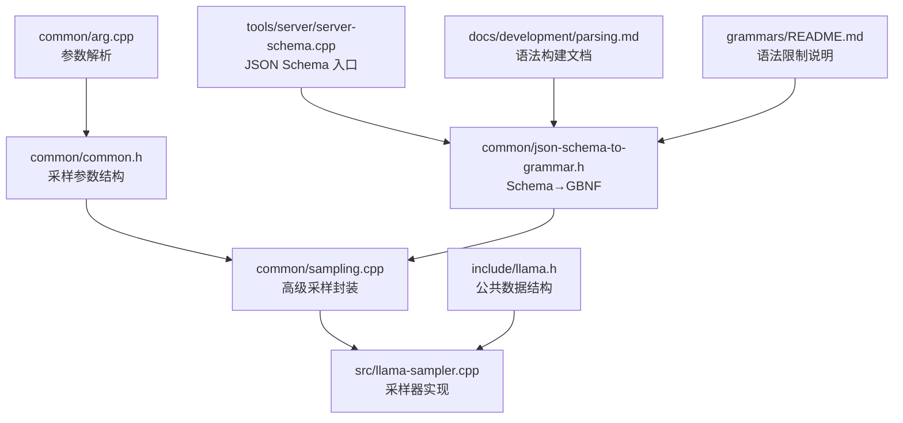

**图表来源**
- [common/sampling.cpp:191-447](file://common/sampling.cpp#L191-L447)
- [src/llama-sampler.cpp:870-963](file://src/llama-sampler.cpp#L870-L963)
- [common/common.h:246-258](file://common/common.h#L246-L258)
- [common/arg.cpp:2021-2046](file://common/arg.cpp#L2021-L2046)
- [tools/server/server-schema.cpp:251-272](file://tools/server/server-schema.cpp#L251-L272)
- [common/json-schema-to-grammar.h:1-23](file://common/json-schema-to-grammar.h#L1-L23)
- [docs/development/parsing.md:94-166](file://docs/development/parsing.md#L94-L166)
- [grammars/README.md:203-215](file://grammars/README.md#L203-L215)

**章节来源**
- [common/sampling.h:10-32](file://common/sampling.h#L10-L32)
- [common/sampling.cpp:191-447](file://common/sampling.cpp#L191-L447)
- [src/llama-sampler.h:10-36](file://src/llama-sampler.h#L10-L36)
- [src/llama-sampler.cpp:870-963](file://src/llama-sampler.cpp#L870-L963)
- [include/llama.h:231-244](file://include/llama.h#L231-L244)

## 核心组件
- common_sampler：高级采样封装，负责：
  - 根据 common_params_sampling 构建采样链。
  - 维护最近接受 token 的历史环缓冲。
  - 维护当前候选集 cur_p，便于获取非采样 token 的概率。
  - 支持语法校验与推理预算控制。
  - 提供 sample、accept、reset、clone、copy、get_candidates 等接口。
- llama_sampler_chain：采样器链容器，顺序应用各采样器，支持后端采样加速。
- 具体采样器：greedy、dist、top_k、top_p、min_p、typical_p、xtc、temperature、penalties、adaptive_p、dry 等。

**章节来源**
- [common/sampling.h:10-32](file://common/sampling.h#L10-L32)
- [common/sampling.cpp:112-173](file://common/sampling.cpp#L112-L173)
- [src/llama-sampler.h:10-36](file://src/llama-sampler.h#L10-L36)

## 架构总览
采样与生成的整体流程如下：
- 上层通过 common_sampler_init 根据参数构建采样链，并可选地初始化语法采样器和推理预算采样器。
- 每次解码时，common_sampler_sample 从上下文读取 logits/probs/candidates，依次应用推理预算、语法（可选）、采样链，最终得到候选 token。
- 若启用语法且未采用 grammar_first，则对单个采样结果进行语法校验；若不合法，则重新应用语法约束后再次采样。
- 采样结果通过 common_sampler_accept 进入历史环缓冲，并同步更新语法与推理预算状态。

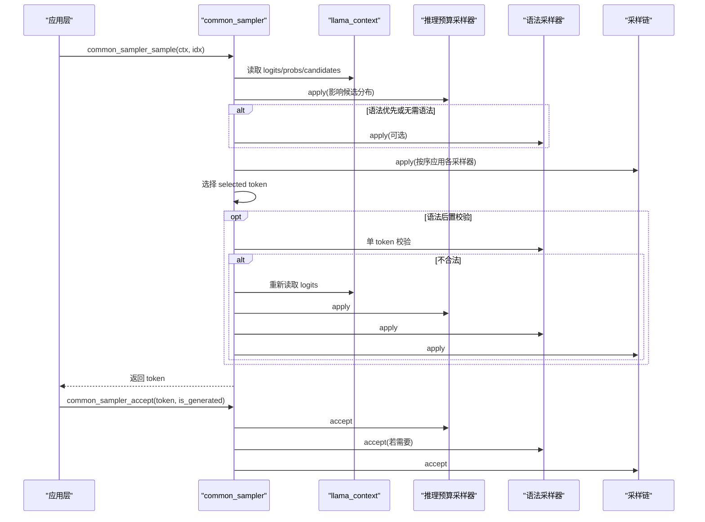

**图表来源**
- [common/sampling.cpp:606-688](file://common/sampling.cpp#L606-L688)
- [common/sampling.cpp:476-508](file://common/sampling.cpp#L476-L508)
- [src/llama-sampler.cpp:895-963](file://src/llama-sampler.cpp#L895-L963)

**章节来源**
- [common/sampling.cpp:191-447](file://common/sampling.cpp#L191-L447)
- [common/sampling.cpp:606-688](file://common/sampling.cpp#L606-L688)
- [src/llama-sampler.cpp:895-963](file://src/llama-sampler.cpp#L895-L963)

## 详细组件分析

### 采样器链与基础采样器
- 采样器链（llama_sampler_chain）：
  - 维护一组采样器，按顺序 apply。
  - 支持后端采样加速，当某个采样器实现 backend_apply 时，可跳过 CPU 路径。
- 基础采样器：
  - greedy：选择 logit 最大的 token。
  - dist：基于 softmax 概率分布采样，支持后端图计算。
  - top_k：仅保留前 k 个候选。
  - top_p：累积概率达到 p 的最小集合，支持 min_keep。
  - penalties：重复惩罚、频率惩罚、存在惩罚。
  - temperature：温度缩放，支持动态范围与指数。
  - typical_p、min_p、xtc、adaptive_p、dry 等。

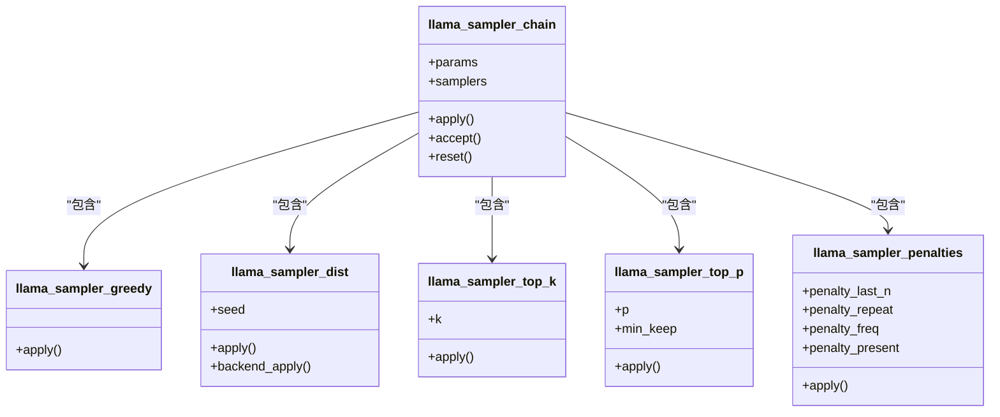

**图表来源**
- [src/llama-sampler.cpp:870-963](file://src/llama-sampler.cpp#L870-L963)
- [src/llama-sampler.cpp:1021-1120](file://src/llama-sampler.cpp#L1021-L1120)
- [src/llama-sampler.cpp:1124-1421](file://src/llama-sampler.cpp#L1124-L1421)
- [src/llama-sampler.cpp:1444-1539](file://src/llama-sampler.cpp#L1444-L1539)
- [src/llama-sampler.cpp:1541-1599](file://src/llama-sampler.cpp#L1541-L1599)
- [src/llama-sampler.cpp:2982-3016](file://src/llama-sampler.cpp#L2982-L3016)

**章节来源**
- [src/llama-sampler.cpp:870-963](file://src/llama-sampler.cpp#L870-L963)
- [src/llama-sampler.cpp:1021-1120](file://src/llama-sampler.cpp#L1021-L1120)
- [src/llama-sampler.cpp:1124-1421](file://src/llama-sampler.cpp#L1124-L1421)
- [src/llama-sampler.cpp:1444-1539](file://src/llama-sampler.cpp#L1444-L1539)
- [src/llama-sampler.cpp:1541-1599](file://src/llama-sampler.cpp#L1541-L1599)
- [src/llama-sampler.cpp:2982-3016](file://src/llama-sampler.cpp#L2982-L3016)

### Top-K 与 Top-P（核采样）
- Top-K：
  - 实现 llama_sampler_top_k_impl，先部分排序，再截取前 k。
  - 后端优化：ggml_top_k 操作符。
- Top-P（核采样）：
  - 实现 llama_sampler_top_p_apply，计算 softmax，按概率累积，直到达到 p 或满足 min_keep。
  - 对小候选集就地排序，大候选集使用自适应 top-k 加速。
  - 后端优化：softmax + cumsum + step + sum 图计算。

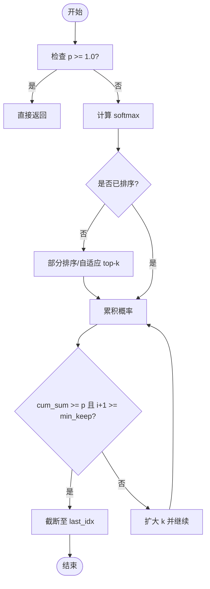

**图表来源**
- [src/llama-sampler.cpp:321-338](file://src/llama-sampler.cpp#L321-L338)
- [src/llama-sampler.cpp:1555-1599](file://src/llama-sampler.cpp#L1555-L1599)

**章节来源**
- [src/llama-sampler.cpp:321-338](file://src/llama-sampler.cpp#L321-L338)
- [src/llama-sampler.cpp:1444-1539](file://src/llama-sampler.cpp#L1444-L1539)
- [src/llama-sampler.cpp:1541-1599](file://src/llama-sampler.cpp#L1541-L1599)

### 温度采样与分布采样
- 温度采样：
  - llama_sampler_temp_impl：temp <= 0 时退化为贪婪；否则对 logit 除以 temp。
  - 支持动态范围与指数（dynatemp_range/dynatemp_exponent）。
- 分布采样：
  - llama_sampler_dist_apply：softmax + 累积概率 + 随机数比较，选择索引。
  - 后端实现：softmax → cumsum → step → sum → index → candidates map。

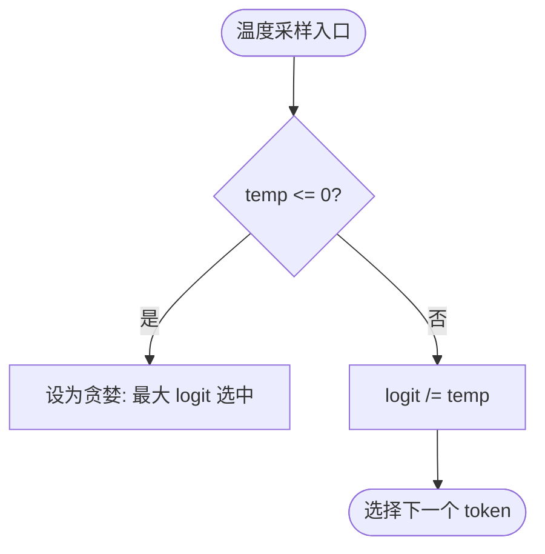

**图表来源**
- [src/llama-sampler.cpp:265-291](file://src/llama-sampler.cpp#L265-L291)
- [src/llama-sampler.cpp:1156-1229](file://src/llama-sampler.cpp#L1156-L1229)
- [src/llama-sampler.cpp:1280-1342](file://src/llama-sampler.cpp#L1280-L1342)

**章节来源**
- [src/llama-sampler.cpp:265-291](file://src/llama-sampler.cpp#L265-L291)
- [src/llama-sampler.cpp:1124-1421](file://src/llama-sampler.cpp#L1124-L1421)

### 重复惩罚与 DRY
- 重复惩罚（penalties）：
  - 维护最近 n 个 token 与计数，对出现过的 token 减去 penalty_freq 与 presence_penalty。
  - 后端支持有限，多输出序列禁用。
- DRY（Don't Repeat Yourself）：
  - 通过 multiplier/base/allowed_length/last_n 控制重复序列的指数惩罚。
  - 支持 sequence breakers（如换行、冒号等）打断重复检测。

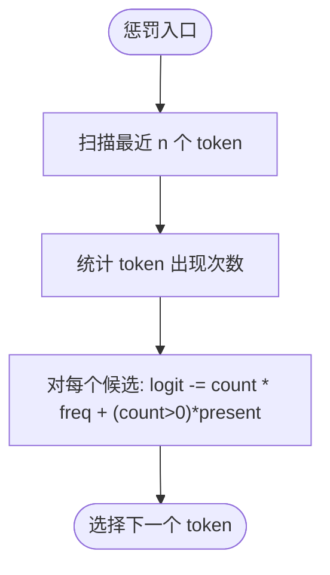

**图表来源**
- [src/llama-sampler.cpp:2982-2986](file://src/llama-sampler.cpp#L2982-L2986)
- [src/llama-sampler.cpp:3560-3582](file://src/llama-sampler.cpp#L3560-L3582)

**章节来源**
- [src/llama-sampler.cpp:2982-3016](file://src/llama-sampler.cpp#L2982-L3016)
- [src/llama-sampler.cpp:3560-3582](file://src/llama-sampler.cpp#L3560-L3582)

### 推理预算与语法状态
- 推理预算（reasoning budget）：
  - 在 common_sampler_init 中根据 start/end 标记与 tokens 控制思考块长度与强制结束。
  - 在 common_sampler_accept 中推进状态，结束时回放结束序列以推进语法状态。
- 语法采样器：
  - 支持 llguidance、GBNF 懒加载语法。
  - 支持 trigger patterns/tokens，配合 preserved tokens 确保触发词不被采样改变。

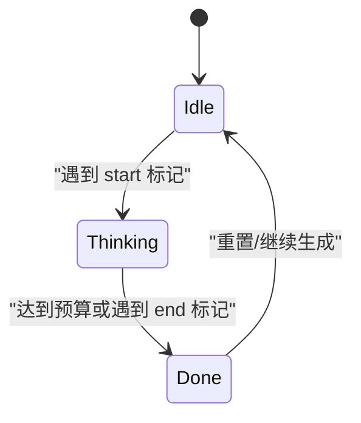

**图表来源**
- [common/sampling.cpp:314-327](file://common/sampling.cpp#L314-L327)
- [common/sampling.cpp:476-508](file://common/sampling.cpp#L476-L508)

**章节来源**
- [common/sampling.cpp:314-327](file://common/sampling.cpp#L314-L327)
- [common/sampling.cpp:476-508](file://common/sampling.cpp#L476-L508)

## 依赖关系分析
- common_sampler 依赖：
  - llama_sampler_chain（采样链）
  - llama_sampler（语法、推理预算）
  - llama_context（读取 logits/probs/candidates）
  - common_params_sampling（参数）
- 具体采样器依赖 ggml 后端算子（如 argmax、top_k、softmax、cumsum、step、sum）。

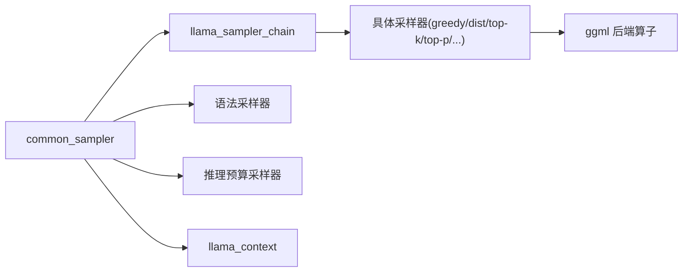

**图表来源**
- [common/sampling.cpp:191-447](file://common/sampling.cpp#L191-L447)
- [src/llama-sampler.cpp:870-963](file://src/llama-sampler.cpp#L870-L963)

**章节来源**
- [common/sampling.cpp:191-447](file://common/sampling.cpp#L191-L447)
- [src/llama-sampler.cpp:870-963](file://src/llama-sampler.cpp#L870-L963)

## 性能与实现特性
- 后端采样加速：
  - 当采样器实现 backend_init/backend_apply 时，可在 GPU/后端图计算中完成采样，减少 CPU 开销。
  - 采样链在 backend_apply 中跳过已在前缀运行的后端采样器。
- 候选集优化：
  - 小候选集就地排序，大候选集使用桶式 partial_sort 提升效率。
  - Top-P 在大 vocab 时使用自适应 top-k 避免全量排序。
- 时间统计：
  - common_perf_print 输出采样时间、prompt eval、eval、总时间与未分配时间。

**章节来源**
- [src/llama-sampler.cpp:663-836](file://src/llama-sampler.cpp#L663-L836)
- [src/llama-sampler.cpp:134-215](file://src/llama-sampler.cpp#L134-L215)
- [common/sampling.cpp:552-596](file://common/sampling.cpp#L552-L596)

## 参数配置与停止条件
- 采样参数结构（common_params_sampling）：
  - 温度、Top-K、Top-P、Min-P、XTC、Typical-P、Top-N-Sigma、DRY、Adaptive-P、Mirostat、重复/频率/存在惩罚、ignore_eos、no_perf、timing_per_token 等。
- 命令行参数：
  - --temperature、--top-k、--top-p、--min-p、--repeat-penalty、--presence-penalty、--frequency-penalty、--dry-multiplier、--dry-base、--dry-allowed-length、--dry-penalty-last-n、--mirostat、--mirostat-tau、--mirostat-eta 等。
- 停止条件：
  - ignore_eos：忽略 EOS 提前终止。
  - 推理预算：通过 start/end 标记与 tokens 控制思考块长度与强制结束。
  - 语法：GBNF 语法可自然终止于匹配规则。

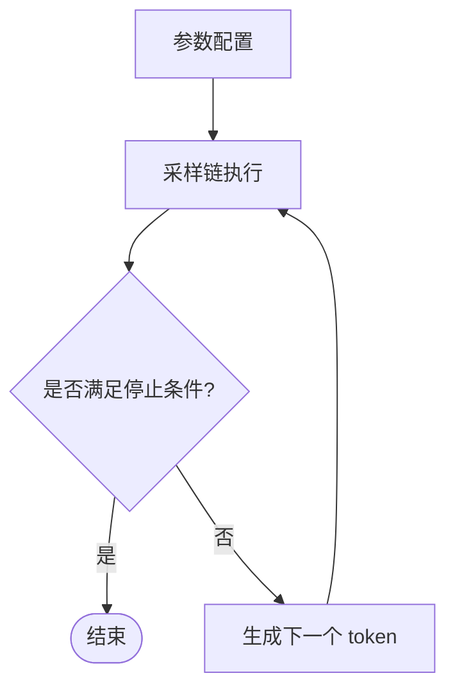

**图表来源**
- [common/common.h:246-258](file://common/common.h#L246-L258)
- [common/arg.cpp:2021-2046](file://common/arg.cpp#L2021-L2046)
- [common/arg.cpp:2092-2141](file://common/arg.cpp#L2092-L2141)
- [common/sampling.cpp:314-327](file://common/sampling.cpp#L314-L327)

**章节来源**
- [common/common.h:246-258](file://common/common.h#L246-L258)
- [common/arg.cpp:2021-2046](file://common/arg.cpp#L2021-L2046)
- [common/arg.cpp:2092-2141](file://common/arg.cpp#L2092-L2141)
- [common/sampling.cpp:314-327](file://common/sampling.cpp#L314-L327)

## 结构化输出与 JSON 模式
- JSON Schema 到 GBNF 语法：
  - 通过 json_schema_to_grammar 将 JSON Schema 转换为 GBNF 语法字符串。
  - 服务端 API 支持 json_schema 字段，自动转换为 grammar。
- 语法类型与懒加载：
  - COMMON_GRAMMAR_TYPE_OUTPUT_FORMAT：输出格式语法，支持预填充（prefill）以跳过模板已放置的 token。
  - 懒加载语法：仅在触发词匹配时生成相关规则，减少语法规模。
- 触发词与保留 token：
  - common_sampling_add_preserved_tokens：将单 token 的词加入 preserved_tokens。
  - common_sampling_add_grammar_triggers：将 word/pattern/token 类型的触发词加入 grammar_triggers。
- 已知限制：
  - additionalProperties 默认 false，可减少幻觉但可能限制扩展性。
  - prefixItems 不支持，minimum/exclusiveMinimum 仅支持 integer。
  - pattern 必须以 ^ 开头并以 $ 结尾。
  - 远程 $ref 不支持。

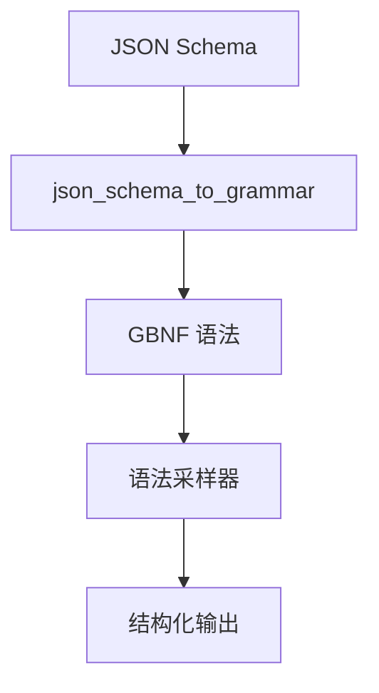

**图表来源**
- [common/json-schema-to-grammar.h:1-23](file://common/json-schema-to-grammar.h#L1-L23)
- [tools/server/server-schema.cpp:251-272](file://tools/server/server-schema.cpp#L251-L272)
- [common/sampling.cpp:216-280](file://common/sampling.cpp#L216-L280)
- [docs/development/parsing.md:94-166](file://docs/development/parsing.md#L94-L166)
- [grammars/README.md:203-215](file://grammars/README.md#L203-L215)

**章节来源**
- [common/json-schema-to-grammar.h:1-23](file://common/json-schema-to-grammar.h#L1-L23)
- [tools/server/server-schema.cpp:251-272](file://tools/server/server-schema.cpp#L251-L272)
- [common/sampling.cpp:216-280](file://common/sampling.cpp#L216-L280)
- [docs/development/parsing.md:94-166](file://docs/development/parsing.md#L94-L166)
- [grammars/README.md:203-215](file://grammars/README.md#L203-L215)

## 多轮对话上下文一致性
- KV 缓存：
  - llama_context 维护 KV 缓存，避免重复计算历史 token 的注意力。
- 推理预算：
  - 通过 start/end 标记控制思考块长度，结束时回放结束序列以推进语法状态。
- 语法状态推进：
  - 对于输出格式语法，prefill 已放置的模板 token，确保语法状态与上下文一致。
- 候选集与历史：
  - common_sampler 维护 prev 环缓冲，便于调试与回溯。

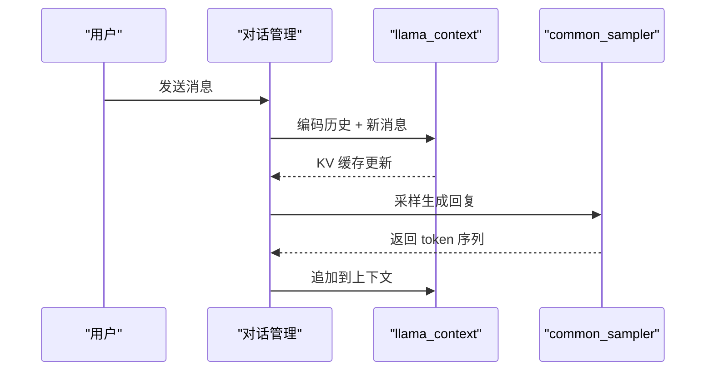

**图表来源**
- [common/sampling.cpp:314-327](file://common/sampling.cpp#L314-L327)
- [common/sampling.cpp:476-508](file://common/sampling.cpp#L476-L508)
- [common/sampling.cpp:892-927](file://common/sampling.cpp#L892-L927)

**章节来源**
- [common/sampling.cpp:314-327](file://common/sampling.cpp#L314-L327)
- [common/sampling.cpp:476-508](file://common/sampling.cpp#L476-L508)
- [common/sampling.cpp:892-927](file://common/sampling.cpp#L892-L927)

## 采样策略选择与调优指南
- 贪婪解码（greedy）：
  - 适用：确定性任务、低多样性需求。
  - 参数：无额外参数。
- 温度采样（temperature）：
  - 适用：创意写作、开放域对话。
  - 调优：temp 越高越多样，越低越确定；结合 dynatemp_range/dynatemp_exponent 控制动态范围。
- Top-K：
  - 适用：控制候选集大小，避免长尾噪声。
  - 调优：k 越小越保守，越大越多样。
- Top-P（核采样）：
  - 适用：平衡质量与多样性。
  - 调优：p 越大越多样，min_keep 保证至少保留的候选数。
- Min-P：
  - 适用：相对概率阈值过滤。
  - 调优：min_p 相对于最高概率 token 的比例。
- Typical-P：
  - 适用：保持局部典型性，避免过度平滑。
  - 调优：typ_p 控制典型性强度。
- XTC：
  - 适用：随机移除低概率 token，增加多样性。
  - 调优：xtc_probability 与 xtc_threshold。
- DRY：
  - 适用：抑制重复与冗余。
  - 调优：multiplier/base/allowed_length/last_n 与 sequence breakers。
- Adaptive-P：
  - 适用：自适应目标概率，随时间调整。
  - 调优：adaptive_target 与 adaptive_decay。
- Mirostat：
  - 适用：控制困惑度，自适应学习率。
  - 调优：mirostat_tau（目标熵）与 mirostat_eta（学习率）。

建议组合：
- 高质量稳定：greedy 或 temp=0 + penalties。
- 创意多样：temp > 0 + top_p 或 typical_p。
- 防重复：penalties + dry。
- 结构化输出：grammar/json_schema + 触发词与保留 token。

[本节为概念性指导，不直接分析具体文件]

## 故障排查
- 语法解析失败：
  - 检查 grammar 字符串是否为空或非法。
  - 确认 llguidance 是否启用。
- 后端采样不兼容：
  - 语法或推理预算与后端采样不兼容，会自动禁用后端采样。
- 参数无效：
  - repeat-penalty 必须为正数且有限。
  - presence/frequency-penalty 必须为有限数。
- JSON Schema 限制：
  - additionalProperties 默认 false，如需扩展需显式设置。
  - pattern 必须以 ^ 开头并以 $ 结尾。
  - 远程 $ref 不支持。

**章节来源**
- [common/sampling.cpp:216-280](file://common/sampling.cpp#L216-L280)
- [common/sampling.cpp:422-432](file://common/sampling.cpp#L422-L432)
- [common/arg.cpp:2092-2141](file://common/arg.cpp#L2092-L2141)
- [grammars/README.md:203-215](file://grammars/README.md#L203-L215)

## 结论
llama.cpp 的采样与生成系统通过灵活的采样链、后端加速、语法约束与推理预算控制，提供了从确定性到高度多样化的完整生成能力。开发者可根据任务需求选择合适的采样策略与参数组合，并通过 JSON Schema 与 GBNF 语法实现结构化输出。在多轮对话场景中，KV 缓存与语法状态推进确保了上下文一致性与生成稳定性。

[本节为总结性内容，不直接分析具体文件]