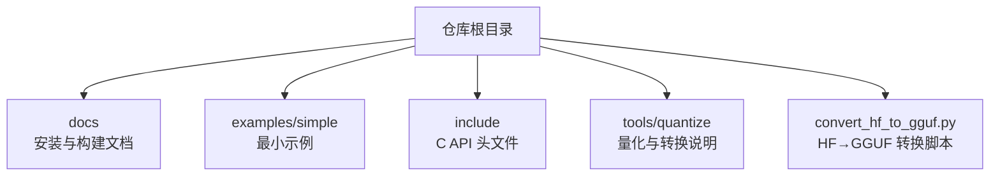
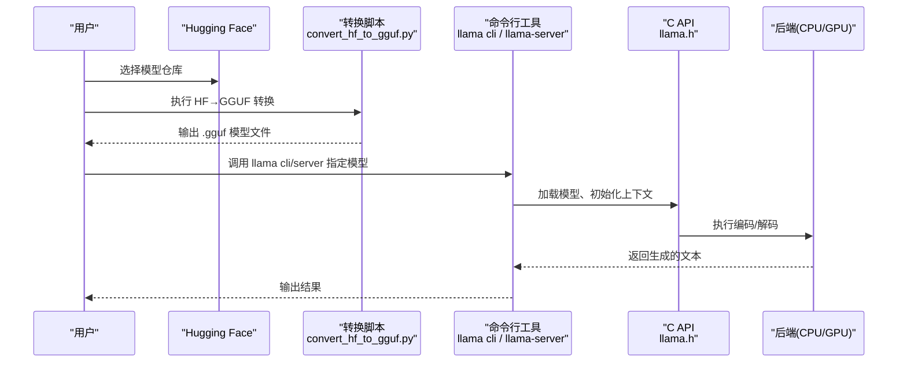
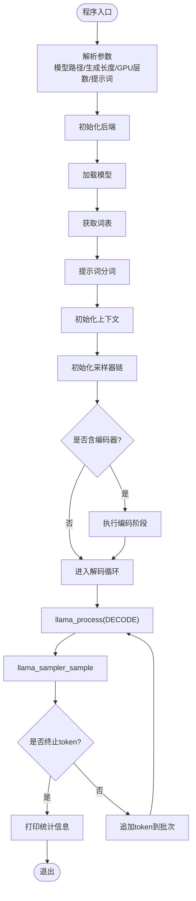
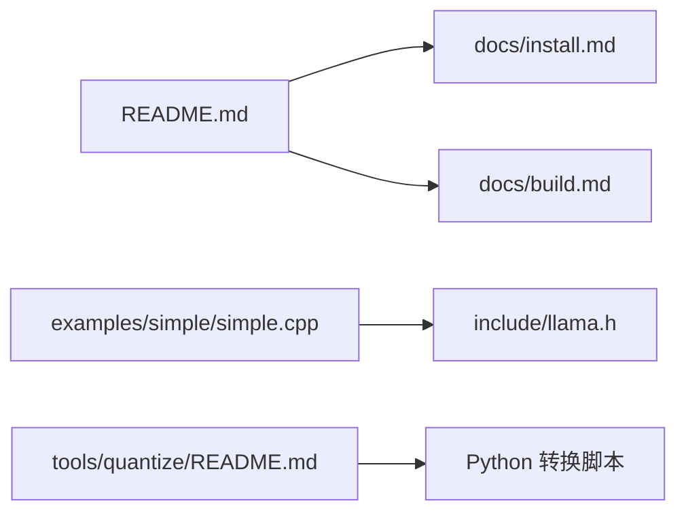

# 快速开始指南

<cite>
**本文引用的文件**   
- [README.md](file://README.md)
- [docs/install.md](file://docs/install.md)
- [docs/build.md](file://docs/build.md)
- [examples/simple/README.md](file://examples/simple/README.md)
- [examples/simple/simple.cpp](file://examples/simple/simple.cpp)
- [include/llama.h](file://include/llama.h)
- [include/llama-cpp.h](file://include/llama-cpp.h)
- [tools/quantize/README.md](file://tools/quantize/README.md)
</cite>

## 目录
1. [简介](#简介)
2. [项目结构](#项目结构)
3. [核心组件](#核心组件)
4. [架构总览](#架构总览)
5. [详细组件分析](#详细组件分析)
6. [依赖分析](#依赖分析)
7. [性能考虑](#性能考虑)
8. [故障排除指南](#故障排除指南)
9. [结论](#结论)
10. [附录](#附录)

## 简介
本指南面向初学者，帮助你在 30 分钟内完成 llama.cpp 的环境准备、模型下载与转换、编译配置，并使用 C API 运行第一个文本生成程序。你将学会：
- 在 Windows/macOS/Linux 上安装预构建版本或从源码编译
- 将 Hugging Face 模型转换为 GGUF 格式
- 使用命令行工具进行推理
- 编写并运行一个基于 C API 的最小示例程序

## 项目结构
llama.cpp 仓库包含核心库、示例程序、文档和工具。对于快速开始，重点关注以下路径：
- 顶层 README 提供一键安装与快速命令
- docs/install.md 与 docs/build.md 提供安装与编译说明
- examples/simple 提供最小 C/C++ 示例
- include/llama.h 暴露 C API
- tools/quantize 提供量化与转换流程说明

**图示来源**
- [README.md:20-45](file://README.md#L20-L45)
- [docs/install.md:1-79](file://docs/install.md#L1-L79)
- [docs/build.md:1-14](file://docs/build.md#L1-L14)
- [examples/simple/README.md:1-22](file://examples/simple/README.md#L1-L22)
- [include/llama.h:1-300](file://include/llama.h#L1-L300)
- [tools/quantize/README.md:1-36](file://tools/quantize/README.md#L1-L36)

**章节来源**
- [README.md:20-45](file://README.md#L20-L45)
- [docs/install.md:1-79](file://docs/install.md#L1-L79)
- [docs/build.md:1-14](file://docs/build.md#L1-L14)
- [examples/simple/README.md:1-22](file://examples/simple/README.md#L1-L22)

## 核心组件
- 预构建安装：通过 conda-forge、Winget、Homebrew、MacPorts、Nix 等渠道直接安装
- 源码编译：使用 CMake 构建 CPU/GPU 后端（Metal、CUDA、HIP、Vulkan、SYCL、ZenDNN 等）
- 模型转换：使用 Python 脚本将 Hugging Face 模型转换为 GGUF 格式
- C API：通过 include/llama.h 暴露的 C 接口进行模型加载、上下文初始化、采样与解码

**章节来源**
- [docs/install.md:1-79](file://docs/install.md#L1-L79)
- [docs/build.md:33-152](file://docs/build.md#L33-L152)
- [tools/quantize/README.md:1-36](file://tools/quantize/README.md#L1-L36)
- [include/llama.h:1-300](file://include/llama.h#L1-L300)

## 架构总览
下图展示从“下载模型”到“运行推理”的整体流程，以及 CLI、C API 与后端的关系。

**图示来源**
- [README.md:37-45](file://README.md#L37-L45)
- [tools/quantize/README.md:30-36](file://tools/quantize/README.md#L30-L36)
- [include/llama.h:248-300](file://include/llama.h#L248-L300)

## 详细组件分析

### 环境准备与安装
- 推荐新手优先使用预构建版本，避免编译依赖问题
- 支持平台与安装方式见下表：

| 安装方式 | Windows | Mac | Linux |
|---|---:|---:|---:|
| conda-forge | ✅ | ✅ | ✅ |
| Winget | ✅ | — | — |
| Homebrew | — | ✅ | ✅ |
| MacPorts | — | ✅ | — |
| Nix | — | ✅ | ✅ |

常用命令：
- conda-forge：`conda install -c conda-forge llama.cpp`
- Winget：`winget install llama.cpp`
- Homebrew：`brew install llama.cpp`
- MacPorts：`sudo port install llama.cpp`
- Nix：`nix profile install nixpkgs#llama-cpp`

若需 GPU 加速，可在安装后通过命令行参数控制层卸载（如 `-ngl`），或在源码编译时启用对应后端。

**章节来源**
- [docs/install.md:1-79](file://docs/install.md#L1-L79)

### 源码编译（CPU/GPU）
- CPU 构建（默认）：
  - `cmake -B build`
  - `cmake --build build --config Release`
- BLAS 优化（可选）：
  - OpenBLAS：`cmake -B build -DGGML_BLAS=ON -DGGML_BLAS_VENDOR=OpenBLAS`
  - Intel oneMKL：按文档设置 oneAPI 环境变量后构建
- Metal（macOS）：默认启用；可通过 `--n-gpu-layers 0` 禁用
- CUDA（NVIDIA）：`cmake -B build -DGGML_CUDA=ON`
- HIP（AMD）：参考 ROCm 安装与构建步骤
- Vulkan：需要 Vulkan SDK，Windows/Linux/Mac 均有说明
- ZenDNN（AMD CPU）：`cmake -B build -DGGML_ZENDNN=ON`

提示：
- 使用 Ninja 或并行编译选项可显著缩短构建时间
- 如需静态库，添加 `-DBUILD_SHARED_LIBS=OFF`
- 如需 HTTPS/TLS，安装 OpenSSL 开发库

**章节来源**
- [docs/build.md:33-152](file://docs/build.md#L33-L152)
- [docs/build.md:154-167](file://docs/build.md#L154-L167)
- [docs/build.md:169-336](file://docs/build.md#L169-L336)
- [docs/build.md:337-446](file://docs/build.md#L337-L446)
- [docs/build.md:447-587](file://docs/build.md#L447-L587)
- [docs/build.md:589-646](file://docs/build.md#L589-L646)

### 模型转换（HF → GGUF）
- 使用仓库提供的 Python 脚本将 Hugging Face 模型转换为 GGUF 格式
- 量化可将权重精度降低（例如从 FP32/BF16 到 Q4_K/Q8_0），减小体积并提升推理速度
- 典型流程：
  1) 准备输入 GGUF（可从 HF 仓库转换）
  2) 量化为所需格式
  3) 验证 perplexity（可选）

参考命令（示例）：
- 转换：`python convert_hf_to_gguf.py --outfile model.gguf --outtype bf16 --remote org/model-name`
- 量化：参见 tools/quantize 下的说明

注意：
- 多模态模型还需转换编码器与投影层
- 量化可能引入精度损失，可使用 imatrix 文件最小化

**章节来源**
- [tools/quantize/README.md:1-36](file://tools/quantize/README.md#L1-L36)

### 命令行推理（llama cli / llama-server）
- 直接从 Hugging Face 下载并运行模型：
  - `llama cli -hf ggml-org/Qwen3.5-0.8B-GGUF`
- 启动兼容 OpenAI 的 API 服务器：
  - `llama serve -hf ggml-org/Qwen3.5-0.8B-GGUF`

这些命令会处理模型下载、加载与推理，适合快速体验。

**章节来源**
- [README.md:37-45](file://README.md#L37-L45)

### 使用 C API 进行简单文本生成
示例程序位于 examples/simple，展示了最小化的文本生成流程：
- 解析命令行参数（模型路径、生成长度、GPU 层数、提示词）
- 初始化后端与模型
- 对提示词进行分词
- 初始化上下文与采样器
- 循环解码并输出新 token

关键步骤概览（不展示代码内容）：
- 加载模型：`llama_model_load_from_file`
- 获取词表：`llama_model_get_vocab`
- 分词：`llama_tokenize`
- 初始化上下文：`llama_init_from_model`
- 初始化采样器链：`llama_sampler_chain_init`，添加贪婪采样
- 批处理与解码：`llama_process(LLAMA_PROCESS_TYPE_DECODE, ...)`
- 采样下一个 token：`llama_sampler_sample`
- 结束条件：遇到 EOS/EOT/EOM 等终止 token

**图示来源**
- [examples/simple/simple.cpp:25-239](file://examples/simple/simple.cpp#L25-L239)
- [include/llama.h:248-300](file://include/llama.h#L248-L300)

**章节来源**
- [examples/simple/simple.cpp:1-239](file://examples/simple/simple.cpp#L1-L239)
- [examples/simple/README.md:1-22](file://examples/simple/README.md#L1-L22)
- [include/llama.h:248-300](file://include/llama.h#L248-L300)

## 依赖分析
- 顶层 README 提供快速安装与运行入口
- docs/install.md 与 docs/build.md 分别覆盖预构建安装与源码编译
- examples/simple 依赖 include/llama.h 暴露的 C API
- tools/quantize 提供量化与转换流程说明

**图示来源**
- [README.md:20-45](file://README.md#L20-L45)
- [docs/install.md:1-79](file://docs/install.md#L1-L79)
- [docs/build.md:1-14](file://docs/build.md#L1-L14)
- [examples/simple/simple.cpp:1-239](file://examples/simple/simple.cpp#L1-L239)
- [include/llama.h:1-300](file://include/llama.h#L1-L300)
- [tools/quantize/README.md:1-36](file://tools/quantize/README.md#L1-L36)

**章节来源**
- [README.md:20-45](file://README.md#L20-L45)
- [docs/install.md:1-79](file://docs/install.md#L1-L79)
- [docs/build.md:1-14](file://docs/build.md#L1-L14)
- [examples/simple/simple.cpp:1-239](file://examples/simple/simple.cpp#L1-L239)
- [include/llama.h:1-300](file://include/llama.h#L1-L300)
- [tools/quantize/README.md:1-36](file://tools/quantize/README.md#L1-L36)

## 性能考虑
- 使用 BLAS 优化（OpenBLAS、Intel oneMKL）可提升 prompt 处理吞吐
- 合理设置 GPU 层卸载（`-ngl`）以充分利用显存
- 调整 batch 大小与 ubatch 大小以平衡延迟与吞吐
- 量化模型可减少内存占用并提升速度，但需权衡精度
- 针对特定硬件（CUDA、Vulkan、SYCL、ZenDNN）启用相应后端以获得最佳性能

[本节为通用指导，无需具体文件引用]

## 故障排除指南
常见问题与建议：
- 无法找到 CUDA/Vulkan/SYCL 等后端：确认已安装对应 SDK 并在 CMake 中启用相应选项
- 运行时显存不足：减少 `-ngl` 或使用更小量化模型；Linux 下可尝试统一内存环境变量
- 编译失败：检查编译器与依赖版本；Windows 上使用 VS Developer Command Prompt；Linux 安装缺失的开发包（如 libssl-dev、libvulkan-dev）
- 模型加载失败：确认模型文件格式为 GGUF，且与模型架构匹配
- 性能不佳：开启 BLAS/GPU 后端，调整批大小，使用量化模型

**章节来源**
- [docs/build.md:169-336](file://docs/build.md#L169-L336)
- [docs/build.md:447-587](file://docs/build.md#L447-L587)

## 结论
通过以上步骤，你可以在 30 分钟内完成 llama.cpp 的安装、模型转换与第一次推理。建议先从预构建版本入手，再逐步探索源码编译与 C API 集成。遇到问题时，优先检查后端安装与 CMake 配置，并结合日志定位原因。

[本节为总结性内容，无需具体文件引用]

## 附录
- 快速命令速查：
  - 安装：`conda install -c conda-forge llama.cpp`
  - 运行：`llama cli -hf ggml-org/Qwen3.5-0.8B-GGUF`
  - 服务：`llama serve -hf ggml-org/Qwen3.5-0.8B-GGUF`
  - 转换：`python convert_hf_to_gguf.py --outfile model.gguf --outtype bf16 --remote org/model-name`
  - 编译：`cmake -B build && cmake --build build --config Release`

[本节为补充信息，无需具体文件引用]