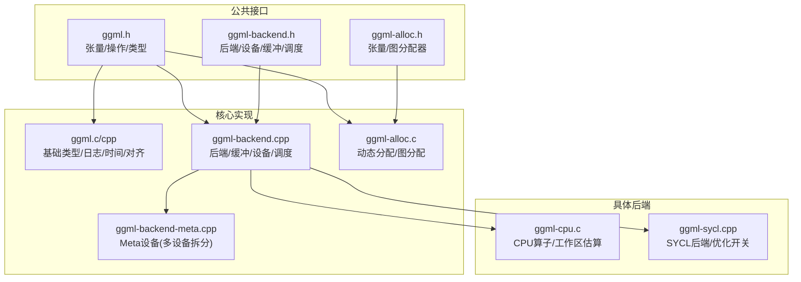
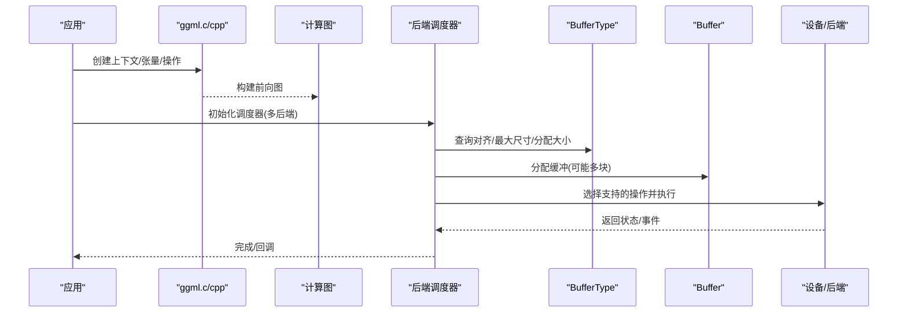
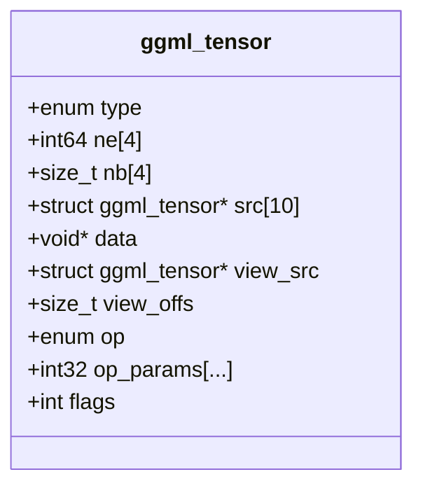
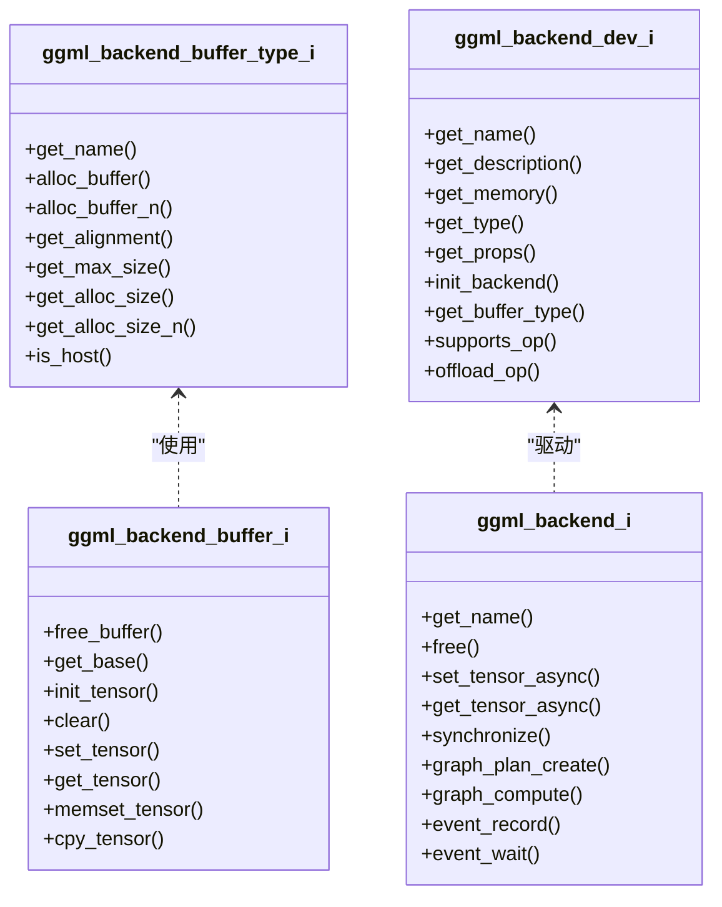
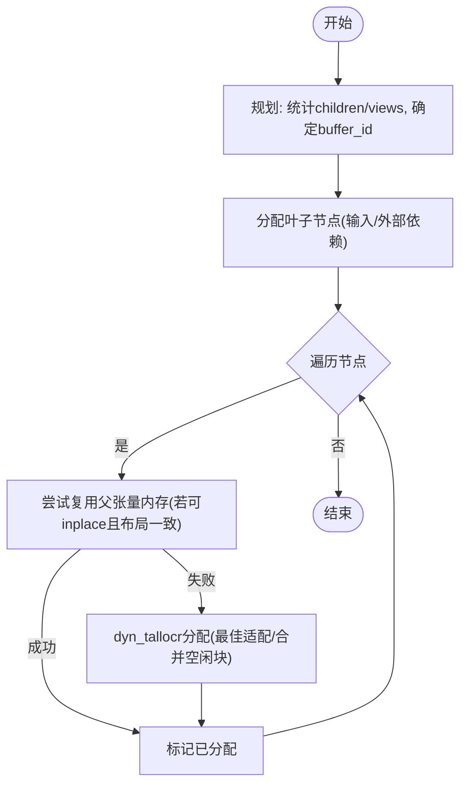
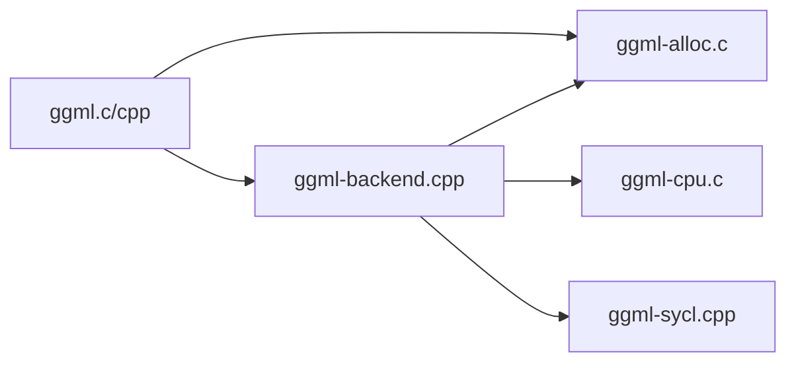

# GGML计算层架构

<cite>
**本文引用的文件**   
- [ggml.h](file://ggml/include/ggml.h)
- [ggml-backend.h](file://ggml/include/ggml-backend.h)
- [ggml-alloc.h](file://ggml/include/ggml-alloc.h)
- [ggml.c](file://ggml/src/ggml.c)
- [ggml.cpp](file://ggml/src/ggml.cpp)
- [ggml-backend.cpp](file://ggml/src/ggml-backend.cpp)
- [ggml-alloc.c](file://ggml/src/ggml-alloc.c)
- [ggml-backend-meta.cpp](file://ggml/src/ggml-backend-meta.cpp)
- [ggml-backend-impl.h](file://ggml/src/ggml-backend-impl.h)
- [ggml-cpu.c](file://ggml/src/ggml-cpu/ggml-cpu.c)
- [ggml-sycl.cpp](file://ggml/src/ggml-sycl/ggml-sycl.cpp)
- [test-opt.cpp](file://tests/test-opt.cpp)
</cite>

## 目录
1. [引言](#引言)
2. [项目结构](#项目结构)
3. [核心组件](#核心组件)
4. [架构总览](#架构总览)
5. [详细组件分析](#详细组件分析)
6. [依赖关系分析](#依赖关系分析)
7. [性能考量](#性能考量)
8. [故障排查指南](#故障排查指南)
9. [结论](#结论)
10. [附录](#附录)

## 引言
本文件系统性梳理GGML作为底层张量计算库的架构与实现，重点覆盖：
- 张量表示、计算图构建与执行机制
- 后端抽象层设计，统一CPU/GPU/加速器等硬件接口
- 内存分配器工作原理（动态内存管理、缓存策略）
- 计算图优化技术（算子融合、内存复用、并行执行）
- 算子扩展示例与性能调优最佳实践

## 项目结构
GGML的核心位于ggml目录，包含公共头文件、后端抽象、具体后端实现以及通用工具。关键目录与文件：
- ggml/include: 对外API与类型定义（张量、操作枚举、后端接口、分配器接口）
- ggml/src: 核心实现（基础类型、后端调度、分配器、线程与日志）
- ggml/src/ggml-*: 各后端实现（CPU/CUDA/Metal/SYCL/OpenVINO/Vulkan等）
- tests: 针对分配器、后端、优化的测试用例



**图示来源**
- [ggml.h:389-605](file://ggml/include/ggml.h#L389-L605)
- [ggml-backend.h:24-31](file://ggml/include/ggml-backend.h#L24-L31)
- [ggml-alloc.h:13-22](file://ggml/include/ggml-alloc.h#L13-L22)
- [ggml-backend.cpp:926-970](file://ggml/src/ggml-backend.cpp#L926-L970)
- [ggml-alloc.c:457-496](file://ggml/src/ggml-alloc.c#L457-L496)

**章节来源**
- [ggml.h:389-605](file://ggml/include/ggml.h#L389-L605)
- [ggml-backend.h:24-31](file://ggml/include/ggml-backend.h#L24-L31)
- [ggml-alloc.h:13-22](file://ggml/include/ggml-alloc.h#L13-L22)

## 核心组件
- 张量与操作
  - 张量结构体包含数据类型、维度ne、步长nb、源张量指针数组src、数据指针data、视图信息view_src/view_offs、op与op_params等字段，支持非连续布局与视图语义。
  - 操作枚举涵盖算术、归约、矩阵乘、卷积、注意力变体、量化相关、优化步骤等。
- 后端抽象
  - 通过BufferType/Buffer/Backend/Device/Registry五层抽象统一不同硬件能力；提供异步拷贝、事件同步、图计划与执行、设备属性查询等。
- 分配器
  - 张量分配器tallocr用于在单一buffer中线性分配；图分配器gallocr基于虚拟缓冲vbuffer与动态分配器dyn_tallocr，支持多buffer、内存复用与按拓扑顺序释放。
- 调度器
  - 后端调度器sched将图切分为多个split，按后端能力分配节点，处理跨后端拷贝、事件流水线与回调钩子。

**章节来源**
- [ggml.h:684-717](file://ggml/include/ggml.h#L684-L717)
- [ggml.h:491-605](file://ggml/include/ggml.h#L491-L605)
- [ggml-backend.h:24-31](file://ggml/include/ggml-backend.h#L24-L31)
- [ggml-backend.h:51-70](file://ggml/include/ggml-backend.h#L51-L70)
- [ggml-backend.h:136-181](file://ggml/include/ggml-backend.h#L136-L181)
- [ggml-alloc.h:13-22](file://ggml/include/ggml-alloc.h#L13-L22)
- [ggml-alloc.h:46-72](file://ggml/include/ggml-alloc.h#L46-L72)
- [ggml-backend.h:309-379](file://ggml/include/ggml-backend.h#L309-L379)

## 架构总览
GGML采用“张量+计算图”的声明式建模方式，结合后端抽象与调度器，将计算卸载到不同硬件。分配器负责在运行时为图节点分配可复用的内存块，减少碎片与重复分配。



**图示来源**
- [ggml.c:57-70](file://ggml/src/ggml.c#L57-L70)
- [ggml-backend.cpp:595-604](file://ggml/src/ggml-backend.cpp#L595-L604)
- [ggml-backend.h:309-379](file://ggml/include/ggml-backend.h#L309-L379)

## 详细组件分析

### 张量与计算图
- 张量结构体
  - 关键字段：type、ne[]、nb[]、src[]、data、view_src、view_offs、op、op_params、flags等。
  - 支持非连续布局（通过nb步长），便于转置/切片/拼接等操作零拷贝。
- 计算图
  - 由节点（张量）与边（src引用）构成；支持输入/输出标记、参数标记、损失标记等。
  - 前向构建后，可通过后端执行或反向传播（自动微分）。



**图示来源**
- [ggml.h:684-717](file://ggml/include/ggml.h#L684-L717)

**章节来源**
- [ggml.h:684-717](file://ggml/include/ggml.h#L684-L717)
- [ggml.h:491-605](file://ggml/include/ggml.h#L491-L605)

### 后端抽象层
- BufferType/Buffer/Backend/Device/Registry
  - BufferType描述内存特性（对齐、最大尺寸、是否host、分配大小计算）。
  - Buffer封装实际内存块，提供set/get/memset/copy等访问接口。
  - Backend封装流式执行（图计划/计算）、异步拷贝、事件同步。
  - Device暴露设备能力（类型、内存、mmap、事件、offload判断）。
  - Registry用于动态加载与枚举后端。
- 调度器
  - 将图切分为多个split，按后端能力分配节点，必要时插入跨后端拷贝。
  - 支持评估回调、复制权重回调、重分配回调。



**图示来源**
- [ggml-backend-impl.h:17-30](file://ggml/src/ggml-backend-impl.h#L17-L30)
- [ggml-backend-impl.h:122-135](file://ggml/src/ggml-backend-impl.h#L122-L135)
- [ggml-backend.h:136-181](file://ggml/include/ggml-backend.h#L136-L181)

**章节来源**
- [ggml-backend.h:24-31](file://ggml/include/ggml-backend.h#L24-L31)
- [ggml-backend.h:51-70](file://ggml/include/ggml-backend.h#L51-L70)
- [ggml-backend.h:136-181](file://ggml/include/ggml-backend.h#L136-L181)
- [ggml-backend.h:309-379](file://ggml/include/ggml-backend.h#L309-L379)
- [ggml-backend-impl.h:17-30](file://ggml/src/ggml-backend-impl.h#L17-L30)
- [ggml-backend-impl.h:122-135](file://ggml/src/ggml-backend-impl.h#L122-L135)

### 内存分配器（动态管理与缓存策略）
- tallocr（张量分配器）
  - 在单个buffer内线性分配，维护base/alignment/offset，保证对齐。
- dyn_tallocr（动态分配器）
  - 维护多个chunk（每个chunk一个free_blocks列表），按最佳适配策略分配，合并相邻空闲块，避免碎片。
- vbuffer（虚拟缓冲）
  - 将逻辑上连续的地址空间映射到多个backend buffer（chunks），对外呈现连续视图。
- gallocr（图分配器）
  - 遍历图的叶子节点与节点，统计children/views数，按拓扑顺序分配；对可inplace操作尝试复用父张量内存；输出张量不释放。
  - 支持reserve预分配以规避重分配；单buffer自动realloc，多buffer需显式设置node/leaf buffer id。



**图示来源**
- [ggml-alloc.c:202-309](file://ggml/src/ggml-alloc.c#L202-L309)
- [ggml-alloc.c:623-689](file://ggml/src/ggml-alloc.c#L623-L689)
- [ggml-alloc.c:718-800](file://ggml/src/ggml-alloc.c#L718-L800)

**章节来源**
- [ggml-alloc.h:13-22](file://ggml/include/ggml-alloc.h#L13-L22)
- [ggml-alloc.h:46-72](file://ggml/include/ggml-alloc.h#L46-L72)
- [ggml-alloc.c:59-92](file://ggml/src/ggml-alloc.c#L59-L92)
- [ggml-alloc.c:121-178](file://ggml/src/ggml-alloc.c#L121-L178)
- [ggml-alloc.c:396-446](file://ggml/src/ggml-alloc.c#L396-L446)
- [ggml-alloc.c:457-496](file://ggml/src/ggml-alloc.c#L457-L496)
- [ggml-alloc.c:623-689](file://ggml/src/ggml-alloc.c#L623-L689)
- [ggml-alloc.c:718-800](file://ggml/src/ggml-alloc.c#L718-L800)

### 计算图优化（融合、复用、并行）
- 算子融合
  - 后端可实现graph_optimize回调，注入自定义优化（如添加分配依赖、改变执行顺序）。
  - 例如SYCL后端启用fusion开关，Metal后端根据形状/精度编译特定pipeline。
- 内存复用
  - 通过ggml_op_can_inplace与gallocr的父张量复用逻辑，减少中间结果分配。
  - 测试用例验证了通过后端优化回调控制分配依赖的行为。
- 并行执行
  - 后端支持异步执行与事件同步；调度器支持多后端并行与流水线拷贝。

```mermaid
sequenceDiagram
participant App as "应用"
participant Sched as "调度器"
participant Backend as "后端"
participant Opt as "优化回调"
App->>Sched : 构建图/分配
Sched->>Backend : graph_optimize(graph, params)
Backend->>Opt : 调用用户优化(如add_alloc_dep)
Opt-->>Backend : 修改依赖/顺序
Backend-->>Sched : 返回优化后图
Sched->>Backend : graph_compute/graph_plan_compute
```

**图示来源**
- [ggml-backend.cpp:710-715](file://ggml/src/ggml-backend.cpp#L710-L715)
- [test-opt.cpp:645-678](file://tests/test-opt.cpp#L645-L678)
- [ggml-sycl.cpp:94-112](file://ggml/src/ggml-sycl/ggml-sycl.cpp#L94-L112)

**章节来源**
- [ggml-backend.cpp:710-715](file://ggml/src/ggml-backend.cpp#L710-L715)
- [test-opt.cpp:645-678](file://tests/test-opt.cpp#L645-L678)
- [ggml-sycl.cpp:94-112](file://ggml/src/ggml-sycl/ggml-sycl.cpp#L94-L112)

### 算子实现示例（扩展新计算功能）
- 以CPU后端为例，展示如何在工作区估算与任务划分中为新算子预留临时内存与并行槽位。
- 参考路径：
  - CPU后端工作区估算与任务划分片段：[ggml-cpu.c:2897-2920](file://ggml/src/ggml-cpu/ggml-cpu.c#L2897-L2920)
- 扩展建议：
  - 在ggml.h中添加新操作枚举与必要参数宏。
  - 在后端目录新增对应实现（如ggml-cpu/ops.cpp或独立文件），实现forward/backward与工作区估算。
  - 在调度器与分配器侧确保新算子的内存需求被正确估计与复用。

**章节来源**
- [ggml-cpu.c:2897-2920](file://ggml/src/ggml-cpu/ggml-cpu.c#L2897-L2920)

## 依赖关系分析
- 模块耦合
  - ggml.c/cpp提供基础类型、日志、时间、对齐等基础设施。
  - ggml-backend.cpp实现后端/缓冲/设备/调度，依赖ggml-alloc.c进行图分配。
  - ggml-alloc.c依赖后端接口（BufferType/Buffer）进行实际分配。
  - 具体后端（CPU/SYCL等）通过后端接口注册自身能力，并被调度器选择。
- 外部依赖
  - 平台相关（Windows/POSIX/macOS）在ggml.c中处理时间与文件路径。
  - 可选HBM（高带宽内存）在分配路径中条件编译。



**图示来源**
- [ggml.c:4-16](file://ggml/src/ggml.c#L4-L16)
- [ggml-backend.cpp:11-14](file://ggml/src/ggml-backend.cpp#L11-L14)
- [ggml-alloc.c:1-4](file://ggml/src/ggml-alloc.c#L1-L4)

**章节来源**
- [ggml.c:4-16](file://ggml/src/ggml.c#L4-L16)
- [ggml-backend.cpp:11-14](file://ggml/src/ggml-backend.cpp#L11-L14)
- [ggml-alloc.c:1-4](file://ggml/src/ggml-alloc.c#L1-L4)

## 性能考量
- 内存复用优先
  - 利用ggml_op_can_inplace与gallocr的父张量复用，减少中间结果分配。
  - 使用reserve预分配避免频繁realloc，尤其在多buffer场景下需显式设置node/leaf buffer id。
- 后端选择与offload
  - 通过ggml_backend_supports_op/offload_op判断是否卸载至GPU/加速器。
  - 合理设置buffer usage（WEIGHTS vs COMPUTE）影响后端选择与数据放置。
- 并行与异步
  - 启用后端异步执行与事件同步，配合调度器的pipeline模式提升吞吐。
- 精度与融合
  - 根据后端能力选择动态精度（如SYCL的动态精度选项），开启fusion以提升算子效率。

[本节为通用指导，不直接分析具体文件]

## 故障排查指南
- 常见错误
  - 分配失败：检查buffer size与alignment，确认reserve是否足够；查看日志中的“not enough space in the buffer”。
  - 越界访问：确保offset+size不超过tensor nbytes；检查view_src与buffer一致性。
  - 后端不支持：确认后端supports_op/offload_op返回值，必要时回退到CPU。
- 调试手段
  - 使用ggml_log_callback_default或自定义回调打印日志。
  - 通过环境变量GGML_NO_BACKTRACE关闭回溯；在Linux/macOS可使用内置backtrace辅助定位。
  - 使用测试用例（如test-alloc.cpp、test-opt.cpp）复现问题。

**章节来源**
- [ggml.c:244-273](file://ggml/src/ggml.c#L244-L273)
- [ggml.c:343-414](file://ggml/src/ggml.c#L343-L414)
- [ggml-alloc.c:76-92](file://ggml/src/ggml-alloc.c#L76-L92)
- [test-alloc.cpp:496-512](file://tests/test-alloc.cpp#L496-L512)

## 结论
GGML通过清晰的张量模型与计算图抽象，结合强大的后端抽象层与灵活的分配器，实现了跨硬件的高效张量计算。其调度器与优化回调机制使得算子融合、内存复用与并行执行得以统一落地。遵循本文的最佳实践与性能建议，可在不同平台上获得稳定且高效的推理与训练体验。

[本节为总结性内容，不直接分析具体文件]

## 附录
- 快速上手
  - 创建上下文与张量，构建前向图，选择后端并执行。
  - 使用gallocr.reserve预分配，再反复build_graph与compute。
- 扩展新后端
  - 实现BufferType/Buffer/Backend/Device接口，注册到Registry。
  - 在ggml-backend.cpp中集成你的后端能力（supports_op/offload_op）。
- 参考路径
  - 张量与操作定义：[ggml.h:389-605](file://ggml/include/ggml.h#L389-L605)
  - 后端接口与调度：[ggml-backend.h:24-31](file://ggml/include/ggml-backend.h#L24-L31), [ggml-backend.h:309-379](file://ggml/include/ggml-backend.h#L309-L379)
  - 分配器API：[ggml-alloc.h:13-22](file://ggml/include/ggml-alloc.h#L13-L22), [ggml-alloc.h:46-72](file://ggml/include/ggml-alloc.h#L46-L72)