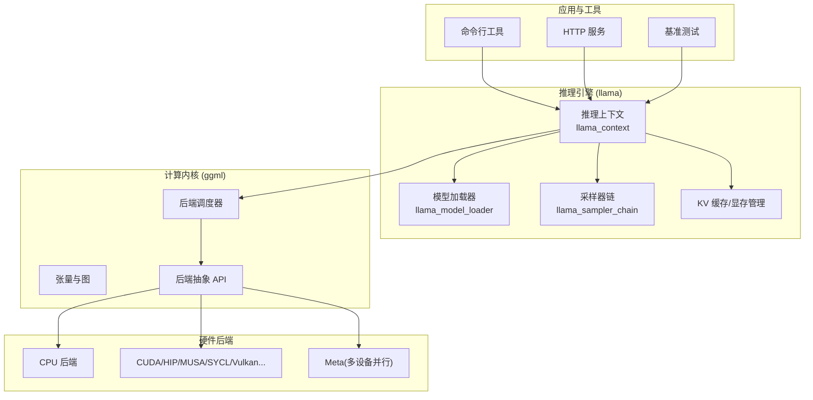
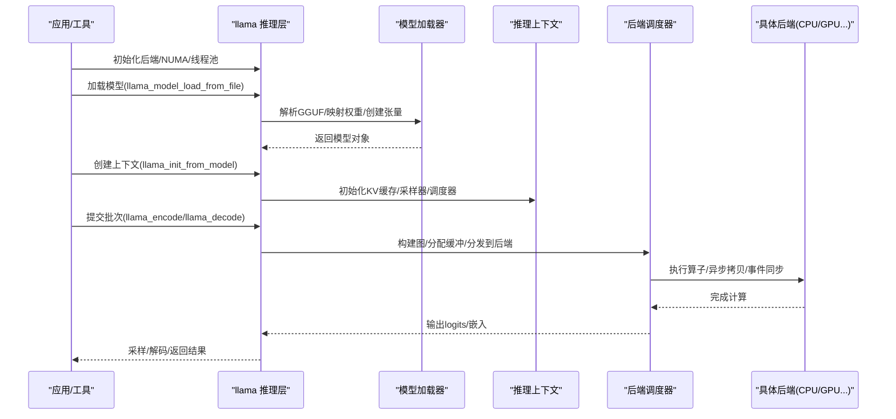
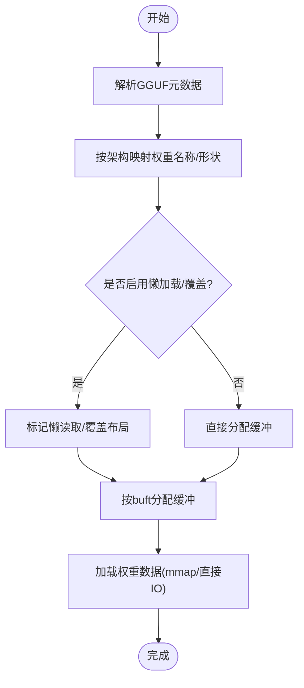
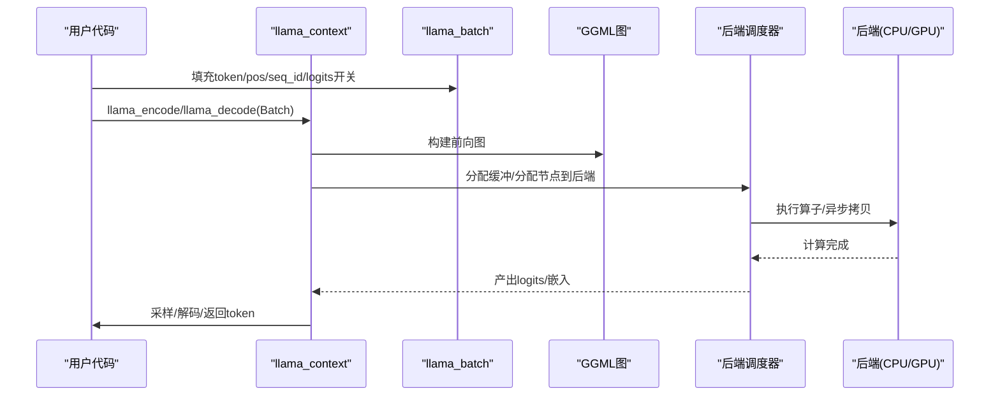
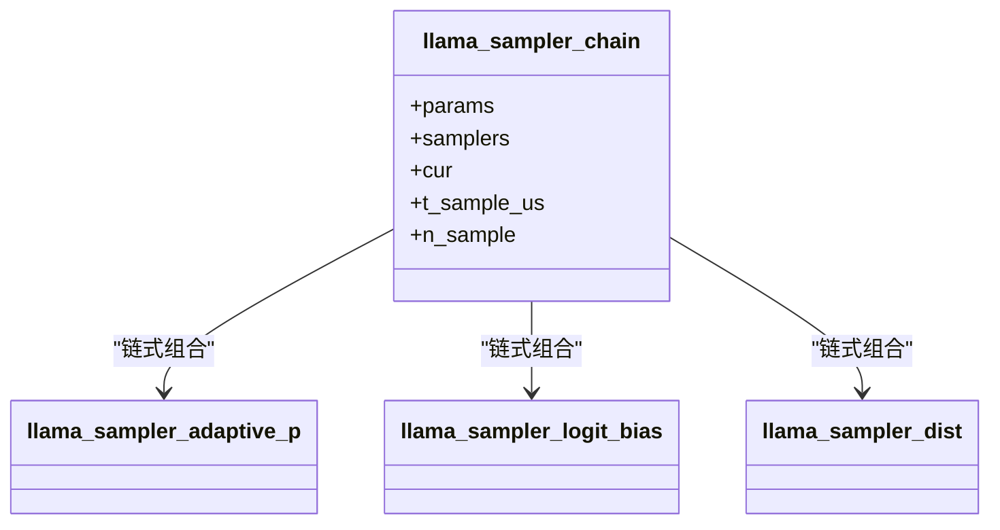
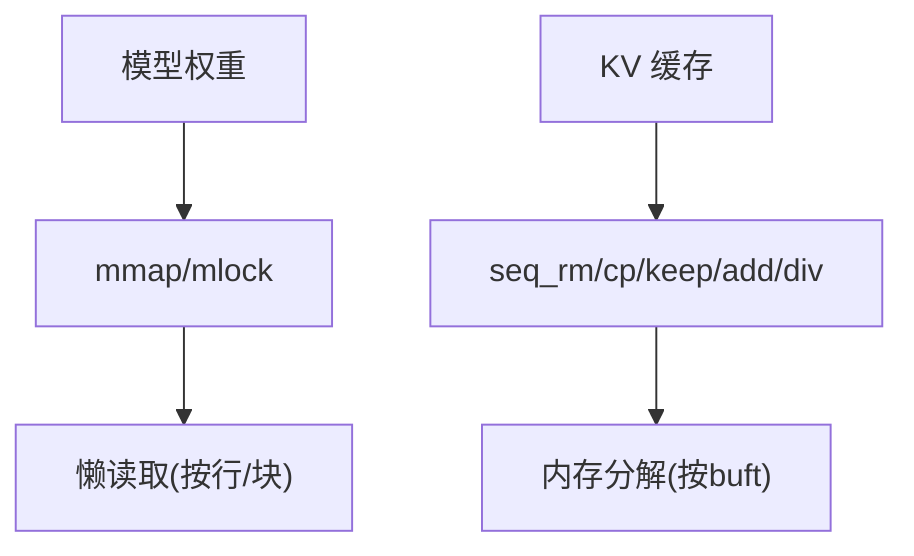
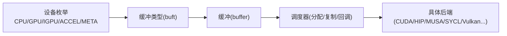
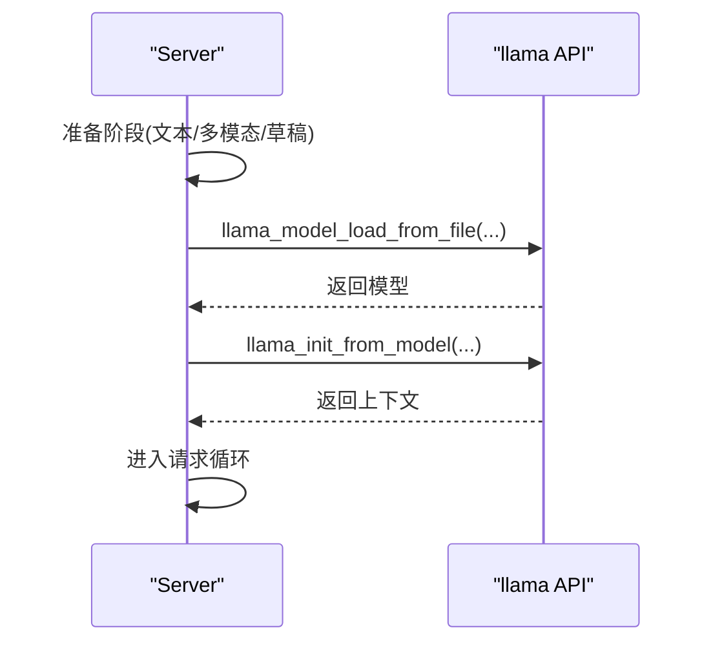
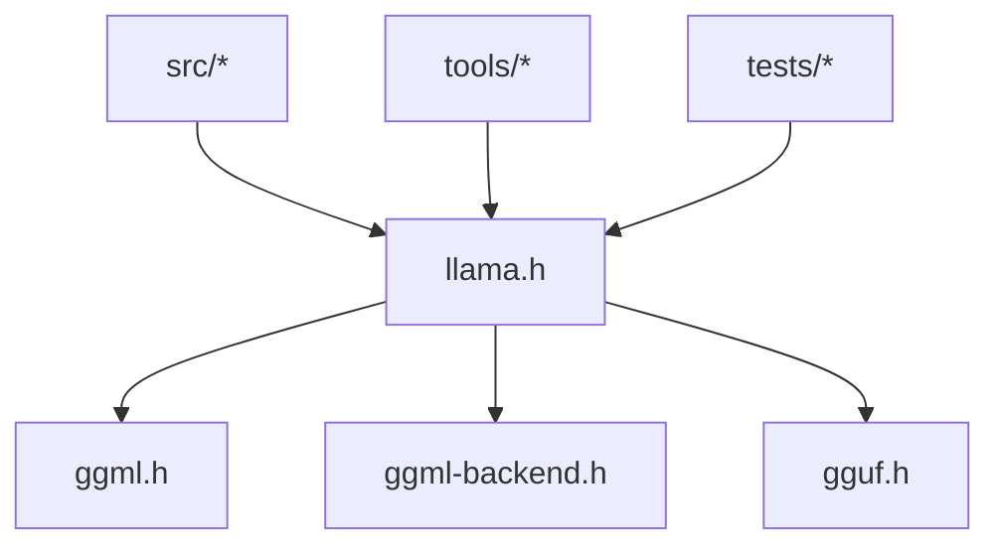

# 技术架构概览

<cite>
**本文引用的文件**   
- [README.md](file://README.md)
- [llama.h](file://include/llama.h)
- [ggml.h](file://ggml/include/ggml.h)
- [ggml-backend.h](file://ggml/include/ggml-backend.h)
- [llama-model-loader.h](file://src/llama-model-loader.h)
- [server-context.cpp](file://tools/server/server-context.cpp)
- [test-thread-safety.cpp](file://tests/test-thread-safety.cpp)
- [fit.cpp](file://common/fit.cpp)
- [llama-mmap.h](file://src/llama-mmap.h)
- [llama-context.cpp](file://src/llama-context.cpp)
- [llama-context.h](file://src/llama-context.h)
- [llama-memory-recurrent.h](file://src/llama-memory-recurrent.h)
- [VirtGPU.md](file://docs/backend/VirtGPU.md)
</cite>

## 目录
1. [引言](#引言)
2. [项目结构](#项目结构)
3. [核心组件](#核心组件)
4. [架构总览](#架构总览)
5. [详细组件分析](#详细组件分析)
6. [依赖关系分析](#依赖关系分析)
7. [性能与优化](#性能与优化)
8. [故障排查指南](#故障排查指南)
9. [结论](#结论)

## 引言
本文件为 llama.cpp 的技术架构概览，面向希望理解系统高层设计与关键实现机制的开发者。文档围绕以下目标展开：
- 描述推理引擎、GGML 计算库、硬件抽象层（后端）和工具生态的分层架构
- 解释模型加载、推理执行与结果输出的数据流
- 说明模块化设计模式：插件式后端、工厂式模型加载器、策略式采样器
- 阐述内存管理、并发处理与性能优化的技术决策与权衡
- 提供架构图与组件关系图，帮助快速把握整体设计

## 项目结构
仓库采用“推理层 + 计算内核层 + 后端抽象层 + 工具生态”的分层组织方式：
- include/llama.h：对外 C API，定义模型、上下文、批输入、量化类型、加载模式等核心数据结构
- ggml/*：GGML 张量库与后端抽象，包含张量、操作、调度器、设备枚举、动态加载等
- src/*：推理引擎实现，包括模型加载器、上下文、KV 缓存、采样器、IO、量化等
- tools/*：CLI、Server、Benchmark、Quantize、RPC 等工具链
- docs/*：构建、后端、多模态、开发指南
- conversion/*、examples/*、tests/*：模型转换、示例与测试

图表来源
- [llama.h:320-428](file://include/llama.h#L320-L428)
- [ggml-backend.h:268-379](file://ggml/include/ggml-backend.h#L268-L379)

章节来源
- [README.md:60-96](file://README.md#L60-L96)

## 核心组件
- 推理引擎（llama）
  - 模型加载器：解析 GGUF，按架构映射权重，支持分片、懒加载、mmap/mlock、KV 覆盖与张量布局覆盖
  - 推理上下文：封装批处理、KV 缓存、采样器链、后端调度器、线程池、性能统计
  - 采样器：策略式采样链，支持温度、Top-K/P、XTC、Logit Bias、Grammar 等
- 计算内核（ggml）
  - 张量与计算图：统一的数据结构与操作算子集合
  - 后端抽象：设备、缓冲区、缓冲类型、事件、异步拷贝、图计划与执行
  - 调度器：跨设备分配、复制、拆分、回调与重分配
- 工具生态
  - CLI/Server/Benchmark/Quantize/RPC 等，复用同一套推理 API

章节来源
- [llama.h:320-428](file://include/llama.h#L320-L428)
- [ggml.h:684-717](file://ggml/include/ggml.h#L684-L717)
- [ggml-backend.h:268-379](file://ggml/include/ggml-backend.h#L268-L379)

## 架构总览
llama.cpp 的核心分层如下：
- 应用层：CLI、Server、Benchmark 等工具调用统一的 C API
- 推理层：模型加载、上下文管理、批处理、采样、KV 缓存
- 计算层：GGML 张量与图，提供通用算子与自动微分能力
- 后端层：通过 ggml-backend 抽象不同硬件（CPU/GPU/NPU/WebGPU 等），由调度器负责分配与同步
- 元设备：聚合多个设备以支持张量并行与跨设备通信

图表来源
- [llama.h:487-562](file://include/llama.h#L487-L562)
- [ggml-backend.h:268-379](file://ggml/include/ggml-backend.h#L268-L379)

## 详细组件分析

### 模型加载流程（工厂式加载器）
- 入口：C API 暴露多种加载方式（文件、文件指针、分片、用户自定义张量数据）
- 内部：llama_model_loader 负责：
  - 解析 GGUF 元数据与权重偏移
  - 根据架构（LLM_KV）映射权重名称与形状
  - 支持懒读取（TENSOR_READ_LAZY）、mmap/mlock、KV 覆盖、张量布局覆盖
  - 将权重分配到不同缓冲类型（host/device），并记录映射范围以便按需换页
- 进度与取消：支持 progress_callback 中断加载

图表来源
- [llama-model-loader.h:30-184](file://src/llama-model-loader.h#L30-L184)
- [llama.h:508-541](file://include/llama.h#L508-L541)

章节来源
- [llama-model-loader.h:30-184](file://src/llama-model-loader.h#L30-L184)
- [llama.h:508-541](file://include/llama.h#L508-L541)

### 推理执行过程（上下文与调度）
- 上下文参数：上下文大小、批大小、线程数、RoPE 缩放、Flash Attention、K/V 数据类型、采样链等
- 批处理：llama_batch 承载 token/embedding/位置/序列ID/logits 开关
- 执行路径：encode/decode -> 构建计算图 -> 调度器分配/分发 -> 后端执行 -> 回写 logits/嵌入
- 结果输出：采样器链对 logits 进行概率变换与选择，得到下一个 token

图表来源
- [llama.h:248-273](file://include/llama.h#L248-L273)
- [llama.h:366-428](file://include/llama.h#L366-L428)
- [ggml-backend.h:268-379](file://ggml/include/ggml-backend.h#L268-L379)

章节来源
- [llama.h:248-273](file://include/llama.h#L248-L273)
- [llama.h:366-428](file://include/llama.h#L366-L428)

### 采样器（策略模式）
- 采样器链：串联多个采样策略（温度、Top-K/P、XTC、Logit Bias、Grammar 等）
- 每个采样器实现统一接口，可独立替换或组合
- 支持 per-sequence 配置，便于多序列差异化采样

图表来源
- [llama-sampler.h:12-36](file://src/llama-sampler.h#L12-L36)
- [llama-sampler.cpp:3752-3906](file://src/llama-sampler.cpp#L3752-L3906)

章节来源
- [llama-sampler.h:12-36](file://src/llama-sampler.h#L12-L36)
- [llama-sampler.cpp:3752-3906](file://src/llama-sampler.cpp#L3752-L3906)

### 内存管理与 KV 缓存
- mmap/mlock：支持按需映射与锁定，减少初始加载时间与抖动
- 懒读取：对大张量按行/块按需读取，降低峰值内存
- KV 缓存：多实现（DSA/ISWA/MSA/Recurrent/Hybrid），支持序列裁剪/复制/保留/位移/除法等操作
- 内存分解：按缓冲类型统计模型/上下文/计算缓冲占用

图表来源
- [llama-mmap.h:47-92](file://src/llama-mmap.h#L47-L92)
- [llama-memory-recurrent.h:42-67](file://src/llama-memory-recurrent.h#L42-L67)
- [llama-context.cpp:3700-3729](file://src/llama-context.cpp#L3700-L3729)

章节来源
- [llama-mmap.h:47-92](file://src/llama-mmap.h#L47-L92)
- [llama-memory-recurrent.h:42-67](file://src/llama-memory-recurrent.h#L42-L67)
- [llama-context.cpp:3700-3729](file://src/llama-context.cpp#L3700-L3729)

### 后端抽象与多设备协同
- 设备与缓冲类型：区分 CPU/GPU/IGPU/ACCEL/META，支持 host buffer、事件、mmap 能力
- 调度器：按操作支持性、张量位置、缓冲使用意图（权重/计算）分配节点，必要时在设备间拷贝
- 动态加载：支持从动态库加载后端，注册设备与功能
- VirtGPU：在虚拟机场景下通过共享内存与远端渲染组件协作

图表来源
- [ggml-backend.h:136-196](file://ggml/include/ggml-backend.h#L136-L196)
- [ggml-backend.h:268-379](file://ggml/include/ggml-backend.h#L268-L379)
- [VirtGPU.md:1-23](file://docs/backend/VirtGPU.md#L1-L23)

章节来源
- [ggml-backend.h:136-196](file://ggml/include/ggml-backend.h#L136-L196)
- [ggml-backend.h:268-379](file://ggml/include/ggml-backend.h#L268-L379)
- [VirtGPU.md:1-23](file://docs/backend/VirtGPU.md#L1-L23)

### 工具与服务集成
- Server 侧加载流程：准备阶段（文本模型/多模态/草稿模型）-> 进度回调 -> 实际加载与上下文初始化
- 典型用法：先加载模型，再创建上下文，最后进入请求循环

图表来源
- [server-context.cpp:1113-1152](file://tools/server/server-context.cpp#L1113-L1152)
- [llama.h:522-562](file://include/llama.h#L522-L562)

章节来源
- [server-context.cpp:1113-1152](file://tools/server/server-context.cpp#L1113-L1152)

## 依赖关系分析
- 顶层依赖
  - llama.h 依赖 ggml.h、ggml-cpu.h、ggml-backend.h、gguf.h
  - 推理层依赖 GGML 张量与后端抽象
- 组件耦合
  - 模型加载器依赖 GGUF 解析与架构映射
  - 上下文依赖调度器与采样器链
  - 后端调度器依赖设备与缓冲类型
- 外部集成点
  - 动态库加载后端
  - RPC/多进程/多线程（示例与测试）

图表来源
- [llama.h:1-8](file://include/llama.h#L1-L8)

章节来源
- [llama.h:1-8](file://include/llama.h#L1-L8)

## 性能与优化
- 量化与精度
  - 支持多种量化格式（Q4/Q5/Q6/IQ系列/TQ/NVFP4 等），在精度与速度/内存之间权衡
- 内存优化
  - mmap/mlock、懒读取、按缓冲类型统计与优化、避免不必要拷贝
- 并发与并行
  - 线程池（CPU 线程/批线程）、NUMA 优化、多 GPU/多设备并行（张量并行/流水线并行）
- 算子优化
  - Flash Attention、SIMD/AMX/NEON、专用后端内核（CUDA/HIP/MUSA/SYCL/Vulkan/WebGPU/OpenCL）
- 调度与分配
  - 预分配测量图、按需重分配回调、评估回调用于观察与早停

章节来源
- [llama.h:117-163](file://include/llama.h#L117-L163)
- [llama.h:366-428](file://include/llama.h#L366-L428)
- [ggml-backend.h:268-379](file://ggml/include/ggml-backend.h#L268-L379)

## 故障排查指南
- 模型加载失败
  - 检查 GGUF 完整性、分片命名规则、mmap/直接 IO 权限
  - 使用 no_alloc/no_host/use_extra_bufts 等参数定位问题
- 上下文创建失败
  - 检查 n_ctx/n_batch/n_ubatch/n_seq_max 与设备显存匹配
  - 确认后端可用性与能力（Flash Attention、异步、事件）
- 并发与线程安全
  - 参考线程安全测试用例，确保每上下文独立采样器链与批对象
- 性能异常
  - 检查量化类型、批大小、线程数、NUMA 设置
  - 使用 memory_breakdown 分析各缓冲类型占用

章节来源
- [test-thread-safety.cpp:1-39](file://tests/test-thread-safety.cpp#L1-L39)
- [test-thread-safety.cpp:71-98](file://tests/test-thread-safety.cpp#L71-L98)
- [fit.cpp:56-84](file://common/fit.cpp#L56-L84)
- [llama-context.cpp:3700-3729](file://src/llama-context.cpp#L3700-L3729)

## 结论
llama.cpp 通过清晰的三层架构（推理引擎 / GGML 计算内核 / 后端抽象）与完善的工具生态，实现了跨平台、高性能的大模型推理。其关键设计要点包括：
- 插件式后端与动态加载，扩展性强
- 工厂式模型加载器，支持多样化权重布局与懒加载
- 策略式采样器链，灵活组合采样算法
- 精细的内存管理与 KV 缓存，适配多设备与大规模模型
- 丰富的并发与并行机制，兼顾吞吐与时延

这些设计使 llama.cpp 能在本地与云端广泛部署，并在不同硬件上取得最优性能。