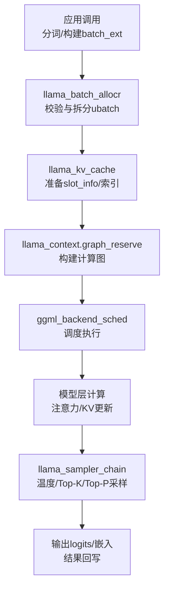
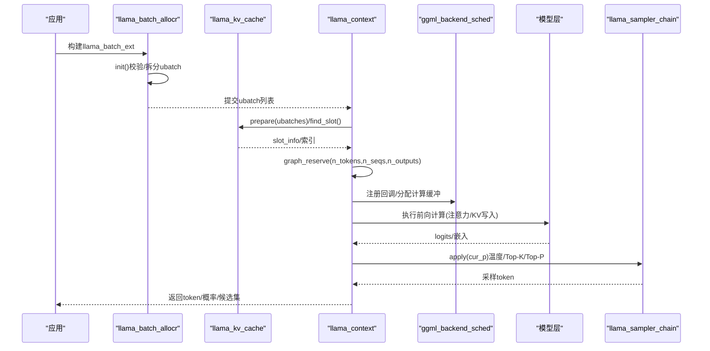
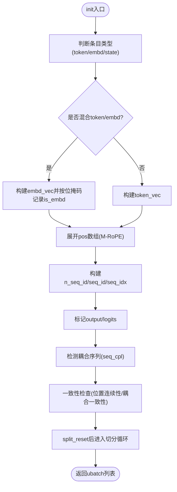
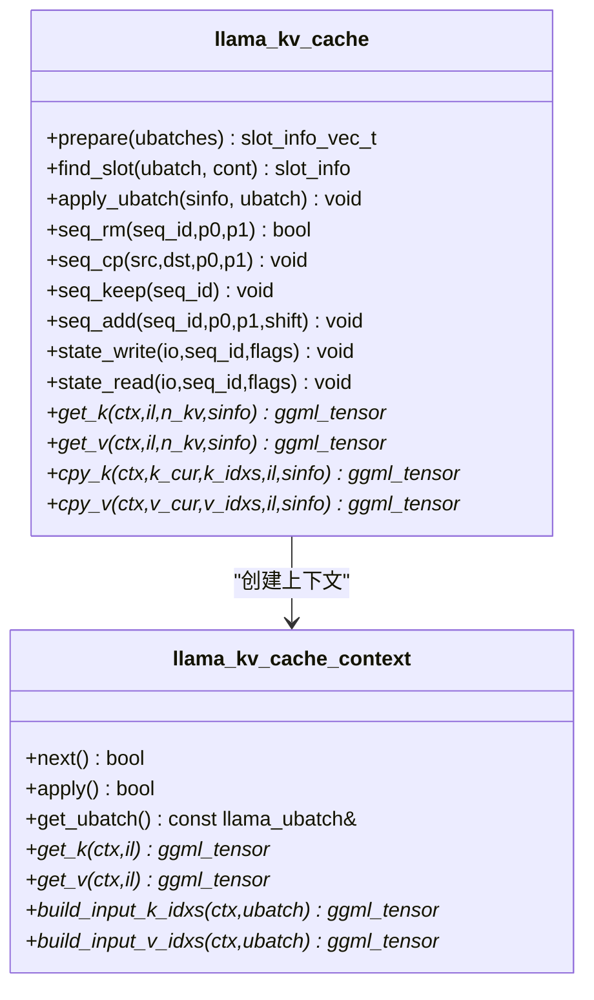
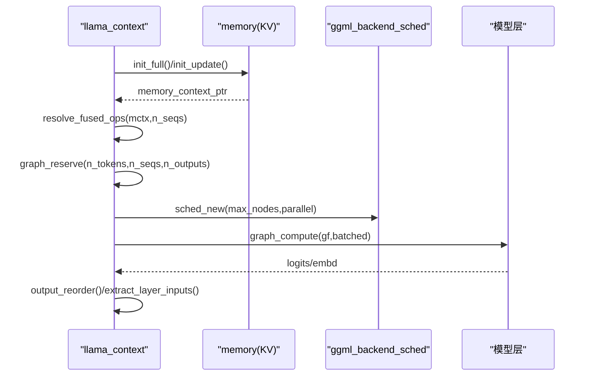
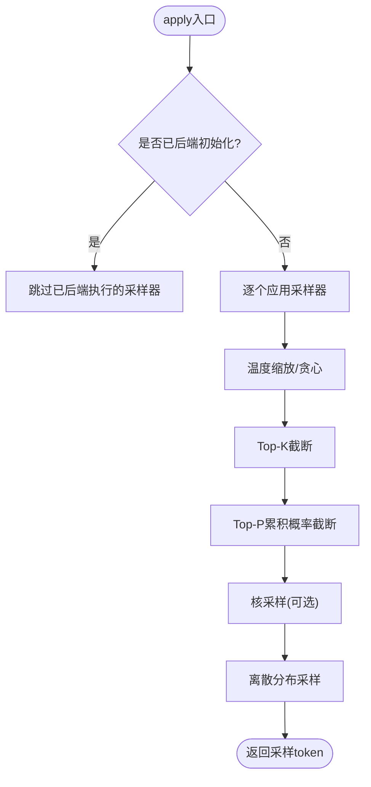
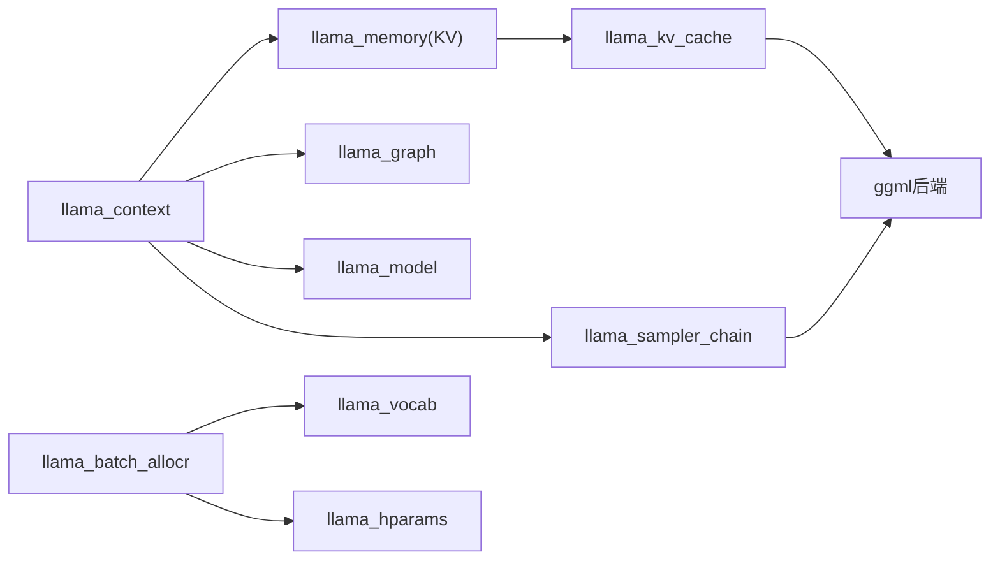

# 数据流架构

<cite>
**本文引用的文件**   
- [src/llama.cpp](file://src/llama.cpp)
- [src/llama-context.h](file://src/llama-context.h)
- [src/llama-context.cpp](file://src/llama-context.cpp)
- [src/llama-kv-cache.h](file://src/llama-kv-cache.h)
- [src/llama-kv-cache.cpp](file://src/llama-kv-cache.cpp)
- [src/llama-sampler.h](file://src/llama-sampler.h)
- [src/llama-sampler.cpp](file://src/llama-sampler.cpp)
- [src/llama-batch.h](file://src/llama-batch.h)
- [src/llama-batch.cpp](file://src/llama-batch.cpp)
</cite>

## 目录
1. [引言](#引言)
2. [项目结构](#项目结构)
3. [核心组件](#核心组件)
4. [架构总览](#架构总览)
5. [详细组件分析](#详细组件分析)
6. [依赖关系分析](#依赖关系分析)
7. [性能考量](#性能考量)
8. [故障排查指南](#故障排查指南)
9. [结论](#结论)

## 引言
本文面向 llama.cpp 的数据流架构，系统性梳理从文本输入到模型输出的完整处理链路：分词与批构建、编码阶段、注意力计算、KV 缓存更新、采样生成与输出。重点解释 KV 缓存机制在长上下文与内存优化中的作用，说明温度控制、Top-K、Top-P 等采样策略的执行流程，并阐述批处理推理的调度与并发模型。文末提供性能瓶颈分析与优化建议，辅以数据流图与时序图帮助理解复杂交互。

## 项目结构
本仓库采用分层模块化组织：
- 顶层接口与后端初始化位于 src/llama.cpp，负责设备选择、模型加载、系统能力探测等。
- 推理上下文与图调度集中在 src/llama-context.*，封装了批处理、图保留、后端调度器、输出缓冲、采样链集成等。
- KV 缓存抽象与实现位于 src/llama-kv-cache.*，提供按层 K/V 张量、流式管理、序列操作、状态持久化等能力。
- 采样子系统位于 src/llama-sampler.*，提供采样链、温度、Top-K、Top-P、核采样等算法与后端执行探测。
- 批处理与分片逻辑位于 src/llama-batch.*，将高层 batch_ext 转换为内部 ubatch，支持混合 token/embedding、位置维度扩展、耦合序列检测与多种切分策略。

图表来源
- [src/llama-batch.cpp:28-496](file://src/llama-batch.cpp#L28-L496)
- [src/llama-kv-cache.cpp:724-769](file://src/llama-kv-cache.cpp#L724-L769)
- [src/llama-context.cpp:707-757](file://src/llama-context.cpp#L707-L757)
- [src/llama-sampler.cpp:663-770](file://src/llama-sampler.cpp#L663-L770)

章节来源
- [src/llama.cpp:122-151](file://src/llama.cpp#L122-L151)
- [src/llama-context.h:45-153](file://src/llama-context.h#L45-L153)
- [src/llama-kv-cache.h:20-118](file://src/llama-kv-cache.h#L20-L118)
- [src/llama-sampler.h:12-36](file://src/llama-sampler.h#L12-L36)
- [src/llama-batch.h:17-83](file://src/llama-batch.h#L17-L83)

## 核心组件
- 批处理与分片（llama_batch_allocr）：负责将高层 llama_batch_ext 规范化为内部 llama_ubatch，支持混合 token/embedding、M-RoPE 位置扩展、耦合序列检测、多种切分策略（简单、等长、按序列）。
- KV 缓存（llama_kv_cache）：按层维护 K/V 张量，支持流式（stream）管理、序列增删改查、跨流复制、状态读写、旋转 Hadamard 预计算与量化加速路径。
- 推理上下文（llama_context）：封装图保留、后端调度器、输出缓冲区、采样链绑定、融合算子探测、流水线并行开关、性能统计。
- 采样子系统（llama_sampler_chain）：串联多个采样器，支持 CPU/GPU 后端探测与执行，内置温度、Top-K、Top-P、核采样等常用策略。

章节来源
- [src/llama-batch.h:154-261](file://src/llama-batch.h#L154-L261)
- [src/llama-kv-cache.h:20-118](file://src/llama-kv-cache.h#L20-L118)
- [src/llama-context.h:45-153](file://src/llama-context.h#L45-L153)
- [src/llama-sampler.h:12-36](file://src/llama-sampler.h#L12-L36)

## 架构总览
下图展示从输入到输出的端到端数据流，包括批构建、KV 缓存准备、图构建与执行、采样与输出。

图表来源
- [src/llama-batch.cpp:28-496](file://src/llama-batch.cpp#L28-L496)
- [src/llama-kv-cache.cpp:724-769](file://src/llama-kv-cache.cpp#L724-L769)
- [src/llama-context.cpp:707-757](file://src/llama-context.cpp#L707-L757)
- [src/llama-sampler.cpp:663-770](file://src/llama-sampler.cpp#L663-L770)

## 详细组件分析

### 批处理与分片（llama_batch_allocr）
- 职责：将 llama_batch_ext 标准化为 llama_ubatch，完成类型判定（纯token、纯embd、混合）、位置数组展开（M-RoPE）、序列集合与耦合关系分析、输出标记、一致性检查。
- 关键流程：
  - init()：校验输入合法性、构建扁平数组、统计输出数量、识别耦合序列、建立 seq_set_map。
  - split_simple()/split_equal()/split_seq()：提供三种切分策略，保证序列集不重叠、位置连续或允许跳跃（M-RoPE），支持尾部保留 n_keep_tail。
  - ubatch_add()：组装 llama_ubatch 指针视图，复用 data_t 避免重复分配。

图表来源
- [src/llama-batch.cpp:28-496](file://src/llama-batch.cpp#L28-L496)
- [src/llama-batch.cpp:585-788](file://src/llama-batch.cpp#L585-L788)

章节来源
- [src/llama-batch.cpp:28-496](file://src/llama-batch.cpp#L28-L496)
- [src/llama-batch.cpp:585-788](file://src/llama-batch.cpp#L585-L788)

### KV 缓存机制（llama_kv_cache）
- 设计要点：
  - 按层维护 K/V 张量，支持流（stream）维度以区分不同序列组；统一模式（unified）下所有序列共享一个流，非统一模式下每个序列独立流。
  - 通过 v_cells 管理单元（cell）元信息（位置、序列归属、偏移、扩展信息），支持快速查找空闲槽位 find_slot()。
  - 提供序列级操作：seq_rm/seq_cp/seq_keep/seq_add/seq_div，以及状态读写 state_write/state_read。
  - 针对量化 K/V 与特定架构（如 DeepSeek Lightning Indexer）预计算 Hadamard 旋转矩阵，减少运行时开销。
- 长上下文与内存优化：
  - 支持 offload 将 KV 张量放置到目标设备 buffer type，减少主机-设备拷贝。
  - 使用 ggml_context 与 backend buffer 分离，按 buft 分组上下文，降低碎片化。
  - 通过 sc_info（stream_copy_info）延迟跨流复制，在 update() 时批量应用，降低同步开销。

图表来源
- [src/llama-kv-cache.h:20-118](file://src/llama-kv-cache.h#L20-L118)
- [src/llama-kv-cache.h:359-474](file://src/llama-kv-cache.h#L359-L474)

章节来源
- [src/llama-kv-cache.cpp:65-389](file://src/llama-kv-cache.cpp#L65-L389)
- [src/llama-kv-cache.cpp:404-679](file://src/llama-kv-cache.cpp#L404-L679)
- [src/llama-kv-cache.cpp:724-769](file://src/llama-kv-cache.cpp#L724-L769)

### 推理上下文与图调度（llama_context）
- 职责：
  - 初始化后端（GPU/CPU/ACCEL），设置线程数、输出缓冲、采样链绑定。
  - 图保留 graph_reserve：根据 n_tokens/n_seqs/n_outputs 预留最坏情况图节点，探测融合算子（Flash Attention、Gated Delta Net、Lightning Indexer、DeepSeek V4 HC）的设备兼容性。
  - 调度器 sched_new：创建 ggml_backend_sched，注册专家权重复制回调与图重分配回调，支持流水线并行（pipeline_parallel）条件启用。
  - process_ubatch/graph_compute：执行异步计算，提取层输入嵌入（可选），维护输出映射与交换顺序。
- 并发模型：
  - 基于 ggml_backend_sched 的多后端并行，支持异步计算与事件（若设备支持）。
  - 通过 separate arenas for graphs with/without outputs 提高 CUDA Graph 缓存命中率。

图表来源
- [src/llama-context.cpp:599-674](file://src/llama-context.cpp#L599-L674)
- [src/llama-context.cpp:707-757](file://src/llama-context.cpp#L707-L757)

章节来源
- [src/llama-context.cpp:168-573](file://src/llama-context.cpp#L168-L573)
- [src/llama-context.cpp:599-674](file://src/llama-context.cpp#L599-L674)
- [src/llama-context.cpp:707-757](file://src/llama-context.cpp#L707-L757)

### 采样子系统（llama_sampler_chain）
- 组成：
  - llama_sampler_chain：维护采样器链、后端初始化状态、节点计数、计时与统计。
  - 具体采样器：温度（temp）、Top-K、Top-P、核采样（top-p with nucleus）、语法约束（grammar）等。
- 执行流程：
  - chain_apply：遍历采样器链，跳过已在后端执行的采样器，依次对 cur_p（logits/probs）进行变换。
  - 后端探测：backend_init/backend_accept/backend_apply 用于在 GPU/CPU 上构建子图并验证算子支持。
  - 随机性：llama_sample_dist 使用离散分布采样，支持种子管理 get_rng_seed。

图表来源
- [src/llama-sampler.cpp:265-338](file://src/llama-sampler.cpp#L265-L338)
- [src/llama-sampler.cpp:663-770](file://src/llama-sampler.cpp#L663-L770)
- [src/llama-sampler.cpp:217-247](file://src/llama-sampler.cpp#L217-L247)

章节来源
- [src/llama-sampler.cpp:265-338](file://src/llama-sampler.cpp#L265-L338)
- [src/llama-sampler.cpp:663-770](file://src/llama-sampler.cpp#L663-L770)
- [src/llama-sampler.cpp:217-247](file://src/llama-sampler.cpp#L217-L247)

## 依赖关系分析
- llama_context 依赖 llama_memory（KV缓存抽象）、llama_graph（图构建）、llama_model（模型参数与设备）、llama_sampler（采样链）。
- llama_kv_cache 依赖 llama_model/hparams 获取层配置，依赖 ggml 后端进行张量分配与计算。
- llama_batch_allocr 依赖 llama_vocab 与 llama_hparams 进行类型与位置维度校验。
- llama_sampler_chain 依赖 ggml 后端探测与算子支持检查。

图表来源
- [src/llama-context.h:45-153](file://src/llama-context.h#L45-L153)
- [src/llama-kv-cache.h:20-118](file://src/llama-kv-cache.h#L20-L118)
- [src/llama-batch.h:154-261](file://src/llama-batch.h#L154-L261)
- [src/llama-sampler.h:12-36](file://src/llama-sampler.h#L12-L36)

章节来源
- [src/llama-context.h:45-153](file://src/llama-context.h#L45-L153)
- [src/llama-kv-cache.h:20-118](file://src/llama-kv-cache.h#L20-L118)
- [src/llama-batch.h:154-261](file://src/llama-batch.h#L154-L261)
- [src/llama-sampler.h:12-36](file://src/llama-sampler.h#L12-L36)

## 性能考量
- 融合算子探测：自动检测 Flash Attention、Gated Delta Net、Lightning Indexer、DeepSeek V4 HC 的设备兼容性，若不匹配则禁用对应融合路径，避免错误结果与额外开销。
- 流水线并行：在多设备且满足异步/事件能力时启用 pipeline_parallel，提升吞吐；若计算缓冲不足则自动降级。
- KV 缓存优化：
  - 量化 K/V 与 Hadamard 旋转预计算减少运行时开销。
  - 跨流复制延迟至 update() 批量应用，降低同步成本。
  - 按 buft 分组 ggml_context，减少内存碎片。
- 采样后端化：采样器链支持后端初始化与子图构建，减少 CPU-GPU 往返，提升采样吞吐。
- 图重用：通过 gf_res_prev/gf_res_reserve 复用图结果，减少重新分配；环境变量 LLAMA_GRAPH_REUSE_DISABLE 可关闭此行为用于调试。

[本节为通用性能讨论，不直接分析具体文件]

## 故障排查指南
- 模型加载失败：检查后端是否已加载（ggml_backend_load_all），确认设备列表与 split_mode 配置正确。
- KV 缓存溢出或位置不一致：确保输入批次的位置与 KV 缓存中的最后位置一致（M-RoPE 允许跳跃但需 X < Y），耦合序列必须保持相同位置范围。
- 融合算子不可用：日志中会提示设备不匹配导致融合算子被禁用，可通过调整 --no-flash-attn 或相关参数切换。
- 采样异常：确认采样链后端初始化成功，检查设备是否支持所需算子；必要时关闭后端采样回退到 CPU。

章节来源
- [src/llama.cpp:407-445](file://src/llama.cpp#L407-L445)
- [src/llama-batch.cpp:345-426](file://src/llama-batch.cpp#L345-L426)
- [src/llama-context.cpp:599-674](file://src/llama-context.cpp#L599-L674)
- [src/llama-sampler.cpp:637-661](file://src/llama-sampler.cpp#L637-L661)

## 结论
llama.cpp 的数据流架构以 llama_context 为核心协调者，结合 llama_batch_allocr 的灵活批处理、llama_kv_cache 的高效 KV 管理、llama_sampler_chain 的可插拔采样策略，形成从输入到输出的完整闭环。通过融合算子探测、流水线并行、KV 缓存优化与采样后端化，系统在多设备上实现了高吞吐与低延迟。实际部署中应关注位置一致性、设备能力匹配与采样链配置，以获得稳定与高性能的推理体验。