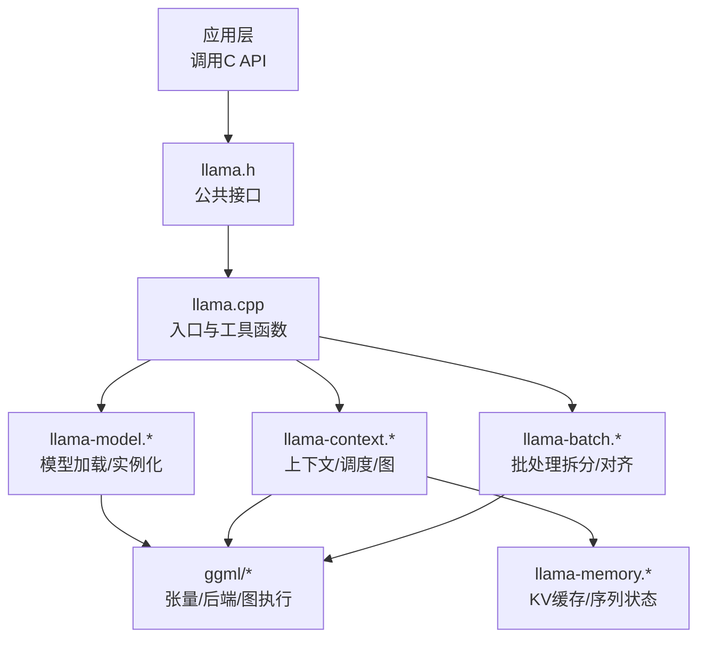
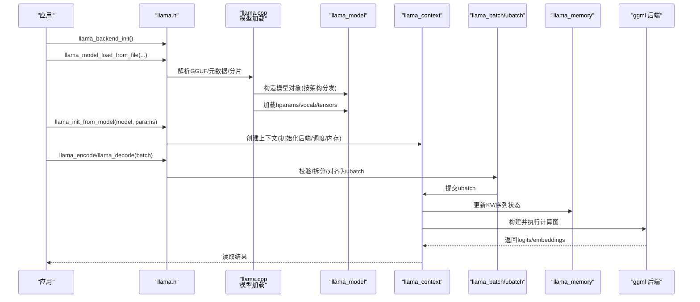
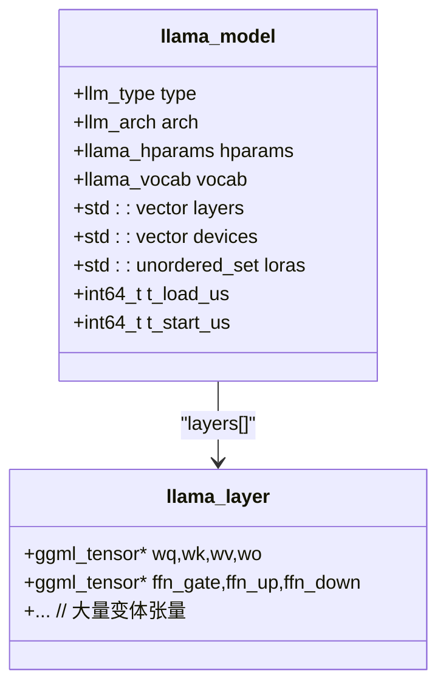
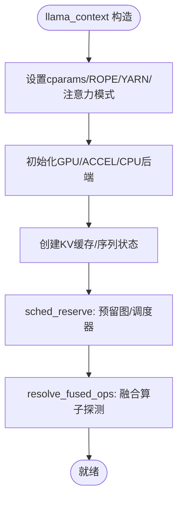
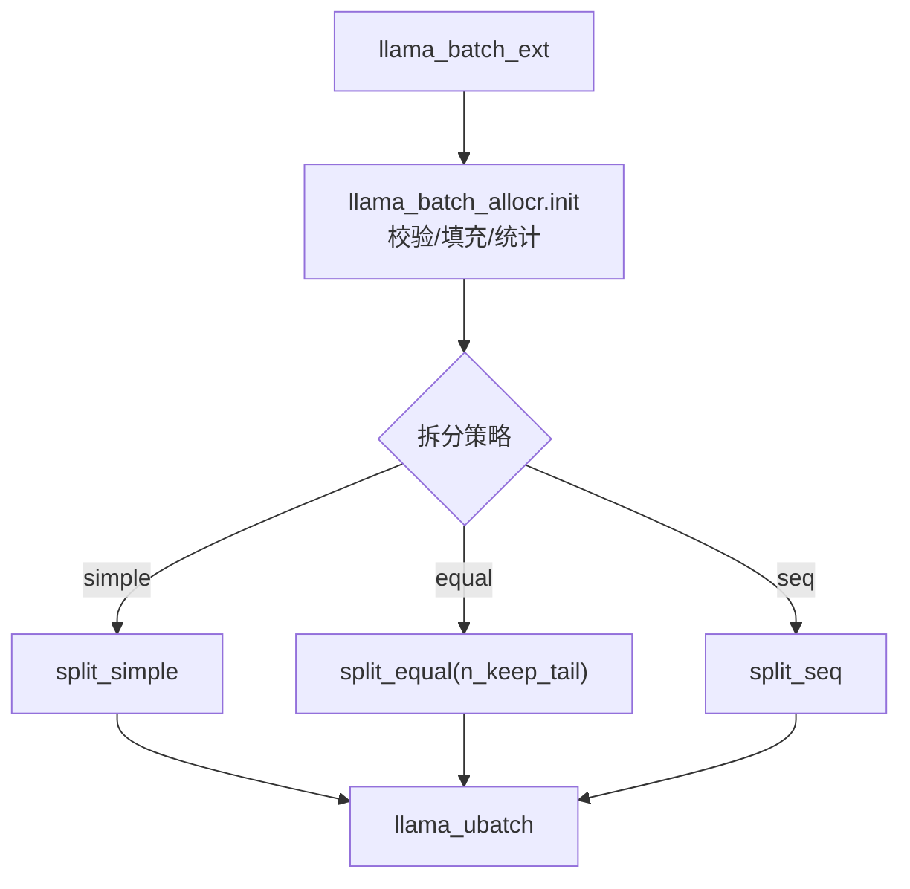
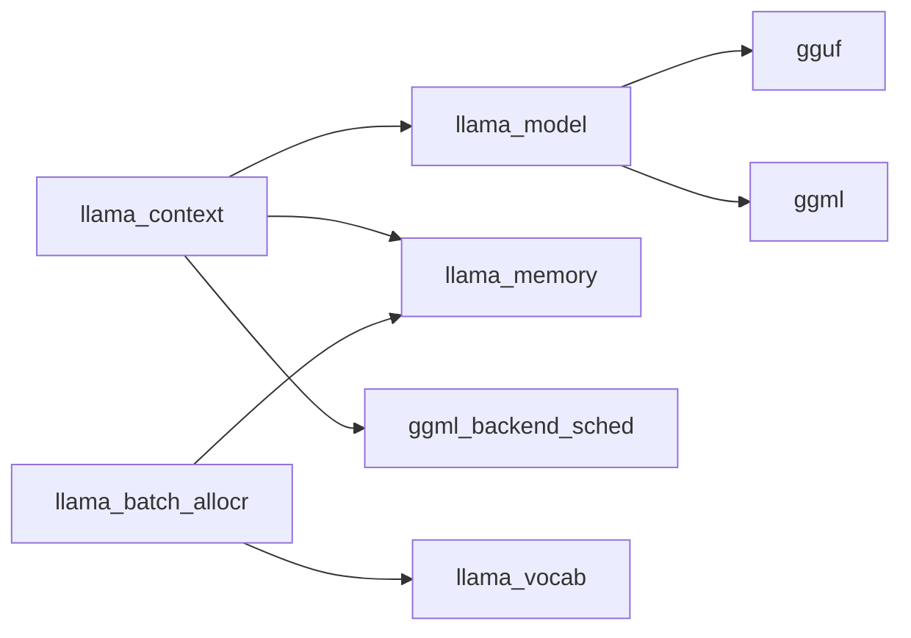

# 核心引擎架构

<cite>
**本文引用的文件**   
- [llama.h](file://include/llama.h)
- [llama.cpp](file://src/llama.cpp)
- [llama-model.h](file://src/llama-model.h)
- [llama-context.h](file://src/llama-context.h)
- [llama-batch.h](file://src/llama-batch.h)
- [llama-model.cpp](file://src/llama-model.cpp)
- [llama-context.cpp](file://src/llama-context.cpp)
- [llama-batch.cpp](file://src/llama-batch.cpp)
</cite>

## 目录
1. [简介](#简介)
2. [项目结构](#项目结构)
3. [核心组件](#核心组件)
4. [架构总览](#架构总览)
5. [详细组件分析](#详细组件分析)
6. [依赖关系分析](#依赖关系分析)
7. [性能与并发](#性能与并发)
8. [故障排查指南](#故障排查指南)
9. [结论](#结论)
10. [附录：API使用示例路径](#附录api使用示例路径)

## 简介
本文件面向 llama.cpp 核心推理引擎的架构文档，聚焦以下方面：
- 模型加载器、上下文管理器、批处理系统与内存管理器的设计与实现
- 核心数据结构 llama_model、llama_context、llama_batch 的设计与关系
- 模型初始化流程、推理执行循环与结果处理的数据流
- 并发机制、线程安全与性能优化策略
- 基于仓库源码的结构化分析与图示

## 项目结构
llama.cpp 的核心由三层组成：
- 公共 C API（include/llama.h）：对外暴露模型加载、上下文创建、批处理与解码等接口
- 核心实现（src/）：模型加载与实例化、上下文调度与图构建、批处理拆分与对齐、KV缓存与内存模块
- 底层计算（ggml）：张量、后端设备、图执行与内存分配

图表来源
- [llama.h:248-273](file://include/llama.h#L248-L273)
- [llama.cpp:316-445](file://src/llama.cpp#L316-L445)
- [llama-model.cpp:363-383](file://src/llama-model.cpp#L363-L383)
- [llama-context.cpp:168-573](file://src/llama-context.cpp#L168-L573)
- [llama-batch.cpp:28-496](file://src/llama-batch.cpp#L28-L496)

章节来源
- [llama.h:248-273](file://include/llama.h#L248-L273)
- [llama.cpp:316-445](file://src/llama.cpp#L316-L445)

## 核心组件
- 模型（llama_model）：封装模型架构、参数、权重张量、词表、设备选择与量化信息
- 上下文（llama_context）：封装推理会话、KV缓存、调度器、图构建与输出缓冲
- 批处理（llama_batch / llama_ubatch / llama_batch_ext）：统一输入表示、拆分与对齐、位置与序列映射
- 内存（llama_memory_i 及其实现）：KV缓存、序列状态、滑动窗口与回滚支持

章节来源
- [llama-model.h:679-800](file://src/llama-model.h#L679-L800)
- [llama-context.h:45-448](file://src/llama-context.h#L45-L448)
- [llama-batch.h:17-275](file://src/llama-batch.h#L17-L275)
- [llama.h:753-818](file://include/llama.h#L753-L818)

## 架构总览
下图展示从模型加载到推理执行的端到端数据流。

图表来源
- [llama.cpp:316-445](file://src/llama.cpp#L316-L445)
- [llama-context.cpp:168-573](file://src/llama-context.cpp#L168-L573)
- [llama-batch.cpp:28-496](file://src/llama-batch.cpp#L28-L496)
- [llama.h:984-1008](file://include/llama.h#L984-L1008)

## 详细组件分析

### 模型加载器与模型对象（llama_model）
- 加载流程
  - 通过 llama_model_load_from_file 系列接口进入，内部统一走 llama_model_load_from_file_impl -> llama_model_load
  - 使用 llama_model_loader 解析 GGUF 元数据、张量名与形状，并按架构创建具体模型实例
  - 设备选择与多卡切分：llama_prepare_model_devices 根据 split_mode 与 tensor_split 配置设备列表
  - 加载步骤：load_hparams -> load_vocab -> load_stats -> load_tensors
- 模型对象
  - 包含架构类型、超参、词表、各层张量指针、设备列表、LoRA适配器集合、可预取张量集合等
  - 提供 create_memory 以根据架构与上下文参数创建 KV 缓存与序列状态

图表来源
- [llama-model.h:679-800](file://src/llama-model.h#L679-L800)
- [llama-model.cpp:363-383](file://src/llama-model.cpp#L363-L383)
- [llama.cpp:158-313](file://src/llama.cpp#L158-L313)
- [llama.cpp:316-378](file://src/llama.cpp#L316-L378)

章节来源
- [llama.cpp:316-445](file://src/llama.cpp#L316-L445)
- [llama-model.cpp:363-383](file://src/llama-model.cpp#L363-L383)
- [llama-model.h:679-800](file://src/llama-model.h#L679-L800)

### 上下文管理器（llama_context）
- 职责
  - 初始化后端（GPU/ACCEL/CPU）、调度器（ggml_backend_sched）与计算图预留
  - 管理 KV 缓存与序列状态（通过 llama_memory），以及 MoE 专家缓存
  - 提供 encode/decode 接口，内部将 llama_batch_ext 转为 llama_ubatch 并提交
  - 维护 logits/embeddings 输出缓冲与采样链（可选）
- 关键流程
  - 构造函数中设置 cparams（上下文参数）、初始化 memory、backends、sched_reserve
  - sched_reserve 中预留最坏情况图节点数，并根据是否启用流水线并行调整调度器
  - resolve_fused_ops 自动探测 Flash Attention/GDN/Lightning Indexer 等融合算子可用性
  - graph_reserve/graph_compute 负责图构建与异步执行

图表来源
- [llama-context.cpp:168-573](file://src/llama-context.cpp#L168-L573)
- [llama-context.cpp:599-674](file://src/llama-context.cpp#L599-L674)
- [llama-context.cpp:707-800](file://src/llama-context.cpp#L707-L800)

章节来源
- [llama-context.h:45-448](file://src/llama-context.h#L45-L448)
- [llama-context.cpp:168-573](file://src/llama-context.cpp#L168-L573)
- [llama-context.cpp:599-674](file://src/llama-context.cpp#L599-L674)
- [llama-context.cpp:707-800](file://src/llama-context.cpp#L707-L800)

### 批处理系统（llama_batch / llama_ubatch / llama_batch_ext）
- 设计要点
  - llama_batch_ext：高层扩展批结构，支持 token/embd/state 混合输入、M-RoPE 多段位置、决策顺序等
  - llama_batch_allocr：将 llama_batch_ext 校验、填充并转换为内部 llama_batch，再拆分为多个 llama_ubatch
  - llama_ubatch：轻量级批次描述，指向实际数据或共享 data_t，便于高效切片与复用
- 拆分策略
  - split_simple：简单顺序切分
  - split_equal：等长序列集切分，支持尾部保留 n_keep_tail
  - split_seq：按序列集切分，避免耦合序列跨 ubatch
- 一致性检查
  - 校验 seq_id 范围、位置连续性、耦合序列一致性、M-RoPE 位置约束等

图表来源
- [llama-batch.h:17-275](file://src/llama-batch.h#L17-L275)
- [llama-batch.cpp:28-496](file://src/llama-batch.cpp#L28-L496)
- [llama-batch.cpp:585-800](file://src/llama-batch.cpp#L585-L800)

章节来源
- [llama-batch.h:17-275](file://src/llama-batch.h#L17-L275)
- [llama-batch.cpp:28-496](file://src/llama-batch.cpp#L28-L496)
- [llama-batch.cpp:585-800](file://src/llama-batch.cpp#L585-L800)

### 内存管理器（KV缓存与序列状态）
- 抽象接口
  - llama_memory_i：定义序列增删改查、位置查询、移位等能力
  - llama_context 持有 llama_memory_ptr，并在构造时根据模型与上下文参数创建具体实现
- 功能特性
  - 支持 SWA（滑动窗口注意力）、部分回滚（n_rs_seq）、统一 KV 缓冲（kv_unified）
  - 提供 per-sequence 的设备侧拷贝缓存（mem_storage）用于快速状态保存/加载
- 与上下文协作
  - 在 sched_reserve 前完成 memory->init_full，确保图构建阶段有完整内存视图
  - decode 过程中按需更新 KV 与序列位置，保证位置连续性与耦合序列一致

章节来源
- [llama.h:753-818](file://include/llama.h#L753-L818)
- [llama-context.h:45-448](file://src/llama-context.h#L45-L448)
- [llama-context.cpp:474-485](file://src/llama-context.cpp#L474-L485)

## 依赖关系分析
- 组件耦合
  - llama_context 强依赖 llama_model（架构/超参/设备）、llama_memory（KV/序列）、ggml_backend_sched（图调度）
  - llama_batch_allocr 依赖 llama_vocab 与 llama_memory 进行位置与序列一致性校验
  - llama_model 依赖 gguf/ggml 进行张量加载与布局
- 外部依赖
  - ggml 后端（CPU/GPU/ACCEL/RPC）与设备发现
  - gguf 文件格式与元数据
- 潜在环依赖
  - 无直接代码环；通过头文件的前向声明与分层组织避免循环

图表来源
- [llama-context.h:45-448](file://src/llama-context.h#L45-L448)
- [llama-batch.h:17-275](file://src/llama-batch.h#L17-L275)
- [llama-model.h:679-800](file://src/llama-model.h#L679-L800)

章节来源
- [llama-context.h:45-448](file://src/llama-context.h#L45-L448)
- [llama-batch.h:17-275](file://src/llama-batch.h#L17-L275)
- [llama-model.h:679-800](file://src/llama-model.h#L679-L800)

## 性能与并发
- 线程与后端
  - llama_attach_threadpool/detach_threadpool 允许绑定自定义线程池
  - llama_set_n_threads 控制生成与批处理的线程数
  - 后端线程数通过 set_n_threads_fns 批量下发至各后端
- 图与调度
  - sched_reserve 预留最大图节点数，减少运行时重分配
  - pipeline_parallel 在多设备条件下尝试开启流水线并行（需 async/events 支持）
  - graph_reuse_disable 环境变量可禁用图复用以调试
- 融合算子
  - resolve_fused_ops 自动探测 Flash Attention、Gated Delta Net、Lightning Indexer、DeepSeek V4 HC 等融合算子
  - 若目标设备不匹配则降级为非融合路径
- 内存与缓存
  - kv_unified 对多序列共享前缀场景优化
  - moe_cache_size 控制专家缓存大小，减少重复加载
  - mem_storage 缓存 per-sequence 的设备侧状态，加速状态存取

章节来源
- [llama.h:498-504](file://include/llama.h#L498-L504)
- [llama.h:1096-1132](file://include/llama.h#L1096-L1132)
- [llama-context.cpp:517-553](file://src/llama-context.cpp#L517-L553)
- [llama-context.cpp:599-674](file://src/llama-context.cpp#L599-L674)
- [llama-context.cpp:368-374](file://src/llama-context.cpp#L368-L374)

## 故障排查指南
- 常见错误与定位
  - 后端未加载：提示“no backends are loaded”，需在调用前加载后端
  - 设备选择不合法：main_gpu 越界或 tensor parallel 需要至少一个设备
  - KV 槽位不足：llama_decode 返回 1，需减小 batch 或增大上下文
  - 融合算子不可用：日志提示设备不匹配，自动降级
  - M-RoPE 位置不一致：batch 校验失败，需保证位置连续或满足跳跃规则
- 建议步骤
  - 打印系统信息与后端能力：llama_print_system_info
  - 检查上下文参数：n_ctx/n_batch/n_ubatch/n_seq_max 是否合理
  - 关闭图复用/融合算子自动探测以隔离问题
  - 使用 LLAMA_BATCH_DEBUG 环境变量查看批拆分细节

章节来源
- [llama.cpp:407-410](file://src/llama.cpp#L407-L410)
- [llama.cpp:158-313](file://src/llama.cpp#L158-L313)
- [llama.h:994-1008](file://include/llama.h#L994-L1008)
- [llama-context.cpp:599-674](file://src/llama-context.cpp#L599-L674)
- [llama-batch.cpp:345-496](file://src/llama-batch.cpp#L345-L496)

## 结论
llama.cpp 的核心引擎通过清晰的层次划分与可扩展的抽象，实现了从模型加载、上下文管理、批处理拆分到图执行与内存管理的完整推理链路。其设计强调：
- 架构无关的模型实例化与设备切分
- 灵活的批处理与位置语义（含 M-RoPE）
- 强大的后端调度与融合算子自适应
- 完善的 KV 缓存与序列状态管理
这些特性共同保障了高性能、可扩展与易用的推理体验。

## 附录：API使用示例路径
以下为仓库中与核心 API 使用相关的示例文件路径（供参考）：
- 基础推理示例：examples/simple/simple.cpp
- 对话示例：examples/simple-chat/simple-chat.cpp
- 批处理示例：examples/batched/batched.cpp
- 嵌入示例：examples/embedding/embedding.cpp
- 服务器示例：tools/server/server.cpp
- 评估示例：examples/llama-eval/llama-eval.py