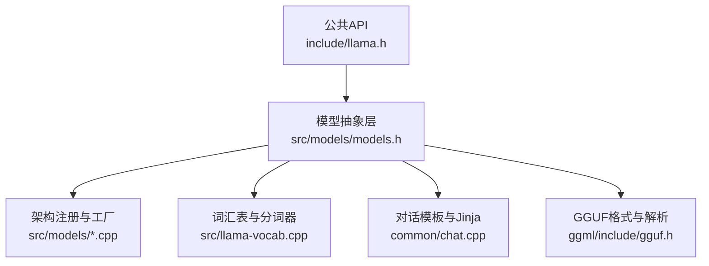
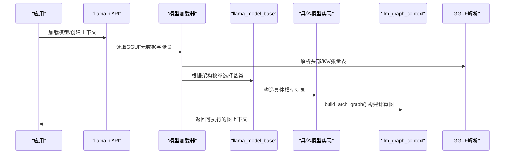
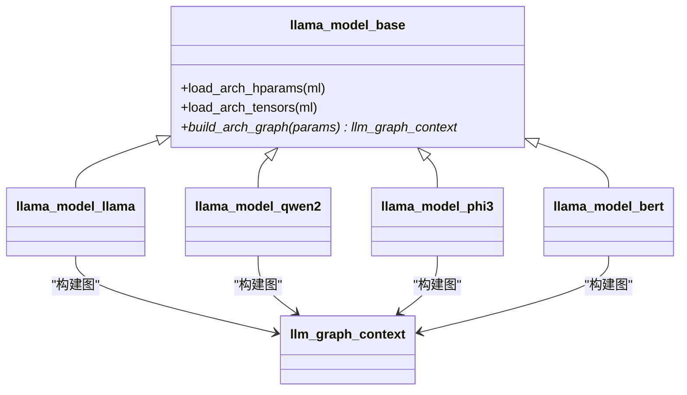
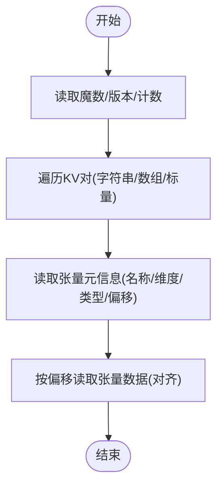
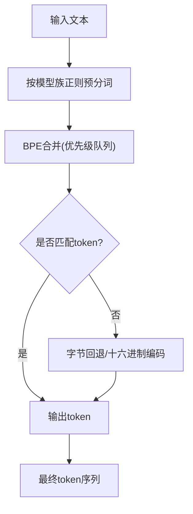
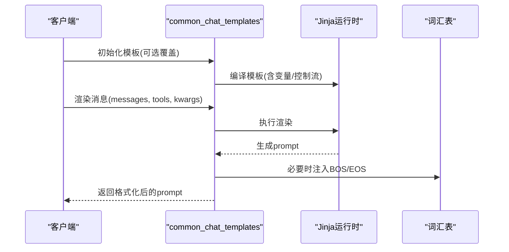
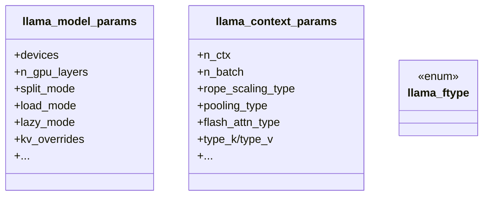
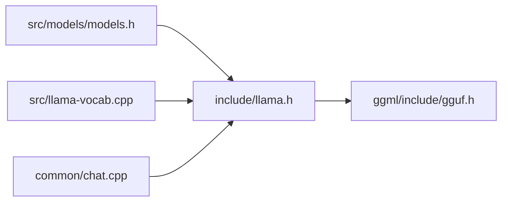

# 模型系统架构

<cite>
**本文引用的文件**   
- [README.md](file://README.md)
- [llama.h](file://include/llama.h)
- [models.h](file://src/models/models.h)
- [llama-vocab.cpp](file://src/llama-vocab.cpp)
- [chat.cpp](file://common/chat.cpp)
- [gguf.h](file://ggml/include/gguf.h)
- [HOWTO-add-model.md](file://docs/development/HOWTO-add-model.md)
</cite>

## 目录
1. [简介](#简介)
2. [项目结构](#项目结构)
3. [核心组件](#核心组件)
4. [架构总览](#架构总览)
5. [详细组件分析](#详细组件分析)
6. [依赖关系分析](#依赖关系分析)
7. [性能考量](#性能考量)
8. [故障排查指南](#故障排查指南)
9. [结论](#结论)
10. [附录：添加新模型架构的开发指南与最佳实践](#附录添加新模型架构的开发指南与最佳实践)

## 简介
本文件面向希望理解 llama.cpp 模型系统的开发者与维护者，系统性阐述以下主题：
- 插件化模型架构与工厂模式如何支持 100+ 种模型类型
- GGUF 文件格式的结构与解析机制
- 词汇表系统与分词器适配器（SPM/BPE/WPM/UGM/RWKV 等）及多语言支持
- 对话模板系统设计与 Jinja 模板引擎集成
- 模型参数配置、量化格式支持与版本兼容性管理
- 添加新模型架构的完整开发流程与最佳实践

## 项目结构
llama.cpp 将“模型加载—图构建—推理执行”解耦为多层模块：
- 公共 API 层：定义对外接口、枚举、参数结构与工具函数
- 模型抽象层：统一模型基类、架构枚举、张量/超参命名映射
- 具体模型实现层：每种模型一个继承自基类的实现，负责加载权重与构建计算图
- 词汇表与分词器：按不同 tokenizer 类型提供适配
- 对话模板：基于内置 Jinja 子集渲染消息序列
- GGUF 读写：二进制元数据与张量数据的解析与序列化

图表来源
- [llama.h:1-120](file://include/llama.h#L1-L120)
- [models.h:147-200](file://src/models/models.h#L147-L200)
- [llama-vocab.cpp:72-120](file://src/llama-vocab.cpp#L72-L120)
- [chat.cpp:304-340](file://common/chat.cpp#L304-L340)
- [gguf.h:1-34](file://ggml/include/gguf.h#L1-L34)

章节来源
- [README.md:60-118](file://README.md#L60-L118)

## 核心组件
- 公共 API 与参数
  - 模型上下文与批处理结构体、采样链、LoRA 适配器、KV 覆盖、设备与内存布局等
  - 量化类型枚举、RoPE 缩放、注意力类型、拆分模式等
- 模型抽象与具体实现
  - 所有模型继承统一的基类，暴露 load_arch_hparams/load_arch_tensors/build_arch_graph 等钩子
  - 通过架构枚举与映射表完成运行时实例化
- 词汇表与分词器
  - 支持 SPM、BPE、WPM、UGM、RWKV、PLAMO2/3 等多种分词策略
  - BPE 预分词正则表达式按模型族定制，兼顾多语言与特殊脚本
- 对话模板
  - 默认 chatml 模板，支持 Jinja 子集渲染，兼容 OpenAI 风格消息与工具调用
- GGUF 格式
  - 文件头、KV 元数据、张量表与张量数据块；支持对齐与扩展字段

章节来源
- [llama.h:117-163](file://include/llama.h#L117-L163)
- [llama.h:320-458](file://include/llama.h#L320-L458)
- [models.h:147-200](file://src/models/models.h#L147-L200)
- [llama-vocab.cpp:72-120](file://src/llama-vocab.cpp#L72-L120)
- [chat.cpp:304-340](file://common/chat.cpp#L304-L340)
- [gguf.h:1-34](file://ggml/include/gguf.h#L1-L34)

## 架构总览
下图展示从外部调用到具体模型图构建的关键路径。

图表来源
- [llama.h:517-554](file://include/llama.h#L517-L554)
- [gguf.h:1-34](file://ggml/include/gguf.h#L1-L34)
- [models.h:147-200](file://src/models/models.h#L147-L200)

## 详细组件分析

### 插件化模型架构与工厂模式
- 设计要点
  - 所有模型继承统一基类，暴露一致的加载与建图接口
  - 通过架构枚举与名称映射在运行时选择具体实现
  - 每个模型类内部封装其特有的张量布局与图构建逻辑
- 典型类关系

图表来源
- [models.h:147-200](file://src/models/models.h#L147-L200)

章节来源
- [models.h:147-200](file://src/models/models.h#L147-L200)

### GGUF 文件格式与解析机制
- 文件结构
  - 魔数、版本号、张量数量、KV 对数量
  - KV 对：键名、值类型、数组元素或标量值
  - 张量表：名称、维度、数据类型、偏移
  - 张量数据块：可选且对齐
- 解析流程

图表来源
- [gguf.h:1-34](file://ggml/include/gguf.h#L1-L34)

章节来源
- [gguf.h:1-34](file://ggml/include/gguf.h#L1-L34)

### 词汇表系统与分词器适配器
- 支持的词汇表类型
  - SPM（SentencePiece）、BPE（GPT-2 风格）、WPM（WordPiece）、UGM（Unigram）、RWKV、PLAMO2/3 等
- BPE 预分词正则表达式按模型族定制，覆盖英文、中文、代码、多语种与特殊脚本
- 会话级分词流程

图表来源
- [llama-vocab.cpp:280-587](file://src/llama-vocab.cpp#L280-L587)
- [llama-vocab.cpp:589-774](file://src/llama-vocab.cpp#L589-L774)

章节来源
- [llama-vocab.cpp:72-120](file://src/llama-vocab.cpp#L72-L120)
- [llama-vocab.cpp:280-587](file://src/llama-vocab.cpp#L280-L587)
- [llama-vocab.cpp:589-774](file://src/llama-vocab.cpp#L589-L774)

### 对话模板系统与 Jinja 集成
- 默认模板为 chatml，支持 Jinja 子集渲染
- 支持 OpenAI 风格消息、工具调用、思考内容、媒体标记等
- 模板校验与示例渲染

图表来源
- [chat.cpp:304-340](file://common/chat.cpp#L304-L340)
- [chat.cpp:610-685](file://common/chat.cpp#L610-L685)
- [chat.cpp:729-800](file://common/chat.cpp#L729-L800)

章节来源
- [chat.cpp:304-340](file://common/chat.cpp#L304-L340)
- [chat.cpp:610-685](file://common/chat.cpp#L610-L685)
- [chat.cpp:729-800](file://common/chat.cpp#L729-L800)

### 模型参数配置、量化格式与版本兼容
- 模型参数
  - 设备列表、GPU 层数、拆分模式、加载模式、懒加载、KV 覆盖、进度回调等
- 上下文参数
  - 上下文长度、批次大小、线程数、RoPE 缩放、池化类型、注意力类型、Flash Attention、K/V 缓存类型、MOE 缓存等
- 量化类型
  - F16/F32/BF16 与多种整数量化(Q4_K/Q5_K/IQ系列/TQ/NVFP4/MXFP4_MOE 等)
- 版本与兼容性
  - 会话/状态序列魔法字与版本常量；GGUF 版本与对齐

图表来源
- [llama.h:320-458](file://include/llama.h#L320-L458)
- [llama.h:117-163](file://include/llama.h#L117-L163)
- [llama.h:41-49](file://include/llama.h#L41-L49)

章节来源
- [llama.h:320-458](file://include/llama.h#L320-L458)
- [llama.h:117-163](file://include/llama.h#L117-L163)
- [llama.h:41-49](file://include/llama.h#L41-L49)

## 依赖关系分析
- 组件耦合
  - 公共 API 依赖 ggml/gguf 基础库
  - 模型抽象层依赖架构枚举与张量命名映射
  - 具体模型实现依赖图构建上下文与后端算子
  - 词汇表与分词器依赖 Unicode 与正则预处理
  - 对话模板依赖 Jinja 运行时与消息规范化
- 关键依赖图

图表来源
- [llama.h:1-120](file://include/llama.h#L1-L120)
- [gguf.h:1-34](file://ggml/include/gguf.h#L1-L34)
- [models.h:1-20](file://src/models/models.h#L1-L20)
- [llama-vocab.cpp:1-20](file://src/llama-vocab.cpp#L1-L20)
- [chat.cpp:1-20](file://common/chat.cpp#L1-L20)

## 性能考量
- 量化选择
  - 根据硬件能力与精度需求选择合适的量化类型（如 Q4_K_M、IQ3_S、NVFP4 等）
- 批处理与上下文
  - 合理设置 n_batch/n_ubatch/n_ctx，避免频繁重分配与碎片化
- RoPE 与长上下文
  - 使用 YaRN/LongRoPE 等缩放策略以支持更长上下文
- 注意力优化
  - 启用 Flash Attention（若后端支持），减少显存占用并提升吞吐
- 设备与内存
  - 利用 split_mode/tensor_split 进行多卡切分；合理使用 mmap/mlock 降低页错误与拷贝开销

[本节为通用指导，不直接分析具体文件]

## 故障排查指南
- 模板渲染异常
  - 检查模板语法与变量引用；使用模板校验函数快速定位问题
- 分词不一致
  - 核对模型族的预分词正则与 byte_encode 标志；确认 BOS/EOS 追加行为
- GGUF 解析失败
  - 检查文件魔数、版本与对齐；确认 KV 字段完整性
- 量化/加载错误
  - 核对 ftype 与后端支持；检查 tensor_buft_overrides 与 lazy_mode 配置

章节来源
- [chat.cpp:610-685](file://common/chat.cpp#L610-L685)
- [llama-vocab.cpp:589-774](file://src/llama-vocab.cpp#L589-L774)
- [gguf.h:1-34](file://ggml/include/gguf.h#L1-L34)

## 结论
llama.cpp 通过清晰的层次划分与插件化架构，实现了高可扩展的模型系统：
- 统一的模型基类与工厂机制支撑 100+ 模型类型
- GGUF 作为标准容器承载元数据与权重，便于跨生态转换与复用
- 词汇表与分词器适配多语言与复杂脚本
- 对话模板与 Jinja 集成提供灵活的提示工程体验
- 完善的参数与量化体系保障在不同硬件上的高效运行

[本节为总结性内容，不直接分析具体文件]

## 附录：添加新模型架构的开发指南与最佳实践
- 步骤概览
  1. 在架构枚举中新增一项，并在名称映射表中登记
  2. 在加载器中处理非标准元数据（如有）
  3. 在 RoPE 相关逻辑中添加对应分支（如适用）
  4. 实现模型类：继承基类，实现 hparams/tensors 加载与图构建
  5. 在映射函数中注册新架构以实例化你的实现
- 注意事项
  - 注意 ggml 维度顺序与 PyTorch 的差异
  - 确保在所有涉及架构枚举的开关处补充新分支，避免 CI 测试失败

章节来源
- [HOWTO-add-model.md:101-120](file://docs/development/HOWTO-add-model.md#L101-L120)