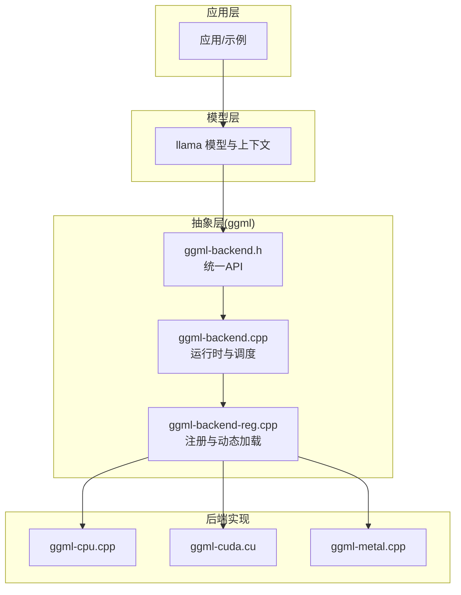
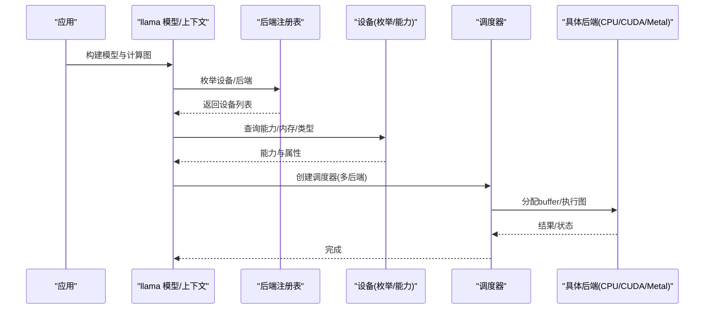
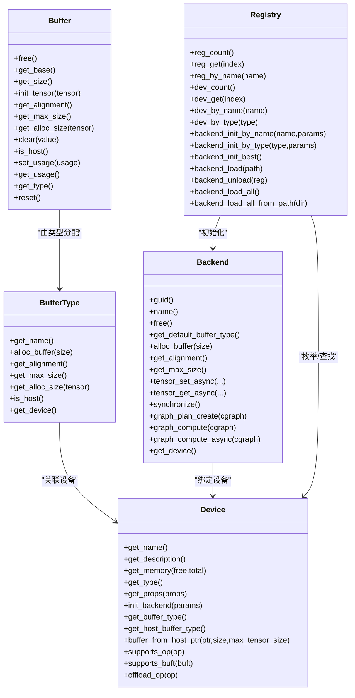
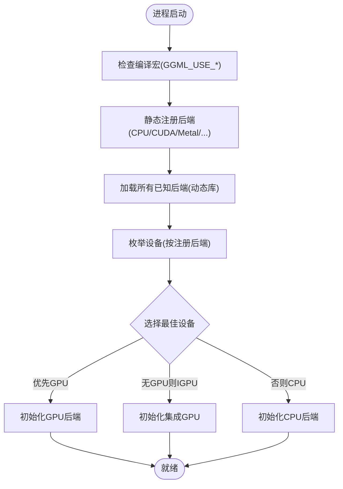
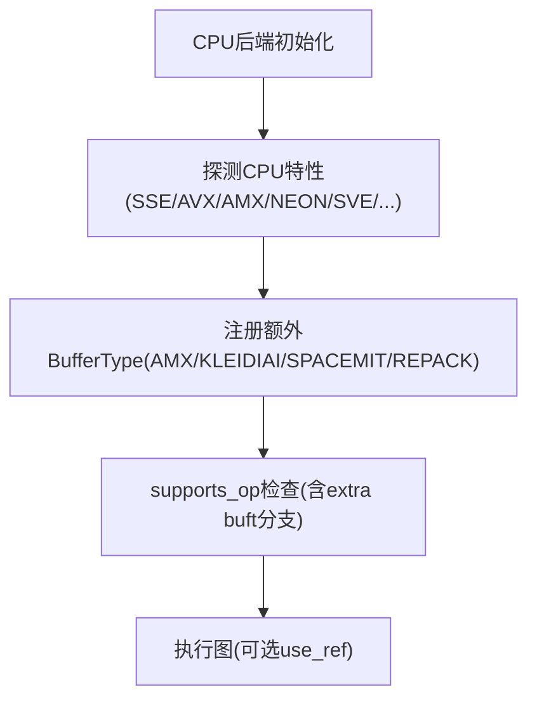
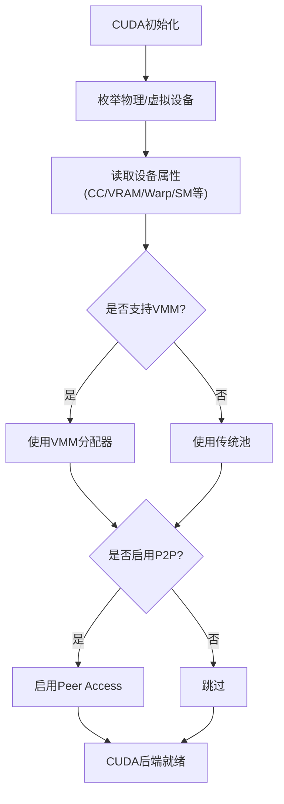
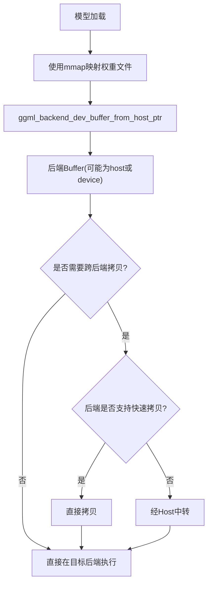
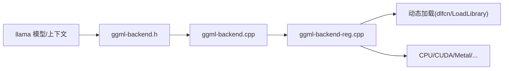

# 硬件抽象层架构

<cite>
**本文引用的文件**   
- [ggml-backend.h](file://ggml/include/ggml-backend.h)
- [ggml-backend.cpp](file://ggml/src/ggml-backend.cpp)
- [ggml-backend-reg.cpp](file://ggml/src/ggml-backend-reg.cpp)
- [ggml-cpu.cpp](file://ggml/src/ggml-cpu/ggml-cpu.cpp)
- [ggml-cuda.cu](file://ggml/src/ggml-cuda/ggml-cuda.cu)
- [ggml-metal.cpp](file://ggml/src/ggml-metal/ggml-metal.cpp)
- [llama-model.cpp](file://src/llama-model.cpp)
- [llama-context.cpp](file://src/llama-context.cpp)
- [OPENCL.md](file://docs/backend/OPENCL.md)
</cite>

## 目录
1. [引言](#引言)
2. [项目结构](#项目结构)
3. [核心组件](#核心组件)
4. [架构总览](#架构总览)
5. [详细组件分析](#详细组件分析)
6. [依赖关系分析](#依赖关系分析)
7. [性能与优化](#性能与优化)
8. [故障排查指南](#故障排查指南)
9. [结论](#结论)
10. [附录：添加新后端开发指南](#附录添加新后端开发指南)

## 引言
本文件面向硬件抽象层（HAL）的架构文档，聚焦于统一的硬件抽象接口设计、后端注册机制、设备发现与能力检测、内存映射与数据传输策略，以及 CPU/CUDA/Metal 等后端的实现差异。同时给出添加新硬件后端的步骤、接口要求与测试方法，并汇总兼容性矩阵与性能对比要点。

## 项目结构
本项目在 ggml 层提供统一的硬件抽象接口与调度器，上层 llama 模型通过该抽象选择具体后端执行计算。关键目录与职责如下：
- ggml/include: 统一后端 API 头文件，定义 buffer/buffer type/device/backend/reg 等核心类型与函数
- ggml/src: 后端运行时与调度器实现，包含通用逻辑与动态加载
- ggml/src/ggml-cpu, ggml-cuda, ggml-metal, ...: 各硬件后端的具体实现
- src: 模型与上下文管理，负责将图节点分配到不同后端、处理权重分配与内存映射
- docs/backend: 各后端的使用说明与兼容性信息

图表来源
- [ggml-backend.h:1-464](file://ggml/include/ggml-backend.h#L1-L464)
- [ggml-backend.cpp:1-800](file://ggml/src/ggml-backend.cpp#L1-L800)
- [ggml-backend-reg.cpp:1-599](file://ggml/src/ggml-backend-reg.cpp#L1-L599)
- [ggml-cpu.cpp:1-720](file://ggml/src/ggml-cpu/ggml-cpu.cpp#L1-L720)
- [ggml-cuda.cu:6072-6151](file://ggml/src/ggml-cuda/ggml-cuda.cu#L6072-L6151)
- [ggml-metal.cpp:1-200](file://ggml/src/ggml-metal/ggml-metal.cpp#L1-L200)

章节来源
- [ggml-backend.h:1-464](file://ggml/include/ggml-backend.h#L1-L464)
- [ggml-backend-reg.cpp:1-599](file://ggml/src/ggml-backend-reg.cpp#L1-L599)

## 核心组件
- 统一后端接口（ggml-backend.h）
  - 定义 buffer/buffer type/device/backend/reg 等核心对象与操作
  - 提供设备枚举、能力查询、异步拷贝、事件同步、图计划与执行、调度器等 API
- 运行时与调度器（ggml-backend.cpp）
  - 实现 buffer/buffer type 的默认分配策略、张量拷贝、异步拷贝回退、事件封装、图计划与执行包装
  - 暴露设备与后端初始化、支持性判断、offload 决策等
- 后端注册与动态加载（ggml-backend-reg.cpp）
  - 维护全局注册表，按编译开关静态注册后端，或从动态库动态加载
  - 提供设备枚举、按名称/类型查找、最佳后端自动选择、环境变量控制
- 各后端实现
  - CPU：纯 CPU 路径，支持多种 SIMD/指令集特性探测与扩展 buffer type
  - CUDA：GPU 路径，多设备/VMM/虚拟设备/P2P 等高级特性
  - Metal：Apple GPU 路径，遵循统一后端接口

章节来源
- [ggml-backend.h:1-464](file://ggml/include/ggml-backend.h#L1-L464)
- [ggml-backend.cpp:1-800](file://ggml/src/ggml-backend.cpp#L1-L800)
- [ggml-backend-reg.cpp:1-599](file://ggml/src/ggml-backend-reg.cpp#L1-L599)
- [ggml-cpu.cpp:1-720](file://ggml/src/ggml-cpu/ggml-cpu.cpp#L1-L720)
- [ggml-cuda.cu:6072-6151](file://ggml/src/ggml-cuda/ggml-cuda.cu#L6072-L6151)
- [ggml-metal.cpp:1-200](file://ggml/src/ggml-metal/ggml-metal.cpp#L1-L200)

## 架构总览
下图展示从模型到后端的调用链路与数据流：

图表来源
- [ggml-backend-reg.cpp:316-390](file://ggml/src/ggml-backend-reg.cpp#L316-L390)
- [ggml-backend.h:268-380](file://ggml/include/ggml-backend.h#L268-L380)
- [llama-context.cpp:2854-2870](file://src/llama-context.cpp#L2854-L2870)

## 详细组件分析

### 统一后端接口与数据结构
- 核心类型
  - ggml_backend_buffer_type_t / ggml_backend_buffer_t：缓冲类型与缓冲实例
  - ggml_backend_dev_t / ggml_backend_t：设备与后端实例
  - ggml_backend_reg_t：后端注册对象
- 设备能力与属性
  - ggml_backend_dev_caps：异步、host buffer、from host ptr、events、mmap_support
  - ggml_backend_dev_props：name/description/memory_free/total/type/device_id/caps
- 后端调度器
  - 支持多后端协同、按 tensor 位置与操作支持性分配、跨后端拷贝、回调与重分配

图表来源
- [ggml-backend.h:24-464](file://ggml/include/ggml-backend.h#L24-L464)

章节来源
- [ggml-backend.h:24-464](file://ggml/include/ggml-backend.h#L24-L464)

### 后端注册与设备发现
- 静态注册：根据编译宏（如 GGML_USE_CUDA/GGML_USE_METAL/GGML_USE_CPU）在构造函数中注册对应后端
- 动态加载：支持从动态库加载后端，检查 ggml_backend_score 与 ggml_backend_init，校验 API 版本
- 设备枚举：每个后端可注册多个设备；提供按名称/类型查找、最佳后端自动选择
- 环境变量：GGML_DISABLE_VULKAN、GGML_BACKEND_PATH 等控制行为

图表来源
- [ggml-backend-reg.cpp:119-174](file://ggml/src/ggml-backend-reg.cpp#L119-L174)
- [ggml-backend-reg.cpp:382-390](file://ggml/src/ggml-backend-reg.cpp#L382-L390)
- [ggml-backend-reg.cpp:567-599](file://ggml/src/ggml-backend-reg.cpp#L567-L599)

章节来源
- [ggml-backend-reg.cpp:119-174](file://ggml/src/ggml-backend-reg.cpp#L119-L174)
- [ggml-backend-reg.cpp:382-390](file://ggml/src/ggml-backend-reg.cpp#L382-L390)
- [ggml-backend-reg.cpp:567-599](file://ggml/src/ggml-backend-reg.cpp#L567-L599)

### CPU 后端实现模式
- 设备与后端
  - 单设备 CPU，描述信息来自系统 API（macOS/Linux/Windows）
  - 支持额外 buffer type（AMX/KLEIDIAI/RISCV64 SPACEMIT/REPACK），通过 get_extra_bufts 暴露
- 能力检测
  - supports_op 对常见算子进行类型与参数检查，部分算子委托给 extra buffer type
  - supports_buft 允许 host buffer 与额外 buffer type
- 线程与参考实现
  - 可通过 set_n_threads/set_threadpool 配置线程池
  - use_ref 启用参考实现路径用于验证

图表来源
- [ggml-cpu.cpp:42-86](file://ggml/src/ggml-cpu/ggml-cpu.cpp#L42-L86)
- [ggml-cpu.cpp:424-492](file://ggml/src/ggml-cpu/ggml-cpu.cpp#L424-L492)
- [ggml-cpu.cpp:541-656](file://ggml/src/ggml-cpu/ggml-cpu.cpp#L541-L656)

章节来源
- [ggml-cpu.cpp:42-86](file://ggml/src/ggml-cpu/ggml-cpu.cpp#L42-L86)
- [ggml-cpu.cpp:424-492](file://ggml/src/ggml-cpu/ggml-cpu.cpp#L424-L492)
- [ggml-cpu.cpp:541-656](file://ggml/src/ggml-cpu/ggml-cpu.cpp#L541-L656)

### CUDA 后端实现模式
- 设备发现
  - 物理设备计数与属性读取，支持虚拟设备（GGML_CUDA_DEVICES）
  - 每设备记录 compute capability、VMM 支持、共享内存、warp size、协作 launch 等
- 内存管理
  - 传统池与 VMM 两种分配器，按需映射物理页，支持 P2P 访问
  - 支持统一内存（GGML_CUDA_ENABLE_UNIFIED_MEMORY）、pinned memory 禁用、注册主机内存
- 多后端与 offload
  - 为每个设备创建 backend 实例，支持最小批大小阈值触发 offload
  - 支持 NCCL/Peer Access 加速多卡通信

图表来源
- [ggml-cuda.cu:265-447](file://ggml/src/ggml-cuda/ggml-cuda.cu#L265-L447)
- [ggml-cuda.cu:572-731](file://ggml/src/ggml-cuda/ggml-cuda.cu#L572-L731)
- [ggml-cuda.cu:6072-6151](file://ggml/src/ggml-cuda/ggml-cuda.cu#L6072-L6151)

章节来源
- [ggml-cuda.cu:265-447](file://ggml/src/ggml-cuda/ggml-cuda.cu#L265-L447)
- [ggml-cuda.cu:572-731](file://ggml/src/ggml-cuda/ggml-cuda.cu#L572-L731)
- [ggml-cuda.cu:6072-6151](file://ggml/src/ggml-cuda/ggml-cuda.cu#L6072-L6151)

### Metal 后端实现模式
- 遵循统一后端接口，提供 Apple GPU 的计算与内存管理
- 与 CPU/CUDA 类似，通过注册与设备枚举接入调度器
- 具体实现细节见 ggml-metal.cpp

章节来源
- [ggml-metal.cpp:1-200](file://ggml/src/ggml-metal/ggml-metal.cpp#L1-L200)

### 内存映射、数据传输与优化策略
- 内存映射
  - 设备能力 caps.mmap_support 指示是否支持 mmap 加载
  - 模型加载时可使用 ggml_backend_dev_buffer_from_host_ptr 将已映射地址直接作为后端 buffer
- 数据传输
  - ggml_backend_tensor_copy 优先走后端专用拷贝，否则回退到 host 中转
  - 异步拷贝 ggml_backend_tensor_copy_async 若后端不支持，则先同步再阻塞拷贝
- 优化策略
  - 调度器按 tensor 位置（如权重 buffer 标记 USAGE_WEIGHTS）尽量在同一后端执行以减少传输
  - 针对小批量或全 offload 场景，强制某些算子在目标后端执行以降低跨后端拷贝

图表来源
- [llama-model.cpp:1927-1955](file://src/llama-model.cpp#L1927-L1955)
- [ggml-backend.cpp:628-670](file://ggml/src/ggml-backend.cpp#L628-L670)
- [llama-context.cpp:2854-2870](file://src/llama-context.cpp#L2854-L2870)

章节来源
- [llama-model.cpp:1927-1955](file://src/llama-model.cpp#L1927-L1955)
- [ggml-backend.cpp:628-670](file://ggml/src/ggml-backend.cpp#L628-L670)
- [llama-context.cpp:2854-2870](file://src/llama-context.cpp#L2854-L2870)

## 依赖关系分析
- 耦合与内聚
  - ggml-backend.h 作为稳定边界，内部实现解耦于具体后端
  - 后端实现仅依赖统一接口，避免反向依赖
- 直接与间接依赖
  - 模型层依赖调度器与后端 API
  - 调度器依赖设备能力与 buffer type
  - 动态加载模块依赖平台 dl 接口
- 外部依赖
  - CUDA/HIP/MUSA 驱动与库
  - Metal/OpenGL/OpenCL/Vulkan 等图形/并行框架
  - BLAS/ZDNN/OpenVINO 等加速库

图表来源
- [ggml-backend-reg.cpp:1-599](file://ggml/src/ggml-backend-reg.cpp#L1-L599)
- [ggml-backend.cpp:1-800](file://ggml/src/ggml-backend.cpp#L1-L800)

章节来源
- [ggml-backend-reg.cpp:1-599](file://ggml/src/ggml-backend-reg.cpp#L1-L599)
- [ggml-backend.cpp:1-800](file://ggml/src/ggml-backend.cpp#L1-L800)

## 性能与优化
- 后端选择
  - 优先 GPU，其次 IGPU，最后 CPU；可通过环境变量或显式初始化指定
- 算子 offload
  - CUDA 后端支持最小批大小阈值触发 offload；BLAS 后端对大矩阵更优
- 内存池与 VMM
  - CUDA 后端在支持 VMM 的设备上使用虚拟内存分配器，减少碎片与提升复用
- 多卡与 P2P
  - 启用 GGML_CUDA_P2P 或 NCCL 构建时可启用 peer access，降低跨卡拷贝开销
- 调度优化
  - 通过 USAGE_WEIGHTS 标记权重 buffer，调度器尽量在同一后端执行相关算子
  - 对小批量或全 offload 场景，强制特定算子在目标后端执行，减少跨后端拷贝

章节来源
- [ggml-backend-reg.cpp:382-390](file://ggml/src/ggml-backend-reg.cpp#L382-L390)
- [ggml-cuda.cu:180-183](file://ggml/src/ggml-cuda/ggml-cuda.cu#L180-L183)
- [ggml-blas.cpp:392-433](file://ggml/src/ggml-blas/ggml-blas.cpp#L392-L433)
- [ggml-cuda.cu:572-731](file://ggml/src/ggml-cuda/ggml-cuda.cu#L572-L731)
- [llama-context.cpp:2854-2870](file://src/llama-context.cpp#L2854-L2870)

## 故障排查指南
- 动态库加载失败
  - 检查 ggml_backend_load 日志，确认 ggml_backend_score 与 ggml_backend_init 存在且 API 版本匹配
- 设备不可用
  - 检查 GGML_DISABLE_VULKAN 等环境变量；确认设备枚举与能力查询返回正常
- 内存不足
  - 调整 GGML_CUDA_DEVICES 或关闭统一内存；检查 VMM 与 P2P 配置
- 跨后端拷贝慢
  - 确认后端是否实现 cpy_tensor_async；必要时启用 USAGE_WEIGHTS 减少跨后端拷贝

章节来源
- [ggml-backend-reg.cpp:220-264](file://ggml/src/ggml-backend-reg.cpp#L220-L264)
- [ggml-backend-reg.cpp:129-136](file://ggml/src/ggml-backend-reg.cpp#L129-L136)
- [ggml-cuda.cu:155-178](file://ggml/src/ggml-cuda/ggml-cuda.cu#L155-L178)
- [ggml-backend.cpp:628-670](file://ggml/src/ggml-backend.cpp#L628-L670)

## 结论
ggml 层通过统一的硬件抽象接口与调度器，实现了多后端（CPU/CUDA/Metal/...）的统一接入与自动选择。后端注册机制既支持编译期静态注册，也支持运行期动态加载。设备发现与能力检测确保在不同平台上正确选择最优后端。内存映射与数据传输策略在保证正确性的前提下，尽可能减少跨后端拷贝，提升整体性能。

## 附录：添加新硬件后端开发指南

### 接口实现要求
- 实现后端注册对象（ggml_backend_reg_t）
  - 提供 get_name、get_device_count、get_device、get_proc_address
  - 通过 ggml_backend_register 注册到全局注册表
- 实现设备接口（ggml_backend_device_i）
  - 提供 get_name/get_description/get_memory/get_type/get_props/init_backend/get_buffer_type/get_host_buffer_type/buffer_from_host_ptr/supports_op/supports_buft/offload_op/event_new/free/synchronize/wait
  - 在 get_props 中设置 caps（async/host_buffer/buffer_from_host_ptr/events/mmap_support）
- 实现后端接口（ggml_backend_i）
  - 提供 get_name/free/graph_plan_create/graph_plan_free/graph_plan_compute/graph_compute/event_record/event_wait 等
- 实现 buffer/buffer type
  - 提供 alloc_buffer/free/get_base/get_alignment/get_max_size/get_alloc_size/is_host 等
  - 可选实现 init_tensor/clear/reset/cpy_tensor/memset_tensor 等

### 注册与发现
- 静态注册：在 ggml-backend-reg.cpp 中添加编译宏分支并在构造函数中调用 register_backend
- 动态加载：导出 ggml_backend_score 与 ggml_backend_init，确保 API 版本匹配

### 测试方法
- 单元测试
  - 使用 test-backend-ops 验证算子支持与数值一致性
  - 使用 compare-llama-bench.py 对比不同后端性能指标（FLOPS/吞吐/延迟）
- 端到端测试
  - 使用 llama 上下文与模型，验证权重加载、图执行、内存分布与 offload 行为
- 兼容性矩阵
  - 参考 docs/backend/OPENCL.md 的格式，记录 OS/硬件/数据类型支持情况

章节来源
- [ggml-backend.h:149-181](file://ggml/include/ggml-backend.h#L149-L181)
- [ggml-backend.h:202-263](file://ggml/include/ggml-backend.h#L202-L263)
- [ggml-backend-reg.cpp:119-174](file://ggml/src/ggml-backend-reg.cpp#L119-L174)
- [OPENCL.md:33-73](file://docs/backend/OPENCL.md#L33-L73)