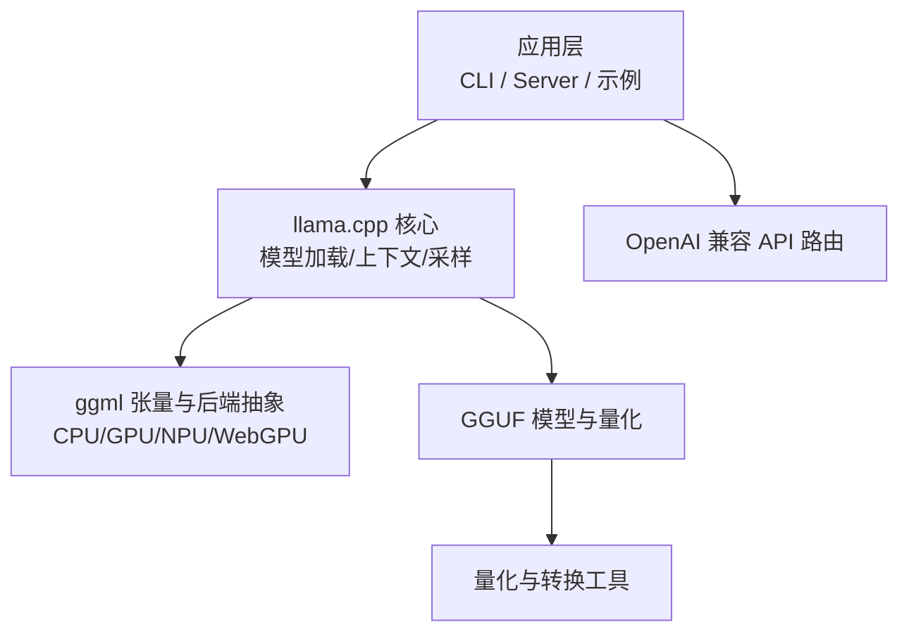
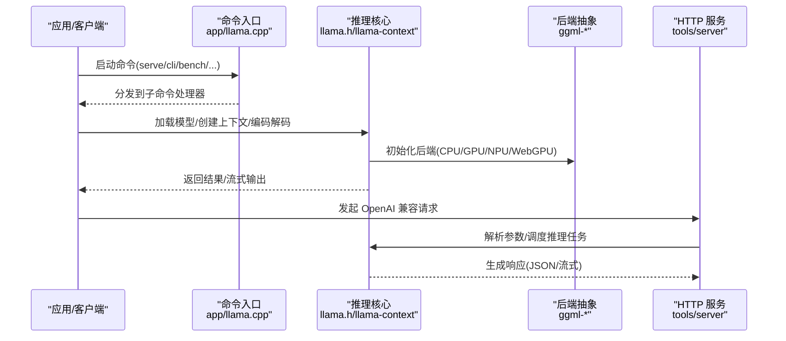
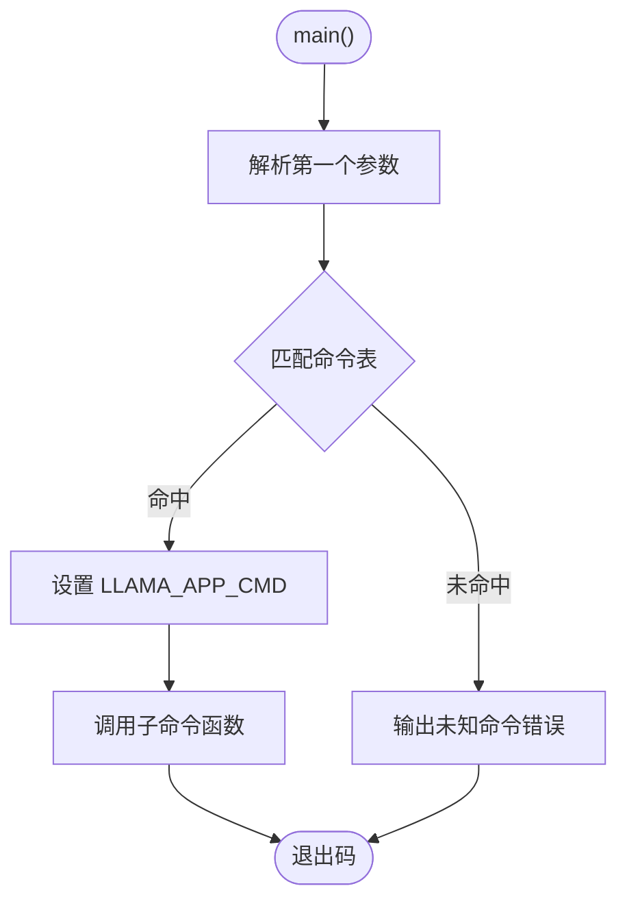
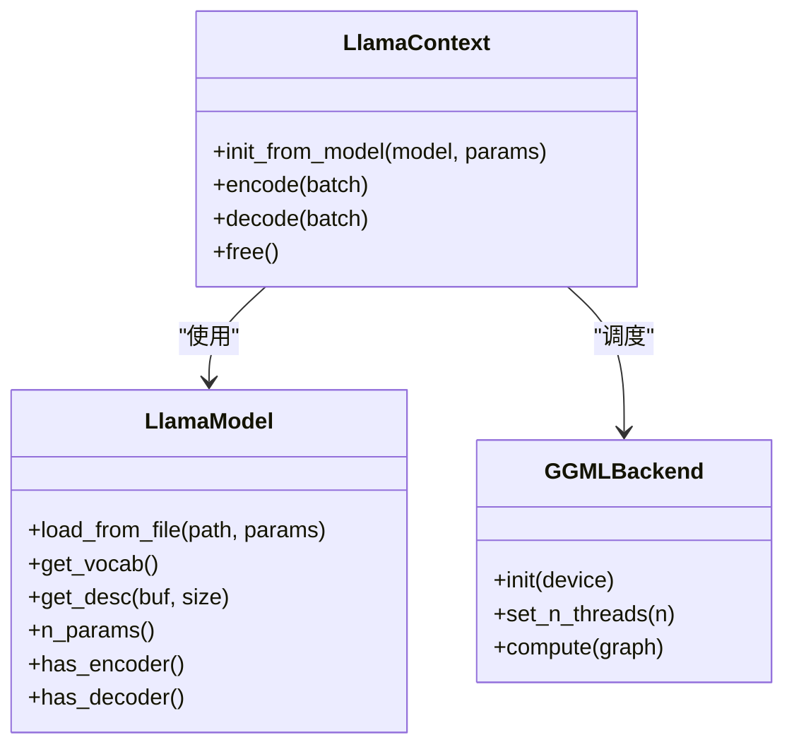
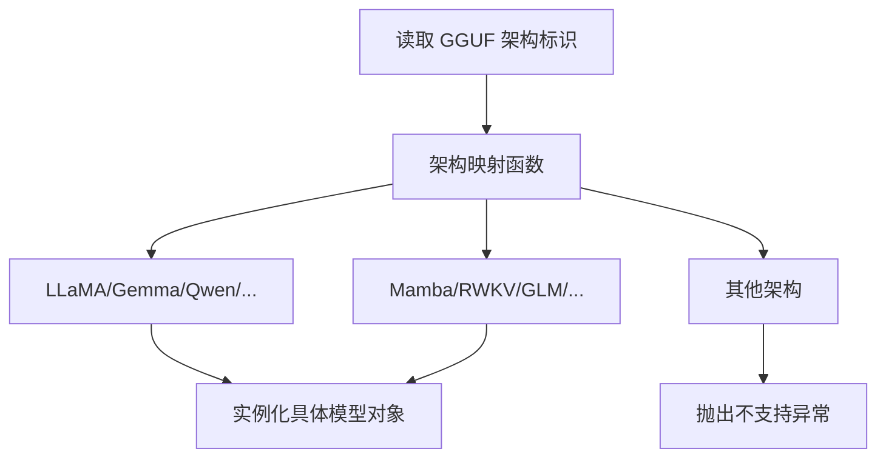
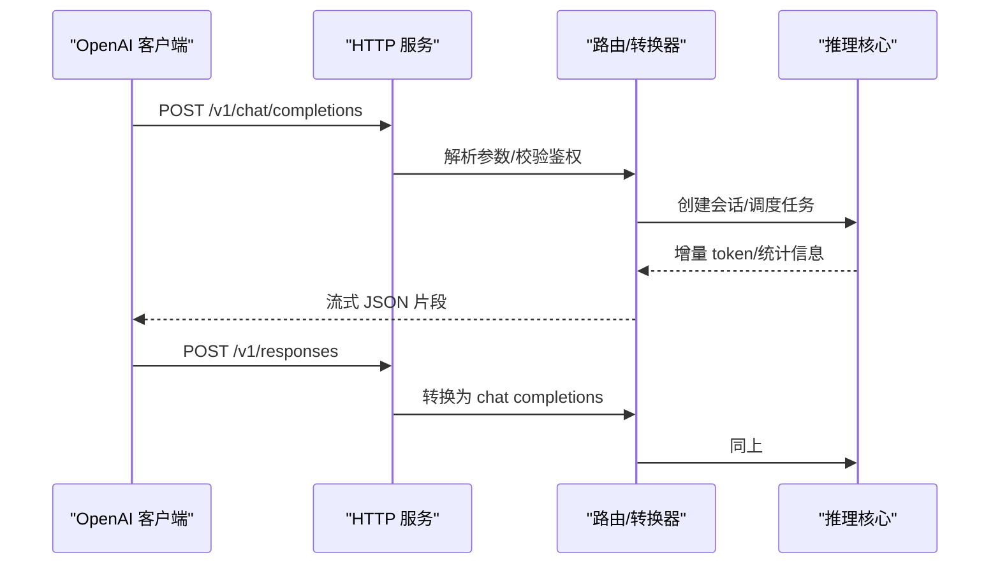
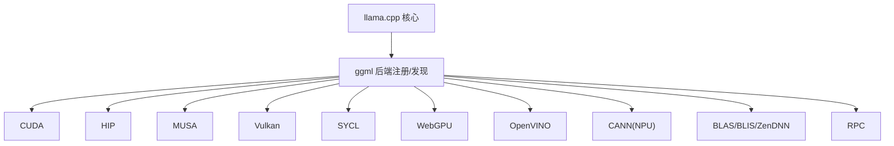
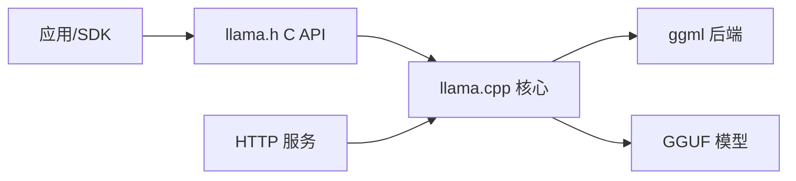
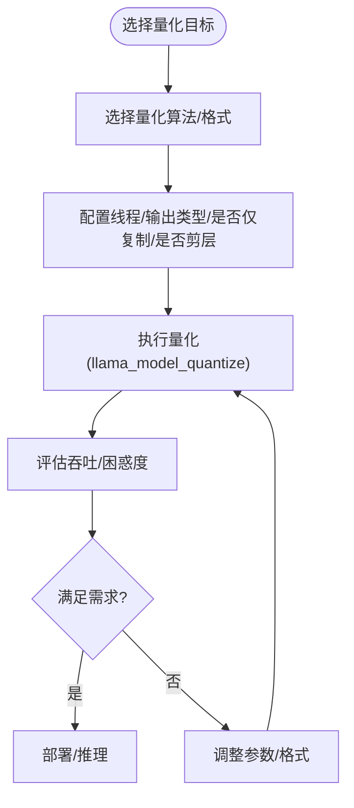

# 项目介绍与特性

<cite>
**本文引用的文件**   
- [README.md](file://README.md)
- [app/llama.cpp](file://app/llama.cpp)
- [include/llama.h](file://include/llama.h)
- [src/llama-model.cpp](file://src/llama-model.cpp)
- [src/llama-context.cpp](file://src/llama-context.cpp)
- [tools/server/README.md](file://tools/server/README.md)
- [tools/server/server-context.cpp](file://tools/server/server-context.cpp)
- [ggml/src/ggml-webgpu/ggml-webgpu.cpp](file://ggml/src/ggml-webgpu/ggml-webgpu.cpp)
- [docs/backend/CANN.md](file://docs/backend/CANN.md)
- [docs/build.md](file://docs/build.md)
- [tools/quantize/README.md](file://tools/quantize/README.md)
- [tools/quantize/quantize.cpp](file://tools/quantize/quantize.cpp)
</cite>

## 目录
1. [引言](#引言)
2. [项目结构](#项目结构)
3. [核心组件](#核心组件)
4. [架构总览](#架构总览)
5. [详细组件分析](#详细组件分析)
6. [依赖关系分析](#依赖关系分析)
7. [性能与量化特性](#性能与量化特性)
8. [故障排查指南](#故障排查指南)
9. [结论](#结论)

## 引言
llama.cpp 是一个以 C/C++ 实现的轻量级、跨平台大型语言模型推理引擎，目标是在尽可能少的依赖和配置下，在多种硬件（CPU/GPU/NPU）上提供高性能的 LLM/VLM 推理能力。其核心价值在于：
- 纯 C/C++ 实现，无外部运行时依赖，便于嵌入到各类应用与系统中
- 对 Apple Silicon 等平台的深度优化（ARM NEON、Accelerate、Metal）
- 支持 x86/RISC-V 等多架构指令集加速
- 丰富的量化格式，显著降低显存占用并提升吞吐
- 多后端加速（CUDA/HIP/MUSA/Vulkan/SYCL/WebGPU/OpenVINO/CANN 等），以及 CPU+GPU 混合推理
- 内置 OpenAI 兼容 API 服务器，便于快速集成现有生态

这些特性使 llama.cpp 在“轻量、高效、广泛兼容”之间取得平衡，既适合本地桌面/移动端部署，也适合云端服务化运行。

**章节来源**
- [README.md:60-96](file://README.md#L60-L96)

## 项目结构
仓库采用分层组织方式，核心库、工具链、示例与文档分离，便于按需构建与扩展：
- include/: 对外 C API 头文件（如 llama.h）
- src/: 核心推理逻辑、模型加载、上下文管理、KV Cache、采样器等
- ggml/: 底层张量计算与后端抽象（CPU/GPU/NPU/WebGPU 等）
- tools/: 命令行工具与服务端（cli、server、quantize、bench 等）
- docs/: 构建、后端、多模态、开发指南
- examples/: 示例程序（简单推理、批处理、并行、TTS 等）
- conversion/: 模型转换脚本（HF→GGUF 等）
- models/templates/: 各模型的聊天模板 Jinja 文件

**图表来源**
- [app/llama.cpp:64-78](file://app/llama.cpp#L64-L78)
- [include/llama.h:480-562](file://include/llama.h#L480-L562)
- [tools/server/README.md:1308-1341](file://tools/server/README.md#L1308-L1341)

**章节来源**
- [app/llama.cpp:64-78](file://app/llama.cpp#L64-L78)
- [include/llama.h:480-562](file://include/llama.h#L480-L562)

## 核心组件
- 命令入口与子命令分发：统一入口将 serve/cli/bench/quantize 等子命令路由到对应实现
- 推理核心：模型加载、上下文创建、批处理、KV Cache、采样器链
- 后端系统：通过 ggml 抽象出 CPU/GPU/NPU/WebGPU 等后端，自动发现与初始化
- API 服务：内置 HTTP 服务，暴露 OpenAI/Anthropic 兼容接口
- 量化与转换：提供多种量化格式与转换工具链

**章节来源**
- [app/llama.cpp:64-78](file://app/llama.cpp#L64-L78)
- [include/llama.h:480-562](file://include/llama.h#L480-L562)
- [src/llama-context.cpp:414-472](file://src/llama-context.cpp#L414-L472)
- [tools/server/README.md:1308-1341](file://tools/server/README.md#L1308-L1341)

## 架构总览
llama.cpp 的推理流程从应用层调用开始，经过命令分发进入核心推理管线，最终由 ggml 后端执行具体算子。API 服务则作为独立入口，将请求转换为内部任务并在同一推理内核中执行。

**图表来源**
- [app/llama.cpp:129-148](file://app/llama.cpp#L129-L148)
- [include/llama.h:480-562](file://include/llama.h#L480-L562)
- [src/llama-context.cpp:414-472](file://src/llama-context.cpp#L414-L472)
- [tools/server/README.md:1308-1341](file://tools/server/README.md#L1308-L1341)

## 详细组件分析

### 命令入口与子命令分发
- 主程序根据第一个参数选择子命令（serve/cli/bench/quantize/perplexity/download/update/version/licenses/help 等）
- 子命令函数指针表集中管理，便于扩展与维护
- Windows 环境下设置环境变量以便子进程正确重入

**图表来源**
- [app/llama.cpp:129-148](file://app/llama.cpp#L129-L148)

**章节来源**
- [app/llama.cpp:64-78](file://app/llama.cpp#L64-L78)
- [app/llama.cpp:129-148](file://app/llama.cpp#L129-L148)

### 推理核心与上下文管理
- 通过 llama_model_load_from_file 加载 GGUF 模型，llama_init_from_model 创建上下文
- 上下文参数控制上下文长度、批大小、线程数、RoPE 缩放、Flash Attention、K/V 缓存类型等
- 后端初始化顺序：优先 GPU 设备，再 ACCEL 设备，最后 CPU；并为每个后端注册线程设置回调

**图表来源**
- [include/llama.h:517-562](file://include/llama.h#L517-L562)
- [src/llama-context.cpp:414-472](file://src/llama-context.cpp#L414-L472)

**章节来源**
- [include/llama.h:320-428](file://include/llama.h#L320-L428)
- [include/llama.h:517-562](file://include/llama.h#L517-L562)
- [src/llama-context.cpp:414-472](file://src/llama-context.cpp#L414-L472)

### 模型架构支持
- 通过统一的架构映射函数，按 GGUF 中的架构标识实例化具体模型类
- 支持大量主流架构（LLaMA、Gemma、Qwen、DeepSeek、Mamba、RWKV、GLM、Phi、StarCoder、Bert 等）
- 新增架构需遵循贡献规范并进行 logits/量化/困惑度/工具链验证

**图表来源**
- [src/llama-model.cpp:43-359](file://src/llama-model.cpp#L43-L359)

**章节来源**
- [src/llama-model.cpp:43-359](file://src/llama-model.cpp#L43-L359)
- [skills/add-new-model/SKILL.md:81-91](file://skills/add-new-model/SKILL.md#L81-L91)

### OpenAI 兼容 API 服务
- 提供 /v1/completions、/v1/chat/completions、/v1/responses、/v1/embeddings 等接口
- 支持流式输出、工具调用、Anthropic 兼容消息接口
- Responses 接口内部会转换为 Chat Completions 进行推理

**图表来源**
- [tools/server/README.md:1308-1341](file://tools/server/README.md#L1308-L1341)
- [tools/server/server-context.cpp:5518-5550](file://tools/server/server-context.cpp#L5518-L5550)

**章节来源**
- [tools/server/README.md:1308-1341](file://tools/server/README.md#L1308-L1341)
- [tools/server/server-context.cpp:5518-5550](file://tools/server/server-context.cpp#L5518-L5550)

### 多硬件后端加速
- 支持 CUDA（NVIDIA）、HIP（AMD）、MUSA（摩尔线程）、Vulkan、SYCL、WebGPU、OpenVINO、CANN（昇腾 NPU）、BLAS/BLIS、ZenDNN、RPC 等
- 可动态加载后端库，同一二进制在不同机器上使用不同 GPU
- WebGPU 后端在浏览器环境中也可运行，具备 f16 与隐式同步能力

**图表来源**
- [docs/backend/CANN.md:73-176](file://docs/backend/CANN.md#L73-L176)
- [ggml/src/ggml-webgpu/ggml-webgpu.cpp:4932-4950](file://ggml/src/ggml-webgpu/ggml-webgpu.cpp#L4932-L4950)
- [docs/build.md:870-877](file://docs/build.md#L870-L877)

**章节来源**
- [README.md:76-96](file://README.md#L76-L96)
- [docs/backend/CANN.md:73-176](file://docs/backend/CANN.md#L73-L176)
- [ggml/src/ggml-webgpu/ggml-webgpu.cpp:4932-4950](file://ggml/src/ggml-webgpu/ggml-webgpu.cpp#L4932-L4950)
- [docs/build.md:870-877](file://docs/build.md#L870-L877)

## 依赖关系分析
- 上层应用通过 llama.h 提供的 C API 与核心交互
- 核心通过 ggml 后端抽象调度具体算子实现
- 模型文件为 GGUF 格式，包含权重、元数据与分词器信息
- 服务端基于 HTTP 协议暴露 REST 接口，内部复用核心推理逻辑

**图表来源**
- [include/llama.h:480-562](file://include/llama.h#L480-L562)
- [tools/server/README.md:1308-1341](file://tools/server/README.md#L1308-L1341)

**章节来源**
- [include/llama.h:480-562](file://include/llama.h#L480-L562)
- [tools/server/README.md:1308-1341](file://tools/server/README.md#L1308-L1341)

## 性能与量化特性
- 量化格式丰富：涵盖 Q2_K/Q3_K/Q4_K/Q5_K/Q6_K/IQ1_S/IQ2_XS/IQ3_XXS/IQ4_NL/TQ1_0/TQ2_0/NVFP4 等，兼顾体积与精度
- 量化评估工具提供 prompt 处理与文本生成的吞吐对比，便于选型
- 可通过 llama_model_quantize 进行量化，支持重要性矩阵、剪层、输出张量量化等选项

**图表来源**
- [include/llama.h:441-458](file://include/llama.h#L441-L458)
- [tools/quantize/README.md:150-177](file://tools/quantize/README.md#L150-L177)
- [tools/quantize/quantize.cpp:50-65](file://tools/quantize/quantize.cpp#L50-L65)

**章节来源**
- [include/llama.h:117-163](file://include/llama.h#L117-L163)
- [include/llama.h:441-458](file://include/llama.h#L441-L458)
- [tools/quantize/README.md:150-177](file://tools/quantize/README.md#L150-L177)
- [tools/quantize/quantize.cpp:50-65](file://tools/quantize/quantize.cpp#L50-L65)

## 故障排查指南
- 后端初始化失败：检查设备枚举与驱动可用性，必要时禁用 GPU 或切换后端
- 上下文溢出警告：当 n_ctx_seq > n_ctx_train 时可能触发训练上下文溢出告警，需调整上下文参数
- API 鉴权失败：确保 Authorization 头携带正确的 API Key，静态资源无需鉴权
- 量化后性能下降：尝试不同量化格式，结合 benchmark 工具对比吞吐与质量

**章节来源**
- [src/llama-context.cpp:414-472](file://src/llama-context.cpp#L414-L472)
- [tools/server/tests/unit/test_security.py:36-47](file://tools/server/tests/unit/test_security.py#L36-L47)

## 结论
llama.cpp 以纯 C/C++ 实现为核心，凭借广泛的模型架构支持、丰富的量化格式、多硬件后端加速与 OpenAI 兼容 API，成为在本地与云端部署 LLM/VLM 的高效选择。其“轻量、高效、广泛兼容”的独特价值，使其既能满足初学者快速上手的需求，也能支撑资深开发者在高并发、低延迟场景下的深度定制与优化。