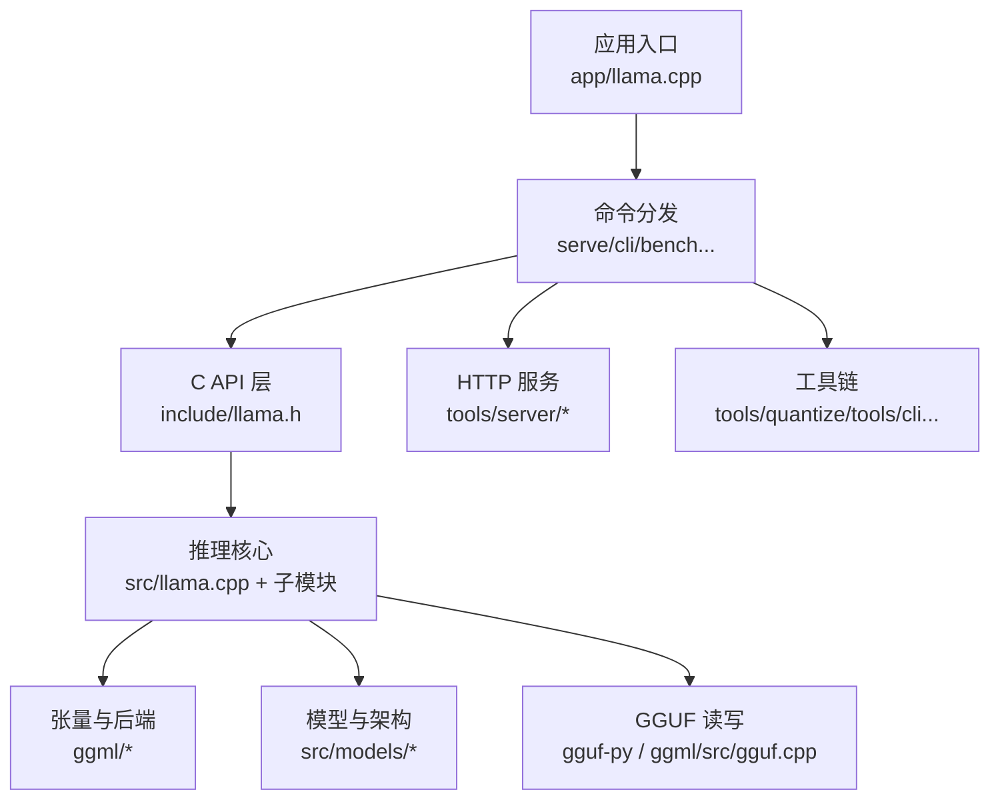
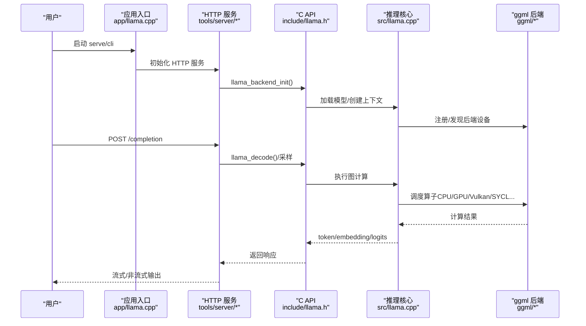
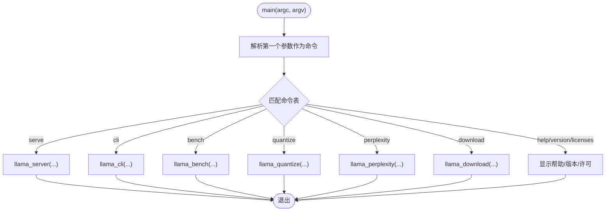
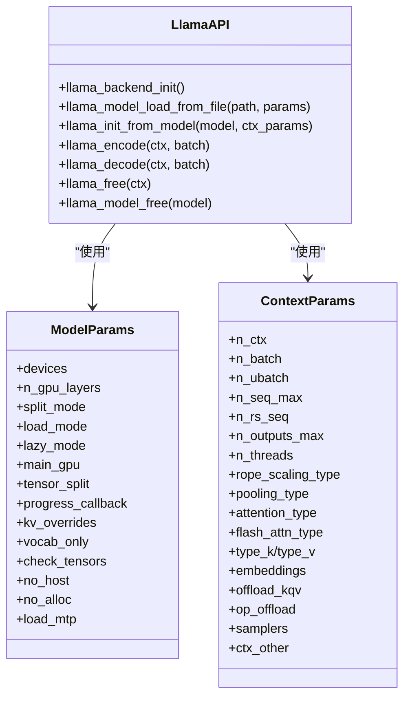
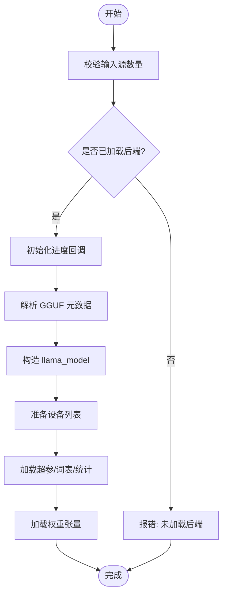
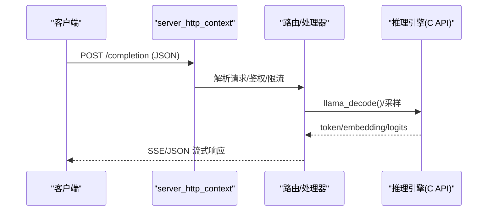
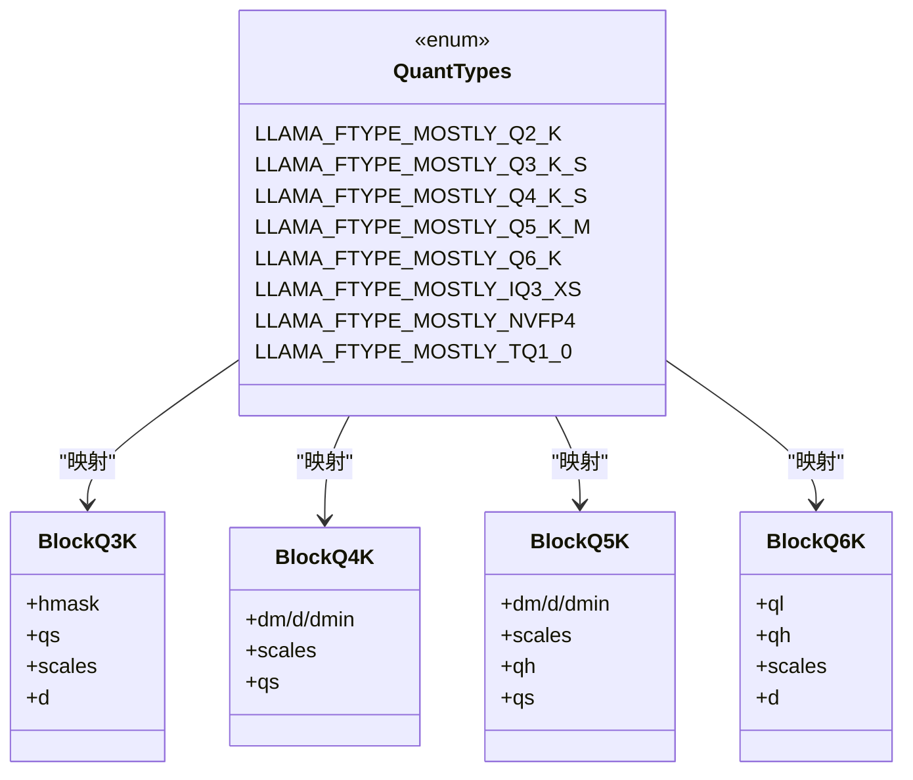
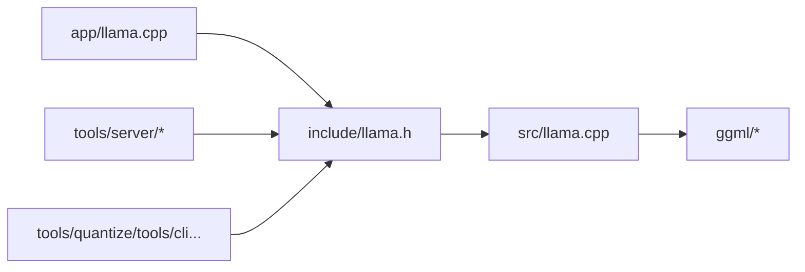

# 项目概述

<cite>
**本文引用的文件**   
- [README.md](file://README.md)
- [include/llama.h](file://include/llama.h)
- [src/llama.cpp](file://src/llama.cpp)
- [app/llama.cpp](file://app/llama.cpp)
- [tools/cli/main.cpp](file://tools/cli/main.cpp)
- [tools/server/server-http.cpp](file://tools/server/server-http.cpp)
- [tools/server/README.md](file://tools/server/README.md)
- [ggml/src/ggml-common.h](file://ggml/src/ggml-common.h)
- [tools/quantize/quantize.cpp](file://tools/quantize/quantize.cpp)
- [tools/quantize/README.md](file://tools/quantize/README.md)
- [conversion/base.py](file://conversion/base.py)
- [docs/build.md](file://docs/build.md)
- [docs/docker.md](file://docs/docker.md)
- [docs/multi-gpu.md](file://docs/multi-gpu.md)
</cite>

## 目录
1. [简介](#简介)
2. [项目结构](#项目结构)
3. [核心组件](#核心组件)
4. [架构总览](#架构总览)
5. [详细组件分析](#详细组件分析)
6. [依赖关系分析](#依赖关系分析)
7. [性能与量化](#性能与量化)
8. [快速开始指南](#快速开始指南)
9. [故障排查](#故障排查)
10. [结论](#结论)

## 简介
llama.cpp 是一个以 C/C++ 实现的轻量级、高性能大语言模型（LLM）推理引擎，目标是“最小化设置、最大化性能”，在多种硬件上提供本地与云端的一体化推理能力。其技术优势包括：
- 纯 C/C++ 实现，无外部运行时依赖
- Apple Silicon 优先优化（ARM NEON、Accelerate、Metal）
- x86 指令集支持（AVX/AVX2/AVX512/AMX），RISC-V 扩展支持
- 多精度整数量化（1.5/2/3/4/5/6/8 bit）以降低显存占用并提升吞吐
- 自定义 CUDA 内核，并通过 HIP/MUSA 兼容 AMD/Moore Threads GPU
- Vulkan/SYCL/WebGPU/OpenVINO/CANN 等后端
- CPU+GPU 混合推理，突破单卡显存限制

项目基于 ggml 张量库构建，提供统一的 C API、命令行工具、OpenAI 兼容的 REST 服务以及丰富的示例与工具链。

**章节来源**
- [README.md:60-96](file://README.md#L60-L96)

## 项目结构
仓库采用分层与模块化组织方式：
- include/: 对外 C API 头文件（llama.h, llama-cpp.h）
- src/: 核心推理逻辑（模型加载、上下文、KV Cache、采样、图执行等）
- ggml/: 底层张量计算与后端抽象（CPU/GPU/Vulkan/SYCL/OpenVINO 等）
- tools/: 工具集（CLI、Server、量化、评测、RPC、UI 等）
- examples/: 示例程序（简单推理、批处理、嵌入、并行、Speculative 等）
- docs/: 文档（构建、后端、多模态、多 GPU、性能调优等）
- conversion/: Python 转换脚本（HF→GGUF 等）
- models/templates/: 对话模板（Jinja）
- grammars/: GBNF 语法约束

**图表来源**
- [app/llama.cpp:64-78](file://app/llama.cpp#L64-L78)
- [include/llama.h:478-562](file://include/llama.h#L478-L562)
- [src/llama.cpp:122-155](file://src/llama.cpp#L122-L155)
- [tools/server/server-http.cpp:19-51](file://tools/server/server-http.cpp#L19-L51)

**章节来源**
- [app/llama.cpp:64-78](file://app/llama.cpp#L64-L78)
- [include/llama.h:478-562](file://include/llama.h#L478-L562)

## 核心组件
- C API 与类型系统：定义模型、上下文、批次、采样器、量化类型、加载模式、设备拆分等关键数据结构与函数。
- 模型加载与设备选择：从 GGUF 解析元数据与权重，自动探测并选择可用设备（CPU/GPU/RPC），支持张量并行与层切分。
- 推理上下文与 KV Cache：管理序列上下文、注意力缓存、RoPE 缩放、Flash Attention、批量解码等。
- 采样与生成：支持 top-k/top-p/min-p/typical/XTC/Mirostat/Dry 等采样策略，可组合为采样链。
- HTTP 服务：基于 cpp-httplib 的 OpenAI 兼容接口，支持流式输出、嵌入、属性查询、工具调用等。
- 工具生态：CLI 交互、量化、困惑度评测、基准测试、RPC 分布式、Web UI。

**章节来源**
- [include/llama.h:117-163](file://include/llama.h#L117-L163)
- [include/llama.h:200-228](file://include/llama.h#L200-L228)
- [include/llama.h:320-428](file://include/llama.h#L320-L428)
- [src/llama.cpp:158-313](file://src/llama.cpp#L158-L313)
- [tools/server/server-http.cpp:19-51](file://tools/server/server-http.cpp#L19-L51)

## 架构总览
下图展示从 CLI/Server 到推理核心的调用路径，以及与 ggml 后端的交互。

**图表来源**
- [app/llama.cpp:129-148](file://app/llama.cpp#L129-L148)
- [tools/server/server-http.cpp:19-51](file://tools/server/server-http.cpp#L19-L51)
- [include/llama.h:478-562](file://include/llama.h#L478-L562)
- [src/llama.cpp:122-155](file://src/llama.cpp#L122-L155)

## 详细组件分析

### 应用入口与命令路由
- app/llama.cpp 提供统一入口 main，根据子命令分发到 serve/cli/bench/quantize/perplexity/download 等。
- 支持自更新（安装版）、版本与许可证查看、帮助信息。

**图表来源**
- [app/llama.cpp:64-78](file://app/llama.cpp#L64-L78)
- [app/llama.cpp:129-148](file://app/llama.cpp#L129-L148)

**章节来源**
- [app/llama.cpp:64-78](file://app/llama.cpp#L64-L78)
- [app/llama.cpp:129-148](file://app/llama.cpp#L129-L148)

### C API 与推理生命周期
- 初始化：llama_backend_init 负责时间初始化、f16 表预热、后端注册。
- 模型加载：llama_model_load_from_file/splits/file_ptr/init_from_user 支持多种输入源；内部通过 llama_model_loader 解析 GGUF，构造 llama_model，并准备设备列表。
- 上下文创建：llama_init_from_model 创建推理上下文，配置 n_ctx/n_batch/n_ubatch/线程数、RoPE/Pooling/Flash Attention 等。
- 推理：llama_encode/llama_decode 配合 llama_batch 进行批次推理；采样由采样链驱动。
- 资源释放：llama_free/llama_model_free/llama_adapter_lora_free。

**图表来源**
- [include/llama.h:478-562](file://include/llama.h#L478-L562)
- [include/llama.h:320-428](file://include/llama.h#L320-L428)
- [src/llama.cpp:122-155](file://src/llama.cpp#L122-L155)

**章节来源**
- [include/llama.h:478-562](file://include/llama.h#L478-L562)
- [include/llama.h:320-428](file://include/llama.h#L320-L428)
- [src/llama.cpp:122-155](file://src/llama.cpp#L122-L155)

### 模型加载与设备选择流程
- 校验输入源（metadata/path/file）唯一性。
- 若未加载后端则报错提示。
- 进度回调默认打印百分比。
- 解析 GGUF -> 构造模型 -> 准备设备列表 -> 加载超参/词表/统计 -> 加载权重。
- 设备选择策略：显式 devices 或自动扫描 GPU/iGPU/RPC，支持张量并行 Meta device。

**图表来源**
- [src/llama.cpp:380-445](file://src/llama.cpp#L380-L445)
- [src/llama.cpp:316-378](file://src/llama.cpp#L316-L378)
- [src/llama.cpp:158-313](file://src/llama.cpp#L158-L313)

**章节来源**
- [src/llama.cpp:380-445](file://src/llama.cpp#L380-L445)
- [src/llama.cpp:316-378](file://src/llama.cpp#L316-L378)
- [src/llama.cpp:158-313](file://src/llama.cpp#L158-L313)

### HTTP 服务与 OpenAI 兼容接口
- 基于 cpp-httplib 的多监听器、线程池任务队列。
- 暴露 /completion、/v1/completions、/embeddings、/props 等端点，支持流式输出与全局属性控制。
- 内置 Web UI，支持多模态与模型能力检测。

**图表来源**
- [tools/server/server-http.cpp:19-51](file://tools/server/server-http.cpp#L19-L51)
- [tools/server/README.md:833-949](file://tools/server/README.md#L833-L949)

**章节来源**
- [tools/server/server-http.cpp:19-51](file://tools/server/server-http.cpp#L19-L51)
- [tools/server/README.md:833-949](file://tools/server/README.md#L833-L949)

### 量化与格式
- 支持多种量化类型（Q2_K/Q3_K/Q4_K/Q5_K/Q6_K/IQ系列/NVFP4/TQ 等），对应不同位宽与质量/速度权衡。
- ggml 内部定义了 Q3_K/Q4_K/Q5_K/Q6_K 等块结构，用于高效反量化与计算。
- quantize 工具提供 dry_run、只复制、保持分片、重要性矩阵等选项。

**图表来源**
- [include/llama.h:117-163](file://include/llama.h#L117-L163)
- [ggml/src/ggml-common.h:311-368](file://ggml/src/ggml-common.h#L311-L368)
- [tools/quantize/quantize.cpp:50-65](file://tools/quantize/quantize.cpp#L50-L65)

**章节来源**
- [include/llama.h:117-163](file://include/llama.h#L117-L163)
- [ggml/src/ggml-common.h:311-368](file://ggml/src/ggml-common.h#L311-L368)
- [tools/quantize/quantize.cpp:50-65](file://tools/quantize/quantize.cpp#L50-L65)
- [tools/quantize/README.md:150-177](file://tools/quantize/README.md#L150-L177)

### 与其他 LLM 框架的区别与独特价值
- 零依赖、跨平台、极致便携：纯 C/C++，无需 Python 运行时即可运行推理与服务。
- 广泛的后端覆盖：CUDA/HIP/MUSA/Vulkan/SYCL/OpenVINO/CANN/WebGPU/OpenCL/Metal 等，适配多厂商硬件。
- 灵活的量化体系：从 1.5bit 到 8bit，兼顾体积与质量，便于边缘与移动端部署。
- 一体化工具链：CLI、Server、量化、评测、RPC、Web UI 开箱即用。
- 对 Apple Silicon 的深度优化：NEON/Accelerate/Metal 原生加速。
- 开源协议与社区活跃：MIT 许可，持续迭代与贡献者生态。

[本节为概念性总结，不直接分析具体文件]

## 依赖关系分析
- 上层应用（app/llama.cpp）依赖 C API（include/llama.h）。
- C API 封装推理核心（src/llama.cpp）与模型/上下文/采样等子系统。
- 推理核心依赖 ggml 张量库与后端抽象（ggml/*），通过后端注册机制动态发现设备。
- HTTP 服务依赖 cpp-httplib，并与 C API 交互完成推理。
- 工具链（quantize/cli/bench/perplexity）复用 C API 与 common 组件。

**图表来源**
- [app/llama.cpp:64-78](file://app/llama.cpp#L64-L78)
- [include/llama.h:478-562](file://include/llama.h#L478-L562)
- [src/llama.cpp:122-155](file://src/llama.cpp#L122-L155)
- [tools/server/server-http.cpp:19-51](file://tools/server/server-http.cpp#L19-L51)

**章节来源**
- [app/llama.cpp:64-78](file://app/llama.cpp#L64-L78)
- [include/llama.h:478-562](file://include/llama.h#L478-L562)
- [src/llama.cpp:122-155](file://src/llama.cpp#L122-L155)
- [tools/server/server-http.cpp:19-51](file://tools/server/server-http.cpp#L19-L51)

## 性能与量化
- 量化类型与位宽直接影响模型大小与吞吐。例如 Q4_K_M 在速度与质量之间取得良好平衡，IQ 系列在更低位宽下仍保持较高质量。
- 量化评估工具提供 prompt processing t/s 与 text generation t/s 指标，便于对比不同量化方案。
- NVFP4 等新格式在特定硬件上有额外优化路径（如压缩张量格式）。

**章节来源**
- [tools/quantize/README.md:150-177](file://tools/quantize/README.md#L150-L177)
- [conversion/base.py:1139-1162](file://conversion/base.py#L1139-L1162)

## 快速开始指南

### 环境要求
- 操作系统：Linux/macOS/Windows
- 编译器：GCC/Clang/MSVC（依据平台）
- 可选后端：CUDA/HIP/MUSA/Vulkan/SYCL/OpenVINO/CANN/WebGPU/OpenCL/Metal（按需启用）
- Docker 镜像与预编译二进制可从发行页获取

**章节来源**
- [README.md:20-45](file://README.md#L20-L45)
- [docs/build.md](file://docs/build.md)
- [docs/docker.md](file://docs/docker.md)

### 基本安装步骤
- 一键安装：curl/powershell 脚本
- 访问 https://llama.app 按指引安装
- 使用 Docker：参考 docs/docker.md
- 下载预编译二进制：releases 页面
- 源码构建：参考 docs/build.md

**章节来源**
- [README.md:20-45](file://README.md#L20-L45)
- [docs/docker.md](file://docs/docker.md)
- [docs/build.md](file://docs/build.md)

### 第一个推理示例
- 直接从 Hugging Face 下载并运行模型：
  - llama cli -hf ggml-org/Qwen3.5-0.8B-GGUF
- 启动 OpenAI 兼容 API 服务：
  - llama serve -hf ggml-org/Qwen3.5-0.8B-GGUF

**章节来源**
- [README.md:37-45](file://README.md#L37-L45)

## 故障排查
- 模型加载失败：检查后端是否已加载（ggml_backend_load_all），确认 GGUF 文件完整与路径正确。
- 设备选择异常：确认 split_mode 与 main_gpu 配置，避免重复设备 ID；必要时禁用 RPC 或 iGPU 干扰。
- 性能不达预期：调整 n_ctx/n_batch/n_ubatch、RoPE 缩放、Flash Attention、采样策略；参考性能调优文档。
- HTTP 服务端口冲突：修改监听地址/端口，或使用 --host/--port 参数。

**章节来源**
- [src/llama.cpp:407-410](file://src/llama.cpp#L407-L410)
- [src/llama.cpp:158-313](file://src/llama.cpp#L158-L313)
- [docs/multi-gpu.md](file://docs/multi-gpu.md)

## 结论
llama.cpp 以极简依赖、广泛后端支持与丰富工具链，为 LLM 推理提供了高可移植性与高性能的实现。无论是本地桌面、服务器还是边缘设备，均可通过统一的 C API 与工具链快速落地。结合多样化量化与硬件后端，开发者可在质量、速度与资源占用之间灵活权衡，满足生产环境的多样化需求。

[本节为总结性内容，不直接分析具体文件]