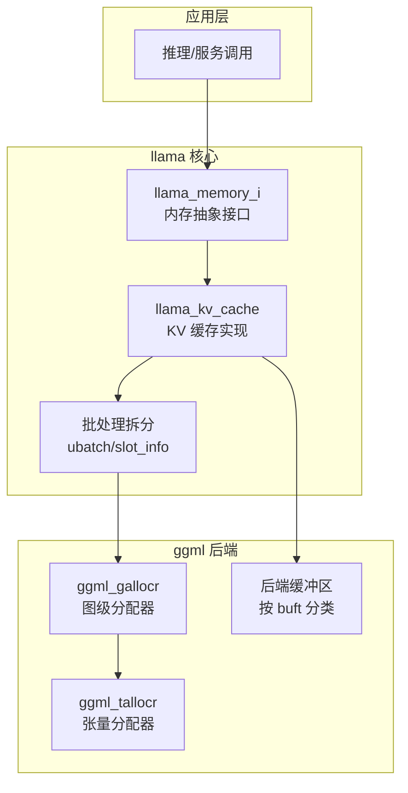
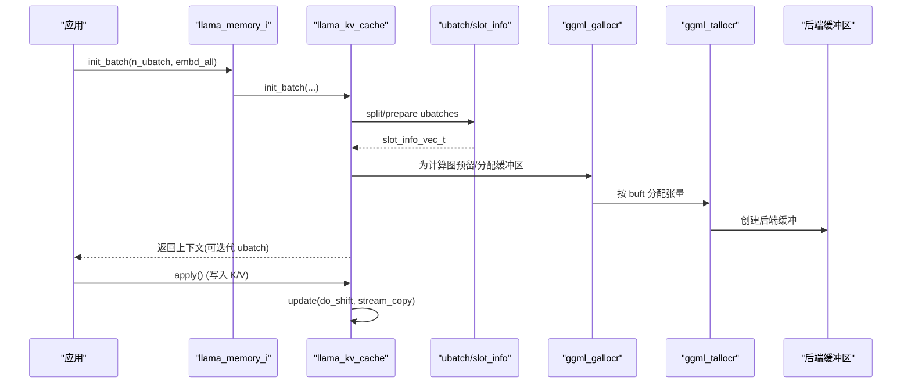
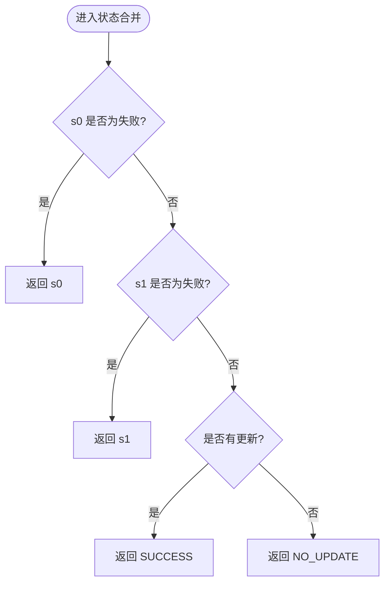
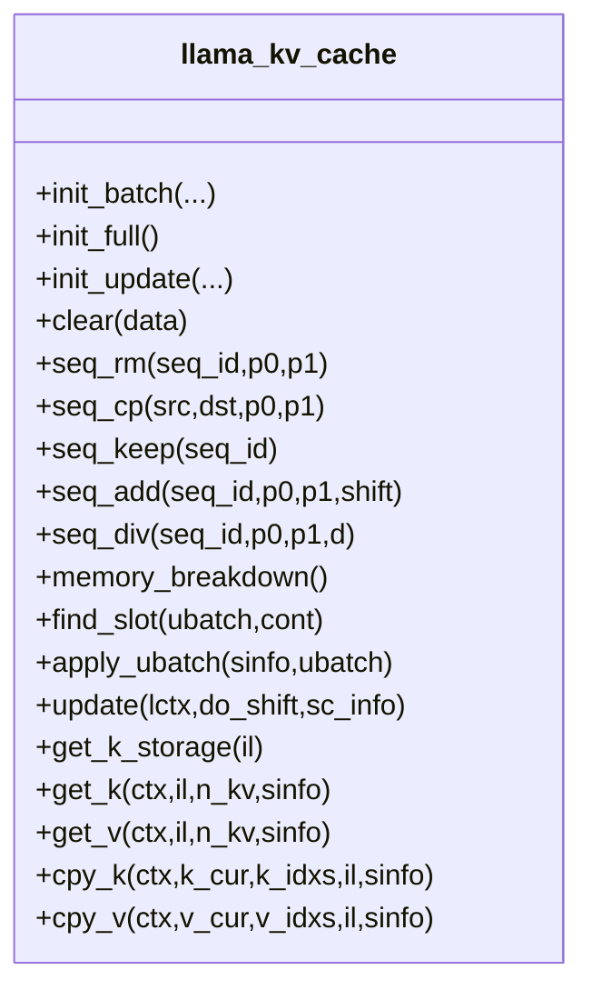
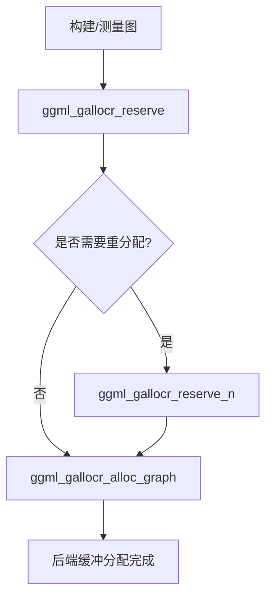
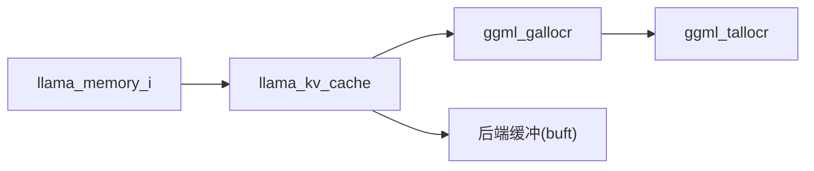

# 内存管理优化

<cite>
**本文引用的文件**   
- [README.md](file://README.md)
- [llama-memory.h](file://src/llama-memory.h)
- [llama-memory.cpp](file://src/llama-memory.cpp)
- [llama-kv-cache.h](file://src/llama-kv-cache.h)
- [llama-kv-cache.cpp](file://src/llama-kv-cache.cpp)
- [ggml-alloc.h](file://ggml/include/ggml-alloc.h)
</cite>

## 目录
1. [简介](#简介)
2. [项目结构](#项目结构)
3. [核心组件](#核心组件)
4. [架构总览](#架构总览)
5. [详细组件分析](#详细组件分析)
6. [依赖关系分析](#依赖关系分析)
7. [性能与带宽优化](#性能与带宽优化)
8. [故障排查指南](#故障排查指南)
9. [结论](#结论)
10. [附录](#附录)

## 简介
本技术文档聚焦 llama.cpp 的内存管理优化，围绕以下主题展开：
- 自定义分配器、垃圾回收机制与内存池技术
- KV 缓存的动态分配、替换策略与碎片整理
- 量化格式对内存使用的影响
- 内存带宽优化最佳实践
- 生产环境中的内存监控与调优方法

llama.cpp 基于 ggml 后端抽象，通过统一的内存接口与图级分配器实现跨设备（CPU/GPU/NPU）的高效内存管理与计算调度。KV 缓存采用“流式分片 + 环形槽位”的设计，结合 SWA（滑动窗口注意力）掩码与 K-shift 机制，在长上下文场景下显著降低内存占用并提升吞吐。

## 项目结构
与内存管理直接相关的代码主要分布在以下模块：
- src/llama-memory.*：LLM 内存抽象接口与状态合并工具
- src/llama-kv-cache.*：KV 缓存实现（含 slot 查找、更新、K-shift、流拷贝等）
- ggml/include/ggml-alloc.h：ggml 张量/图级分配器 API
- README.md：项目概览与特性说明

图表来源
- [llama-memory.h:17-131](file://src/llama-memory.h#L17-L131)
- [llama-kv-cache.h:20-357](file://src/llama-kv-cache.h#L20-L357)
- [ggml-alloc.h:14-83](file://ggml/include/ggml-alloc.h#L14-L83)

章节来源
- [README.md:60-74](file://README.md#L60-L74)

## 核心组件
- llama_memory_i / llama_memory_context_i：统一 LLM 内存抽象，定义批处理初始化、全缓存模拟、更新准备、序列操作、状态读写与内存统计等能力。
- llama_kv_cache：具体 KV 缓存实现，负责 K/V 张量布局、流（stream）划分、槽位查找与复用、SWA 掩码、K-shift、跨流拷贝、状态持久化等。
- ggml_tallocr / ggml_gallocr：底层张量与计算图的分配器，支持多后端缓冲区分配、预分配与自动重分配。

章节来源
- [llama-memory.h:17-131](file://src/llama-memory.h#L17-L131)
- [llama-kv-cache.h:20-357](file://src/llama-kv-cache.h#L20-L357)
- [ggml-alloc.h:14-83](file://ggml/include/ggml-alloc.h#L14-L83)

## 架构总览
下图展示从上层批处理到 KV 缓存再到 ggml 分配器的完整数据与控制流。

图表来源
- [llama-kv-cache.cpp:724-769](file://src/llama-kv-cache.cpp#L724-L769)
- [llama-kv-cache.cpp:837-916](file://src/llama-kv-cache.cpp#L837-L916)
- [ggml-alloc.h:48-74](file://ggml/include/ggml-alloc.h#L48-L74)

## 详细组件分析

### 内存抽象与状态管理（llama_memory_*）
- 设计要点
  - 通过 llama_memory_i 暴露统一的内存生命周期与操作语义，屏蔽不同缓存实现的差异。
  - llama_memory_status 提供组合与失败判定工具，便于混合内存类型（如 iSWA）的状态聚合。
  - 提供 state_write/state_read 接口，用于序列化/反序列化缓存状态；同时支持仅遍历 buffer 而不拷贝数据的统计模式。

- 关键流程
  - 状态合并：将两个子上下文的状态合并，任一失败即整体失败；否则若存在更新则返回成功，否则无更新。
  - Buffer 收集：通过自定义 writer 遍历状态写入路径，收集所有被访问的后端 buffer，便于外部统计或迁移。

图表来源
- [llama-memory.cpp:9-48](file://src/llama-memory.cpp#L9-L48)

章节来源
- [llama-memory.h:17-131](file://src/llama-memory.h#L17-L131)
- [llama-memory.cpp:9-93](file://src/llama-memory.cpp#L9-L93)

### KV 缓存（llama_kv_cache）
- 数据结构与布局
  - 每层维护 K/V 张量，支持按流（stream）切分视图；当启用 unified 时仅一个流，否则每个序列映射到一个流。
  - v_cells 以环形槽位存储 KV 单元，配合 v_heads 指针加速空闲槽查找。
  - 支持 V 转置与非转置两种布局，适配是否启用 Flash Attention。

- 动态分配与容量规划
  - 构造阶段按 hparams 与 offload/unified 参数决定 K/V 张量的设备与维度，并通过 ggml_backend_alloc_ctx_tensors_from_buft 一次性分配后端缓冲。
  - 支持 no_alloc 模式（仅估算大小），便于离线评估模型与上下文内存。

- 槽位查找与替换策略
  - find_slot：优先从当前 head 向后扫描，必要时回绕至开头；支持连续槽位与离散槽位两种模式；考虑 SWA 掩码允许覆盖历史位置。
  - apply_ubatch：写入新槽位，清理被覆盖的历史位置，保证每个序列的 [pos_min, pos_max] 连续性不变。

- 更新与 K-shift
  - update：可选执行跨流 KV 拷贝（seq_cp 延迟提交），以及根据 RoPE 配置生成并执行 K-shift 图，移动 K 值以对齐相对位置。
  - get_can_shift：依据模型架构与 n_pos_per_embd 判断是否支持 K-shift。

- 内存统计与可视化
  - memory_breakdown：按后端缓冲类型汇总已分配或预估的 KV 缓存大小。

图表来源
- [llama-kv-cache.h:20-357](file://src/llama-kv-cache.h#L20-L357)

章节来源
- [llama-kv-cache.h:20-357](file://src/llama-kv-cache.h#L20-L357)
- [llama-kv-cache.cpp:65-389](file://src/llama-kv-cache.cpp#L65-L389)
- [llama-kv-cache.cpp:391-402](file://src/llama-kv-cache.cpp#L391-L402)
- [llama-kv-cache.cpp:404-679](file://src/llama-kv-cache.cpp#L404-L679)
- [llama-kv-cache.cpp:707-769](file://src/llama-kv-cache.cpp#L707-L769)
- [llama-kv-cache.cpp:771-835](file://src/llama-kv-cache.cpp#L771-L835)
- [llama-kv-cache.cpp:837-916](file://src/llama-kv-cache.cpp#L837-L916)
- [llama-kv-cache.cpp:918-1208](file://src/llama-kv-cache.cpp#L918-L1208)
- [llama-kv-cache.cpp:1221-1296](file://src/llama-kv-cache.cpp#L1221-L1296)
- [llama-kv-cache.cpp:1298-1439](file://src/llama-kv-cache.cpp#L1298-L1439)

### ggml 分配器（ggml_tallocr / ggml_gallocr）
- 张量分配器（ggml_tallocr）
  - 针对单一后端缓冲进行线性偏移分配，适合简单场景。
- 图级分配器（ggml_gallocr）
  - 支持多后端缓冲（n_backends），先通过 measure graph 预分配，再在拓扑变化时自动重分配。
  - 提供 reserve/reserve_n_size/n 等接口，便于在构建图前确定各缓冲大小，避免运行时频繁扩容。

图表来源
- [ggml-alloc.h:24-74](file://ggml/include/ggml-alloc.h#L24-L74)

章节来源
- [ggml-alloc.h:14-83](file://ggml/include/ggml-alloc.h#L14-L83)

## 依赖关系分析
- llama_kv_cache 依赖 ggml 后端缓冲类型（buft）进行设备相关分配；通过 ggml_backend_alloc_ctx_tensors_from_buft 批量分配张量缓冲。
- llama_memory_i 作为抽象层，解耦了上层批处理逻辑与具体缓存实现。
- ggml_gallocr 与 ggml_tallocr 为底层分配基础设施，被 KV 缓存与图构建过程间接使用。

图表来源
- [llama-kv-cache.cpp:277-295](file://src/llama-kv-cache.cpp#L277-L295)
- [ggml-alloc.h:48-83](file://ggml/include/ggml-alloc.h#L48-L83)

章节来源
- [llama-kv-cache.cpp:277-295](file://src/llama-kv-cache.cpp#L277-L295)
- [ggml-alloc.h:48-83](file://ggml/include/ggml-alloc.h#L48-L83)

## 性能与带宽优化
- KV 缓存布局优化
  - 非 FA 场景下 V 转置布局可减少行索引计算开销；FA 场景下非转置布局更利于并行 tile 读取。
  - 通过 get_n_kv 对 n_kv 进行最小 padding（≥256），有助于后端算子稳定性能。
- 槽位查找与碎片整理
  - find_slot 优先利用 head 附近空闲区域，减少跨区扫描；SWA 掩码允许覆盖旧位置，提高空间利用率。
  - apply_ubatch 在覆盖历史位置后主动清理 [pos_min, seq_pos_max] 区间，维持序列连续性，避免无效访问。
- K-shift 与 RoPE
  - 在需要时通过图计算移动 K 值，避免物理搬移大量数据；仅在支持且必要条件下启用。
- 量化格式影响
  - K/V 缓存数据类型由 type_k/type_v 控制，量化类型越小，缓存体积越低，但可能带来额外解码开销。
  - 可通过环境变量关闭注意力旋转（LLAMA_ATTN_ROT_DISABLE）以规避某些量化下的旋转矩阵开销。
- 带宽优化建议
  - 尽量保持 k/v 写入索引连续（cont=true），减少 scatter/gather 开销。
  - 合理设置 kv_size 与 n_seq_max，避免频繁扩容与跨流拷贝。
  - 使用 ggml_gallocr.reserve 预分配，减少运行时重分配带来的带宽抖动。

章节来源
- [llama-kv-cache.cpp:1282-1296](file://src/llama-kv-cache.cpp#L1282-L1296)
- [llama-kv-cache.cpp:918-1208](file://src/llama-kv-cache.cpp#L918-L1208)
- [llama-kv-cache.cpp:837-916](file://src/llama-kv-cache.cpp#L837-L916)
- [llama-kv-cache.cpp:315-364](file://src/llama-kv-cache.cpp#L315-L364)

## 故障排查指南
- 常见问题定位
  - 槽位不足：find_slot 返回空表示无法为 ubatch 找到合适槽位，需检查 kv_size 与 n_seq_max 是否过小。
  - 跨流拷贝失败：update 中 sc_info 为空或流号越界会触发断言，确认 seq_cp 的参数与流映射是否正确。
  - K-shift 不支持：get_can_shift 返回 false 时不应尝试 shift，检查模型架构与 n_pos_per_embd。
- 调试开关
  - 环境变量 LLAMA_KV_CACHE_DEBUG 可输出详细的槽位与位置信息，辅助定位碎片与覆盖问题。
  - 环境变量 LLAMA_ATTN_ROT_DISABLE 可禁用注意力旋转，便于隔离旋转相关开销。
- 内存泄漏检测
  - 使用 llama_memory_get_buffers 收集状态写入过程中访问的所有后端 buffer，结合外部工具（如 Valgrind/ASan）跟踪未释放对象。
  - 在 no_alloc 模式下，memory_breakdown 返回的是预估大小，可用于对比实际分配差异。

章节来源
- [llama-kv-cache.cpp:918-1115](file://src/llama-kv-cache.cpp#L918-L1115)
- [llama-kv-cache.cpp:837-916](file://src/llama-kv-cache.cpp#L837-L916)
- [llama-kv-cache.cpp:1210-1219](file://src/llama-kv-cache.cpp#L1210-L1219)
- [llama-kv-cache.cpp:387-389](file://src/llama-kv-cache.cpp#L387-L389)
- [llama-memory.cpp:67-93](file://src/llama-memory.cpp#L67-L93)
- [llama-kv-cache.cpp:707-722](file://src/llama-kv-cache.cpp#L707-L722)

## 结论
llama.cpp 的内存管理以 llama_memory_i 抽象为核心，结合 llama_kv_cache 的具体实现与 ggml 分配器，形成高效、可扩展的 KV 缓存体系。通过流式分片、环形槽位、SWA 掩码与 K-shift 等机制，系统在长上下文与高并发场景下实现了低内存占用与高吞吐。在生产环境中，建议结合 memory_breakdown 与环境变量进行精细化调优，并借助外部工具进行内存泄漏检测与性能剖析。

## 附录
- 环境变量
  - LLAMA_ATTN_ROT_DISABLE：禁用注意力旋转，适用于某些量化场景以降低开销。
  - LLAMA_KV_CACHE_DEBUG：开启 KV 缓存调试日志，输出槽位与位置信息。
- 关键 API 参考
  - llama_memory_status_combine / llama_memory_status_is_fail：状态合并与失败判定。
  - llama_kv_cache::find_slot / apply_ubatch / update：槽位查找、写入与更新。
  - ggml_gallocr_reserve / ggml_gallocr_alloc_graph：图级分配器预分配与分配。

章节来源
- [llama-memory.cpp:9-65](file://src/llama-memory.cpp#L9-L65)
- [llama-kv-cache.cpp:918-1208](file://src/llama-kv-cache.cpp#L918-L1208)
- [ggml-alloc.h:48-74](file://ggml/include/ggml-alloc.h#L48-L74)