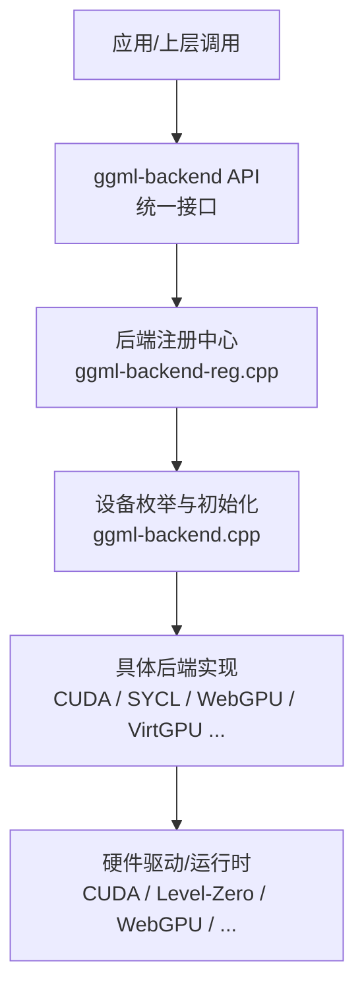
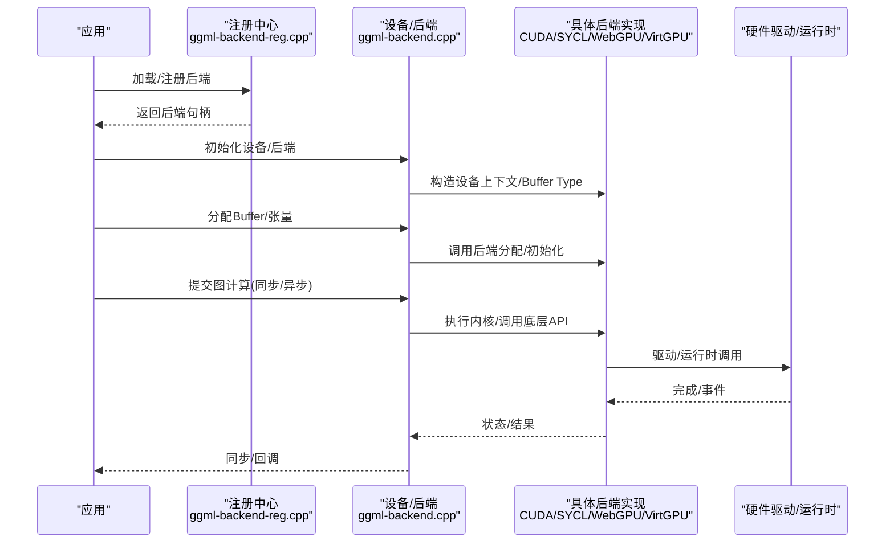
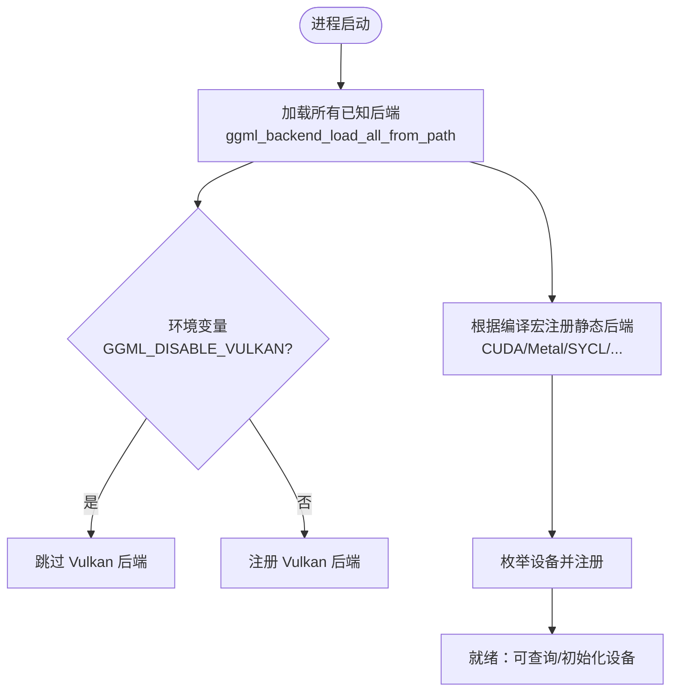
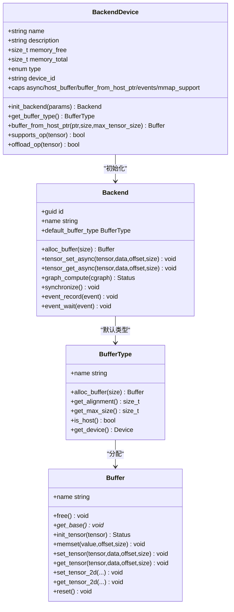
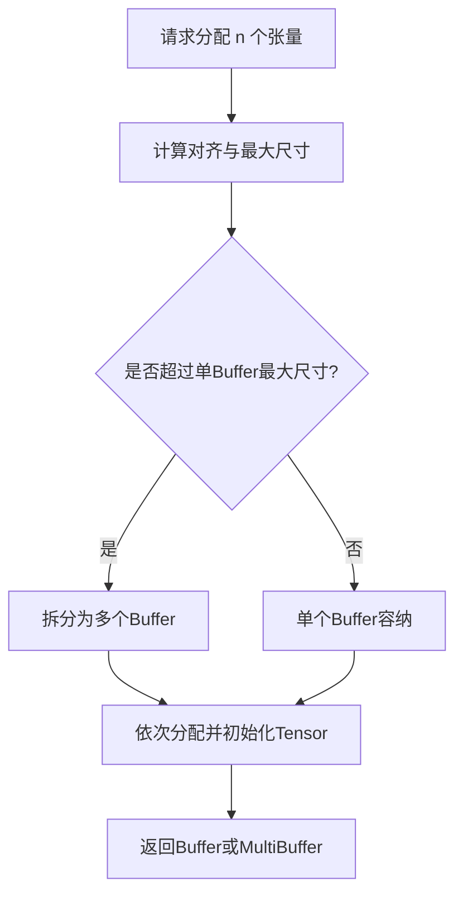
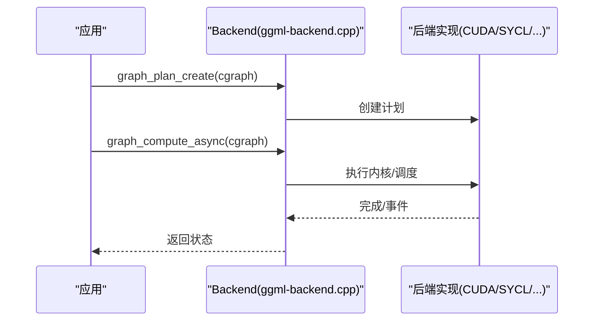
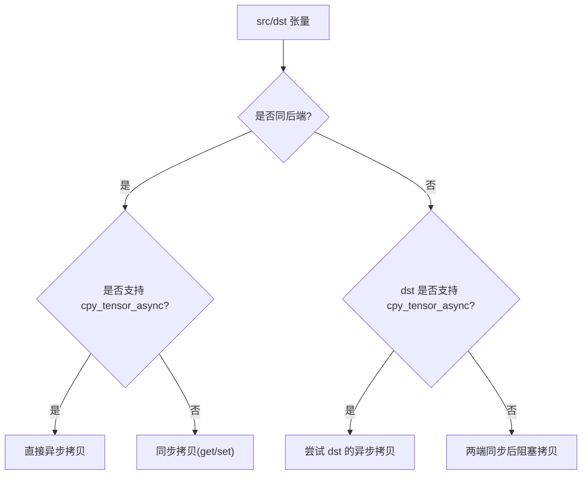
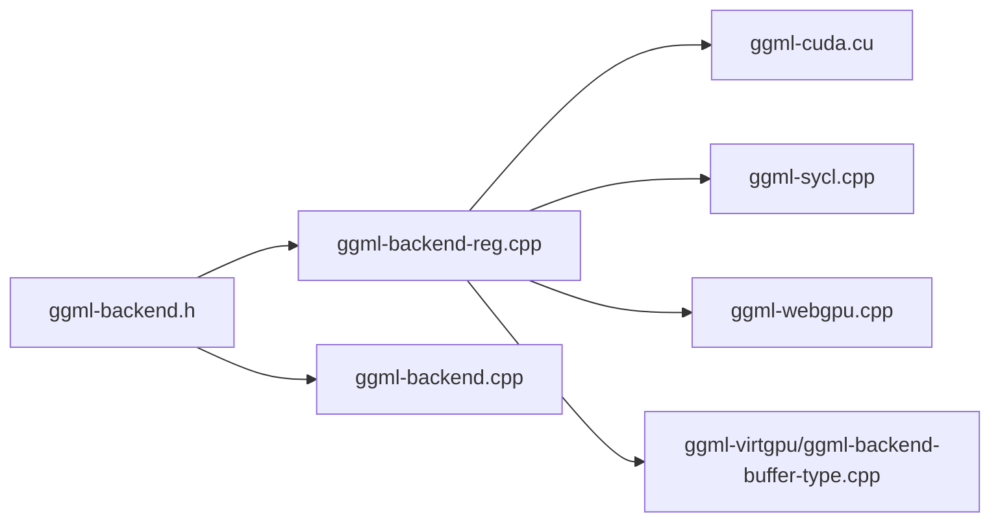

# 后端扩展开发

<cite>
**本文引用的文件**   
- [ggml-backend.h](file://ggml/include/ggml-backend.h)
- [ggml-backend-reg.cpp](file://ggml/src/ggml-backend-reg.cpp)
- [ggml-backend.cpp](file://ggml/src/ggml-backend.cpp)
- [ggml-backend-impl.h](file://ggml/src/ggml-backend-impl.h)
- [ggml-cuda.cu](file://ggml/src/ggml-cuda/ggml-cuda.cu)
- [ggml-webgpu.cpp](file://ggml/src/ggml-webgpu/ggml-webgpu.cpp)
- [ggml-sycl.cpp](file://ggml/src/ggml-sycl/ggml-sycl.cpp)
- [ggml-backend-buffer-type.cpp](file://ggml/src/ggml-virtgpu/ggml-backend-buffer-type.cpp)
- [SYCL.md](file://docs/backend/SYCL.md)
- [CUDA-FEDORA.md](file://docs/backend/CUDA-FEDORA.md)
</cite>

## 目录
1. [引言](#引言)
2. [项目结构](#项目结构)
3. [核心组件](#核心组件)
4. [架构总览](#架构总览)
5. [详细组件分析](#详细组件分析)
6. [依赖关系分析](#依赖关系分析)
7. [性能与优化](#性能与优化)
8. [故障排查指南](#故障排查指南)
9. [结论](#结论)
10. [附录](#附录)

## 引言
本文件面向硬件后端扩展开发者，系统性说明如何在 llama.cpp/ggml 中实现新的硬件后端（如 GPU、NPU 或其他加速设备）。内容涵盖：
- 后端注册机制与设备发现流程
- 内存管理接口（Buffer/Buffer Type/Tensor）
- 算子映射与执行路径（图计算、异步拷贝、事件同步）
- 并行策略（张量并行、层并行）与通信原语
- SIMD/GEMM 优化思路、内存访问模式与带宽利用
- 性能分析与调试技巧

## 项目结构
ggml 的后端抽象位于 ggml/include/ggml-backend.h，具体实现分布在 ggml/src 下的各后端目录（如 CUDA、SYCL、WebGPU、VirtGPU 等），并通过统一的注册与调度机制集成。

图示来源
- [ggml-backend.h:230-263](file://ggml/include/ggml-backend.h#L230-L263)
- [ggml-backend-reg.cpp:115-174](file://ggml/src/ggml-backend-reg.cpp#L115-L174)
- [ggml-backend.cpp:717-791](file://ggml/src/ggml-backend.cpp#L717-L791)

章节来源
- [ggml-backend.h:230-263](file://ggml/include/ggml-backend.h#L230-L263)
- [ggml-backend-reg.cpp:115-174](file://ggml/src/ggml-backend-reg.cpp#L115-L174)

## 核心组件
- 后端注册与设备枚举
  - 通过 ggml_backend_register 将后端注册到全局注册表；支持动态加载 .so/.dll 后端库。
  - 提供按名称/类型查找设备、按名称/类型初始化后端的便捷函数。
- 设备与后端对象
  - 设备（ggml_backend_dev_t）描述硬件能力、内存属性、支持的 Buffer Type 等。
  - 后端（ggml_backend_t）封装流式执行、张量读写、图计算、事件同步等。
- Buffer/Buffer Type/Tensor
  - Buffer Type 定义分配策略、对齐、最大尺寸、是否主机内存等。
  - Buffer 是实际分配的内存块，提供 set/get/memset/copy 等数据访问接口。
  - Tensor 在 Buffer 上布局，支持视图（view）和跨后端拷贝。
- 图计算与调度
  - 支持图计划创建/执行、异步执行、回调与重分配。
  - 多后端调度器负责张量放置、跨后端拷贝与切分。

章节来源
- [ggml-backend.h:24-31](file://ggml/include/ggml-backend.h#L24-L31)
- [ggml-backend.h:37-70](file://ggml/include/ggml-backend.h#L37-L70)
- [ggml-backend.h:79-120](file://ggml/include/ggml-backend.h#L79-L120)
- [ggml-backend.h:136-196](file://ggml/include/ggml-backend.h#L136-L196)
- [ggml-backend.h:230-263](file://ggml/include/ggml-backend.h#L230-L263)
- [ggml-backend.h:268-379](file://ggml/include/ggml-backend.h#L268-L379)
- [ggml-backend-impl.h:46-63](file://ggml/src/ggml-backend-impl.h#L46-L63)

## 架构总览
下图展示了从应用到硬件驱动的完整链路，包括后端注册、设备发现、Buffer 分配、图计算与异步拷贝。

图示来源
- [ggml-backend-reg.cpp:220-264](file://ggml/src/ggml-backend-reg.cpp#L220-L264)
- [ggml-backend.cpp:750-791](file://ggml/src/ggml-backend.cpp#L750-L791)
- [ggml-cuda.cu:6072-6151](file://ggml/src/ggml-cuda/ggml-cuda.cu#L6072-L6151)
- [ggml-webgpu.cpp:3947-3964](file://ggml/src/ggml-webgpu/ggml-webgpu.cpp#L3947-L3964)

## 详细组件分析

### 后端注册与设备发现
- 静态编译后端：在构建时通过宏开关（如 GGML_USE_CUDA）在构造函数中注册后端。
- 动态加载后端：通过 ggml_backend_load/ggml_backend_load_all_from_path 扫描并加载符合命名规范的动态库，调用库内 ggml_backend_init 获取注册信息。
- 设备枚举：每个后端在其 reg 接口中暴露设备数量与设备对象；注册中心维护全局设备列表，支持按名称/类型查询。

图示来源
- [ggml-backend-reg.cpp:115-174](file://ggml/src/ggml-backend-reg.cpp#L115-L174)
- [ggml-backend-reg.cpp:567-598](file://ggml/src/ggml-backend-reg.cpp#L567-L598)

章节来源
- [ggml-backend-reg.cpp:115-174](file://ggml/src/ggml-backend-reg.cpp#L115-L174)
- [ggml-backend-reg.cpp:220-264](file://ggml/src/ggml-backend-reg.cpp#L220-L264)
- [ggml-backend-reg.cpp:335-390](file://ggml/src/ggml-backend-reg.cpp#L335-L390)

### 设备与后端对象模型
- 设备属性：名称、描述、内存大小、类型（CPU/GPU/IGPU/ACCEL/META）、PCI ID、能力位（异步、pinned host buffer、host ptr、events、mmap）。
- 后端对象：GUID、名称、默认 Buffer Type、张量读写（同步/异步）、图计划与执行、事件、设备指针。
- Buffer/Buffer Type：名称、分配/释放、基址、对齐、最大尺寸、是否主机内存、使用标记（权重/计算）。

图示来源
- [ggml-backend.h:136-196](file://ggml/include/ggml-backend.h#L136-L196)
- [ggml-backend.h:79-120](file://ggml/include/ggml-backend.h#L79-L120)
- [ggml-backend.h:37-70](file://ggml/include/ggml-backend.h#L37-L70)
- [ggml-backend-impl.h:46-63](file://ggml/src/ggml-backend-impl.h#L46-L63)

章节来源
- [ggml-backend.h:79-120](file://ggml/include/ggml-backend.h#L79-L120)
- [ggml-backend.h:136-196](file://ggml/include/ggml-backend.h#L136-L196)
- [ggml-backend.h:37-70](file://ggml/include/ggml-backend.h#L37-L70)
- [ggml-backend-impl.h:46-63](file://ggml/src/ggml-backend-impl.h#L46-L63)

### 内存管理与 Buffer 分配
- Buffer Type 分配策略：支持批量分配（alloc_buffer_n）以合并多个张量的连续内存，减少碎片与分配开销。
- 对齐与最大尺寸：由后端声明，用于规划张量布局与避免越界。
- 主机内存与设备内存：is_host 区分；部分后端支持从主机指针创建 Buffer（buffer_from_host_ptr）。
- 使用标记：权重（WEIGHTS）与计算（COMPUTE）影响调度与放置策略。

图示来源
- [ggml-backend.cpp:48-178](file://ggml/src/ggml-backend.cpp#L48-L178)
- [ggml-backend.h:37-70](file://ggml/include/ggml-backend.h#L37-L70)

章节来源
- [ggml-backend.cpp:48-178](file://ggml/src/ggml-backend.cpp#L48-L178)
- [ggml-backend.h:37-70](file://ggml/include/ggml-backend.h#L37-L70)

### 算子映射与图执行
- 图计划：后端可为图创建计划对象，支持预分配与复用。
- 执行入口：同步/异步图计算接口；内部会委托给后端 iface.graph_compute。
- 优化：后端可实现 graph_optimize 进行节点融合、重排等优化。
- 回调：评估回调允许用户观察中间节点，便于调试与分析。

图示来源
- [ggml-backend.cpp:574-604](file://ggml/src/ggml-backend.cpp#L574-L604)
- [ggml-backend.h:102-107](file://ggml/include/ggml-backend.h#L102-L107)

章节来源
- [ggml-backend.cpp:574-604](file://ggml/src/ggml-backend.cpp#L574-L604)
- [ggml-backend.h:102-107](file://ggml/include/ggml-backend.h#L102-L107)

### 异步拷贝与事件同步
- 张量拷贝：优先走后端专用 cpy_tensor/cpy_tensor_async；否则回退为 get/set。
- 事件：设备侧事件记录/等待/同步，用于细粒度流水线控制。
- 跨后端拷贝：自动选择最优路径，必要时先同步两端再阻塞拷贝。

图示来源
- [ggml-backend.cpp:628-670](file://ggml/src/ggml-backend.cpp#L628-L670)
- [ggml-backend.h:114-130](file://ggml/include/ggml-backend.h#L114-L130)

章节来源
- [ggml-backend.cpp:628-670](file://ggml/src/ggml-backend.cpp#L628-L670)
- [ggml-backend.h:114-130](file://ggml/include/ggml-backend.h#L114-L130)

### 典型后端实现要点

#### CUDA 后端
- 注册：遍历物理/虚拟设备，构造设备对象与后端注册接口，导出 ggml_backend_cuda_reg。
- 初始化：按设备索引创建后端上下文，绑定设备与接口。
- 特性：PCI Bus ID、最小 offload batch、虚拟设备标识处理。

章节来源
- [ggml-cuda.cu:6072-6151](file://ggml/src/ggml-cuda/ggml-cuda.cu#L6072-L6151)

#### WebGPU 后端
- Buffer 分配：基于 wgpu::Buffer 创建存储缓冲，设置 Usage 标志（Storage/CopySrc/CopyDst）。
- 命名与计数：为每个 Buffer 生成唯一名称，便于调试。

章节来源
- [ggml-webgpu.cpp:3947-3964](file://ggml/src/ggml-webgpu/ggml-webgpu.cpp#L3947-L3964)

#### VirtGPU 后端（远程/虚拟化）
- Buffer 分配：根据设备能力选择从主机指针创建或远端分配；缓存 apir_context 与 base 指针。
- 适配：通过 remoting 接口桥接本地 ggml Buffer 与远端资源。

章节来源
- [ggml-backend-buffer-type.cpp:1-32](file://ggml/src/ggml-virtgpu/ggml-backend-buffer-type.cpp#L1-L32)

#### SYCL 后端（张量并行）
- 通信入口：通过 meta backend 调用 comm_init/allreduce_tensor/free。
- 小/大数据路径：小张量走 FP32 直拷+ADD；大数据走 BF16 压缩传输以降低 PCIe 带宽压力。
- 持久缓冲区：每设备保留 uint8_t 缓冲区，按元素数复用。

章节来源
- [ggml-sycl.cpp:7311-7336](file://ggml/src/ggml-sycl/ggml-sycl.cpp#L7311-L7336)

## 依赖关系分析
- 头文件依赖：ggml-backend.h 定义公共 API；ggml-backend-impl.h 定义内部结构与版本常量。
- 运行时依赖：各后端依赖各自运行时（CUDA Runtime、Level-Zero、WebGPU、OpenCL 等）。
- 构建期依赖：CMake 宏控制后端启用；动态加载依赖系统 dlopen/LoadLibrary。

图示来源
- [ggml-backend.h:1-31](file://ggml/include/ggml-backend.h#L1-L31)
- [ggml-backend-reg.cpp:29-91](file://ggml/src/ggml-backend-reg.cpp#L29-L91)

章节来源
- [ggml-backend.h:1-31](file://ggml/include/ggml-backend.h#L1-L31)
- [ggml-backend-reg.cpp:29-91](file://ggml/src/ggml-backend-reg.cpp#L29-L91)

## 性能与优化
- SIMD/GEMM 优化
  - 针对量化数据类型（如 Q4_K/Q5_K/Q6_K/Q8_0）进行 reorder 与向量点积优化，提升吞吐。
  - 使用专用 MMA/矩阵乘内核（如 CUDA mmq/mmf/mmvq）与 tile 化访存。
- 并行计算策略
  - 层并行（split-mode layer）与张量并行（split-mode tensor）结合 Flash Attention 降低显存占用并提升吞吐。
  - 多设备 all-reduce 优化：小数据直拷+逐设备 ADD，大数据 BF16 压缩传输。
- 内存访问模式
  - 对齐与连续分配：通过 Buffer Type 的对齐与最大尺寸规划，减少碎片与跨页访问。
  - 主机/设备内存分离：权重常驻设备内存，激活缓冲按需映射/卸载（参考 Hexagon/NPU 滑动窗口）。
- 工具与环境
  - SYCL：oneAPI/Level-Zero 设备选择、FP16/FP32 精度权衡、GRAPH 扩展。
  - CUDA：Fedora 环境安装与容器化部署、nvcc 验证。

章节来源
- [SYCL.md:53-100](file://docs/backend/SYCL.md#L53-L100)
- [SYCL.md:777-800](file://docs/backend/SYCL.md#L777-L800)
- [CUDA-FEDORA.md:234-284](file://docs/backend/CUDA-FEDORA.md#L234-L284)

## 故障排查指南
- 后端加载失败
  - 检查动态库路径与命名规范（libggml-*.so/*.dll），确认 ggml_backend_score 与 ggml_backend_init 符号存在。
  - 查看日志输出（DEBUG/INFO/ERROR）定位缺失依赖或版本不匹配。
- 设备不可用
  - 确认驱动与运行时已正确安装（CUDA nvcc、oneAPI sycl-ls）。
  - 检查环境变量（如 ONEAPI_DEVICE_SELECTOR、GGML_DISABLE_VULKAN）。
- 内存不足
  - 调整 split-mode（layer/tensor）与 flash-attn 开关；监控设备内存使用。
  - 对 NPU/GPU 采用滑动窗口映射/卸载策略，减少峰值内存。
- 性能异常
  - 对比 FP16/FP32 精度与性能差异；开启后端特定优化（如 oneDNN、GRAPH）。
  - 使用测试用例（test-backend-ops）与示例脚本逐步验证算子与设备。

章节来源
- [ggml-backend-reg.cpp:220-264](file://ggml/src/ggml-backend-reg.cpp#L220-L264)
- [SYCL.md:168-223](file://docs/backend/SYCL.md#L168-L223)
- [CUDA-FEDORA.md:234-284](file://docs/backend/CUDA-FEDORA.md#L234-L284)

## 结论
通过 ggml 的统一后端抽象，开发者可以以较低成本接入新硬件平台。关键在于：
- 正确实现设备与后端接口，提供稳定的 Buffer/Buffer Type/Tensor 语义
- 完善注册与设备发现，确保被调度器识别
- 优化内存分配与访存模式，结合 SIMD/GEMM 内核提升吞吐
- 利用异步拷贝与事件机制构建高效流水线
- 借助文档与工具链（oneAPI、CUDA）进行环境与性能调优

## 附录
- 快速上手
  - 构建与运行 SYCL 后端：参考 examples/sycl 脚本与文档。
  - 配置 CUDA 环境：参考 Fedora 安装指南与容器方案。
- 常用命令
  - 列出 SYCL 设备：./build/bin/llama-ls-sycl-device
  - 运行测试：./build/bin/test-backend-ops -b SYCL0
  - 服务启动：./examples/sycl/start-svr.sh -m PATH/MODEL_FILE

章节来源
- [SYCL.md:168-223](file://docs/backend/SYCL.md#L168-L223)
- [CUDA-FEDORA.md:234-284](file://docs/backend/CUDA-FEDORA.md#L234-L284)