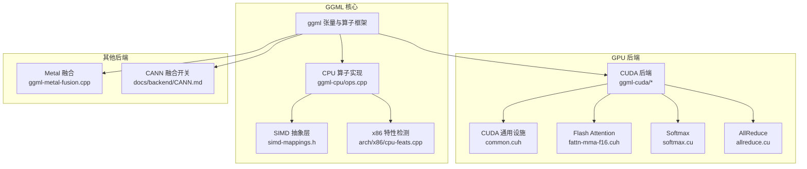
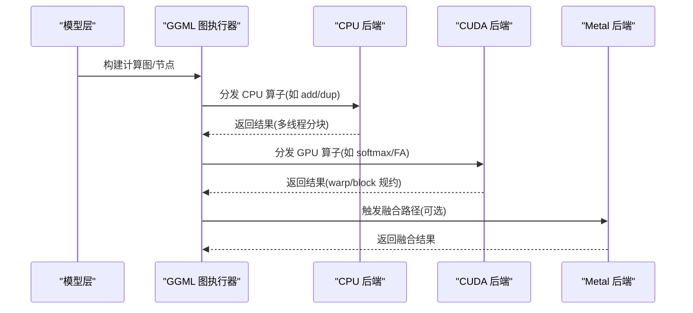
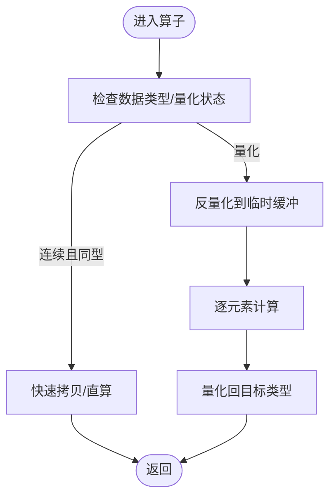
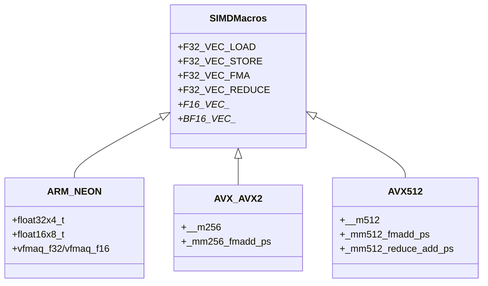
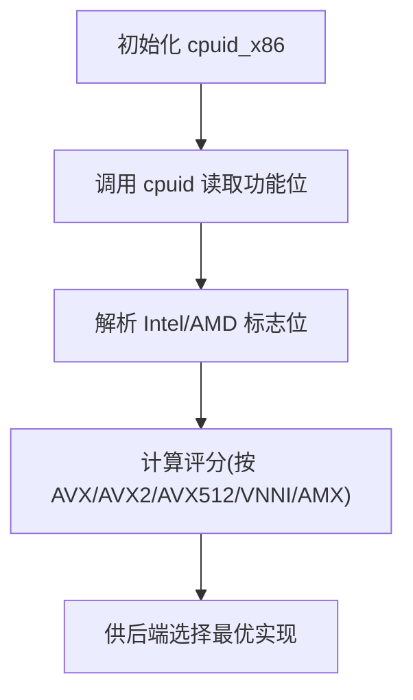
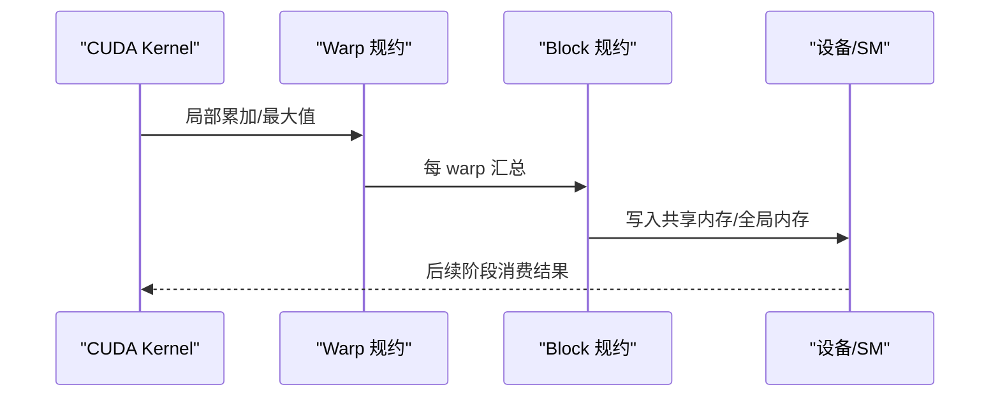
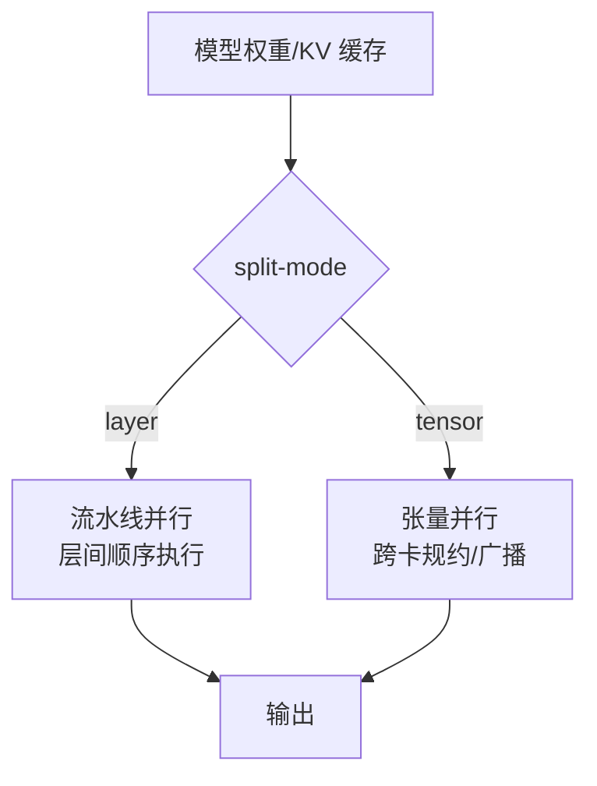
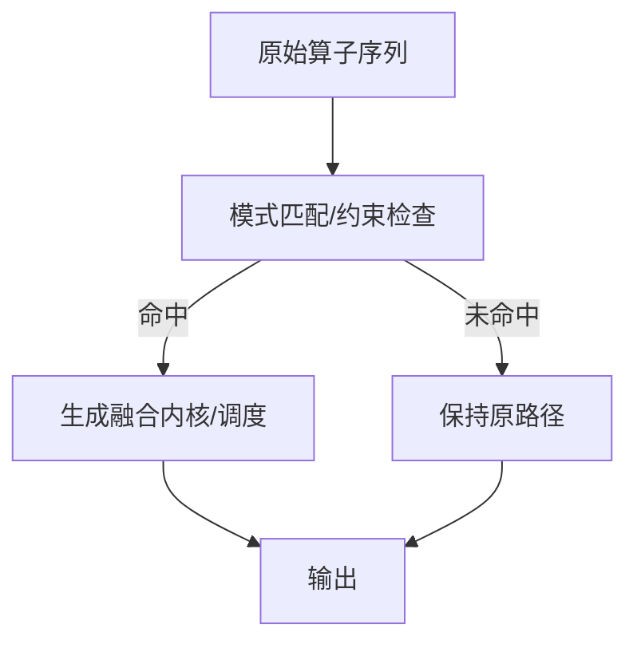
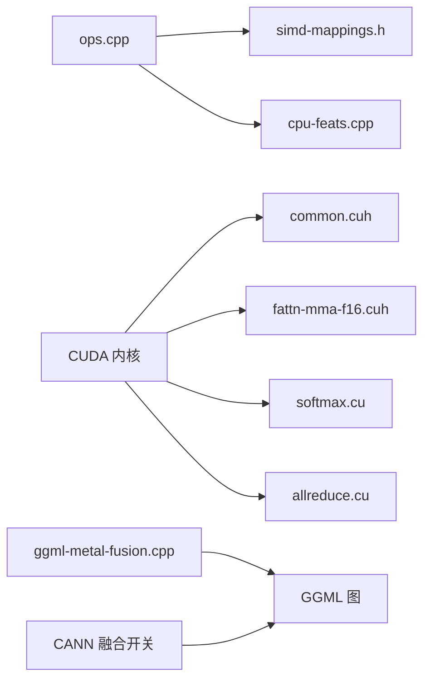
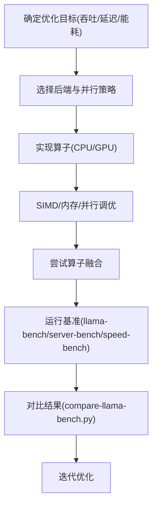

# 算子开发与优化

<cite>
**本文引用的文件**   
- [README.md](file://README.md)
- [ops.md](file://docs/ops.md)
- [ggml-cpu/ops.cpp](file://ggml/src/ggml-cpu/ops.cpp)
- [ggml-cpu/simd-mappings.h](file://ggml/src/ggml-cpu/simd-mappings.h)
- [ggml-cpu/arch/x86/cpu-feats.cpp](file://ggml/src/ggml-cpu/arch/x86/cpu-feats.cpp)
- [ggml-cuda/common.cuh](file://ggml/src/ggml-cuda/common.cuh)
- [ggml-cuda/fattn-mma-f16.cuh](file://ggml/src/ggml-cuda/fattn-mma-f16.cuh)
- [ggml-cuda/allreduce.cu](file://ggml/src/ggml-cuda/allreduce.cu)
- [ggml-cuda/softmax.cu](file://ggml/src/ggml-cuda/softmax.cu)
- [ggml-metal/ggml-metal-fusion.cpp](file://ggml/src/ggml-metal/ggml-metal-fusion.cpp)
- [multi-gpu.md](file://docs/multi-gpu.md)
- [CANN.md](file://docs/backend/CANN.md)
- [run.py](file://scripts/snapdragon/run.py)
- [speed-bench README.md](file://tools/server/bench/speed-bench/README.md)
- [llama-bench README.md](file://tools/llama-bench/README.md)
- [server-bench README.md](file://tools/server/bench/README.md)
- [compare-llama-bench.py](file://scripts/compare-llama-bench.py)
</cite>

## 目录
1. [简介](#简介)
2. [项目结构](#项目结构)
3. [核心组件](#核心组件)
4. [架构总览](#架构总览)
5. [详细组件分析](#详细组件分析)
6. [依赖关系分析](#依赖关系分析)
7. [性能考量与基准测试](#性能考量与基准测试)
8. [故障排查指南](#故障排查指南)
9. [结论](#结论)

## 简介
本指南面向希望在 llama.cpp/ggml 中开发并优化自定义张量算子的工程师，覆盖从 CPU/GPU 实现、SIMD 指令优化（AVX2/AVX512/ARM NEON）、并行计算策略（多线程、GPU 并行、内存访问优化）、算子融合与内核优化技巧，到性能基准与调优工具的全流程。文档以仓库现有实现为依据，提供可操作的步骤、图示与参考路径，帮助你在不同后端上高效落地新算子。

## 项目结构
- ggml 是底层张量与算子库，按后端划分：CPU、CUDA/HIP/MUSA、Metal、SYCL、Vulkan、OpenCL、ZenDNN 等。
- CPU 端通过 simd-mappings.h 统一抽象 SIMD 向量接口，并在 ops.cpp 中实现具体算子前向逻辑；x86 特性检测在 arch/x86/cpu-feats.cpp 中完成。
- GPU 端 CUDA 代码集中在 ggml-cuda，包含大量算子内核与通用设施（common.cuh），以及 Flash Attention、Softmax、AllReduce 等关键路径。
- Metal/SYCL/Vulkan 等后端各自提供算子与融合支持。
- 文档与工具：docs/ops.md 维护算子-后端支持矩阵；tools/llama-bench、tools/server/bench 提供性能基准；scripts/compare-llama-bench.py 用于对比结果可视化。

**图表来源** 
- [ggml-cpu/ops.cpp:1-800](file://ggml/src/ggml-cpu/ops.cpp#L1-L800)
- [ggml-cpu/simd-mappings.h:171-800](file://ggml/src/ggml-cpu/simd-mappings.h#L171-L800)
- [ggml-cpu/arch/x86/cpu-feats.cpp:263-327](file://ggml/src/ggml-cpu/arch/x86/cpu-feats.cpp#L263-L327)
- [ggml-cuda/common.cuh:1-120](file://ggml/src/ggml-cuda/common.cuh#L1-L120)
- [ggml-cuda/fattn-mma-f16.cuh:1588-1624](file://ggml/src/ggml-cuda/fattn-mma-f16.cuh#L1588-L1624)
- [ggml-cuda/softmax.cu:345-359](file://ggml/src/ggml-cuda/softmax.cu#L345-L359)
- [ggml-cuda/allreduce.cu:1-38](file://ggml/src/ggml-cuda/allreduce.cu#L1-L38)
- [ggml-metal/ggml-metal-fusion.cpp:401-434](file://ggml/src/ggml-metal/ggml-metal-fusion.cpp#L401-L434)
- [CANN.md:355-358](file://docs/backend/CANN.md#L355-L358)

**章节来源**
- [README.md:60-97](file://README.md#L60-L97)
- [ops.md:1-134](file://docs/ops.md#L1-L134)

## 核心组件
- CPU 算子调度与实现：ops.cpp 提供 dup/add/add_id 等算子的线程分块、类型转换与量化路径。
- SIMD 抽象：simd-mappings.h 为 ARM NEON、SVE、AVX/AVX2/AVX512、POWER9、WASM 等定义统一的 F32/F16/BF16 向量操作宏。
- x86 特性检测：cpu-feats.cpp 通过 cpuid 探测 AVX/AVX2/AVX512/VNNI/AMX 等能力，并给出评分。
- CUDA 通用设施：common.cuh 定义设备能力判断、warp/block 规约、dp4a、half/half2 运算、共享内存限制等。
- Flash Attention：fattn-mma-f16.cuh 使用 MMA/Tensor Core 进行稳定 softmax 的跨 warp 规约。
- Softmax：softmax.cu 根据共享内存大小与设备能力选择并行策略。
- AllReduce：allreduce.cu 针对 PCIe/NVLink/xGMI 等不同互联提供内核或拷贝引擎路径。
- Metal 融合：ggml-metal-fusion.cpp 对 softmax+argsort+get_rows 等序列进行融合匹配。
- CANN 融合：CANN.md 提供 GGML_CANN_OPERATOR_FUSION 开关。

**章节来源**
- [ggml-cpu/ops.cpp:1-800](file://ggml/src/ggml-cpu/ops.cpp#L1-L800)
- [ggml-cpu/simd-mappings.h:171-800](file://ggml/src/ggml-cpu/simd-mappings.h#L171-L800)
- [ggml-cpu/arch/x86/cpu-feats.cpp:263-327](file://ggml/src/ggml-cpu/arch/x86/cpu-feats.cpp#L263-L327)
- [ggml-cuda/common.cuh:128-144](file://ggml/src/ggml-cuda/common.cuh#L128-L144)
- [ggml-cuda/fattn-mma-f16.cuh:1588-1624](file://ggml/src/ggml-cuda/fattn-mma-f16.cuh#L1588-L1624)
- [ggml-cuda/softmax.cu:345-359](file://ggml/src/ggml-cuda/softmax.cu#L345-L359)
- [ggml-cuda/allreduce.cu:1-38](file://ggml/src/ggml-cuda/allreduce.cu#L1-L38)
- [ggml-metal/ggml-metal-fusion.cpp:401-434](file://ggml/src/ggml-metal/ggml-metal-fusion.cpp#L401-L434)
- [CANN.md:355-358](file://docs/backend/CANN.md#L355-L358)

## 架构总览
下图展示从高层模型调用到各后端算子执行的典型数据流与并行化方式。

**图表来源**
- [ggml-cpu/ops.cpp:1-800](file://ggml/src/ggml-cpu/ops.cpp#L1-L800)
- [ggml-cuda/softmax.cu:345-359](file://ggml/src/ggml-cuda/softmax.cu#L345-L359)
- [ggml-metal/ggml-metal-fusion.cpp:401-434](file://ggml/src/ggml-metal/ggml-metal-fusion.cpp#L401-L434)

## 详细组件分析

### CPU 算子实现与并行
- 线程分块：ops.cpp 中对 dup/add/add_id 等算子采用行/块维度切分，按 ith/nth 分配任务范围，减少竞争。
- 类型与量化：非量化路径直接 memcpy 或逐元素转换；量化路径通过 from_float/to_float 回调进行量化/反量化。
- 内存布局：优先走连续内存路径，避免索引开销；对非连续输入做行级复制与步长处理。

**图表来源**
- [ggml-cpu/ops.cpp:17-473](file://ggml/src/ggml-cpu/ops.cpp#L17-L473)
- [ggml-cpu/ops.cpp:576-700](file://ggml/src/ggml-cpu/ops.cpp#L576-L700)

**章节来源**
- [ggml-cpu/ops.cpp:17-473](file://ggml/src/ggml-cpu/ops.cpp#L17-L473)
- [ggml-cpu/ops.cpp:576-700](file://ggml/src/ggml-cpu/ops.cpp#L576-L700)

### SIMD 指令优化（AVX2/AVX512/ARM NEON）
- 统一抽象：simd-mappings.h 为不同架构定义 F32/F16/BF16 的 LOAD/STORE/FMA/ADD/MUL/REDUCE 宏，屏蔽硬件差异。
- ARM NEON：提供 float32x4_t/float16x8_t 路径，含 FP16 算术与归约。
- AVX/AVX2：基于 __m256，FMA 可用时走 _mm256_fmadd_ps，否则分解为 mul+add。
- AVX512：__m512 路径，支持 _mm512_fmadd_ps 与 reduce_add_ps；FP16 分支在 __AVX512FP16__ 下启用原生 half 指令，否则回退到 FP32 包装。
- POWER9/WASM：分别提供 vec_* 与 wasm_simd128 适配。

**图表来源**
- [ggml-cpu/simd-mappings.h:341-454](file://ggml/src/ggml-cpu/simd-mappings.h#L341-L454)
- [ggml-cpu/simd-mappings.h:456-590](file://ggml/src/ggml-cpu/simd-mappings.h#L456-L590)
- [ggml-cpu/simd-mappings.h:591-693](file://ggml/src/ggml-cpu/simd-mappings.h#L591-L693)

**章节来源**
- [ggml-cpu/simd-mappings.h:341-693](file://ggml/src/ggml-cpu/simd-mappings.h#L341-L693)

### x86 特性检测与路由
- 通过 cpuid 获取 vendor/brand 与各扩展位（AVX/AVX2/AVX512/VNNI/AMX）。
- 评分函数 ggml_backend_cpu_x86_score() 依据编译期宏与运行时能力打分，指导后端选择。

**图表来源**
- [ggml-cpu/arch/x86/cpu-feats.cpp:112-178](file://ggml/src/ggml-cpu/arch/x86/cpu-feats.cpp#L112-L178)
- [ggml-cpu/arch/x86/cpu-feats.cpp:263-327](file://ggml/src/ggml-cpu/arch/x86/cpu-feats.cpp#L263-L327)

**章节来源**
- [ggml-cpu/arch/x86/cpu-feats.cpp:112-178](file://ggml/src/ggml-cpu/arch/x86/cpu-feats.cpp#L112-L178)
- [ggml-cpu/arch/x86/cpu-feats.cpp:263-327](file://ggml/src/ggml-cpu/arch/x86/cpu-feats.cpp#L263-L327)

### GPU 并行与内核优化（CUDA）
- Warp/Block 规约：common.cuh 提供 warp_reduce_sum/max、block_reduce 模板，配合 shared memory 降低带宽压力。
- Flash Attention：fattn-mma-f16.cuh 使用 MMA 指令与跨 warp 规约实现数值稳定的 softmax 聚合。
- Softmax：softmax.cu 根据共享内存容量与设备能力选择单行循环或多 SM 并行。
- AllReduce：allreduce.cu 对小张量用内核内 busy-wait 同步，对大数据用 D2H/H2D 异步拷贝+事件同步，兼顾延迟与吞吐。

**图表来源**
- [ggml-cuda/common.cuh:455-582](file://ggml/src/ggml-cuda/common.cuh#L455-L582)
- [ggml-cuda/fattn-mma-f16.cuh:1588-1624](file://ggml/src/ggml-cuda/fattn-mma-f16.cuh#L1588-L1624)
- [ggml-cuda/softmax.cu:345-359](file://ggml/src/ggml-cuda/softmax.cu#L345-L359)
- [ggml-cuda/allreduce.cu:1-38](file://ggml/src/ggml-cuda/allreduce.cu#L1-L38)

**章节来源**
- [ggml-cuda/common.cuh:455-582](file://ggml/src/ggml-cuda/common.cuh#L455-L582)
- [ggml-cuda/fattn-mma-f16.cuh:1588-1624](file://ggml/src/ggml-cuda/fattn-mma-f16.cuh#L1588-L1624)
- [ggml-cuda/softmax.cu:345-359](file://ggml/src/ggml-cuda/softmax.cu#L345-L359)
- [ggml-cuda/allreduce.cu:1-38](file://ggml/src/ggml-cuda/allreduce.cu#L1-L38)

### 多 GPU 并行与张量/流水线并行
- split-mode 支持 layer（流水线并行）与 tensor（张量并行）两种模式，前者适合预填充吞吐，后者适合生成延迟优化。
- 多卡场景需关注互联带宽（NVLink/xGMI vs PCIe）与通信开销。

**图表来源**
- [multi-gpu.md:18-32](file://docs/multi-gpu.md#L18-L32)

**章节来源**
- [multi-gpu.md:18-32](file://docs/multi-gpu.md#L18-L32)

### 算子融合与内核优化技巧
- Metal 融合：ggml-metal-fusion.cpp 对 softmax→argsort→get_rows 等序列进行模式匹配与融合，减少中间内存与内核启动开销。
- CANN 融合：通过 GGML_CANN_OPERATOR_FUSION 开启 ADD+RMS_NORM 等组合融合。
- Hexagon（Snapdragon）：run.py 暴露 opfusion、opfilter、head-split 等参数控制 NPU 侧融合与内核选择。

**图表来源**
- [ggml-metal/ggml-metal-fusion.cpp:401-434](file://ggml/src/ggml-metal/ggml-metal-fusion.cpp#L401-L434)
- [CANN.md:355-358](file://docs/backend/CANN.md#L355-L358)
- [run.py:168-177](file://scripts/snapdragon/run.py#L168-L177)

**章节来源**
- [ggml-metal/ggml-metal-fusion.cpp:401-434](file://ggml/src/ggml-metal/ggml-metal-fusion.cpp#L401-L434)
- [CANN.md:355-358](file://docs/backend/CANN.md#L355-L358)
- [run.py:168-177](file://scripts/snapdragon/run.py#L168-L177)

## 依赖关系分析
- CPU 算子依赖 simd-mappings.h 提供的向量抽象，并通过 x86 cpu-feats.cpp 的能力检测决定最佳实现路径。
- CUDA 内核依赖 common.cuh 的设备能力与规约工具；Flash Attention/Softmax/AllReduce 等关键路径在此基础上构建。
- Metal/CANN/Hexagon 等后端提供融合能力，依赖各自的图匹配与内核选择逻辑。

**图表来源**
- [ggml-cpu/ops.cpp:1-800](file://ggml/src/ggml-cpu/ops.cpp#L1-L800)
- [ggml-cpu/simd-mappings.h:171-800](file://ggml/src/ggml-cpu/simd-mappings.h#L171-L800)
- [ggml-cpu/arch/x86/cpu-feats.cpp:263-327](file://ggml/src/ggml-cpu/arch/x86/cpu-feats.cpp#L263-L327)
- [ggml-cuda/common.cuh:1-120](file://ggml/src/ggml-cuda/common.cuh#L1-L120)
- [ggml-cuda/fattn-mma-f16.cuh:1588-1624](file://ggml/src/ggml-cuda/fattn-mma-f16.cuh#L1588-L1624)
- [ggml-cuda/softmax.cu:345-359](file://ggml/src/ggml-cuda/softmax.cu#L345-L359)
- [ggml-cuda/allreduce.cu:1-38](file://ggml/src/ggml-cuda/allreduce.cu#L1-L38)
- [ggml-metal/ggml-metal-fusion.cpp:401-434](file://ggml/src/ggml-metal/ggml-metal-fusion.cpp#L401-L434)
- [CANN.md:355-358](file://docs/backend/CANN.md#L355-L358)

**章节来源**
- [ggml-cpu/ops.cpp:1-800](file://ggml/src/ggml-cpu/ops.cpp#L1-L800)
- [ggml-cpu/simd-mappings.h:171-800](file://ggml/src/ggml-cpu/simd-mappings.h#L171-L800)
- [ggml-cpu/arch/x86/cpu-feats.cpp:263-327](file://ggml/src/ggml-cpu/arch/x86/cpu-feats.cpp#L263-L327)
- [ggml-cuda/common.cuh:1-120](file://ggml/src/ggml-cuda/common.cuh#L1-L120)
- [ggml-cuda/fattn-mma-f16.cuh:1588-1624](file://ggml/src/ggml-cuda/fattn-mma-f16.cuh#L1588-L1624)
- [ggml-cuda/softmax.cu:345-359](file://ggml/src/ggml-cuda/softmax.cu#L345-L359)
- [ggml-cuda/allreduce.cu:1-38](file://ggml/src/ggml-cuda/allreduce.cu#L1-L38)
- [ggml-metal/ggml-metal-fusion.cpp:401-434](file://ggml/src/ggml-metal/ggml-metal-fusion.cpp#L401-L434)
- [CANN.md:355-358](file://docs/backend/CANN.md#L355-L358)

## 性能考量与基准测试
- CPU 优化要点
  - 优先走连续内存路径，减少索引与拷贝。
  - 利用 SIMD 宏（NEON/AVX/AVX512）进行批量 FMA 与归约。
  - 量化路径尽量复用 from_float/to_float 回调，避免重复转换。
- GPU 优化要点
  - 合理使用 warp/block 规约，减少全局内存读写。
  - 根据共享内存大小与设备能力选择并行粒度（如 Softmax）。
  - AllReduce 在小张量用内核内同步，大数据用异步拷贝+事件。
- 多 GPU
  - 根据场景选择 layer/tensor 并行；注意互联带宽对吞吐/延迟的影响。
- 融合
  - 在 Metal/CANN/Hexagon 上启用融合以减少内核启动与中间内存。
- 基准与工具
  - llama-bench：端到端生成/推理吞吐测试，支持多种输出格式。
  - server-bench：HTTP 服务吞吐压测，结合 k6 或 Python 脚本。
  - speed-bench：面向 OpenAI API 的轻量客户端，评估推测解码等场景。
  - compare-llama-bench.py：对比两次运行结果并生成图表。

**图表来源**
- [llama-bench README.md:1-18](file://tools/llama-bench/README.md#L1-L18)
- [server-bench README.md:1-120](file://tools/server/bench/README.md#L1-L120)
- [speed-bench README.md:1-90](file://tools/server/bench/speed-bench/README.md#L1-L90)
- [compare-llama-bench.py:790-1102](file://scripts/compare-llama-bench.py#L790-L1102)

**章节来源**
- [llama-bench README.md:1-18](file://tools/llama-bench/README.md#L1-L18)
- [server-bench README.md:1-120](file://tools/server/bench/README.md#L1-L120)
- [speed-bench README.md:1-90](file://tools/server/bench/speed-bench/README.md#L1-L90)
- [compare-llama-bench.py:790-1102](file://scripts/compare-llama-bench.py#L790-L1102)

## 故障排查指南
- CPU 端
  - 若 SIMD 路径未生效，检查编译宏与运行时特性检测（AVX/AVX2/AVX512/VNNI/AMX）。
  - 量化路径报错时，确认 from_float/to_float 回调是否注册且类型匹配。
- GPU 端
  - 共享内存不足：调整 kernel 共享内存限制或使用更小的 block/warp 配置。
  - 多卡通信瓶颈：AllReduce 路径在大张量下应使用异步拷贝+事件；小张量用内核内同步以降低延迟。
- 融合相关
  - Metal/CANN/Hexagon 融合未生效时，检查融合条件（数据类型、参数常量）与开关选项。

**章节来源**
- [ggml-cpu/arch/x86/cpu-feats.cpp:263-327](file://ggml/src/ggml-cpu/arch/x86/cpu-feats.cpp#L263-L327)
- [ggml-cuda/common.cuh:241-256](file://ggml/src/ggml-cuda/common.cuh#L241-L256)
- [ggml-cuda/allreduce.cu:1-38](file://ggml/src/ggml-cuda/allreduce.cu#L1-L38)
- [ggml-metal/ggml-metal-fusion.cpp:401-434](file://ggml/src/ggml-metal/ggml-metal-fusion.cpp#L401-L434)
- [CANN.md:355-358](file://docs/backend/CANN.md#L355-L358)

## 结论
通过在 ggml 中统一 SIMD 抽象、完善 CPU/GPU 算子实现、引入融合与多卡并行，并结合完善的基准工具链，开发者可以系统性地添加和优化自定义张量操作。建议遵循“先正确后快速”的原则：先保证语义正确与类型安全，再逐步引入 SIMD、并行与融合优化，并以 llama-bench/server-bench/speed-bench 与 compare-llama-bench.py 持续验证收益。