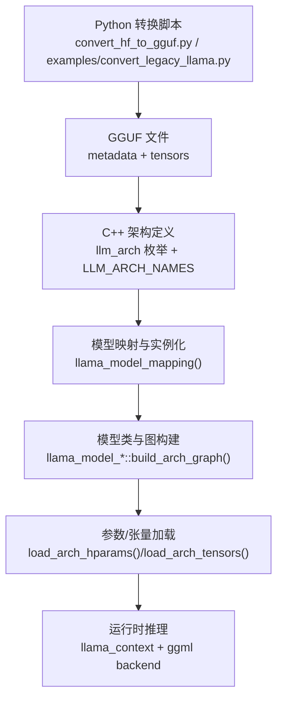
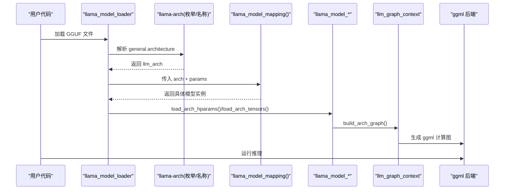
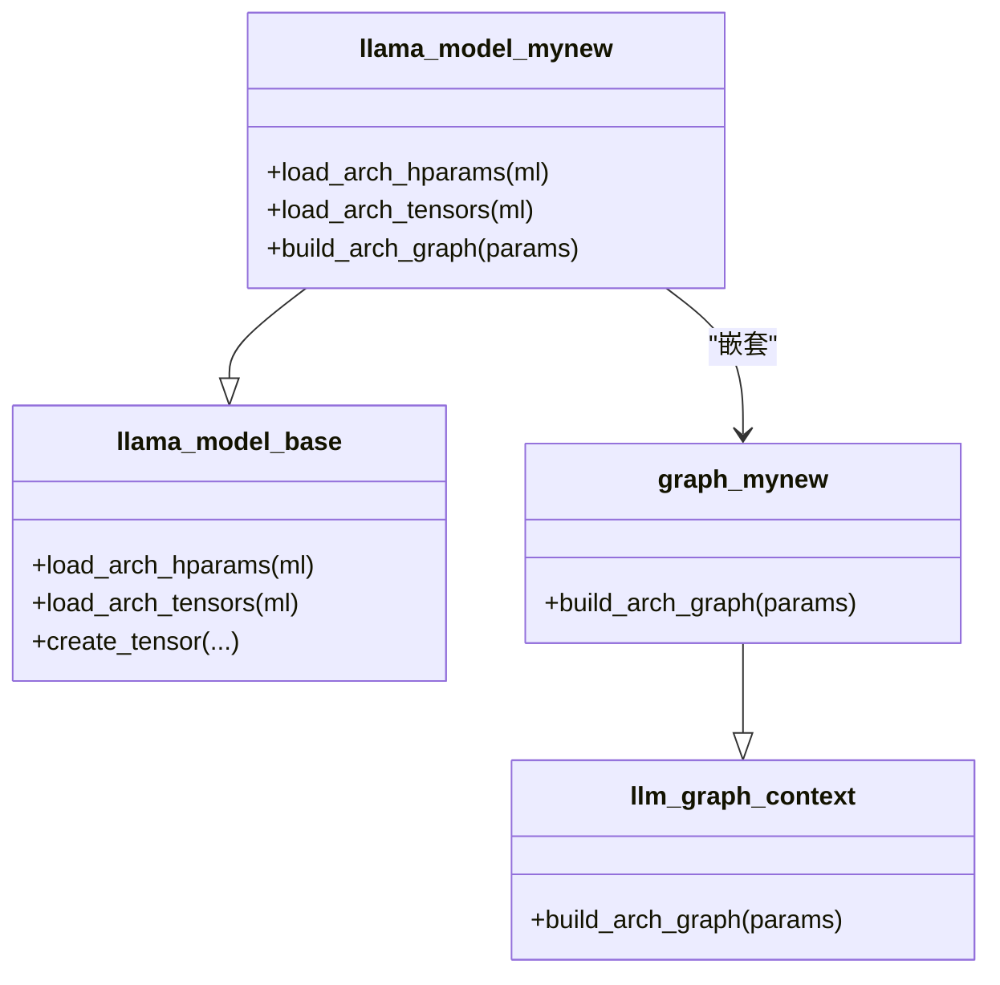
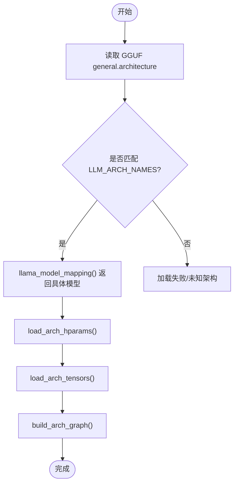
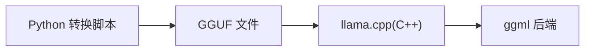

# 自定义模型开发

<cite>
**本文引用的文件**   
- [HOWTO-add-model.md](file://docs/development/HOWTO-add-model.md)
- [SKILL.md](file://skills/add-new-model/SKILL.md)
- [llama-arch.h](file://src/llama-arch.h)
- [llama-arch.cpp](file://src/llama-arch.cpp)
- [models.h](file://src/models/models.h)
- [llama-model.cpp](file://src/llama-model.cpp)
- [llama-model-loader.h](file://src/llama-model-loader.h)
- [llama-model-loader.cpp](file://src/llama-model-loader.cpp)
- [llama.h](file://include/llama.h)
</cite>

## 目录
1. [简介](#简介)
2. [项目结构](#项目结构)
3. [核心组件](#核心组件)
4. [架构总览](#架构总览)
5. [详细组件分析](#详细组件分析)
6. [依赖关系分析](#依赖关系分析)
7. [性能与优化](#性能与优化)
8. [故障排查指南](#故障排查指南)
9. [结论](#结论)
10. [附录：从继承到实现的完整流程示例](#附录从继承到实现的完整流程示例)

## 简介
本文件面向希望在 llama.cpp 中添加新模型架构的开发者，系统讲解从“将模型转换为 GGUF”到“在 C++ 中定义架构、构建推理图、注册映射、加载参数与张量”的全流程。文档同时覆盖 RoPE 变体、MoE、KV Cache、注意力掩码等常见实现要点，并给出调试技巧与性能优化建议，帮助快速集成新模型。

## 项目结构
新增一个模型架构通常涉及以下关键位置：
- Python 转换侧（GGUF）：conversion 脚本、gguf-py 常量与映射
- C++ 架构定义：llm_arch 枚举、名称映射、KV/Tensor 命名
- 模型实例化与图构建：每个模型的 struct + graph，以及统一映射函数
- 参数与张量加载：llama_model_loader 负责读取 GGUF 元数据与权重

图示来源
- [HOWTO-add-model.md:19-128](file://docs/development/HOWTO-add-model.md#L19-L128)
- [llama-arch.cpp:8-167](file://src/llama-arch.cpp#L8-L167)
- [llama-model.cpp:43-75](file://src/llama-model.cpp#L43-L75)

章节来源
- [HOWTO-add-model.md:19-128](file://docs/development/HOWTO-add-model.md#L19-L128)

## 核心组件
- 架构枚举与名称映射：集中管理所有支持的模型族，提供字符串到枚举的反查能力
- KV/Tensor 命名规范：统一的键名模板，便于跨模型复用解析逻辑
- 模型基类与图上下文：llama_model_base 与 llm_graph_context 分别承载参数/张量生命周期与计算图构建
- 模型映射器：根据 GGUF 中的 architecture 字段选择具体模型类
- 参数与张量加载器：按模型族解析元数据与权重，支持可选键与回退策略

章节来源
- [llama-arch.h:13-172](file://src/llama-arch.h#L13-L172)
- [llama-arch.cpp:8-167](file://src/llama-arch.cpp#L8-L167)
- [models.h:147-158](file://src/models/models.h#L147-L158)
- [llama-model.cpp:43-75](file://src/llama-model.cpp#L43-L75)

## 架构总览
下图展示了从 GGUF 到推理图的端到端路径，包括架构检测、模型实例化、图构建与后端执行的关键节点。

图示来源
- [llama-arch.cpp:8-167](file://src/llama-arch.cpp#L8-L167)
- [llama-model.cpp:43-75](file://src/llama-model.cpp#L43-L75)
- [models.h:147-158](file://src/models/models.h#L147-L158)

## 详细组件分析

### 1) 架构定义与注册（llm_arch、LLM_ARCH_NAMES、KV/Tensor 命名）
- 在 src/llama-arch.h 中新增枚举值（如 LLM_ARCH_MYMODEL），保持与其他模型一致的命名风格
- 在 src/llama-arch.cpp 的 LLM_ARCH_NAMES 映射中加入字符串到枚举的对应项
- 如需新的 KV/Tensor 名称，补充 LLM_KV_NAMES 与 LLM_TENSOR_NAMES 模板，确保与现有命名约定一致
- 注意：GGUF 中的 architecture 字符串必须与 LLM_ARCH_NAMES 保持一致，否则无法识别

章节来源
- [llama-arch.h:13-172](file://src/llama-arch.h#L13-L172)
- [llama-arch.cpp:8-167](file://src/llama-arch.cpp#L8-L167)
- [llama-arch.cpp:169-462](file://src/llama-arch.cpp#L169-L462)
- [llama-arch.cpp:464-764](file://src/llama-arch.cpp#L464-L764)

### 2) 模型类与图构建（llama_model_* 与 graph）
- 为每个模型族创建 struct llama_model_xxx，继承自 llama_model_base
- 实现 load_arch_hparams() 与 load_arch_tensors()，用于解析该模型的超参与权重
- 内部嵌套 struct graph : public llm_graph_context，实现 build_arch_graph() 以构建 ggml 计算图
- 在 models.h 中声明该类及其 graph；在 llama-model.cpp 的 llama_model_mapping() 中增加 case 分支以实例化

图示来源
- [models.h:147-158](file://src/models/models.h#L147-L158)
- [llama-model.cpp:43-75](file://src/llama-model.cpp#L43-L75)

章节来源
- [models.h:147-158](file://src/models/models.h#L147-L158)
- [llama-model.cpp:43-75](file://src/llama-model.cpp#L43-L75)

### 3) 参数与张量加载（llama_model_loader）
- llama_model_loader 负责从 GGUF 中读取 metadata 与 tensor 数据
- 模型族通过 load_arch_hparams() 解析必要超参（如 head_count、n_layer、rope 相关等）
- load_arch_tensors() 负责按 LLM_TN_IMPL 模板构造张量并加载权重
- 对缺失或可选的键应使用安全访问器，避免硬崩溃；对关键键缺失应报错而非静默回退

章节来源
- [llama-model-loader.h](file://src/llama-model-loader.h)
- [llama-model-loader.cpp](file://src/llama-model-loader.cpp)

### 4) 模型注册机制与架构检测
- GGUF 的 general.architecture 字段决定 llm_arch
- llama_model_mapping() 根据 arch 返回具体模型实例
- 若未匹配到任何已知架构，将无法创建模型对象，导致加载失败

图示来源
- [llama-arch.cpp:8-167](file://src/llama-arch.cpp#L8-L167)
- [llama-model.cpp:43-75](file://src/llama-model.cpp#L43-L75)

章节来源
- [llama-arch.cpp:8-167](file://src/llama-arch.cpp#L8-L167)
- [llama-model.cpp:43-75](file://src/llama-model.cpp#L43-L75)

### 5) 网络层与前向传播逻辑
- 前向传播由 graph::build_arch_graph() 构建 ggml 计算图表达
- 常见层：Embedding、Attention（含 RoPE、Mask、Flash Attention）、FFN（SwiGLU/GELU 等）、Norm、MoE Router/Experts
- 反向传播：llama.cpp 主要面向推理；训练/微调需借助外部工具链（例如 imatrix、fit 等）

章节来源
- [models.h:147-158](file://src/models/models.h#L147-L158)

### 6) 配置文件格式与解析方法（GGUF）
- GGUF 包含两类信息：metadata（标量/字符串）与 tensors（权重）
- 常用 metadata 键：general.type、general.architecture、tokenizer.*、attention.*、rope.* 等
- 模型族在 load_arch_hparams() 中按需读取这些键，并在必要时做校验与回退

章节来源
- [llama-arch.cpp:169-462](file://src/llama-arch.cpp#L169-L462)

### 7) 多模态编码器（可选）
- 若模型包含视觉/音频编码器，需在 libmtmd 中新增编码器定义与预处理
- 参考 docs/multimodal.md 与 tools/mtmd 源码，尽量复用已有预处理器/投影器

章节来源
- [HOWTO-add-model.md:126-140](file://docs/development/HOWTO-add-model.md#L126-L140)

## 依赖关系分析
- Python 转换脚本依赖 gguf-py 库，输出 GGUF 文件
- C++ 侧依赖 ggml 后端（CPU/CUDA/Metal 等）执行计算图
- llama_model_mapping() 是连接 GGUF 架构与 C++ 模型类的关键枢纽

图示来源
- [HOWTO-add-model.md:19-22](file://docs/development/HOWTO-add-model.md#L19-L22)
- [llama.h:487-560](file://include/llama.h#L487-L560)

章节来源
- [HOWTO-add-model.md:19-22](file://docs/development/HOWTO-add-model.md#L19-L22)
- [llama.h:487-560](file://include/llama.h#L487-L560)

## 性能与优化
- 优先在转换阶段进行张量修改（如 permute、chunking、常数折叠），减少运行时额外算子
- 合理使用 ggml_rope_ext，避免自定义 sin/cos 实现；利用其 n_dims/n_offs 特性高效处理部分维度旋转
- 控制图分裂数量，避免触发 GGML_SCHED_MAX_SPLIT_INPUTS；将不随层变化的张量提升到循环外
- Flash Attention 时确保 KQ mask 类型正确（如 F16）
- KV Cache 对齐与 SWA 语义需遵循专用钩子，不要通过篡改 hparams 伪装行为

章节来源
- [HOWTO-add-model.md:159-198](file://docs/development/HOWTO-add-model.md#L159-L198)
- [SKILL.md:61-80](file://skills/add-new-model/SKILL.md#L61-L80)

## 故障排查指南
- 架构未识别：检查 GGUF general.architecture 是否与 LLM_ARCH_NAMES 一致
- 缺少关键超参：在 load_arch_hparams() 中对必需键进行显式校验并报错
- 图构建异常：使用 examples/eval-callback 调试推理图；逐步缩小问题范围
- 量化后数值差异：先验证原版本 logits，再验证新版本；确认是否为既有差异
- 多后端兼容性：先在 CPU 后端验证，再扩展至 CUDA/Metal 等

章节来源
- [HOWTO-add-model.md:114-128](file://docs/development/HOWTO-add-model.md#L114-L128)
- [SKILL.md:81-91](file://skills/add-new-model/SKILL.md#L81-L91)

## 结论
通过在 Python 转换侧与 C++ 架构侧协同工作，可以在 llama.cpp 中稳定地接入新模型架构。关键在于：
- 明确 GGUF 元数据与张量命名规范
- 在 llama-arch 中完成枚举与名称映射
- 在 models.h 中定义模型类与图构建逻辑
- 在 llama_model_mapping() 中完成实例化注册
- 严格遵循 RoPE、MoE、KV Cache 等最佳实践，并进行充分验证

## 附录：从继承到实现的完整流程示例
以下为从零实现一个新模型架构的步骤清单（不含具体代码片段，仅列出步骤与对应文件位置）：

1. 将模型转换为 GGUF
   - 在 conversion 下新增 TextModel/MmprojModel 子类，注册到 ModelBase
   - 在 gguf-py/gguf/constants.py 添加 MODEL_ARCH、MODEL_ARCH_NAMES、MODEL_TENSORS
   - 在 gguf-py/gguf/tensor_mapping.py 建立原始张量名到标准名的映射
   参考
   - [HOWTO-add-model.md:26-99](file://docs/development/HOWTO-add-model.md#L26-L99)

2. 在 C++ 中定义架构
   - 在 src/llama-arch.h 新增 llm_arch 枚举值
   - 在 src/llama-arch.cpp 的 LLM_ARCH_NAMES 加入字符串映射
   - 如有需要，更新 LLM_KV_NAMES、LLM_TENSOR_NAMES、LLM_TENSOR_INFOS
   - 在 llama_model_rope_type() 中处理 RoPE 变体
   参考
   - [llama-arch.h:13-172](file://src/llama-arch.h#L13-L172)
   - [llama-arch.cpp:8-167](file://src/llama-arch.cpp#L8-L167)
   - [HOWTO-add-model.md:101-113](file://docs/development/HOWTO-add-model.md#L101-L113)

3. 构建 GGML 图实现
   - 在 src/models/<name>.cpp 定义 struct llama_model_<name>，继承自 llama_model_base
   - 实现 load_arch_hparams()/load_arch_tensors()
   - 定义 graph : public llm_graph_context，实现 build_arch_graph()
   - 在 src/models/models.h 中声明该类与 graph
   - 在 src/llama-model.cpp 的 llama_model_mapping() 中增加 case 分支
   参考
   - [models.h:147-158](file://src/models/models.h#L147-L158)
   - [llama-model.cpp:43-75](file://src/llama-model.cpp#L43-L75)
   - [HOWTO-add-model.md:114-123](file://docs/development/HOWTO-add-model.md#L114-L123)

4. 可选：多模态编码器
   - 在 clip.cpp 新增编码器定义
   - 在 mtmd.cpp 实现预处理器（可复用已有）
   - 在 tools/mtmd/models 中复用或新增编码器图
   参考
   - [HOWTO-add-model.md:126-140](file://docs/development/HOWTO-add-model.md#L126-L140)

5. 可选：聊天模板/解析支持
   - 如需内置 chat template 或输出解析器，单独 PR 提交
   参考
   - [SKILL.md:57-59](file://skills/add-new-model/SKILL.md#L57-L59)

6. 验证与回归
   - 使用 examples/model-conversion 进行 logits 验证
   - 量化后再验证
   - 在 tools/cli/completion/imatrix/quantize/server 等工具中做基本冒烟测试
   参考
   - [SKILL.md:81-91](file://skills/add-new-model/SKILL.md#L81-L91)