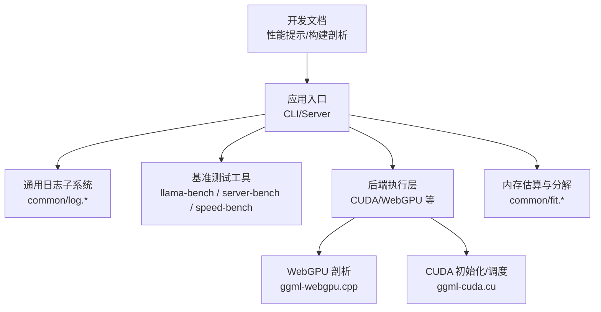
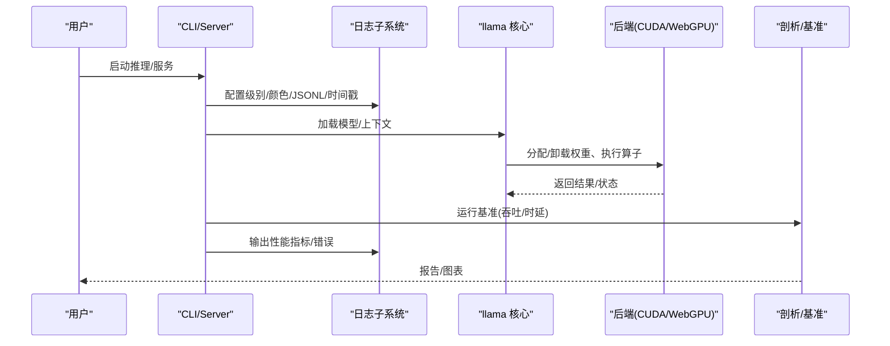
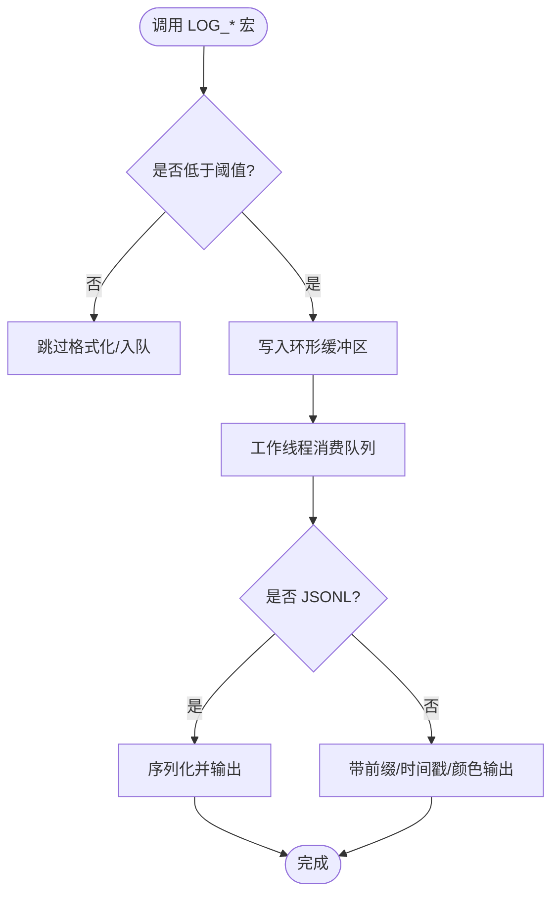
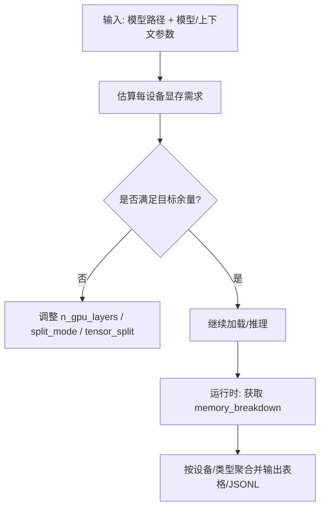
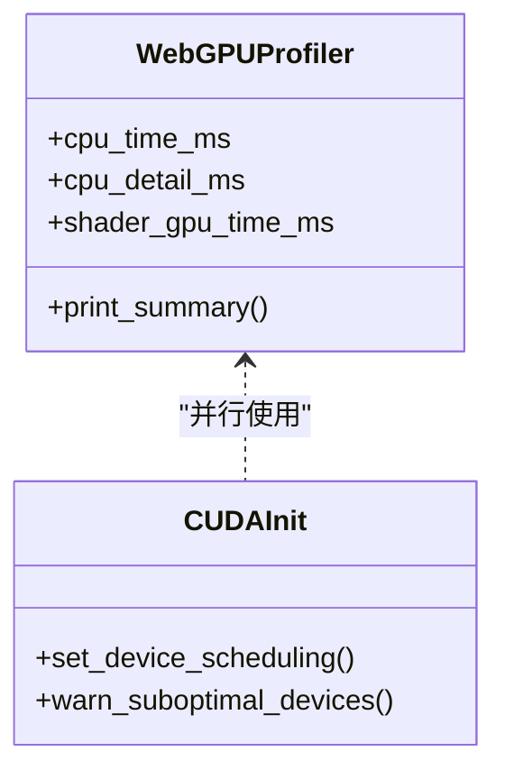
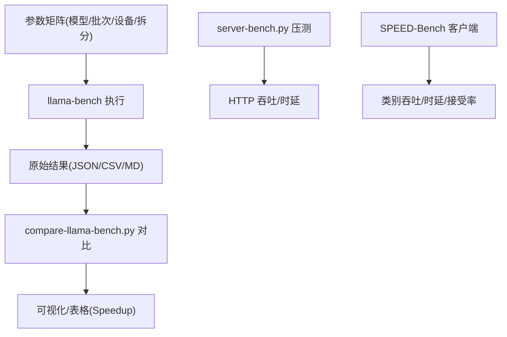
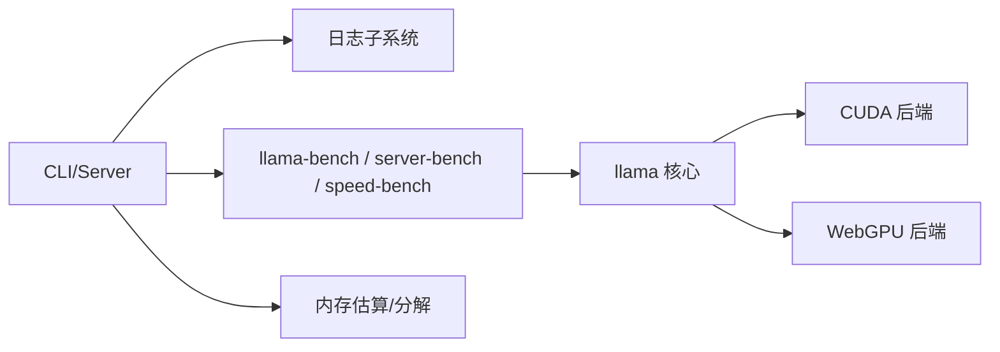

# 调试与性能分析

<cite>
**本文引用的文件**   
- [README.md](file://README.md)
- [log.h](file://common/log.h)
- [log.cpp](file://common/log.cpp)
- [token_generation_performance_tips.md](file://docs/development/token_generation_performance_tips.md)
- [build-profiling.md](file://docs/build-profiling.md)
- [llama-bench.cpp](file://tools/llama-bench/llama-bench.cpp)
- [compare-llama-bench.py](file://scripts/compare-llama-bench.py)
- [server-bench.py](file://scripts/server-bench.py)
- [speed-bench README.md](file://tools/server/bench/speed-bench/README.md)
- [ggml-webgpu.cpp](file://ggml/src/ggml-webgpu/ggml-webgpu.cpp)
- [ggml-cuda.cu](file://ggml/src/ggml-cuda/ggml-cuda.cu)
- [fit.h](file://common/fit.h)
- [fit.cpp](file://common/fit.cpp)
- [cli README.md](file://tools/cli/README.md)
- [rpc README.md](file://tools/rpc/README.md)
</cite>

## 目录
1. [引言](#引言)
2. [项目结构](#项目结构)
3. [核心组件](#核心组件)
4. [架构总览](#架构总览)
5. [详细组件分析](#详细组件分析)
6. [依赖关系分析](#依赖关系分析)
7. [性能注意事项](#性能注意事项)
8. [故障排查指南](#故障排查指南)
9. [结论](#结论)
10. [附录](#附录)

## 引言
本指南面向源码级调试与性能分析，覆盖 llama.cpp 的日志系统、断点调试、内存检查工具、CPU/GPU 性能分析与内存监控、常见瓶颈识别与优化、基准测试框架（回归与对比）以及生产环境监控与诊断技巧。文档以仓库现有实现为依据，提供可操作的步骤、参数与可视化说明，帮助读者快速定位问题并优化推理性能。

## 项目结构
围绕调试与性能分析的关键位置：
- 通用日志子系统：common/log.{h,cpp}
- CLI 与工具参数：tools/cli/README.md
- 基准与对比工具：tools/llama-bench/llama-bench.cpp、scripts/compare-llama-bench.py、scripts/server-bench.py、tools/server/bench/speed-bench/README.md
- 后端性能剖析：ggml/src/ggml-webgpu/ggml-webgpu.cpp、ggml/src/ggml-cuda/ggml-cuda.cu
- 内存估算与分解：common/fit.{h,cpp}
- 开发文档：docs/development/token_generation_performance_tips.md、docs/build-profiling.md

图表来源
- [log.h:1-149](file://common/log.h#L1-L149)
- [log.cpp:1-567](file://common/log.cpp#L1-L567)
- [llama-bench.cpp:427-494](file://tools/llama-bench/llama-bench.cpp#L427-L494)
- [ggml-webgpu.cpp:720-758](file://ggml/src/ggml-webgpu/ggml-webgpu.cpp#L720-L758)
- [ggml-cuda.cu:401-421](file://ggml/src/ggml-cuda/ggml-cuda.cu#L401-L421)
- [fit.h:40-67](file://common/fit.h#L40-L67)
- [fit.cpp:906-965](file://common/fit.cpp#L906-L965)
- [token_generation_performance_tips.md:1-41](file://docs/development/token_generation_performance_tips.md#L1-L41)
- [build-profiling.md:1-123](file://docs/build-profiling.md#L1-L123)

章节来源
- [README.md:60-118](file://README.md#L60-L118)

## 核心组件
- 日志系统：统一输出、级别控制、JSONL 结构化日志、时间戳与前缀、异步工作线程打印。
- 基准测试：llama-bench（端到端吞吐/时延）、server-bench（HTTP 服务端吞吐）、speed-bench（SPEED-Bench 数据集评测）。
- 后端剖析：WebGPU CPU/GPU 计时汇总；CUDA 设备调度与兼容性告警。
- 内存工具：按设备/主机维度统计模型、上下文、计算缓冲占用，辅助调参与回归检测。
- 开发文档：生成阶段性能提示与构建剖析脚本。

章节来源
- [log.h:24-33](file://common/log.h#L24-L33)
- [log.cpp:161-217](file://common/log.cpp#L161-L217)
- [llama-bench.cpp:427-494](file://tools/llama-bench/llama-bench.cpp#L427-L494)
- [ggml-webgpu.cpp:720-758](file://ggml/src/ggml-webgpu/ggml-webgpu.cpp#L720-L758)
- [ggml-cuda.cu:401-421](file://ggml/src/ggml-cuda/ggml-cuda.cu#L401-L421)
- [fit.h:40-67](file://common/fit.h#L40-L67)
- [fit.cpp:906-965](file://common/fit.cpp#L906-L965)

## 架构总览
下图展示从 CLI/Server 到后端执行与剖析的数据流，以及日志与基准工具的集成点。

图表来源
- [log.h:71-100](file://common/log.h#L71-L100)
- [llama-bench.cpp:427-494](file://tools/llama-bench/llama-bench.cpp#L427-L494)
- [ggml-webgpu.cpp:720-758](file://ggml/src/ggml-webgpu/ggml-webgpu.cpp#L720-L758)
- [ggml-cuda.cu:401-421](file://ggml/src/ggml-cuda/ggml-cuda.cu#L401-L421)

## 详细组件分析

### 日志系统与调试输出
- 级别与阈值：支持 DEBUG/TRACE/INFO/WARN/ERROR/OUTPUT，可通过命令行或环境变量设置全局阈值。
- 输出格式：可选 JSONL 结构化日志，便于自动化解析；支持前缀与时间戳，便于时序关联。
- 异步打印：内部工作线程消费队列，避免阻塞热点路径；支持暂停/恢复与刷新。
- 与 ggml 日志桥接：将底层 ggml 日志映射到 common_log 级别，统一出口。

图表来源
- [log.h:112-149](file://common/log.h#L112-L149)
- [log.cpp:239-333](file://common/log.cpp#L239-L333)
- [log.cpp:335-389](file://common/log.cpp#L335-L389)
- [log.cpp:548-566](file://common/log.cpp#L548-L566)

章节来源
- [log.h:24-33](file://common/log.h#L24-L33)
- [log.h:71-100](file://common/log.h#L71-L100)
- [log.cpp:161-217](file://common/log.cpp#L161-L217)
- [log.cpp:239-333](file://common/log.cpp#L239-L333)
- [log.cpp:335-389](file://common/log.cpp#L335-L389)
- [log.cpp:548-566](file://common/log.cpp#L548-L566)

### 断点调试与 RPC 调试
- 在 IDE 中于关键路径（如批处理、KV 缓存、后端算子）设置断点，结合日志级别提升（例如 -lv 5）观察上下文。
- RPC 后端提供多级调试开关 GGML_RPC_DEBUG，配合 -lv 5 输出连接、握手、传输、缓存命中/缺失、节点图转储等细节。

章节来源
- [rpc README.md:114-138](file://tools/rpc/README.md#L114-L138)
- [cli README.md:89-97](file://tools/cli/README.md#L89-L97)

### 内存检查与估算
- 设备内存估算：common_fit_print 与 common_get_device_memory_data 可估计各设备所需显存，辅助选择 n_gpu_layers、split_mode、tensor_split 等参数。
- 运行时内存分解：common_memory_breakdown_print 输出每个设备的 model/context/compute/unaccounted 占比，便于定位异常增长。

图表来源
- [fit.h:40-67](file://common/fit.h#L40-L67)
- [fit.cpp:906-965](file://common/fit.cpp#L906-L965)

章节来源
- [fit.h:40-67](file://common/fit.h#L40-L67)
- [fit.cpp:906-965](file://common/fit.cpp#L906-L965)

### 性能剖析：CPU/GPU 与 WebGPU/CUDA
- WebGPU 剖析：
  - CPU 剖析：GGML_WEBGPU_CPU_PROFILE 开启后，汇总各阶段 CPU 耗时与明细。
  - GPU 剖析：GGML_WEBGPU_GPU_PROFILE 开启后，统计 shader 级 GPU 耗时与比例。
- CUDA 后端：
  - 设备调度策略：针对特定 iGPU 架构启用 spinning 调度以减少同步延迟。
  - 兼容性告警：对缺少张量核心的设备给出编译建议，避免次优性能。

图表来源
- [ggml-webgpu.cpp:259-294](file://ggml/src/ggml-webgpu/ggml-webgpu.cpp#L259-L294)
- [ggml-webgpu.cpp:720-758](file://ggml/src/ggml-webgpu/ggml-webgpu.cpp#L720-L758)
- [ggml-cuda.cu:401-421](file://ggml/src/ggml-cuda/ggml-cuda.cu#L401-L421)

章节来源
- [ggml-webgpu.cpp:720-758](file://ggml/src/ggml-webgpu/ggml-webgpu.cpp#L720-L758)
- [ggml-cuda.cu:401-421](file://ggml/src/ggml-cuda/ggml-cuda.cu#L401-L421)

### 基准测试框架与对比分析
- llama-bench：
  - 支持多模型、多参数组合（prompt/gen/batch/ubatch/n_gpu_layers/split_mode/load_mode/lazy_mode/devices/tensor_split 等），输出 CSV/JSON/JSONL/Markdown/SQL。
  - 支持重复次数、优先级、预热控制、NUMA 策略、RPC 设备注册等。
- compare-llama-bench.py：
  - 对比两次运行结果，自动过滤差异字段，绘制 t/s 或后端算子指标曲线，支持对 GPU 名称归一化与多卡合并显示。
- server-bench.py：
  - 通过 HTTP API 压测 llama-server，支持 MMLU 或随机长度 prompt，输出吞吐与时延，并可保存至 SQLite。
- SPEED-Bench：
  - 基于 OpenAI 兼容接口评估预取/推测解码效果，输出类别吞吐、时延与接受率，支持 diff 对比基线与推测解码。

图表来源
- [llama-bench.cpp:427-494](file://tools/llama-bench/llama-bench.cpp#L427-L494)
- [compare-llama-bench.py:790-1102](file://scripts/compare-llama-bench.py#L790-L1102)
- [server-bench.py:275-289](file://scripts/server-bench.py#L275-L289)
- [speed-bench README.md:1-90](file://tools/server/bench/speed-bench/README.md#L1-L90)

章节来源
- [llama-bench.cpp:427-494](file://tools/llama-bench/llama-bench.cpp#L427-L494)
- [compare-llama-bench.py:790-1102](file://scripts/compare-llama-bench.py#L790-L1102)
- [server-bench.py:275-289](file://scripts/server-bench.py#L275-L289)
- [speed-bench README.md:1-90](file://tools/server/bench/speed-bench/README.md#L1-L90)

### 构建期剖析
- 使用 ClangBuildAnalyzer 分析前端/后端编译时间与 TU 数量，比较 PCH/UB 等优化策略的效果。
- 提供 Mac/Linux/Windows 安装与使用示例，便于 CI 集成。

章节来源
- [build-profiling.md:1-123](file://docs/build-profiling.md#L1-L123)

## 依赖关系分析
- 日志子系统被 CLI/Server 与后端广泛引用，作为统一诊断出口。
- 基准工具依赖 llama API 与 ggml 后端，用于采集吞吐与时延。
- WebGPU/CUDA 后端提供硬件相关性能特征与告警，影响整体吞吐与稳定性。
- fit 模块依赖模型与上下文参数，为基准与部署提供内存预算依据。

图表来源
- [log.h:1-149](file://common/log.h#L1-L149)
- [llama-bench.cpp:427-494](file://tools/llama-bench/llama-bench.cpp#L427-L494)
- [ggml-webgpu.cpp:720-758](file://ggml/src/ggml-webgpu/ggml-webgpu.cpp#L720-L758)
- [ggml-cuda.cu:401-421](file://ggml/src/ggml-cuda/ggml-cuda.cu#L401-L421)
- [fit.h:40-67](file://common/fit.h#L40-L67)

## 性能注意事项
- 确保模型正确卸载到 GPU：通过日志确认 cuBLAS offload 与 VRAM 使用。
- 合理设置线程数：过高的 -t 会导致 CPU 过载，降低 token 生成速度；建议从 1 开始逐步上调。
- 批大小与物理批大小：根据场景调整 -b/-ub，避免 KV 缓存碎片与带宽瓶颈。
- NUMA 亲和性：使用 --numa distribute/isolate/numactl 优化跨节点访问。
- Flash Attention：根据硬件能力选择 on/off/auto，减少注意力计算开销。
- 量化与数据类型：选择合适的 K/V cache 类型与模型量化，平衡精度与带宽。

章节来源
- [token_generation_performance_tips.md:1-41](file://docs/development/token_generation_performance_tips.md#L1-L41)
- [cli README.md:17-75](file://tools/cli/README.md#L17-L75)
- [completion README.md:538-544](file://tools/completion/README.md#L538-L544)

## 故障排查指南
- 现象：推理极慢或卡顿
  - 检查是否真正使用 GPU（查看日志中的 offload 行）。
  - 降低 -t 或绑定 CPU 亲和性，排除 CPU 过载。
  - 检查 NVML/驱动版本与 CUDA 调度策略。
- 现象：显存不足或频繁换页
  - 使用 common_fit_print 预估显存，调整 n_gpu_layers、split_mode、tensor_split。
  - 启用 KV offload 或降低 KV cache 类型精度。
- 现象：RPC 通信不稳定
  - 提高 GGML_RPC_DEBUG 级别，结合 -lv 5 查看握手、传输与缓存命中情况。
- 现象：WebGPU/CUDA 性能异常
  - 开启 CPU/GPU 剖析，关注 shader 耗时与 CPU 阶段瓶颈。
  - 对缺少张量核心的设备，参考 CUDA 告警进行编译选项调整。

章节来源
- [token_generation_performance_tips.md:1-41](file://docs/development/token_generation_performance_tips.md#L1-L41)
- [rpc README.md:114-138](file://tools/rpc/README.md#L114-L138)
- [ggml-webgpu.cpp:720-758](file://ggml/src/ggml-webgpu/ggml-webgpu.cpp#L720-L758)
- [ggml-cuda.cu:401-421](file://ggml/src/ggml-cuda/ggml-cuda.cu#L401-L421)
- [fit.h:40-67](file://common/fit.h#L40-L67)

## 结论
通过统一的日志系统、完善的基准工具链与后端剖析能力，llama.cpp 提供了从源码级调试到生产监控的全链路支撑。实践中应优先确认 GPU 卸载与线程配置，再结合内存估算与分解优化参数，最后用基准与对比脚本验证改进效果。对于复杂部署，建议结合 RPC 调试与 WebGPU/CUDA 剖析定位深层瓶颈。

## 附录
- 常用命令速查
  - 提升日志级别：-v/--verbose 或 -lv/--verbosity N
  - JSONL 结构化日志：--log-jsonl
  - 指定日志文件：--log-file FNAME
  - 启用内部性能计时：--perf
  - 列出可用设备：--list-devices
  - 设置 NUMA：--numa distribute|isolate|numactl
  - 设置 KV offload：-kvo/--kv-offload
  - 设置 Flash Attention：-fa/--flash-attn on|off|auto

章节来源
- [cli README.md:37-97](file://tools/cli/README.md#L37-L97)