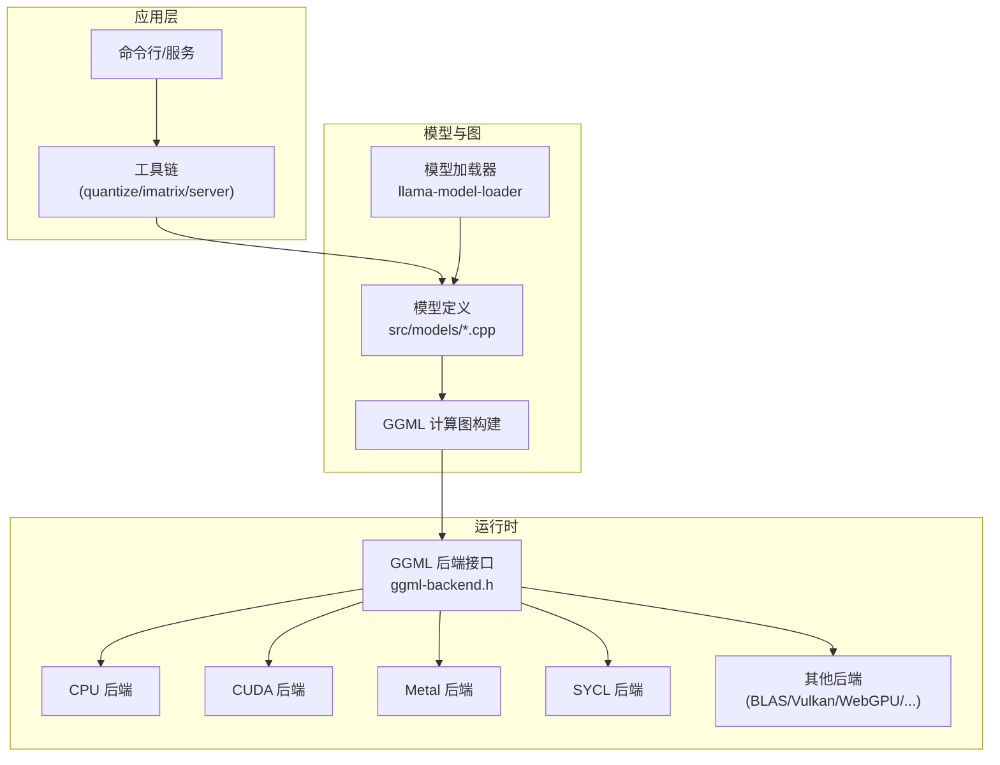
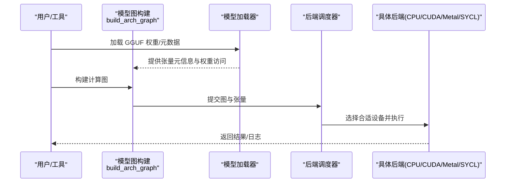
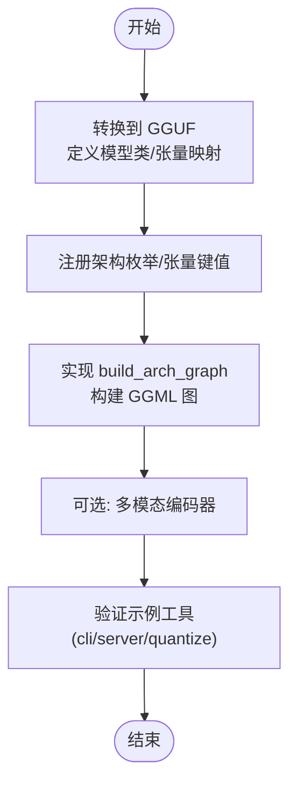
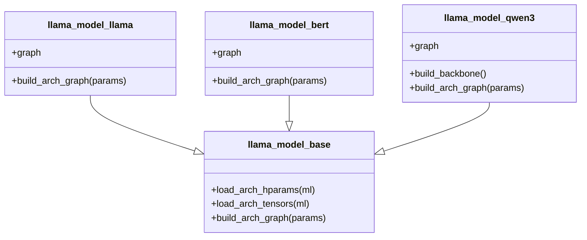
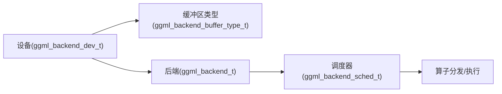
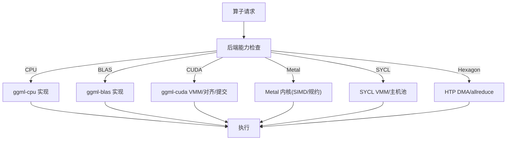
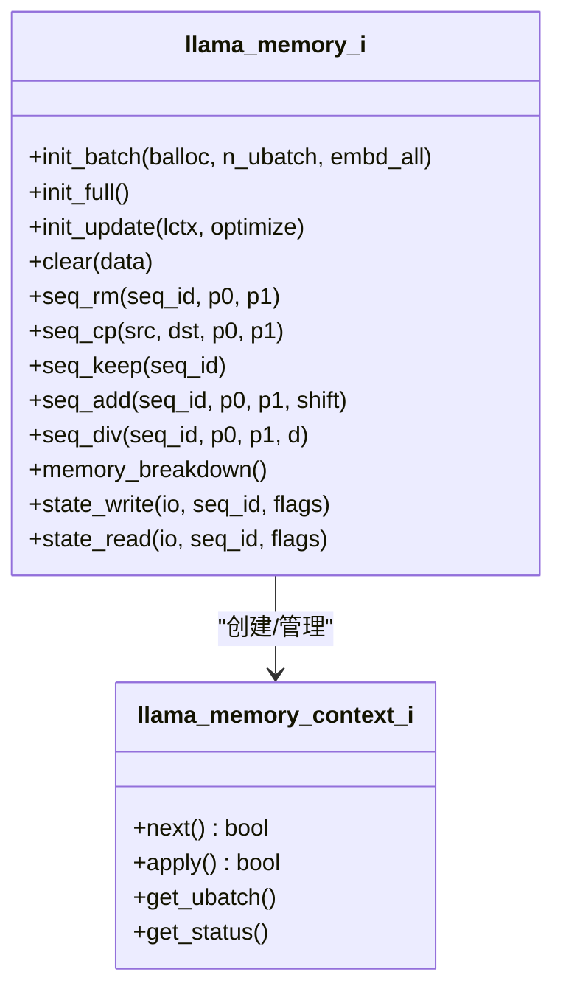
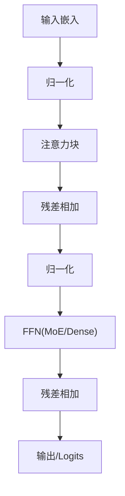
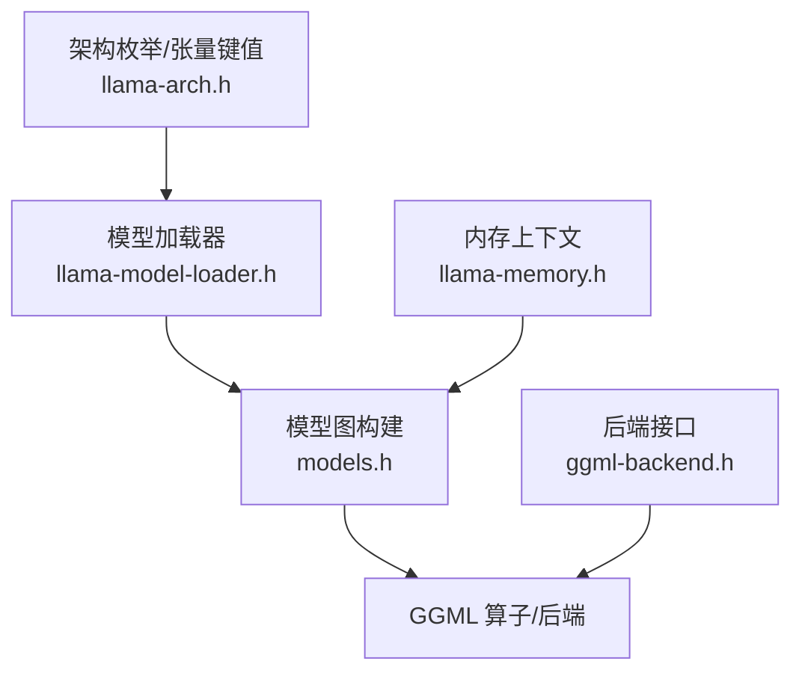

# 高级主题

<cite>
**本文引用的文件**   
- [README.md](file://README.md)
- [HOWTO-add-model.md](file://docs/development/HOWTO-add-model.md)
- [models.h](file://src/models/models.h)
- [llama-arch.h](file://src/llama-arch.h)
- [llama-memory.h](file://src/llama-memory.h)
- [ggml-backend.h](file://ggml/include/ggml-backend.h)
- [llama-model-loader.h](file://src/llama-model-loader.h)
- [lfm2.cpp](file://src/models/lfm2.cpp)
- [command-r.cpp](file://src/models/command-r.cpp)
- [stablelm.cpp](file://src/models/stablelm.cpp)
- [bert.cpp](file://src/models/bert.cpp)
- [ggml-cpu.cpp](file://ggml/src/ggml-cpu/ggml-cpu.cpp)
- [ggml-blas.cpp](file://ggml/src/ggml-blas/ggml-blas.cpp)
- [ggml-cuda.cu](file://ggml/src/ggml-cuda/ggml-cuda.cu)
- [ggml-sycl.cpp](file://ggml/src/ggml-sycl/ggml-sycl.cpp)
- [ggml-metal-ops.cpp](file://ggml/src/ggml-metal/ggml-metal-ops.cpp)
- [fa_vec_common.metal](file://ggml/src/ggml-metal/kernels/fa_vec_common.metal)
- [allreduce-ops.c](file://ggml/src/ggml-hexagon/htp/allreduce-ops.c)
- [virtgpu-apir.h](file://ggml/src/ggml-virtgpu/virtgpu-apir.h)
- [debugging-tests.md](file://docs/development/debugging-tests.md)
</cite>

## 目录
1. [引言](#引言)
2. [项目结构](#项目结构)
3. [核心组件](#核心组件)
4. [架构总览](#架构总览)
5. [详细组件分析](#详细组件分析)
6. [依赖关系分析](#依赖关系分析)
7. [性能考量](#性能考量)
8. [故障排查指南](#故障排查指南)
9. [结论](#结论)
10. [附录](#附录)

## 引言
本文件面向希望深入扩展 llama.cpp 的开发者，聚焦以下高级主题：
- 自定义模型架构的添加方法（网络层、前向图构建与反向传播支持）
- 后端扩展开发（新硬件平台适配、算子实现与优化）
- 内存管理高级技术（自定义分配器、垃圾回收与内存池策略）
- 算子开发与优化（SIMD/并行计算、访存优化）
- 源码级调试技巧与性能分析工具使用

## 项目结构
llama.cpp 采用“模型图 + GGML 后端”的分层架构：
- src/ 提供模型抽象、图构建、KV 缓存与加载器等高层逻辑
- ggml/ 提供跨硬件后端（CPU/GPU/NPU/其他加速器）的统一张量与算子运行时
- docs/ 包含开发指南与后端文档
- tools/ 提供推理、量化、评测等工具链

图示来源
- [README.md:60-96](file://README.md#L60-L96)
- [ggml-backend.h:230-380](file://ggml/include/ggml-backend.h#L230-L380)

章节来源
- [README.md:60-96](file://README.md#L60-L96)

## 核心组件
- 模型架构与图构建：通过继承基类并实现 build_arch_graph 完成；参考 models.h 中的各类模型结构体。
- 后端调度与设备：ggml-backend.h 定义了后端、设备、缓冲区类型、调度器与元设备等统一接口。
- 内存上下文与 KV 缓存：llama-memory.h 定义了统一的内存上下文接口，支持多种缓存策略与批处理切分。
- 模型加载与权重映射：llama-model-loader.h 负责 GGUF 解析、懒加载、多后端缓冲类型映射与惰性读取。

章节来源
- [models.h:147-158](file://src/models/models.h#L147-L158)
- [ggml-backend.h:230-380](file://ggml/include/ggml-backend.h#L230-L380)
- [llama-memory.h:51-128](file://src/llama-memory.h#L51-L128)
- [llama-model-loader.h:30-120](file://src/llama-model-loader.h#L30-L120)

## 架构总览
下图展示从模型到后端的端到端数据流：

图示来源
- [llama-model-loader.h:172-273](file://src/llama-model-loader.h#L172-L273)
- [ggml-backend.h:268-380](file://ggml/include/ggml-backend.h#L268-L380)

## 详细组件分析

### 自定义模型架构添加流程
步骤概览：
1. 将模型转换为 GGUF（Python 转换脚本），定义模型类与张量布局映射。
2. 在 C++ 侧声明架构枚举与张量键值，并在加载器中注册非标准元数据处理。
3. 实现图构建：继承基类，重写 build_arch_graph，返回 llm_graph_context。
4. 可选：为多模态编码器添加预处理与编码器图。

关键要点：
- 优先在转换阶段做张量变换（如归一化折叠、置换），减少推理图复杂度。
- RoPE 相关操作尽量使用 ggml_rope_ext，避免显式 sin/cos 矩阵，便于融合。
- 部分头旋转（nope 部分）可通过 n_dims/n_offs 参数高效实现，无需拼接视图。

图示来源
- [HOWTO-add-model.md:1-140](file://docs/development/HOWTO-add-model.md#L1-L140)

章节来源
- [HOWTO-add-model.md:1-140](file://docs/development/HOWTO-add-model.md#L1-L140)
- [llama-arch.h:13-172](file://src/llama-arch.h#L13-L172)
- [llama-arch.h:469-771](file://src/llama-arch.h#L469-L771)

### 模型图构建与网络层实现
- 典型模型结构体在 models.h 中定义，每个模型提供 graph 内部类以封装层构建逻辑。
- 常见模式：注意力块 + FFN + 残差连接 + 归一化；MoE 分支通过 build_moe_ffn 接入。
- 不同模型的差异主要体现在注意力变体、FFN 激活、归一化位置与特殊头（决策头/投影头等）。

图示来源
- [models.h:147-158](file://src/models/models.h#L147-L158)
- [models.h:290-300](file://src/models/models.h#L290-L300)
- [models.h:579-596](file://src/models/models.h#L579-L596)

章节来源
- [models.h:147-158](file://src/models/models.h#L147-L158)
- [models.h:290-300](file://src/models/models.h#L290-L300)
- [models.h:579-596](file://src/models/models.h#L579-L596)

### 前向传播与反向传播支持
- 前向传播：通过 GGML 算子组合成计算图，由后端调度执行。
- 反向传播：llama.cpp 主要面向推理；如需训练/微调，需基于 GGML 的反向图能力或外部训练框架集成。当前仓库更强调推理优化与部署。

章节来源
- [README.md:60-74](file://README.md#L60-L74)

### 后端扩展与新硬件适配
- 后端接口：ggml-backend.h 提供设备、缓冲区类型、调度器、事件、异步拷贝等统一 API。
- 设备类型：CPU/GPU/IGPU/ACCEL/META，支持动态加载与特性查询。
- 调度器：自动分配节点到合适后端，处理张量复制与缓冲预留。

图示来源
- [ggml-backend.h:136-197](file://ggml/include/ggml-backend.h#L136-L197)
- [ggml-backend.h:268-380](file://ggml/include/ggml-backend.h#L268-L380)

章节来源
- [ggml-backend.h:136-197](file://ggml/include/ggml-backend.h#L136-L197)
- [ggml-backend.h:268-380](file://ggml/include/ggml-backend.h#L268-L380)

### 算子实现与性能优化
- CPU 后端：对基础算子进行通用实现，并通过 extra buffer type 机制扩展特定算子支持。
- BLAS 后端：针对矩阵乘等算子进行加速，要求输入连续/转置等约束。
- CUDA 后端：VMM 内存池、对齐分配、物理内存按需提交，提升大模型吞吐。
- Metal 后端：Top-K 使用基数排序/双调排序自适应选择；FA 内核利用 SIMD 并行与线程组规约。
- SYCL 后端：VMM 虚拟内存池与主机池复用，降低频繁分配开销。
- Hexagon HTP：DMA 队列与 allreduce 优化，适合移动端 NPU。

图示来源
- [ggml-cpu.cpp:424-440](file://ggml/src/ggml-cpu/ggml-cpu.cpp#L424-L440)
- [ggml-blas.cpp:435-456](file://ggml/src/ggml-blas/ggml-blas.cpp#L435-L456)
- [ggml-cuda.cu:593-627](file://ggml/src/ggml-cuda/ggml-cuda.cu#L593-L627)
- [ggml-metal-ops.cpp:5844-5895](file://ggml/src/ggml-metal/ggml-metal-ops.cpp#L5844-L5895)
- [fa_vec_common.metal:554-597](file://ggml/src/ggml-metal/kernels/fa_vec_common.metal#L554-L597)
- [ggml-sycl.cpp:2013-2160](file://ggml/src/ggml-sycl/ggml-sycl.cpp#L2013-L2160)
- [allreduce-ops.c:85-96](file://ggml/src/ggml-hexagon/htp/allreduce-ops.c#L85-L96)

章节来源
- [ggml-cpu.cpp:424-440](file://ggml/src/ggml-cpu/ggml-cpu.cpp#L424-L440)
- [ggml-blas.cpp:435-456](file://ggml/src/ggml-blas/ggml-blas.cpp#L435-L456)
- [ggml-cuda.cu:593-627](file://ggml/src/ggml-cuda/ggml-cuda.cu#L593-L627)
- [ggml-metal-ops.cpp:5844-5895](file://ggml/src/ggml-metal/ggml-metal-ops.cpp#L5844-L5895)
- [fa_vec_common.metal:554-597](file://ggml/src/ggml-metal/kernels/fa_vec_common.metal#L554-L597)
- [ggml-sycl.cpp:2013-2160](file://ggml/src/ggml-sycl/ggml-sycl.cpp#L2013-L2160)
- [allreduce-ops.c:85-96](file://ggml/src/ggml-hexagon/htp/allreduce-ops.c#L85-L96)

### 内存管理高级技术
- 统一内存上下文接口：llama-memory.h 定义 llama_memory_i 与 llama_memory_context_i，用于批处理切分、状态更新与序列操作（删除/复制/保留/移动/缩放）。
- 混合内存策略：支持 iSWA/MSA 等 KV 缓存变体，结合 hybrid 索引/共享策略提升吞吐与内存利用率。
- 后端缓冲类型与用途：ggml-backend.h 定义 WEIGHTS/COMPUTE 等用途，调度器据此决定算子放置与张量复制。
- 自定义分配器与内存池：
  - CUDA VMM：按粒度申请物理内存，延迟提交，减少碎片与同步。
  - SYCL VMM/主机池：虚拟地址空间预留 + 物理内存按需提交；主机侧固定大小池复用。
  - CANN 池：RAII 包装，确保异步算子期间内存可用。
- 懒加载与映射：llama-model-loader.h 支持 TENSOR_READ_LAZY，仅按需读取行，配合 mmap 降低峰值内存。

图示来源
- [llama-memory.h:51-128](file://src/llama-memory.h#L51-L128)

章节来源
- [llama-memory.h:51-128](file://src/llama-memory.h#L51-L128)
- [ggml-backend.h:51-70](file://ggml/include/ggml-backend.h#L51-L70)
- [ggml-cuda.cu:593-627](file://ggml/src/ggml-cuda/ggml-cuda.cu#L593-L627)
- [ggml-sycl.cpp:2013-2160](file://ggml/src/ggml-sycl/ggml-sycl.cpp#L2013-L2160)
- [llama-model-loader.h:85-116](file://src/llama-model-loader.h#L85-L116)

### 模型图构建实例（LFM2/Command-R/StableLM/BERT）
- LFM2：混合 MoE/Dense FFN，短卷积与注意力交替，Hybrid 内存输入。
- Command-R：标准 Transformer 层，FFN 使用 SiLU，残差累加与输出头缩放。
- StableLM：并行残差结构，FFN 前可选归一化，cvec 向量编码。
- BERT：MoE 分支与 Dense 分支切换，GEGLU/GELU 激活，分类头。

图示来源
- [lfm2.cpp:155-326](file://src/models/lfm2.cpp#L155-L326)
- [command-r.cpp:108-142](file://src/models/command-r.cpp#L108-L142)
- [stablelm.cpp:127-170](file://src/models/stablelm.cpp#L127-L170)
- [bert.cpp:170-196](file://src/models/bert.cpp#L170-L196)

章节来源
- [lfm2.cpp:155-326](file://src/models/lfm2.cpp#L155-L326)
- [command-r.cpp:108-142](file://src/models/command-r.cpp#L108-L142)
- [stablelm.cpp:127-170](file://src/models/stablelm.cpp#L127-L170)
- [bert.cpp:170-196](file://src/models/bert.cpp#L170-L196)

## 依赖关系分析
- 模型层依赖 GGML 算子与后端能力判断（CPU/BLAS/CUDA/Metal/SYCL）。
- 加载器依赖 GGUF 元数据与映射表，支持懒加载与多后端缓冲类型。
- 内存上下文与 KV 缓存策略影响批处理切分与图规模估算。

图示来源
- [llama-arch.h:13-172](file://src/llama-arch.h#L13-L172)
- [llama-model-loader.h:30-120](file://src/llama-model-loader.h#L30-L120)
- [models.h:147-158](file://src/models/models.h#L147-L158)
- [llama-memory.h:51-128](file://src/llama-memory.h#L51-L128)
- [ggml-backend.h:230-380](file://ggml/include/ggml-backend.h#L230-L380)

章节来源
- [llama-arch.h:13-172](file://src/llama-arch.h#L13-L172)
- [llama-model-loader.h:30-120](file://src/llama-model-loader.h#L30-L120)
- [models.h:147-158](file://src/models/models.h#L147-L158)
- [llama-memory.h:51-128](file://src/llama-memory.h#L51-L128)
- [ggml-backend.h:230-380](file://ggml/include/ggml-backend.h#L230-L380)

## 性能考量
- 算子选择与后端能力：优先使用后端原生算子（如 BLAS/CUDA/Metal），避免不必要的类型转换与视图拼接。
- 内存池与 VMM：在 GPU 上使用 VMM 减少分配开销；在主机侧使用固定池复用缓冲。
- 访存优化：保持张量连续/转置友好，利用 SIMD/线程组规约（Metal FA 内核）。
- 图融合与预计算：将常量变换（如 norm(1+weight)）下推到转换阶段，减少运行时算子。
- 批处理与 ubatch：合理设置 n_ubatch 与 embd_all，平衡吞吐与显存占用。

[本节为通用指导，不直接分析具体文件]

## 故障排查指南
- 调试测试：参考 development/debugging-tests.md，定位图构建与后端执行问题。
- 后端能力检测：通过 ggml-backend_dev_supports_op 与 supports_buft 判断算子是否可卸载至目标设备。
- 内存泄漏/越界：检查懒加载范围与映射区间，确认 TENSOR_READ_LAZY 配置与文件边界校验。
- 性能瓶颈：使用 llama-bench 与后端 profiling 工具（如 CUDA/NVIDIA/NVTX、Metal Instruments、SYCL 追踪）定位热点算子。

章节来源
- [debugging-tests.md](file://docs/development/debugging-tests.md)
- [ggml-cpu.cpp:424-440](file://ggml/src/ggml-cpu/ggml-cpu.cpp#L424-L440)
- [llama-model-loader.h:229-273](file://src/llama-model-loader.h#L229-L273)

## 结论
llama.cpp 通过清晰的模型图构建与统一的 GGML 后端接口，提供了可扩展的推理基础设施。开发者可按以下步骤扩展：
- 新增模型：遵循 HOWTO 流程，优先在转换阶段做张量变换，简化推理图。
- 扩展后端：实现设备/缓冲类型/算子支持，利用调度器自动分配。
- 优化内存：采用 VMM/内存池与懒加载，降低分配与同步成本。
- 优化算子：利用 SIMD/并行与访存局部性，提升吞吐。
- 调试与性能：结合测试与 profiling 工具，持续迭代优化。

[本节为总结，不直接分析具体文件]

## 附录
- 多模态编码器：参考 tools/mtmd 与 docs/multimodal.md，复用现有编码器并添加模型特定投影。
- 决策模型：遵循 server-decision.cpp 约定，避免侵入 libllama。
- 资源链接：GGUF 规范与社区讨论见 HOWTO 末尾资源列表。

[本节为补充信息，不直接分析具体文件]